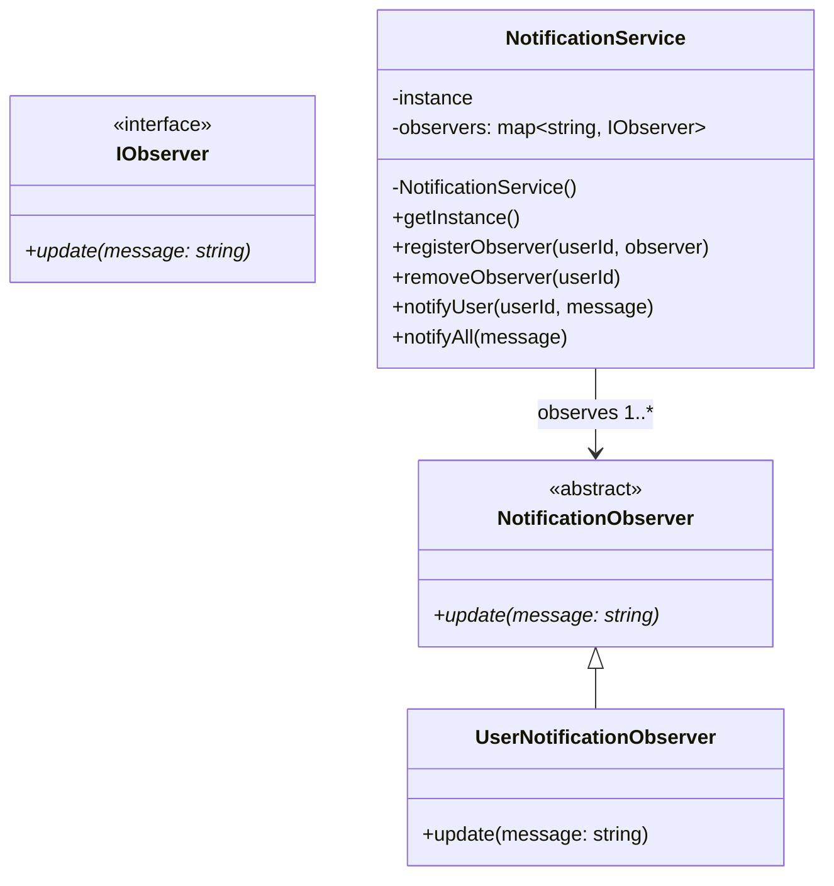
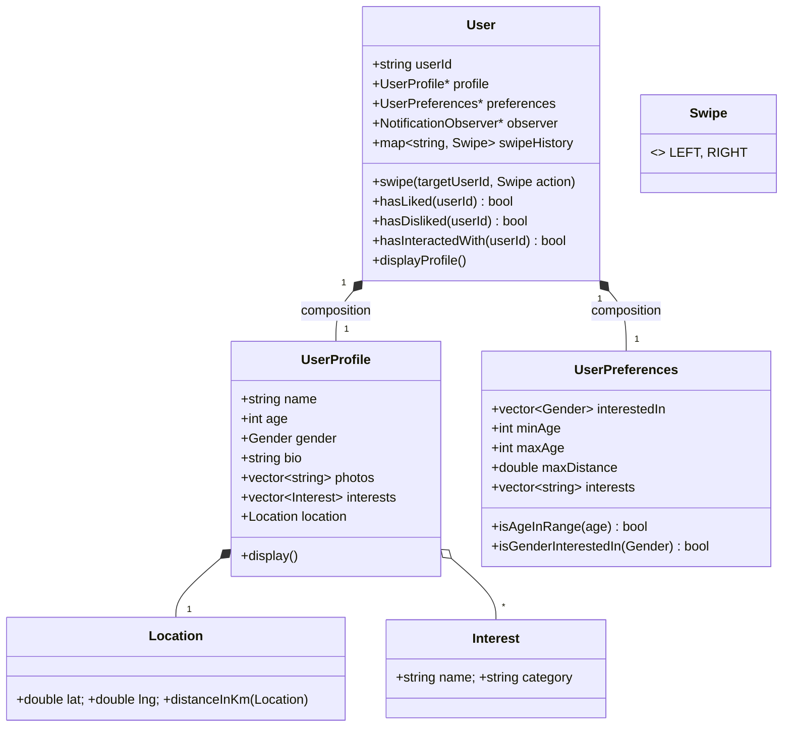
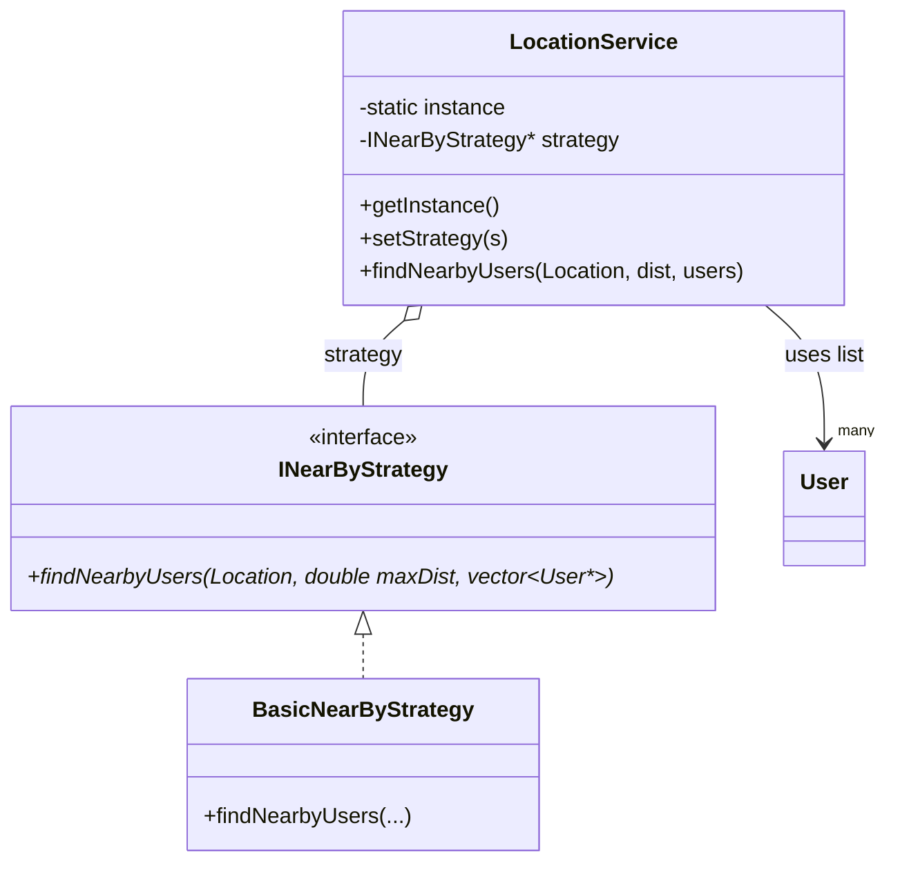
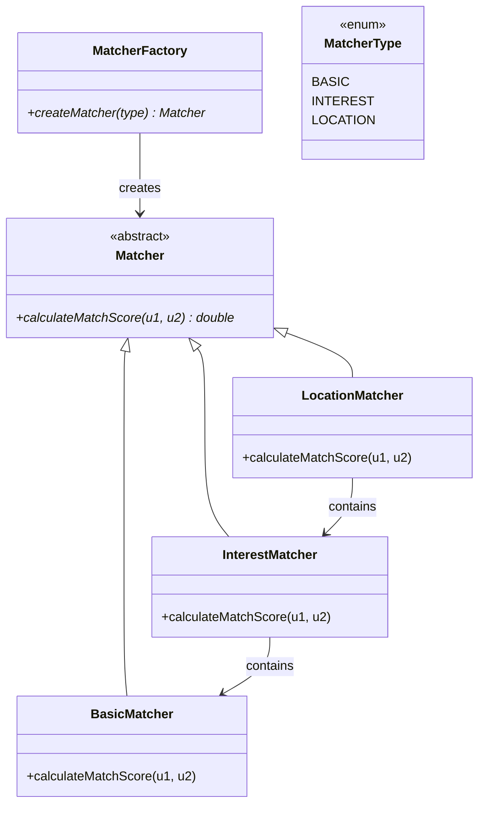
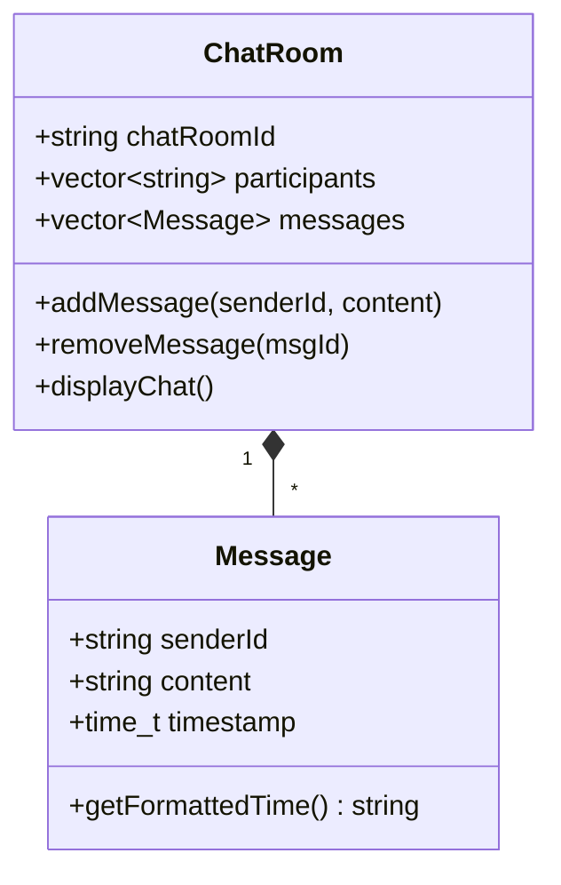
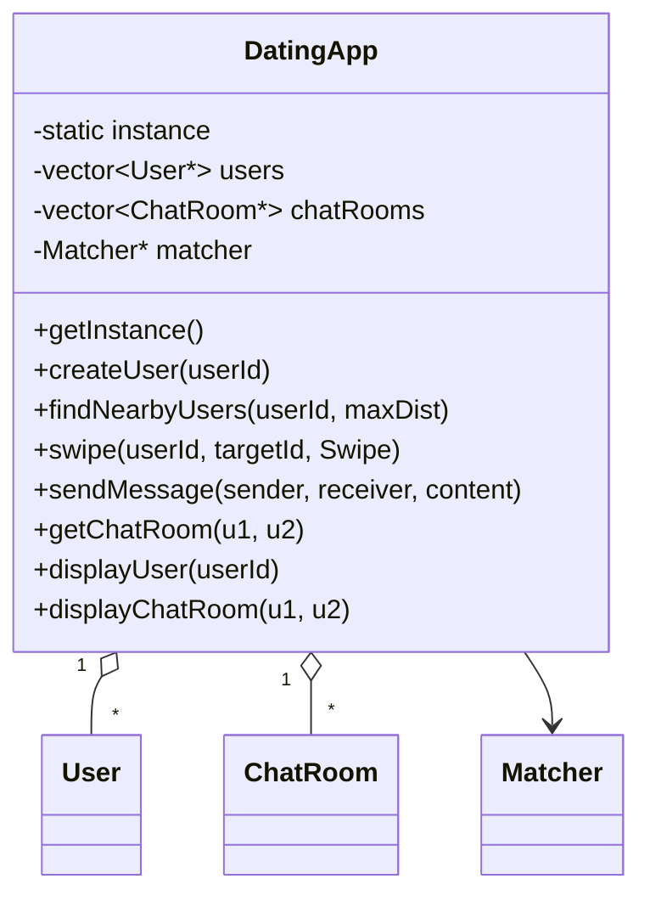

# System Design Learning

## 01. Introduction To System Design (24:46)

## Introduction to Low-Level Design (LLD)

## Core Concept Overview

This tutorial introduces **Low-Level Design (LLD)** - the process of designing the internal structure of an application, focusing on how different components, objects, and entities interact with each other.

### Key Definition

> **LLD** is the complete application design built around DSA concepts - when you take multiple DSA algorithms and build a complete, working application structure around them.

---

## The Anurag vs. Maurya Story: LLD vs DSA

### The Scenario

Two friends join **QuickRide** (an Ola/Uber-like ride booking company):
- **Anurag**: Expert in DSA, knows nothing about LLD
- **Maurya**: Expert in both DSA and LLD

### Problem 1: Finding Shortest Route

**Anurag's Approach (DSA-focused):**
```
1. Identify problem: User needs to go from source to destination
2. Model city as graph:
   - Intersections = Nodes
   - Roads = Edges
3. Apply Dijkstra's Algorithm for shortest path
4. Done!
```

**What Anurag Missed:**
- No object/entity identification
- No relationships between components
- No data security considerations
- No notification system design
- No payment gateway integration
- No scalability planning

**Maurya's Approach (LLD-focused):**

```
Step 1: Identify Objects/Entities
- User
- Rider
- Location
- Notification
- Payment Gateway

Step 2: Define Relationships
- User books ride → Rider assigned
- Rider has Location
- User receives Notification
- Payment processes transaction

Step 3: Consider Non-Functional Requirements
- Data Security (phone number masking)
- Scalability (millions of users)
- Maintainability

Step 4: THEN apply DSA
- Dijkstra for routing
- Priority Queue for nearest rider
```

### Problem 2: Rider Assignment

**Anurag's DSA Solution:**
```java
// Simple Priority Queue approach
PriorityQueue<Rider> nearestRiders = new PriorityQueue<>(
    Comparator.comparingDouble(r -> r.distanceTo(user))
);

// Add all riders within radius
for (Rider r : availableRiders) {
    if (r.distanceTo(user) <= RADIUS) {
        nearestRiders.add(r);
    }
}

// Assign closest rider
Rider assignedRider = nearestRiders.poll();
```

**Maurya's LLD Approach:**
```java
// 1. Define the RiderMapping interface (Reusable)
public interface RiderMappingStrategy {
    Rider findBestRider(User user, List<Rider> availableRiders);
}

// 2. Implement specific strategies
public class NearestRiderStrategy implements RiderMappingStrategy {
    @Override
    public Rider findBestRider(User user, List<Rider> availableRiders) {
        return availableRiders.stream()
            .filter(r -> r.isAvailable())
            .min(Comparator.comparingDouble(r -> r.distanceTo(user)))
            .orElse(null);
    }
}

// 3. Make it plug-and-play for any application
public class DeliveryAssignmentService {
    private RiderMappingStrategy strategy;
    
    public DeliveryAssignmentService(RiderMappingStrategy strategy) {
        this.strategy = strategy;
    }
    
    public void assignDelivery(Order order, List<DeliveryPartner> partners) {
        // Same algorithm works for Zomato, Swiggy, Amazon, etc.
    }
}
```

---

## Three Pillars of LLD

### 1. Scalability

**Definition:** How well your application can handle growth in users, data, and traffic.

```java
// Example: Database Connection Pooling for Scalability
public class ConnectionPool {
    private static final int MAX_CONNECTIONS = 100;
    private BlockingQueue<Connection> availableConnections;
    
    public Connection getConnection() throws InterruptedException {
        if (availableConnections.isEmpty()) {
            // Create new connection or wait
            return createNewConnection();
        }
        return availableConnections.take();
    }
    
    public void releaseConnection(Connection conn) {
        availableConnections.offer(conn);
    }
}
```

**Key Points:**
- Handle millions of users simultaneously
- Application should not crash under load
- Easy to add new features without breaking existing ones

---

### 2. Maintainability

**Definition:** How easily code can be debugged, modified, and extended.

```java
// BAD: Hard to maintain
public class RideService {
    public void bookRide(User u, String paymentType) {
        // 500 lines of code doing everything
        if (paymentType.equals("credit")) {
            // process credit card
        } else if (paymentType.equals("debit")) {
            // process debit card
        } else if (paymentType.equals("upi")) {
            // process UPI
        }
        // ... notification code
        // ... rider assignment code
        // ... route calculation code
    }
}

// GOOD: Maintainable with Single Responsibility
public class RideService {
    private PaymentProcessor paymentProcessor;
    private NotificationService notificationService;
    private RiderAssignmentService riderService;
    private RouteCalculator routeCalculator;
    
    public Ride bookRide(RideRequest request) {
        Payment payment = paymentProcessor.process(request.getPaymentDetails());
        Rider rider = riderService.assignRider(request.getUser());
        Route route = routeCalculator.calculate(request.getSource(), request.getDestination());
        
        Ride ride = new Ride(request.getUser(), rider, route, payment);
        notificationService.notifyRideConfirmed(ride);
        
        return ride;
    }
}
```

**Key Points:**
- New features shouldn't break old ones
- Easy to find and fix bugs
- Code should be self-documenting

---

### 3. Reusability

**Definition:** Code should be easily reusable across different applications (Plug-and-Play model).

```
┌─────────────────────────────────────────────────────────────┐
│                    REUSABLE COMPONENTS                       │
├─────────────────────────────────────────────────────────────┤
│                                                              │
│  ┌──────────────┐  ┌──────────────┐  ┌──────────────┐       │
│  │ Notification │  │   Payment    │  │    Rider     │       │
│  │   Service    │  │   Gateway    │  │   Mapping    │       │
│  └──────────────┘  └──────────────┘  └──────────────┘       │
│         │                 │                 │               │
│         ▼                 ▼                 ▼               │
│  ┌─────────────────────────────────────────────────┐        │
│  │              QuickRide Application               │        │
│  └─────────────────────────────────────────────────┘        │
│                                                              │
│  ┌─────────────────────────────────────────────────┐        │
│  │              Zomato Application                  │        │
│  └─────────────────────────────────────────────────┘        │
│                                                              │
│  ┌─────────────────────────────────────────────────┐        │
│  │              Amazon Application                  │        │
│  └─────────────────────────────────────────────────┘        │
│                                                              │
└─────────────────────────────────────────────────────────────┘
```

```java
// Reusable Payment Interface
public interface PaymentGateway {
    PaymentResult processPayment(PaymentRequest request);
    RefundResult processRefund(RefundRequest request);
}

// Implementations can be swapped
public class StripePaymentGateway implements PaymentGateway { ... }
public class RazorpayPaymentGateway implements PaymentGateway { ... }
public class PaytmPaymentGateway implements PaymentGateway { ... }

// Any application can use any gateway
public class QuickRide {
    private PaymentGateway paymentGateway;
    
    public QuickRide(PaymentGateway gateway) {
        this.paymentGateway = gateway;  // Dependency Injection
    }
}
```

**Key Point:** Avoid **Tight Coupling** - code should not be fixed to a specific application.

---

## LLD vs HLD vs DSA

### Comparison Table

| Aspect | DSA | LLD | HLD |
|--------|-----|-----|-----|
| **Focus** | Algorithms & Data Structures | Code Structure & Object Design | System Architecture |
| **Scope** | Isolated problems | Single application internals | Multiple systems integration |
| **Output** | Algorithm/Function | Class Diagrams, Code | System Design Diagrams |
| **Example** | Dijkstra's Algorithm | Class design for QuickRide | Server setup, Database choice |
| **Code Written** | Yes (algorithm) | Yes (full application) | Minimal/Negligible |

### Visual Representation

```
┌─────────────────────────────────────────────────────────────────┐
│                     APPLICATION BUILDING                         │
├─────────────────────────────────────────────────────────────────┤
│                                                                  │
│   ┌─────────────┐                                               │
│   │    HLD      │  ← System Architecture                        │
│   │             │    • Tech Stack (Java/Spring Boot)            │
│   │             │    • Database (SQL/NoSQL)                     │
│   │             │    • Server Scaling                           │
│   │             │    • Cost Optimization                        │
│   └─────────────┘                                               │
│          │                                                       │
│          ▼                                                       │
│   ┌─────────────┐                                               │
│   │    LLD      │  ← Code Structure                             │
│   │             │    • Classes & Objects                        │
│   │             │    • Relationships                            │
│   │             │    • Design Patterns                          │
│   │             │    • Scalability, Maintainability, Reusability│
│   └─────────────┘                                               │
│          │                                                       │
│          ▼                                                       │
│   ┌─────────────┐                                               │
│   │    DSA      │  ← Brain of Application                       │
│   │             │    • Algorithms (Dijkstra, Sorting)           │
│   │             │    • Data Structures (Heap, Graph)            │
│   └─────────────┘                                               │
│                                                                  │
└─────────────────────────────────────────────────────────────────┘
```

### The Golden Rule

```
┌─────────────────────────────────────────────────────────────────┐
│                                                                  │
│   "If DSA is the BRAIN of an application,                        │
│    LLD is the SKELETON."                                         │
│                                                                  │
│   • Brain (DSA): Thinks and processes                           │
│   • Skeleton (LLD): Provides structure and support              │
│   • Both needed for a working application                       │
│                                                                  │
└─────────────────────────────────────────────────────────────────┘
```

---

## Complete QuickRide LLD Example

### Class Diagram

```
┌─────────────────────────────────────────────────────────────────┐
│                         QUICKRIDE SYSTEM                         │
├─────────────────────────────────────────────────────────────────┤
│                                                                  │
│  ┌──────────────┐         ┌──────────────┐                      │
│  │    User      │         │    Rider     │                      │
│  ├──────────────┤         ├──────────────┤                      │
│  │ - id         │         │ - id         │                      │
│  │ - name       │         │ - name       │                      │
│  │ - phone      │         │ - phone      │                      │
│  │ - location   │         │ - location   │                      │
│  ├──────────────┤         ├──────────────┤                      │
│  │ + bookRide() │         │ + acceptRide()│                     │
│  │ + makePayment│         │ + updateLoc() │                     │
│  └──────────────┘         └──────────────┘                      │
│         │                        │                               │
│         │         ┌──────────────┴──────────────┐               │
│         │         │                             │               │
│         ▼         ▼                             ▼               │
│  ┌──────────────────────┐              ┌──────────────┐         │
│  │        Ride          │              │   Location   │         │
│  ├──────────────────────┤              ├──────────────┤         │
│  │ - id                 │              │ - latitude   │         │
│  │ - user               │              │ - longitude  │         │
│  │ - rider              │              ├──────────────┤         │
│  │ - source             │              │ + distanceTo()│        │
│  │ - destination        │              └──────────────┘         │
│  │ - status             │                                       │
│  │ - fare               │                                       │
│  ├──────────────────────┤                                       │
│  │ + start()            │                                       │
│  │ + complete()         │                                       │
│  │ + cancel()           │                                       │
│  └──────────────────────┘                                       │
│                                                                  │
│  ┌──────────────────────┐    ┌──────────────────────┐          │
│  │  PaymentService      │    │  NotificationService │          │
│  ├──────────────────────┤    ├──────────────────────┤          │
│  │ + processPayment()   │    │ + sendNotification() │          │
│  │ + processRefund()    │    │ + notifyRider()      │          │
│  └──────────────────────┘    │ + notifyUser()       │          │
│                               └──────────────────────┘          │
│                                                                  │
│  ┌──────────────────────┐    ┌──────────────────────┐          │
│  │ RiderMappingService  │    │  RouteCalculator     │          │
│  ├──────────────────────┤    ├──────────────────────┤          │
│  │ + findNearestRider() │    │ + findShortestPath() │          │
│  │ + assignRider()      │    │ + calculateETA()     │          │
│  └──────────────────────┘    └──────────────────────┘          │
│                                                                  │
└─────────────────────────────────────────────────────────────────┘
```

### Complete Implementation

```java
// ==================== ENTITIES ====================

public class Location {
    private double latitude;
    private double longitude;
    
    public double distanceTo(Location other) {
        // Haversine formula
        double latDiff = Math.toRadians(other.latitude - this.latitude);
        double lonDiff = Math.toRadians(other.longitude - this.longitude);
        double a = Math.sin(latDiff/2) * Math.sin(latDiff/2) +
                   Math.cos(Math.toRadians(this.latitude)) * 
                   Math.cos(Math.toRadians(other.latitude)) *
                   Math.sin(lonDiff/2) * Math.sin(lonDiff/2);
        double c = 2 * Math.atan2(Math.sqrt(a), Math.sqrt(1-a));
        return 6371 * c; // Earth's radius in km
    }
}

public class User {
    private String id;
    private String name;
    private String phoneNumber;  // Sensitive - should be masked
    private Location currentLocation;
    
    public Ride bookRide(Location destination) {
        RideRequest request = new RideRequest(this, currentLocation, destination);
        return RideService.getInstance().processRideRequest(request);
    }
}

public class Rider {
    private String id;
    private String name;
    private String phoneNumber;  // Sensitive - should be masked
    private Location currentLocation;
    private boolean isAvailable;
    private double rating;
    
    public void acceptRide(Ride ride) {
        this.isAvailable = false;
        ride.setRider(this);
        ride.setStatus(RideStatus.ACCEPTED);
    }
    
    public void updateLocation(Location newLocation) {
        this.currentLocation = newLocation;
    }
}

// ==================== SERVICES ====================

// Strategy Pattern for Rider Mapping (Reusable)
public interface RiderMappingStrategy {
    Rider findBestRider(Location userLocation, List<Rider> availableRiders);
}

public class NearestRiderStrategy implements RiderMappingStrategy {
    @Override
    public Rider findBestRider(Location userLocation, List<Rider> availableRiders) {
        PriorityQueue<RiderDistance> pq = new PriorityQueue<>(
            Comparator.comparingDouble(RiderDistance::getDistance)
        );
        
        for (Rider rider : availableRiders) {
            if (rider.isAvailable()) {
                double distance = userLocation.distanceTo(rider.getCurrentLocation());
                pq.offer(new RiderDistance(rider, distance));
            }
        }
        
        RiderDistance best = pq.poll();
        return best != null ? best.getRider() : null;
    }
}

// Route Calculator using Dijkstra (DSA inside LLD)
public class RouteCalculator {
    private Graph cityGraph;
    
    public Route findShortestPath(Location source, Location destination) {
        Node sourceNode = cityGraph.findNearestNode(source);
        Node destNode = cityGraph.findNearestNode(destination);
        
        Map<Node, Double> distances = new HashMap<>();
        Map<Node, Node> previous = new HashMap<>();
        PriorityQueue<NodeDistance> pq = new PriorityQueue<>(
            Comparator.comparingDouble(NodeDistance::getDistance)
        );
        
        distances.put(sourceNode, 0.0);
        pq.offer(new NodeDistance(sourceNode, 0.0));
        
        while (!pq.isEmpty()) {
            NodeDistance current = pq.poll();
            Node currentNode = current.getNode();
            
            if (currentNode.equals(destNode)) break;
            
            for (Edge edge : currentNode.getEdges()) {
                Node neighbor = edge.getDestination();
                double newDistance = distances.get(currentNode) + edge.getWeight();
                
                if (newDistance < distances.getOrDefault(neighbor, Double.MAX_VALUE)) {
                    distances.put(neighbor, newDistance);
                    previous.put(neighbor, currentNode);
                    pq.offer(new NodeDistance(neighbor, newDistance));
                }
            }
        }
        
        return buildRoute(previous, sourceNode, destNode);
    }
}

// Payment Service (Reusable across applications)
public interface PaymentGateway {
    PaymentResult processPayment(PaymentRequest request);
}

public class PaymentService {
    private PaymentGateway gateway;
    
    public PaymentService(PaymentGateway gateway) {
        this.gateway = gateway;
    }
    
    public Payment processPayment(Ride ride, PaymentMethod method) {
        PaymentRequest request = new PaymentRequest(
            ride.getFare(),
            method,
            ride.getUser().getId()
        );
        
        PaymentResult result = gateway.processPayment(request);
        
        if (result.isSuccess()) {
            return new Payment(result.getTransactionId(), ride.getFare(), PaymentStatus.COMPLETED);
        } else {
            throw new PaymentFailedException(result.getErrorMessage());
        }
    }
}

// Notification Service (Reusable)
public interface NotificationChannel {
    void send(String recipient, String message);
}

public class NotificationService {
    private List<NotificationChannel> channels;
    
    public NotificationService(List<NotificationChannel> channels) {
        this.channels = channels;
    }
    
    public void notifyRideConfirmed(Ride ride) {
        String userMessage = String.format(
            "Your ride is confirmed! Rider %s will arrive in %d minutes.",
            ride.getRider().getName(),
            ride.getETA()
        );
        
        String riderMessage = String.format(
            "New ride assigned. Pickup at %s.",
            ride.getSource().getAddress()
        );
        
        for (NotificationChannel channel : channels) {
            channel.send(ride.getUser().getPhoneNumber(), userMessage);
            channel.send(ride.getRider().getPhoneNumber(), riderMessage);
        }
    }
}

// ==================== MAIN SERVICE (Facade) ====================

public class RideService {
    private static RideService instance;
    
    private RiderMappingStrategy riderMappingStrategy;
    private RouteCalculator routeCalculator;
    private PaymentService paymentService;
    private NotificationService notificationService;
    private RiderRepository riderRepository;
    private RideRepository rideRepository;
    
    private RideService() {
        // Initialize with default strategies
        this.riderMappingStrategy = new NearestRiderStrategy();
        this.routeCalculator = new RouteCalculator();
        this.paymentService = new PaymentService(new StripePaymentGateway());
        this.notificationService = new NotificationService(
            Arrays.asList(new PushNotificationChannel(), new SMSChannel())
        );
    }
    
    public static synchronized RideService getInstance() {
        if (instance == null) {
            instance = new RideService();
        }
        return instance;
    }
    
    public Ride processRideRequest(RideRequest request) {
        // Step 1: Find available riders
        List<Rider> availableRiders = riderRepository.findAvailableRiders(
            request.getSource(), 
            RADIUS_KM
        );
        
        // Step 2: Assign best rider (DSA - Priority Queue)
        Rider rider = riderMappingStrategy.findBestRider(
            request.getSource(), 
            availableRiders
        );
        
        if (rider == null) {
            throw new NoRiderAvailableException();
        }
        
        // Step 3: Calculate route (DSA - Dijkstra)
        Route route = routeCalculator.findShortestPath(
            request.getSource(), 
            request.getDestination()
        );
        
        // Step 4: Create ride
        Ride ride = new Ride(
            generateRideId(),
            request.getUser(),
            rider,
            request.getSource(),
            request.getDestination(),
            route,
            calculateFare(route)
        );
        
        // Step 5: Save ride
        rideRepository.save(ride);
        
        // Step 6: Notify user and rider
        notificationService.notifyRideConfirmed(ride);
        
        return ride;
    }
    
    public void completeRide(Ride ride) {
        ride.setStatus(RideStatus.COMPLETED);
        
        // Process payment
        Payment payment = paymentService.processPayment(
            ride, 
            ride.getUser().getPreferredPaymentMethod()
        );
        
        ride.setPayment(payment);
        rideRepository.update(ride);
        
        // Notify both parties
        notificationService.notifyRideCompleted(ride);
    }
}
```

---

## Key Takeaways

### 1. LLD is About Structure, Not Just Algorithms

```
DSA solves: "How to find shortest path?"
LLD solves: "How to build a ride-booking application that uses shortest path finding?"
```

### 2. The Three Pillars Must Be Balanced

```
                    SCALABILITY
                        ▲
                       / \
                      /   \
                     /     \
                    /       \
                   /         \
                  /           \
                 /             \
                ▼               ▼
        MAINTAINABILITY ◄────► REUSABILITY
```

### 3. Think Before You Code

```
Wrong Order: Problem → Algorithm → Application
Right Order: Problem → Entities → Relationships → Design → Algorithm → Application
```

### 4. Reusability Through Abstraction

- **Interfaces** for plug-and-play components
- **Dependency Injection** for flexibility
- **Strategy Pattern** for interchangeable algorithms

### 5. The Ultimate Summary

```
┌─────────────────────────────────────────────────────────────────┐
│                                                                  │
│   DSA = Brain (Processing Logic)                                │
│   LLD = Skeleton (Structure & Organization)                     │
│   HLD = Body Systems (Infrastructure & Scaling)                 │
│                                                                  │
│   All three together = Complete Working Application             │
│                                                                  │
└─────────────────────────────────────────────────────────────────┘
```

---

## Prerequisites & Course Structure

- **Language:** C++ (Java source code also provided)
- **Duration:** 30-35 videos
- **Coverage:** Complete LLD concepts from beginner to advanced
- **Resources:** Full notes + GitHub repository with all code
- **Outcome:** Confident in LLD interviews, ready for top companies

---

## Conclusion

This tutorial establishes that **LLD is the critical bridge** between knowing algorithms (DSA) and building real-world applications. It teaches you to:

1. **Identify** objects and entities in a system
2. **Design** relationships between components
3. **Apply** design patterns for scalability, maintainability, and reusability
4. **Integrate** DSA algorithms as tools within a well-designed structure

The QuickRide example demonstrates that a successful application requires:
- **HLD** for system architecture decisions
- **LLD** for code structure and object design
- **DSA** for efficient problem-solving within that structure

---

## 02. OOPs Real-World Examples | OOPs Pillars | Abstraction | Encapsulation (54:00)

## Overview

This lecture covers the **foundation of LLD - Object-Oriented Programming (OOP)**. It explains:
1. History of programming paradigms
2. Why OOPs was needed
3. OOPs vs Procedural Programming
4. The Ideology of OOPs
5. **Abstraction** (with code)
6. **Encapsulation** (with code)

> **Note:** Inheritance and Polymorphism are covered in Part 2 of this lecture.

---

## 1. History of Programming Paradigms

### Evolution Timeline

```
┌─────────────────────────────────────────────────────────────────────────────┐
│                      EVOLUTION OF PROGRAMMING                                │
├─────────────────────────────────────────────────────────────────────────────┤
│                                                                              │
│  ┌─────────────────┐                                                         │
│  │ MACHINE LANGUAGE │  ← Binary (0s and 1s), Direct CPU interaction          │
│  │    (1940s)       │     Example: 01010110 10110101                         │
│  └────────┬────────┘                                                         │
│           │ Problems: Very error-prone, tedious, not scalable               │
│           ▼                                                                  │
│  ┌─────────────────┐                                                         │
│  │ ASSEMBLY LANGUAGE│  ← Mnemonics (MOV, ADD), English keywords              │
│  │    (1950s)       │     Example: MOV A, 61H                                │
│  └────────┬────────┘                                                         │
│           │ Problems: Tightly coupled with hardware, still error-prone      │
│           ▼                                                                  │
│  ┌─────────────────┐                                                         │
│  │   PROCEDURAL     │  ← Functions, Loops, If-Else, Switch                   │
│  │   PROGRAMMING    │     Example: C Language                                │
│  │    (1960s-70s)   │     Recipe-book style: "Do this, then do this"        │
│  └────────┬────────┘                                                         │
│           │ Problems: Not scalable for large apps, no real-world modeling   │
│           ▼                                                                  │
│  ┌─────────────────┐                                                         │
│  │ OBJECT-ORIENTED  │  ← Classes, Objects, Inheritance, Polymorphism         │
│  │   PROGRAMMING    │     Example: C++, Java, Python                         │
│  │    (1980s+)      │     Models real-world entities                         │
│  └─────────────────┘                                                         │
│                                                                              │
└─────────────────────────────────────────────────────────────────────────────┘
```

### Detailed Comparison

| Aspect | Machine Language | Assembly | Procedural | OOP |
|--------|-----------------|----------|------------|-----|
| **Unit** | Binary instructions | Mnemonics | Functions | Objects |
| **Readability** | Extremely poor | Poor | Good | Excellent |
| **Error Prone** | Very high | High | Medium | Low |
| **Scalability** | None | Very low | Low | High |
| **Real-world modeling** | No | No | No | Yes |
| **Reusability** | None | None | Low | High |
| **Hardware coupling** | Tight | Tight | Loose | Very loose |

---

## 2. Why OOPs Matter: Real-World Modeling

### The Core Ideology

> **"Just like your real world works, programming should work the same way."**

In the real world:
- **Everything is an object** (You, me, mic, laptop, car, TV)
- **Objects interact with each other** (You interact with laptop, I interact with mic)

So in programming:
- We should **declare objects**
- We should **make objects interact** with each other

### The Fundamental Truth

```
┌─────────────────────────────────────────────────────────────────────────────┐
│                                                                              │
│   Whenever you see OOP code, just understand:                               │
│                                                                              │
│   "Nothing is happening. A bunch of objects are interacting with each       │
│    other. One object calls another object's method, or one object is        │
│    passed as a parameter to another object. That's it."                     │
│                                                                              │
└─────────────────────────────────────────────────────────────────────────────┘
```

### What is an Object?

An object has **two things**:

```
┌─────────────────────────────────────────────────────────────────────────────┐
│                              OBJECT                                          │
├─────────────────────────────────────────────────────────────────────────────┤
│                                                                              │
│   ┌─────────────────────────┐    ┌─────────────────────────┐                │
│   │    CHARACTERISTICS      │    │       BEHAVIOR          │                │
│   │    (Attributes/Data)    │    │    (Methods/Functions)  │                │
│   ├─────────────────────────┤    ├─────────────────────────┤                │
│   │ • Brand                 │    │ • startEngine()         │                │
│   │ • Model                 │    │ • shiftGear()           │                │
│   │ • isEngineOn            │    │ • accelerate()          │                │
│   │ • currentSpeed          │    │ • brake()               │                │
│   │ • currentGear           │    │ • stopEngine()          │                │
│   └─────────────────────────┘    └─────────────────────────┘                │
│                                                                              │
│   Real-life Car Example:                                                     │
│   • Characteristics: Brand=Ford, Model=Mustang, Engine=On                    │
│   • Behavior: Start, Stop, Accelerate, Brake, Shift Gear                    │
│                                                                              │
└─────────────────────────────────────────────────────────────────────────────┘
```

---

## 3. OOPs vs Procedural Programming

### The Car & Owner Example

**Scenario:** An owner owns a car and drives it.

### Procedural Approach (Without OOPs)

```java
// PROBLEM: No classes, only variables and functions

// Car characteristics as separate variables
String brand1 = "Ford";
String model1 = "Mustang";
boolean isEngineOn1 = false;

String brand2 = "Toyota";
String model2 = "Camry";
boolean isEngineOn2 = false;

// Owner characteristics as separate variables
String owner1Name = "John";
String owner2Name = "Jane";

// Functions for behavior
void start(String brand, String model) {
    System.out.println("Starting " + brand + " " + model);
}

void stop(String brand, String model) {
    System.out.println("Stopping " + brand + " " + model);
}

void shiftGear(String brand, String model, int gear) {
    System.out.println("Shifting " + brand + " to gear " + gear);
}

// Owner drives car
void drive(String ownerName, String brand, String model) {
    start(brand, model);
    shiftGear(brand, model, 1);
    // accelerate...
    stop(brand, model);
}

// Calling
drive(owner1Name, brand1, model1);
```

**Problems with Procedural Approach:**

```
┌─────────────────────────────────────────────────────────────────────────────┐
│                    PROCEDURAL PROGRAMMING PROBLEMS                          │
├─────────────────────────────────────────────────────────────────────────────┤
│                                                                              │
│  1. POOR REAL-WORLD MODELING                                                │
│     • Can't represent "Owner owns Car" naturally                            │
│     • Just a set of methods calling each other                              │
│     • Hard to understand the actual relationship                            │
│                                                                              │
│  2. NO DATA SECURITY                                                        │
│     • All variables are accessible from anywhere                            │
│     • Anyone can change engine state, speed, etc.                           │
│                                                                              │
│  3. NOT SCALABLE                                                            │
│     • Adding a new car means duplicating all variables                      │
│     • brand3, model3, isEngineOn3... and so on                              │
│                                                                              │
│  4. NOT REUSABLE                                                            │
│     • Can't easily reuse car logic in another application                   │
│     • Tightly coupled with specific variable names                          │
│                                                                              │
│  5. HARD TO MAINTAIN                                                        │
│     • Changing one thing requires changes in many places                    │
│     • No encapsulation means bugs spread easily                             │
│                                                                              │
└─────────────────────────────────────────────────────────────────────────────┘
```

### OOP Approach

```java
// SOLUTION: Use classes and objects

// Car class - blueprint for all cars
class Car {
    // Characteristics (Attributes)
    private String brand;
    private String model;
    private boolean isEngineOn;
    private int currentSpeed;
    private int currentGear;
    
    // Constructor
    public Car(String brand, String model) {
        this.brand = brand;
        this.model = model;
        this.isEngineOn = false;
        this.currentSpeed = 0;
        this.currentGear = 0;
    }
    
    // Behaviors (Methods)
    public void startEngine() {
        isEngineOn = true;
        System.out.println(brand + " " + model + ": Engine started");
    }
    
    public void shiftGear(int gear) {
        if (!isEngineOn) {
            System.out.println("Engine is off. Can't shift gear.");
            return;
        }
        this.currentGear = gear;
        System.out.println("Shifted to gear " + gear);
    }
    
    public void accelerate() {
        if (!isEngineOn) {
            System.out.println("Engine is off. Can't accelerate.");
            return;
        }
        currentSpeed += 20;
        System.out.println("Accelerating to " + currentSpeed + " km/h");
    }
    
    public void brake() {
        currentSpeed = Math.max(0, currentSpeed - 20);
        System.out.println("Braking. Speed: " + currentSpeed + " km/h");
    }
    
    public void stopEngine() {
        isEngineOn = false;
        currentSpeed = 0;
        currentGear = 0;
        System.out.println("Engine turned off");
    }
    
    // Getters
    public int getCurrentSpeed() { return currentSpeed; }
    public String getBrand() { return brand; }
    public String getModel() { return model; }
}

// Owner class
class Owner {
    private String name;
    private Car car;  // Owner HAS-A car (Composition)
    
    public Owner(String name, Car car) {
        this.name = name;
        this.car = car;
    }
    
    public void drive() {
        System.out.println(name + " is driving...");
        car.startEngine();
        car.shiftGear(1);
        car.accelerate();
        car.shiftGear(2);
        car.accelerate();
        car.brake();
        car.stopEngine();
    }
}

// Main
public class Main {
    public static void main(String[] args) {
        Car myCar = new Car("Ford", "Mustang");
        Owner owner = new Owner("John", myCar);
        owner.drive();
    }
}
```

**Benefits of OOP Approach:**

```
┌─────────────────────────────────────────────────────────────────────────────┐
│                       OOP BENEFITS                                           │
├─────────────────────────────────────────────────────────────────────────────┤
│                                                                              │
│  1. REAL-WORLD MODELING                                                     │
│     • Owner owns Car - naturally represented                                │
│     • Car has brand, model, engine state                                    │
│     • Owner drives Car - clear interaction                                  │
│                                                                              │
│  2. DATA SECURITY                                                           │
│     • Private variables - can't be changed directly                         │
│     • Controlled access through methods                                     │
│                                                                              │
│  3. SCALABLE                                                                │
│     • Create as many Car objects as needed                                  │
│     • Car car1 = new Car("Ford", "Mustang");                                │
│     • Car car2 = new Car("Toyota", "Camry");                                │
│                                                                              │
│  4. REUSABLE                                                                │
│     • Car class can be used in any application                              │
│     • Plug-and-play model                                                   │
│                                                                              │
│  5. MAINTAINABLE                                                            │
│     • Changes in one place don't break everything                           │
│     • Easy to debug                                                         │
│                                                                              │
└─────────────────────────────────────────────────────────────────────────────┘
```

---

## 4. Pillars of OOPs

```
┌─────────────────────────────────────────────────────────────────────────────┐
│                         FOUR PILLARS OF OOPS                                 │
├─────────────────────────────────────────────────────────────────────────────┤
│                                                                              │
│                    ┌─────────────────────────┐                              │
│                    │      ABSTRACTION        │                              │
│                    │   (Hide unnecessary     │                              │
│                    │    details from client)  │                              │
│                    └───────────┬─────────────┘                              │
│                                │                                             │
│                    ┌───────────▼─────────────┐                              │
│                    │     ENCAPSULATION       │                              │
│                    │   (Wrap data & methods  │                              │
│                    │    + Data Security)     │                              │
│                    └───────────┬─────────────┘                              │
│                                │                                             │
│                    ┌───────────▼─────────────┐                              │
│                    │      INHERITANCE        │                              │
│                    │   (Child class inherits │                              │
│                    │    parent properties)   │                              │
│                    └───────────┬─────────────┘                              │
│                                │                                             │
│                    ┌───────────▼─────────────┐                              │
│                    │      POLYMORPHISM       │                              │
│                    │   (Many forms - same    │                              │
│                    │    method, different    │                              │
│                    │    behavior)            │                              │
│                    └─────────────────────────┘                              │
│                                                                              │
│   Note: This lecture covers Abstraction & Encapsulation                     │
│         Next part covers Inheritance & Polymorphism                         │
│                                                                              │
└─────────────────────────────────────────────────────────────────────────────┘
```

---

## 5. Abstraction (Deep Dive)

### Definition

> **Abstraction hides unnecessary details from a client and showcases only what is necessary.**

### Real-World Analogy: Driving a Car

```
┌─────────────────────────────────────────────────────────────────────────────┐
│                    DRIVING A CAR - WHAT YOU NEED TO KNOW                     │
├─────────────────────────────────────────────────────────────────────────────┤
│                                                                              │
│   YOU NEED TO KNOW:                    YOU DON'T NEED TO KNOW:              │
│   ┌─────────────────────┐              ┌─────────────────────┐              │
│   │ • Turn key/press    │              │ • How engine works  │              │
│   │   start button      │              │ • How gearbox works │              │
│   │ • Press clutch      │              │ • How fuel injection│              │
│   │ • Shift gear        │              │   works             │              │
│   │ • Press accelerator │              │ • How brakes work   │              │
│   │ • Press brake       │              │   internally        │              │
│   └─────────────────────┘              └─────────────────────┘              │
│                                                                              │
│   The car provides an INTERFACE (steering, pedals, gear)                    │
│   You interact with the interface, not the internal complexity              │
│                                                                              │
└─────────────────────────────────────────────────────────────────────────────┘
```

### More Examples

```
┌─────────────────────────────────────────────────────────────────────────────┐
│                    ABSTRACTION IN DAILY LIFE                                 │
├─────────────────────────────────────────────────────────────────────────────┤
│                                                                              │
│   ┌──────────────┐    ┌──────────────┐    ┌──────────────┐                 │
│   │   LAPTOP     │    │     TV       │    │   MOBILE     │                 │
│   ├──────────────┤    ├──────────────┤    ├──────────────┤                 │
│   │ Interface:   │    │ Interface:   │    │ Interface:   │                 │
│   │ • Screen     │    │ • Remote     │    │ • Touchscreen│                 │
│   │ • Keyboard   │    │ • Power btn  │    │ • Buttons    │                 │
│   │ • Touchpad   │    │ • Volume btn │    │ • Apps       │                 │
│   ├──────────────┤    ├──────────────┤    ├──────────────┤                 │
│   │ Hidden:      │    │ Hidden:      │    │ Hidden:      │                 │
│   │ • CPU arch   │    │ • Wiring     │    │ • OS kernel  │                 │
│   │ • RAM timing │    │ • Signal     │    │ • Hardware   │                 │
│   │ • Motherboard│    │   processing │    │   drivers    │                 │
│   └──────────────┘    └──────────────┘    └──────────────┘                 │
│                                                                              │
│   Programming Languages themselves are an abstraction!                      │
│   • You write: if (x > 0) { ... }                                          │
│   • Compiler converts to: 01010110 10110101 ...                            │
│   • You don't need to know how binary works                                 │
│                                                                              │
└─────────────────────────────────────────────────────────────────────────────┘
```

### Abstraction: Two Objects Interacting

```
┌─────────────────────────────────────────────────────────────────────────────┐
│                    ABSTRACTION BETWEEN OBJECTS                               │
├─────────────────────────────────────────────────────────────────────────────┤
│                                                                              │
│   ┌─────────────────────┐              ┌─────────────────────┐              │
│   │     OBJECT 1        │              │     OBJECT 2        │              │
│   │    (Client)         │              │    (Service)        │              │
│   ├─────────────────────┤              ├─────────────────────┤              │
│   │                     │              │                     │              │
│   │  Only needs to know │─────────────▶│  • Hidden Data      │              │
│   │  about behaviors:   │              │  • Hidden Methods   │              │
│   │  • B1               │              │                     │              │
│   │  • B2               │              │  • Public Behavior  │              │
│   │                     │              │    B1, B2           │              │
│   │  Doesn't need to    │              │                     │              │
│   │  know HOW B1, B2    │              │  "I'll handle the   │              │
│   │  are implemented    │              │   implementation"   │              │
│   │                     │              │                     │              │
│   └─────────────────────┘              └─────────────────────┘              │
│                                                                              │
│   Key: Client only knows WHAT the object can do,                            │
│        not HOW it does it                                                   │
│                                                                              │
└─────────────────────────────────────────────────────────────────────────────┘
```

### Code Example: Abstraction with Abstract Class

```java
// ABSTRACT CLASS - The Interface (Blueprint)
abstract class Car {
    // Abstract methods - only declarations, no implementation
    // Child class MUST implement these
    public abstract void startEngine();
    public abstract void shiftGear(int gear);
    public abstract void accelerate();
    public abstract void brake();
    public abstract void stopEngine();
    
    // Destructor (C++ concept)
    // In Java, we use finalize() or AutoCloseable
}

// CONCRETE CLASS - Actual implementation
class SportsCar extends Car {
    private String brand;
    private String model;
    private boolean isEngineOn;
    private int currentSpeed;
    private int currentGear;
    
    public SportsCar(String brand, String model) {
        this.brand = brand;
        this.model = model;
        this.isEngineOn = false;
        this.currentSpeed = 0;
        this.currentGear = 0;
    }
    
    @Override
    public void startEngine() {
        isEngineOn = true;
        System.out.println(brand + " " + model + ": Engine starts with a roar!");
    }
    
    @Override
    public void shiftGear(int gear) {
        if (!isEngineOn) {
            System.out.println("Engine is off. Can't shift gear.");
            return;
        }
        this.currentGear = gear;
        System.out.println("Shifted to gear " + gear);
    }
    
    @Override
    public void accelerate() {
        if (!isEngineOn) {
            System.out.println("Engine is off. Can't accelerate.");
            return;
        }
        currentSpeed += 20;
        System.out.println("Accelerating to " + currentSpeed + " km/h");
    }
    
    @Override
    public void brake() {
        currentSpeed = Math.max(0, currentSpeed - 20);
        System.out.println("Braking. Speed: " + currentSpeed + " km/h");
    }
    
    @Override
    public void stopEngine() {
        isEngineOn = false;
        currentSpeed = 0;
        currentGear = 0;
        System.out.println("Engine turned off");
    }
}

// MAIN - Client Code
public class Main {
    public static void main(String[] args) {
        // Parent reference pointing to child object
        Car myCar = new SportsCar("Ford", "Mustang");
        
        // Client only knows the interface (abstract methods)
        // Doesn't need to know HOW these are implemented
        myCar.startEngine();    // Output: Ford Mustang: Engine starts with a roar!
        myCar.shiftGear(1);     // Output: Shifted to gear 1
        myCar.accelerate();     // Output: Accelerating to 20 km/h
        myCar.shiftGear(2);     // Output: Shifted to gear 2
        myCar.accelerate();     // Output: Accelerating to 40 km/h
        myCar.brake();          // Output: Braking. Speed: 20 km/h
        myCar.stopEngine();     // Output: Engine turned off
    }
}
```

### Abstraction Flow Diagram

```
┌─────────────────────────────────────────────────────────────────────────────┐
│                         ABSTRACTION FLOW                                     │
├─────────────────────────────────────────────────────────────────────────────┤
│                                                                              │
│   ┌─────────────────────────────────────────────────────────────────────┐   │
│   │                      ABSTRACT CLASS: Car                             │   │
│   │  ┌─────────────────────────────────────────────────────────────┐   │   │
│   │  │  virtual void startEngine() = 0;  // Pure virtual           │   │   │
│   │  │  virtual void shiftGear(int) = 0; // Pure virtual           │   │   │
│   │  │  virtual void accelerate() = 0;   // Pure virtual           │   │   │
│   │  │  virtual void brake() = 0;        // Pure virtual           │   │   │
│   │  │  virtual void stopEngine() = 0;   // Pure virtual           │   │   │
│   │  └─────────────────────────────────────────────────────────────┘   │   │
│   │                                                                      │   │
│   │  "I only tell WHAT to do, not HOW to do it"                         │   │
│   │  "Child classes will provide the HOW"                               │   │
│   └─────────────────────────────────────────────────────────────────────┘   │
│                                    │                                         │
│                                    │ extends/inherits                        │
│                                    ▼                                         │
│   ┌─────────────────────────────────────────────────────────────────────┐   │
│   │                    CONCRETE CLASS: SportsCar                         │   │
│   │  ┌─────────────────────────────────────────────────────────────┐   │   │
│   │  │  void startEngine() { isEngineOn = true; ... }              │   │   │
│   │  │  void shiftGear(int g) { currentGear = g; ... }             │   │   │
│   │  │  void accelerate() { currentSpeed += 20; ... }              │   │   │
│   │  │  void brake() { currentSpeed -= 20; ... }                   │   │   │
│   │  │  void stopEngine() { isEngineOn = false; ... }              │   │   │
│   │  └─────────────────────────────────────────────────────────────┘   │   │
│   │                                                                      │   │
│   │  "I provide the actual implementation of all abstract methods"      │   │
│   └─────────────────────────────────────────────────────────────────────┘   │
│                                    │                                         │
│                                    │ Client uses                            │
│                                    ▼                                         │
│   ┌─────────────────────────────────────────────────────────────────────┐   │
│   │                         CLIENT CODE                                  │   │
│   │                                                                      │   │
│   │   Car myCar = new SportsCar("Ford", "Mustang");                     │   │
│   │   myCar.startEngine();  // Client doesn't know internals            │   │
│   │   myCar.accelerate();   // Just calls the interface                 │   │
│   │   myCar.brake();                                                     │   │
│   │                                                                      │   │
│   └─────────────────────────────────────────────────────────────────────┘   │
│                                                                              │
└─────────────────────────────────────────────────────────────────────────────┘
```

---

## 6. Encapsulation (Deep Dive)

### Definition

> **Encapsulation is the bundling of data (characteristics) and methods (behaviors) that operate on that data into a single unit (class), AND providing data security.**

### The Capsule Analogy

```
┌─────────────────────────────────────────────────────────────────────────────┐
│                         CAPSULE ANALOGY                                      │
├─────────────────────────────────────────────────────────────────────────────┤
│                                                                              │
│   ┌─────────────────────────────────────────────────────────────────────┐   │
│   │                         MEDICINE CAPSULE                             │   │
│   │  ┌─────────────────────────────────────────────────────────────┐   │   │
│   │  │                                                              │   │   │
│   │  │   ┌─────────────────────────────────────────────────────┐   │   │   │
│   │  │   │              PROTECTED LAYER                        │   │   │   │
│   │  │   │   ┌─────────────────────────────────────────────┐   │   │   │   │
│   │  │   │   │           MEDICINE (Data)                   │   │   │   │   │
│   │  │   │   │                                             │   │   │   │   │
│   │  │   │   │   • Can't be accessed from outside          │   │   │   │   │
│   │  │   │   │   • Must go through the capsule layer       │   │   │   │   │
│   │  │   │   │                                             │   │   │   │   │
│   │  │   │   └─────────────────────────────────────────────┘   │   │   │   │
│   │  │   │                                                      │   │   │   │
│   │  │   └─────────────────────────────────────────────────────┘   │   │   │
│   │  │                                                              │   │   │
│   │  └─────────────────────────────────────────────────────────────┘   │   │
│   │                                                                      │   │
│   │   Similarly in OOP:                                                  │   │
│   │   • Class = Capsule                                                  │   │
│   │   • Private Data = Medicine (protected)                              │   │
│   │   • Public Methods = The way to interact with the capsule            │   │
│   │                                                                      │   │
│   └─────────────────────────────────────────────────────────────────────┘   │
│                                                                              │
└─────────────────────────────────────────────────────────────────────────────┘
```

### Encapsulation Has TWO Requirements

```
┌─────────────────────────────────────────────────────────────────────────────┐
│                    TWO REQUIREMENTS OF ENCAPSULATION                         │
├─────────────────────────────────────────────────────────────────────────────┤
│                                                                              │
│   REQUIREMENT 1: BUNDLING                                                    │
│   ┌─────────────────────────────────────────────────────────────────────┐   │
│   │  All characteristics AND behaviors of an object                     │   │
│   │  must be bundled together in a single class.                        │   │
│   │                                                                      │   │
│   │  ┌─────────────────────────────────────────────────────────────┐   │   │
│   │  │                    CLASS: Car                                │   │   │
│   │  │  ┌─────────────────────┐  ┌─────────────────────────────┐  │   │   │
│   │  │  │   CHARACTERISTICS   │  │        BEHAVIORS            │  │   │   │
│   │  │  │   (Variables)       │  │        (Methods)            │  │   │   │
│   │  │  ├─────────────────────┤  ├─────────────────────────────┤  │   │   │
│   │  │  │ • brand             │  │ • startEngine()             │  │   │   │
│   │  │  │ • model             │  │ • shiftGear()               │  │   │   │
│   │  │  │ • isEngineOn        │  │ • accelerate()              │  │   │   │
│   │  │  │ • currentSpeed      │  │ • brake()                   │  │   │   │
│   │  │  │ • currentGear       │  │ • stopEngine()              │  │   │   │
│   │  │  └─────────────────────┘  └─────────────────────────────┘  │   │   │
│   │  └─────────────────────────────────────────────────────────────┘   │   │
│   │                                                                      │   │
│   └─────────────────────────────────────────────────────────────────────┘   │
│                                                                              │
│   REQUIREMENT 2: DATA SECURITY                                               │
│   ┌─────────────────────────────────────────────────────────────────────┐   │
│   │  Some data must be protected from outside access.                   │   │
│   │  Use access modifiers to control visibility.                        │   │
│   │                                                                      │   │
│   │  ┌─────────────────────────────────────────────────────────────┐   │   │
│   │  │  private int currentSpeed;  // Can't be accessed directly   │   │   │
│   │  │  public int getCurrentSpeed() { return currentSpeed; }      │   │   │
│   │  │  // Controlled access through getter                        │   │   │
│   │  └─────────────────────────────────────────────────────────────┘   │   │
│   │                                                                      │   │
│   └─────────────────────────────────────────────────────────────────────┘   │
│                                                                              │
└─────────────────────────────────────────────────────────────────────────────┘
```

### Abstraction vs Encapsulation: Key Difference

```
┌─────────────────────────────────────────────────────────────────────────────┐
│                    ABSTRACTION vs ENCAPSULATION                              │
├─────────────────────────────────────────────────────────────────────────────┤
│                                                                              │
│   ┌─────────────────────────────┐    ┌─────────────────────────────┐        │
│   │        ABSTRACTION          │    │       ENCAPSULATION         │        │
│   ├─────────────────────────────┤    ├─────────────────────────────┤        │
│   │                             │    │                             │        │
│   │  Focus: DATA HIDING         │    │  Focus: DATA SECURITY       │        │
│   │                             │    │                             │        │
│   │  "You don't NEED to know    │    │  "You MUST NOT know         │        │
│   │   how engine works"         │    │   the odometer value"       │        │
│   │                             │    │                             │        │
│   │  If you find out,           │    │  If you find out,           │        │
│   │  no harm done               │    │  security threat!           │        │
│   │                             │    │                             │        │
│   │  Example:                   │    │  Example:                   │        │
│   │  • Car engine internals     │    │  • Odometer reading         │        │
│   │  • TV wiring                │    │  • User passwords           │        │
│   │  • Laptop motherboard       │    │  • Bank account balance     │        │
│   │                             │    │                             │        │
│   │  Implementation:            │    │  Implementation:            │        │
│   │  • Abstract classes         │    │  • Private variables        │        │
│   │  • Interfaces               │    │  • Getters/Setters          │        │
│   │                             │    │  • Access modifiers         │        │
│   │                             │    │                             │        │
│   └─────────────────────────────┘    └─────────────────────────────┘        │
│                                                                              │
│   KEY INSIGHT:                                                               │
│   Abstraction is about DESIGN (what to show)                                │
│   Encapsulation is about IMPLEMENTATION (how to protect)                    │
│                                                                              │
└─────────────────────────────────────────────────────────────────────────────┘
```

### Access Modifiers

```
┌─────────────────────────────────────────────────────────────────────────────┐
│                         ACCESS MODIFIERS (C++/Java)                          │
├─────────────────────────────────────────────────────────────────────────────┤
│                                                                              │
│   ┌──────────────┬─────────────────────────────────────────────────────┐    │
│   │  MODIFIER    │                  ACCESS LEVEL                        │    │
│   ├──────────────┼─────────────────────────────────────────────────────┤    │
│   │              │  Same Class │ Same Package │ Child Class │ World   │    │
│   │  public      │     ✓       │      ✓      │      ✓      │   ✓     │    │
│   │  protected   │     ✓       │      ✓      │      ✓      │   ✗     │    │
│   │  private     │     ✓       │      ✗      │      ✗      │   ✗     │    │
│   │  default     │     ✓       │      ✓      │      ✗      │   ✗     │    │
│   └──────────────┴─────────────────────────────────────────────────────┘    │
│                                                                              │
│   In C++: public, private, protected                                         │
│   In Java: public, private, protected, default (package-private)            │
│                                                                              │
└─────────────────────────────────────────────────────────────────────────────┘
```

### Code Example: Encapsulation with Getters & Setters

```java
// ENCAPSULATION EXAMPLE

public class SportsCar {
    // CHARACTERISTICS - All private (Data Security)
    private String brand;
    private String model;
    private boolean isEngineOn;
    private int currentSpeed;
    private int currentGear;
    private String tyre;  // New characteristic
    
    // Constructor
    public SportsCar(String brand, String model) {
        this.brand = brand;
        this.model = model;
        this.isEngineOn = false;
        this.currentSpeed = 0;
        this.currentGear = 0;
        this.tyre = "MRF";  // Default tyre
    }
    
    // ==================== BEHAVIORS (Public Methods) ====================
    
    public void startEngine() {
        isEngineOn = true;
        System.out.println(brand + " " + model + ": Engine started");
    }
    
    public void shiftGear(int gear) {
        if (!isEngineOn) {
            System.out.println("Engine is off. Can't shift gear.");
            return;
        }
        this.currentGear = gear;
        System.out.println("Shifted to gear " + gear);
    }
    
    public void accelerate() {
        if (!isEngineOn) {
            System.out.println("Engine is off. Can't accelerate.");
            return;
        }
        currentSpeed += 20;
        System.out.println("Accelerating to " + currentSpeed + " km/h");
    }
    
    public void brake() {
        currentSpeed = Math.max(0, currentSpeed - 20);
        System.out.println("Braking. Speed: " + currentSpeed + " km/h");
    }
    
    public void stopEngine() {
        isEngineOn = false;
        currentSpeed = 0;
        currentGear = 0;
        System.out.println("Engine turned off");
    }
    
    // ==================== GETTERS & SETTERS ====================
    
    // GETTER for currentSpeed (Read-only - no setter!)
    public int getCurrentSpeed() {
        return this.currentSpeed;
    }
    // Note: No setCurrentSpeed() - you can't directly set speed
    // You must use accelerate() or brake()
    
    // GETTER and SETTER for tyre (Both allowed - with validation)
    public String getTyre() {
        return this.tyre;
    }
    
    public void setTyre(String tyre) {
        // VALIDATION: Check if tyre is valid
        if (tyre == null || tyre.isEmpty()) {
            System.out.println("Invalid tyre name!");
            return;
        }
        
        // VALIDATION: Check if tyre brand exists
        if (!isValidTyreBrand(tyre)) {
            System.out.println("Unknown tyre brand: " + tyre);
            return;
        }
        
        this.tyre = tyre;
        System.out.println("Tyre changed to: " + tyre);
    }
    
    private boolean isValidTyreBrand(String tyre) {
        return tyre.equals("MRF") || tyre.equals("CEAT") || 
               tyre.equals("Apollo") || tyre.equals("Michelin");
    }
    
    // Getters for brand and model (read-only)
    public String getBrand() { return brand; }
    public String getModel() { return model; }
}

// MAIN - Demonstrating Encapsulation
public class Main {
    public static void main(String[] args) {
        SportsCar myCar = new SportsCar("Ford", "Mustang");
        
        // ✅ ALLOWED: Using public methods
        myCar.startEngine();
        myCar.shiftGear(1);
        myCar.accelerate();
        myCar.shiftGear(2);
        myCar.accelerate();
        myCar.brake();
        
        // ✅ ALLOWED: Reading current speed through getter
        System.out.println("Current Speed: " + myCar.getCurrentSpeed());
        
        // ❌ NOT ALLOWED: Direct access to private variable
        // myCar.currentSpeed = 500;  // ERROR: currentSpeed has private access
        
        // ✅ ALLOWED: Using setter with validation
        myCar.setTyre("Michelin");  // Valid
        myCar.setTyre("FakeBrand"); // Invalid - will be rejected
        
        myCar.stopEngine();
    }
}
```

### What Happens Without Encapsulation

```java
// BAD: All public - No encapsulation
class SportsCarBad {
    public String brand;
    public String model;
    public boolean isEngineOn;
    public int currentSpeed;  // PUBLIC - Anyone can change!
    public int currentGear;
    
    // ...
}

// MAIN - Problems
public class Main {
    public static void main(String[] args) {
        SportsCarBad myCar = new SportsCarBad();
        
        // PROBLEM: Directly setting impossible speed!
        myCar.currentSpeed = 500;  // A sports car going 500 km/h?!
        System.out.println("Speed: " + myCar.currentSpeed);  // Output: 500
        
        // PROBLEM: Setting speed to negative!
        myCar.currentSpeed = -100;  // Negative speed?!
        
        // PROBLEM: Changing engine state directly!
        myCar.isEngineOn = true;  // Without proper initialization!
        
        // This is why we need ENCAPSULATION!
    }
}
```

### Encapsulation with Real-World Example: Odometer

```java
public class Car {
    // Private - can't be accessed directly
    private int odometerReading;  // Total km driven
    private int currentSpeed;
    
    public Car() {
        this.odometerReading = 0;
        this.currentSpeed = 0;
    }
    
    // Odometer can only be READ, not written directly
    public int getOdometerReading() {
        return this.odometerReading;
    }
    
    // No setOdometerReading() method!
    // Odometer increases automatically as car moves
    
    public void accelerate() {
        if (currentSpeed < 200) {
            currentSpeed += 10;
            // Odometer increases based on speed and time
            odometerReading += 1;  // Simplified: 1 km per acceleration
        }
    }
    
    public void brake() {
        currentSpeed = Math.max(0, currentSpeed - 10);
    }
}

// Usage
public class Main {
    public static void main(String[] args) {
        Car car = new Car();
        
        // Can READ odometer
        System.out.println("Odometer: " + car.getOdometerReading());  // 0
        
        // Can't directly SET odometer
        // car.odometerReading = 25000;  // ERROR: private access
        
        // Odometer changes through legitimate use
        car.accelerate();  // Odometer becomes 1
        car.accelerate();  // Odometer becomes 2
        car.accelerate();  // Odometer becomes 3
        
        System.out.println("Odometer: " + car.getOdometerReading());  // 3
    }
}
```

---

## 7. Complete Summary Diagram

```
┌─────────────────────────────────────────────────────────────────────────────┐
│                    OOP CONCEPTS - COMPLETE OVERVIEW                          │
├─────────────────────────────────────────────────────────────────────────────┤
│                                                                              │
│   ┌─────────────────────────────────────────────────────────────────────┐   │
│   │                         WHY OOPs?                                    │   │
│   │  • Real-world modeling                                               │   │
│   │  • Data security                                                     │   │
│   │  • Scalability                                                       │   │
│   │  • Reusability                                                       │   │
│   │  • Maintainability                                                   │   │
│   └─────────────────────────────────────────────────────────────────────┘   │
│                                    │                                         │
│                                    ▼                                         │
│   ┌─────────────────────────────────────────────────────────────────────┐   │
│   │                      IDEOLOGY OF OOPs                                │   │
│   │  "Just like your real world works, programming should work."        │   │
│   │  Objects exist and interact with each other.                        │   │
│   └─────────────────────────────────────────────────────────────────────┘   │
│                                    │                                         │
│                                    ▼                                         │
│   ┌─────────────────────────────────────────────────────────────────────┐   │
│   │                        OBJECT = DATA + BEHAVIOR                      │   │
│   │  ┌─────────────────────────┐  ┌─────────────────────────┐          │   │
│   │  │   CHARACTERISTICS       │  │       BEHAVIOR          │          │   │
│   │  │   (Variables)           │  │       (Methods)         │          │   │
│   │  │   • brand               │  │       • startEngine()   │          │   │
│   │  │   • model               │  │       • accelerate()    │          │   │
│   │  │   • currentSpeed        │  │       • brake()         │          │   │
│   │  └─────────────────────────┘  └─────────────────────────┘          │   │
│   └─────────────────────────────────────────────────────────────────────┘   │
│                                    │                                         │
│                                    ▼                                         │
│   ┌─────────────────────────────────────────────────────────────────────┐   │
│   │                         FOUR PILLARS                                 │   │
│   │                                                                      │   │
│   │  ┌──────────────┐  ┌──────────────┐  ┌──────────────┐  ┌──────────┐│   │
│   │  │ ABSTRACTION  │  │ENCAPSULATION │  │ INHERITANCE  │  │POLYMORPH ││   │
│   │  ├──────────────┤  ├──────────────┤  ├──────────────┤  ├──────────┤│   │
│   │  │ Hide         │  │ Bundle data  │  │ Child class  │  │ Many     ││   │
│   │  │ unnecessary  │  │ + methods    │  │ inherits     │  │ forms    ││   │
│   │  │ details      │  │ + Security   │  │ parent       │  │ of same  ││   │
│   │  │              │  │              │  │ properties   │  │ method   ││   │
│   │  │ Focus:       │  │ Focus:       │  │              │  │          ││   │
│   │  │ DATA HIDING  │  │ DATA SECURITY│  │              │  │          ││   │
│   │  │              │  │              │  │              │  │          ││   │
│   │  │ Impl:        │  │ Impl:        │  │ Impl:        │  │ Impl:    ││   │
│   │  │ Abstract     │  │ Private vars │  │ extends      │  │ Override ││   │
│   │  │ classes,     │  │ + Getters/   │  │ keyword      │  │ methods  ││   │
│   │  │ Interfaces   │  │ Setters      │  │              │  │          ││   │
│   │  └──────────────┘  └──────────────┘  └──────────────┘  └──────────┘│   │
│   │                                                                      │   │
│   │  ◀─── COVERED IN THIS LECTURE ───▶  ◀── NEXT LECTURE ──▶            │   │
│   └─────────────────────────────────────────────────────────────────────┘   │
│                                                                              │
└─────────────────────────────────────────────────────────────────────────────┘
```

---

## 8. Key Takeaways

### Abstraction
- **What:** Hides unnecessary details, shows only what's needed
- **Why:** Simplifies interaction, reduces complexity
- **How:** Abstract classes, interfaces, pure virtual functions
- **Real-world:** Car pedals/steering, TV remote, laptop screen
- **Focus:** DATA HIDING (design level)

### Encapsulation
- **What:** Bundles data + methods in a class AND provides data security
- **Why:** Protects sensitive data, controls access, enables validation
- **How:** Access modifiers (private/public/protected), getters/setters
- **Real-world:** Car odometer (read-only), speed (controlled via accelerate/brake)
- **Focus:** DATA SECURITY (implementation level)

### The Golden Difference
```
Abstraction: "You don't NEED to know" → Design decision
Encapsulation: "You MUST NOT know" → Security decision
```

### Prerequisites for Next Lecture
- Inheritance (Child class extends Parent class)
- Polymorphism (Same method, different behavior)
- Types: Compile-time (overloading) vs Runtime (overriding)

---

## 03. Inheritance & Polymorphism in OOPs (44:38)

This lecture completes the four pillars of Object-Oriented Programming (OOP) for Low-Level Design (LLD). It covers **Inheritance** and **Polymorphism**, building on the previous lecture's **Abstraction** and **Encapsulation**. The same `Car` example is extended throughout.

---

## 1. Inheritance

### Concept

Inheritance models **parent-child relationships** between real-world objects. A child class inherits characteristics and behaviors from a parent class, and can add its own specific features.

**Real-world example:**
- Parent: `Car` (generic)
- Children: `ManualCar`, `ElectricCar`

```
┌─────────────────────────────────────────────────────────────┐
│                          Car                                │
│  Characteristics: brand, model, isEngineOn, currentSpeed    │
│  Behaviors: startEngine(), stopEngine(), accelerate(),      │
│             brake()                                         │
└──────────────────────────┬──────────────────────────────────┘
                           │
           ┌───────────────┴───────────────┐
           │                               │
           ▼                               ▼
┌─────────────────────┐         ┌─────────────────────┐
│    ManualCar        │         │    ElectricCar      │
│  + currentGear      │         │  + batteryPercentage│
│  + shiftGear()      │         │  + chargeBattery()  │
└─────────────────────┘         └─────────────────────┘
```

### Code Example (C++)

```cpp
#include <iostream>
#include <string>
using namespace std;

class Car {
protected:  // accessible by child classes, not outside
    string brand;
    string model;
    bool isEngineOn;
    int currentSpeed;

public:
    Car(string b, string m) : brand(b), model(m), isEngineOn(false), currentSpeed(0) {}

    void startEngine() {
        isEngineOn = true;
        cout << brand << " " << model << ": Engine started\n";
    }

    void stopEngine() {
        isEngineOn = false;
        currentSpeed = 0;
        cout << "Engine turned off\n";
    }

    void accelerate() {
        if (!isEngineOn) { cout << "Engine is off. Can't accelerate.\n"; return; }
        currentSpeed += 10;
        cout << "Accelerating to " << currentSpeed << " km/h\n";
    }

    void brake() {
        currentSpeed = max(0, currentSpeed - 10);
        cout << "Braking. Speed: " << currentSpeed << " km/h\n";
    }
};

class ManualCar : public Car {
private:
    int currentGear;
public:
    ManualCar(string b, string m) : Car(b, m), currentGear(0) {}

    void shiftGear(int gear) {
        currentGear = gear;
        cout << "Shifted to gear " << gear << "\n";
    }
};

class ElectricCar : public Car {
private:
    int batteryPercentage;
public:
    ElectricCar(string b, string m) : Car(b, m), batteryPercentage(100) {}

    void chargeBattery() {
        batteryPercentage = 100;
        cout << "Battery fully charged\n";
    }
};

int main() {
    ManualCar wagonR("Suzuki", "Wagon R");
    wagonR.startEngine();
    wagonR.shiftGear(1);
    wagonR.accelerate();
    wagonR.brake();
    wagonR.stopEngine();

    ElectricCar tesla("Tesla", "Model S");
    tesla.startEngine();
    tesla.accelerate();
    tesla.chargeBattery();
    tesla.stopEngine();
}
```

**Output:**
```
Suzuki Wagon R: Engine started
Shifted to gear 1
Accelerating to 10 km/h
Braking. Speed: 0 km/h
Engine turned off
Tesla Model S: Engine started
Accelerating to 10 km/h
Battery fully charged
Engine turned off
```

### Access Modifiers & Inheritance Types

| Modifier | Same Class | Child Class | Outside |
|----------|------------|-------------|---------|
| `public` | ✓ | ✓ | ✓ |
| `protected` | ✓ | ✓ | ✗ |
| `private` | ✓ | ✗ | ✗ |

**Inheritance access specifiers:**

| Inheritance Type | `public` members in parent become | `protected` members become |
|------------------|-----------------------------------|----------------------------|
| `public` | `public` | `protected` |
| `protected` | `protected` | `protected` |
| `private` | `private` | `private` |

> **Practical note:** In 99% of real-world LLD and system design, **public inheritance** is used. Private/protected inheritance breaks the "is-a" relationship and is rarely used.

---

## 2. Polymorphism

### Concept

**Polymorphism** = "many forms". The same method call can behave differently depending on the object or parameters.

**Two real-world scenarios:**
1. Different animals (`Duck`, `Human`, `Tiger`) all have `run()`, but each runs differently.
2. The same `Human` runs differently depending on situation (tired vs. chased by a tiger) — same object, different parameter.

### Types of Polymorphism

```
┌─────────────────────────────────────────────────────────────┐
│                      POLYMORPHISM                           │
├──────────────────────────┬──────────────────────────────────┤
│   Dynamic Polymorphism   │     Static Polymorphism          │
│   (Runtime)              │     (Compile-time)               │
│   Method Overriding      │     Method Overloading           │
│   Virtual functions      │     Same name, different params  │
└──────────────────────────┴──────────────────────────────────┘
```

---

### Dynamic Polymorphism (Method Overriding)

**Definition:** A child class provides a specific implementation of a method already declared in the parent class. The method signature must be identical. In C++, the parent method must be `virtual`.

**Car Example:**
- `Car` declares `virtual void accelerate()` and `virtual void brake()`.
- `ManualCar` overrides `accelerate()` to increase speed by 20 km/h.
- `ElectricCar` overrides `accelerate()` to increase speed by 15 km/h and decrease battery.

```cpp
class Car {
protected:
    string brand, model;
    bool isEngineOn;
    int currentSpeed;
public:
    Car(string b, string m) : brand(b), model(m), isEngineOn(false), currentSpeed(0) {}

    void startEngine() { isEngineOn = true; cout << brand << " " << model << ": Engine started\n"; }
    void stopEngine() { isEngineOn = false; currentSpeed = 0; cout << "Engine turned off\n"; }

    virtual void accelerate() = 0;  // pure virtual
    virtual void brake() = 0;
};

class ManualCar : public Car {
private:
    int currentGear;
public:
    ManualCar(string b, string m) : Car(b, m), currentGear(0) {}

    void shiftGear(int gear) { currentGear = gear; cout << "Shifted to gear " << gear << "\n"; }

    void accelerate() override {
        if (!isEngineOn) return;
        currentSpeed += 20;
        cout << "Manual accelerating to " << currentSpeed << " km/h\n";
    }

    void brake() override {
        currentSpeed = max(0, currentSpeed - 20);
        cout << "Manual braking. Speed: " << currentSpeed << " km/h\n";
    }
};

class ElectricCar : public Car {
private:
    int batteryPercentage;
public:
    ElectricCar(string b, string m) : Car(b, m), batteryPercentage(100) {}

    void chargeBattery() { batteryPercentage = 100; cout << "Battery fully charged\n"; }

    void accelerate() override {
        if (!isEngineOn || batteryPercentage <= 0) return;
        batteryPercentage -= 5;
        currentSpeed += 15;
        cout << "Electric accelerating to " << currentSpeed << " km/h, battery: "
             << batteryPercentage << "%\n";
    }

    void brake() override {
        currentSpeed = max(0, currentSpeed - 15);
        cout << "Regenerative braking. Speed: " << currentSpeed << " km/h\n";
    }
};

int main() {
    ManualCar wagonR("Suzuki", "Wagon R");
    ElectricCar tesla("Tesla", "Model S");

    wagonR.startEngine();
    wagonR.accelerate();  // 20 km/h
    wagonR.accelerate();  // 40 km/h
    wagonR.brake();       // 20 km/h
    wagonR.stopEngine();

    tesla.startEngine();
    tesla.accelerate();   // 15 km/h, battery 95%
    tesla.accelerate();   // 30 km/h, battery 90%
    tesla.brake();        // 15 km/h
    tesla.stopEngine();
}
```

**Output:**
```
Suzuki Wagon R: Engine started
Manual accelerating to 20 km/h
Manual accelerating to 40 km/h
Manual braking. Speed: 20 km/h
Engine turned off
Tesla Model S: Engine started
Electric accelerating to 15 km/h, battery: 95%
Electric accelerating to 30 km/h, battery: 90%
Regenerative braking. Speed: 15 km/h
Engine turned off
```

---

### Static Polymorphism (Method Overloading)

**Definition:** Multiple methods with the **same name** but **different parameter lists** (different number or types of arguments). Resolved at compile time.

**Car Example:**
- `ManualCar` has two `accelerate()` methods:
  - `accelerate()` → default acceleration (+20 km/h)
  - `accelerate(int speed)` → custom acceleration

```cpp
class ManualCar {
private:
    string brand, model;
    bool isEngineOn;
    int currentSpeed;
    int currentGear;
public:
    ManualCar(string b, string m) : brand(b), model(m), isEngineOn(false),
                                    currentSpeed(0), currentGear(0) {}

    void startEngine() { isEngineOn = true; cout << "Engine started\n"; }
    void stopEngine() { isEngineOn = false; currentSpeed = 0; cout << "Engine turned off\n"; }

    // Overloaded methods
    void accelerate() {
        if (!isEngineOn) return;
        currentSpeed += 20;
        cout << "Accelerating to " << currentSpeed << " km/h\n";
    }

    void accelerate(int speed) {
        if (!isEngineOn) return;
        currentSpeed += speed;
        cout << "Accelerating by " << speed << " to " << currentSpeed << " km/h\n";
    }

    void brake() {
        currentSpeed = max(0, currentSpeed - 20);
        cout << "Braking. Speed: " << currentSpeed << " km/h\n";
    }

    void shiftGear(int gear) {
        currentGear = gear;
        cout << "Shifted to gear " << gear << "\n";
    }
};

int main() {
    ManualCar car("Suzuki", "Wagon R");
    car.startEngine();
    car.accelerate();      // +20
    car.accelerate(40);    // +40 → total 60
    car.brake();           // -20 → 40
    car.stopEngine();
}
```

**Output:**
```
Engine started
Accelerating to 20 km/h
Accelerating by 40 to 60 km/h
Braking. Speed: 40 km/h
Engine turned off
```

---

## 3. Combined Example: All Four Pillars

The lecture ends with a single program that demonstrates **Abstraction, Encapsulation, Inheritance, and both types of Polymorphism**.

```cpp
// Abstract base class (Abstraction)
class Car {
protected:  // Encapsulation (protected access)
    string brand, model;
    bool isEngineOn;
    int currentSpeed;
public:
    Car(string b, string m) : brand(b), model(m), isEngineOn(false), currentSpeed(0) {}

    void startEngine() { isEngineOn = true; cout << brand << " " << model << ": Engine started\n"; }
    void stopEngine() { isEngineOn = false; currentSpeed = 0; cout << "Engine turned off\n"; }

    // Dynamic polymorphism (virtual + overloading)
    virtual void accelerate() = 0;
    virtual void accelerate(int speed) = 0;
    virtual void brake() = 0;
};

class ManualCar : public Car {  // Inheritance
private:
    int currentGear;
public:
    ManualCar(string b, string m) : Car(b, m), currentGear(0) {}

    void shiftGear(int gear) { currentGear = gear; cout << "Shifted to gear " << gear << "\n"; }

    void accelerate() override { if (!isEngineOn) return; currentSpeed += 20; cout << "Manual accelerating to " << currentSpeed << " km/h\n"; }
    void accelerate(int speed) override { if (!isEngineOn) return; currentSpeed += speed; cout << "Manual accelerating by " << speed << " to " << currentSpeed << " km/h\n"; }
    void brake() override { currentSpeed = max(0, currentSpeed - 20); cout << "Manual braking. Speed: " << currentSpeed << " km/h\n"; }
};

class ElectricCar : public Car {
private:
    int batteryPercentage;
public:
    ElectricCar(string b, string m) : Car(b, m), batteryPercentage(100) {}

    void chargeBattery() { batteryPercentage = 100; cout << "Battery fully charged\n"; }

    void accelerate() override { if (!isEngineOn || batteryPercentage <= 0) return; batteryPercentage -= 5; currentSpeed += 15; cout << "Electric accelerating to " << currentSpeed << " km/h, battery: " << batteryPercentage << "%\n"; }
    void accelerate(int speed) override { if (!isEngineOn || batteryPercentage <= 0) return; batteryPercentage -= 5; currentSpeed += speed; cout << "Electric accelerating by " << speed << " to " << currentSpeed << " km/h, battery: " << batteryPercentage << "%\n"; }
    void brake() override { currentSpeed = max(0, currentSpeed - 15); cout << "Regenerative braking. Speed: " << currentSpeed << " km/h\n"; }
};

int main() {
    ManualCar wagonR("Suzuki", "Wagon R");
    ElectricCar tesla("Tesla", "Model S");

    wagonR.startEngine();
    wagonR.accelerate();      // overridden + overloaded
    wagonR.accelerate(40);
    wagonR.brake();
    wagonR.stopEngine();

    tesla.startEngine();
    tesla.accelerate();
    tesla.accelerate(30);
    tesla.brake();
    tesla.stopEngine();
}
```

**This single example demonstrates:**
- **Abstraction:** `Car` hides implementation details behind pure virtual functions.
- **Encapsulation:** All data members are `protected` or `private`.
- **Inheritance:** `ManualCar` and `ElectricCar` inherit from `Car`.
- **Dynamic Polymorphism:** `accelerate()` and `brake()` are overridden.
- **Static Polymorphism:** `accelerate()` and `accelerate(int)` are overloaded.

---

## 4. Key Takeaways

| Concept | Definition | Key Mechanism |
|---------|------------|---------------|
| **Inheritance** | Child class acquires properties of parent | `class Child : public Parent` |
| **Dynamic Polymorphism** | Same method signature, different behavior at runtime | `virtual` + `override` |
| **Static Polymorphism** | Same method name, different parameters at compile time | Method overloading |
| **Access Modifiers** | Control visibility | `public`, `protected`, `private` |

**Method Overloading vs Overriding:**

| Feature | Overloading | Overriding |
|---------|-------------|------------|
| Signature | Same name, different parameters | Same name, same parameters |
| Class | Same class (or across inheritance) | Parent-child |
| Binding | Compile-time | Runtime |
| Keyword | — | `virtual` / `override` |

**Practical note:** Always use **public inheritance** in real LLD. Private/protected inheritance is rare and breaks the "is-a" relationship.

---

## 5. Homework (from the lecture)

1. **What is operator overloading in C++?** Provide examples.
2. **Why do Java and Python not support operator overloading, while C++ does?** Discuss design trade-offs.

---

## 6. Summary Diagram: All Four Pillars Together

```
┌─────────────────────────────────────────────────────────────────────┐
│                         OOP PILLARS                                  │
├─────────────────────────────────────────────────────────────────────┤
│                                                                      │
│   ┌──────────────┐    ┌──────────────┐    ┌──────────────┐          │
│   │ ABSTRACTION  │    │ENCAPSULATION │    │ INHERITANCE  │          │
│   │              │    │              │    │              │          │
│   │ Hide details │    │ Bundle data  │    │ Child gets   │          │
│   │ Show only    │    │ + methods    │    │ parent props │          │
│   │ what's needed│    │ + security   │    │ + own props  │          │
│   │              │    │              │    │              │          │
│   │ e.g., pure   │    │ e.g., private│    │ e.g., Manual │          │
│   │ virtual      │    │ members +    │    │ Car : Car    │          │
│   │ functions    │    │ getters/     │    │              │          │
│   │              │    │ setters      │    │              │          │
│   └──────────────┘    └──────────────┘    └──────────────┘          │
│                                                                      │
│   ┌──────────────────────────────────────────────────────────────┐  │
│   │                       POLYMORPHISM                            │  │
│   │                                                               │  │
│   │   ┌─────────────────────┐    ┌─────────────────────────┐     │  │
│   │   │ Dynamic (Runtime)   │    │ Static (Compile-time)   │     │  │
│   │   │ Method Overriding   │    │ Method Overloading      │     │  │
│   │   │ virtual + override  │    │ same name, diff params  │     │  │
│   │   └─────────────────────┘    └─────────────────────────┘     │  │
│   └──────────────────────────────────────────────────────────────┘  │
│                                                                      │
│   All four together = Complete OOP foundation for LLD               │
└─────────────────────────────────────────────────────────────────────┘
```

---

## 04. What is UML Diagrams | Class & Sequence Diagrams with Real Examples (1:12:09)

This lecture introduces **UML (Unified Modeling Language) Diagrams**, focusing on the two most important types for LLD: **Class Diagrams** (Structural) and **Sequence Diagrams** (Behavioral).

---

## 1. What are UML Diagrams?

**UML Diagrams** are a visual way to express an application's design — what components/objects exist, how they're connected, and how they interact.

- UML stands for Unified Modeling Language.

**Why use diagrams instead of paragraphs?**
- Intuitive and easy to understand
- Clearly shows components, objects, and their interactions
- Standardized notation understood across the industry

---

## 2. Types of UML Diagrams

UML diagrams are split into **two categories**:

```
┌─────────────────────────────────────────────────────────────────────┐
│                         UML DIAGRAMS                                 │
├──────────────────────────────┬──────────────────────────────────────┤
│       STRUCTURAL             │          BEHAVIORAL                  │
│       (Static)               │          (Dynamic)                   │
├──────────────────────────────┼──────────────────────────────────────┤
│ • Show application structure │ • Show how components interact       │
│ • What components exist      │ • How objects send messages          │
│ • How they're connected      │ • Object interactions over time      │
│                              │                                      │
│ ⭐ Class Diagram             │ ⭐ Sequence Diagram                   │
│   (99% of LLD interviews)    │   (Important for specific use cases) │
├──────────────────────────────┼──────────────────────────────────────┤
│ 7 types total                │ 7 types total                        │
│ (Only Class Diagram needed)  │ (Only Sequence Diagram needed)       │
└──────────────────────────────┴──────────────────────────────────────┘
```

**Note:** Of the 14 total UML diagram types, only **2 are needed** for LLD: **Class Diagram** and **Sequence Diagram**. The rest are highly use-case specific.

---

## 3. Class Diagrams

### 3.1 Representing a Class

A class is represented as a **rectangle divided into 3 parts**:

```
┌─────────────────────────────────────┐
│           <<abstract>>              │  ← Optional: abstract marker
│              Car                    │  ← PART 1: Class Name
├─────────────────────────────────────┤
│ - brand: String                     │  ← PART 2: Characteristics
│ - model: String                     │     (Variables/Attributes)
│ - engineCC: int                     │
├─────────────────────────────────────┤
│ + startEngine(): void               │  ← PART 3: Behaviors
│ + stopEngine(): void                │     (Methods/Functions)
│ + accelerate(): void                │
│ + brake(): void                     │
└─────────────────────────────────────┘
```

**Format:** `accessModifier variableName: dataType` and `accessModifier methodName(): returnType`

### 3.2 Access Modifiers in UML

| Access Modifier | UML Symbol | Accessible From |
|-----------------|------------|-----------------|
| `public` | `+` | Everywhere |
| `protected` | `#` | Same class + Child classes |
| `private` | `-` | Same class only |

**Example with mixed modifiers:**
```
┌─────────────────────────────────────┐
│              Car                    │
├─────────────────────────────────────┤
│ - brand: String          (private)  │
│ # model: String          (protected)│
│ + engineCC: int          (public)   │
├─────────────────────────────────────┤
│ + startEngine(): void               │
│ - validateEngine(): boolean         │
│ # internalCheck(): void             │
└─────────────────────────────────────┘
```

### 3.3 Class Diagram Example (C++ Code)

```cpp
class Car {
private:
    string brand;
    string model;
    int engineCC;

public:
    void startEngine() { /* ... */ }
    void stopEngine() { /* ... */ }
    void accelerate() { /* ... */ }
    void brake() { /* ... */ }
};
```

**UML Representation:**
```
┌─────────────────────────────────────┐
│              Car                    │
├─────────────────────────────────────┤
│ - brand: String                     │
│ - model: String                     │
│ - engineCC: int                     │
├─────────────────────────────────────┤
│ + startEngine(): void               │
│ + stopEngine(): void                │
│ + accelerate(): void                │
│ + brake(): void                     │
└─────────────────────────────────────┘
```

---

## 4. Class Associations

### 4.1 Association Hierarchy

```
┌─────────────────────────────────────────────────────────────────────┐
│                         ASSOCIATIONS                                 │
├──────────────────────────────────┬──────────────────────────────────┤
│       CLASS ASSOCIATION          │      OBJECT ASSOCIATION          │
│                                  │                                  │
│   ⭐ Inheritance                 │   ⭐ Simple Association          │
│      (IS-A relationship)         │   ⭐ Aggregation                 │
│                                  │   ⭐ Composition                 │
│                                  │      (all are HAS-A)             │
└──────────────────────────────────┴──────────────────────────────────┘
```

**Key insight:** Simple Association, Aggregation, and Composition are all **combined into one "Composition" concept** in programming — they differ only theoretically/conceptually.

---

### 4.2 Inheritance (IS-A Relationship)

**Definition:** Child class inherits parent class properties and behaviors.

**Real-world examples:**
- Cow IS-A Animal
- Tiger IS-A Animal
- ManualCar IS-A Car
- ElectricCar IS-A Car

**UML Notation:** Solid line with a **closed (hollow) arrowhead** pointing to parent.

```
┌──────────────┐
│    Animal    │
└──────┬───────┘
       △
       │  (closed arrow = inheritance)
       │
  ┌────┴────┬──────────┐
  │         │          │
┌─┴──┐   ┌──┴──┐   ┌───┴───┐
│Cow │   │Tiger│   │Human  │
└────┘   └─────┘   └───────┘
```

**Code:**
```cpp
class Animal {
public:
    void eat() { /* ... */ }
};

class Cow : public Animal {
public:
    void moo() { /* ... */ }
};
```

---

### 4.3 Simple Association (Weakest HAS-A)

**Definition:** Two classes are related through a simple link — one object uses/has another, but no ownership.

**Real-world example:** Arjun lives in a House (Arjun HAS-A House)

**UML Notation:** Solid line with an **open arrow**.

```
┌──────────┐         ┌──────────┐
│  Arjun   │────────▶│  House   │
└──────────┘  open   └──────────┘
              arrow
```

---

### 4.4 Aggregation (Container HAS-A)

**Definition:** A container object holds multiple other objects. The contained objects **can exist independently** of the container.

**Real-world example:** Room HAS-A Sofa, Bed, Chair (but Sofa/Bed/Chair can exist without Room)

**UML Notation:** Solid line with a **hollow (unfilled) diamond** on the container side.

```
┌──────────┐
│   Room   │
└────┬─────┘
     ◇ (hollow diamond)
     │
  ┌──┴────┬─────────┐
  │       │         │
┌─┴──┐ ┌──┴──┐ ┌───┴────┐
│Sofa│ │Bed  │ │Chair   │
└────┘ └─────┘ └────────┘

Note: Diamond points toward the CONTAINER (Room)
     "Sofa IS PART OF Room"
```

**Code:**
```cpp
class Room {
private:
    Sofa* sofa;    // pointer - can exist independently
    Bed* bed;
    Chair* chair;
public:
    Room(Sofa* s, Bed* b, Chair* c) : sofa(s), bed(b), chair(c) {}
};
```

---

### 4.5 Composition (Strongest HAS-A)

**Definition:** A strong ownership where the contained objects **cannot exist independently** of the container. If the container dies, the parts die too.

**Real-world example:** Chair HAS-A Seat, Arms, Wheels (these cannot exist without the chair)

**UML Notation:** Solid line with a **filled (solid) diamond** on the container side.

```
┌──────────┐
│  Chair   │
└────┬─────┘
     ◆ (filled diamond)
     │
  ┌──┴────┬─────────┐
  │       │         │
┌─┴────┐ ┌─┴──┐ ┌──┴─────┐
│Seat  │ │Arms│ │Wheels  │
└──────┘ └────┘ └────────┘

"Seat, Arms, Wheels cannot exist without Chair"
```

**Code:**
```cpp
class Chair {
private:
    Seat seat;      // value - tied to Chair's lifecycle
    Arms arms;
    Wheels wheels;
public:
    Chair() : seat(), arms(), wheels() {}
};
```

---

### 4.6 Composition in Code (General Pattern)

Regardless of whether it's Simple Association, Aggregation, or Composition, the **programmatic representation is the same**:

```cpp
class A {
public:
    void method1() { /* ... */ }
};

class B {
private:
    A* a;  // Reference to A (HAS-A relationship)
public:
    B() {
        a = new A();  // Or passed in constructor
    }
    
    void method2() {
        // Call method1 on A's object
        a->method1();
    }
};

int main() {
    B* b = new B();
    b->method2();  // Internally calls a->method1()
}
```

**Key insight:** Composition is **more important than inheritance** in LLD. Most real-world designs use composition.

---

### 4.7 Association Summary Table

| Relationship | Notation | Meaning | Example |
|-------------|----------|---------|---------|
| **Inheritance** | Closed arrow | IS-A | ManualCar IS-A Car |
| **Simple Association** | Open arrow | Uses / Lives-in | Arjun HAS-A House |
| **Aggregation** | Hollow diamond | Container HAS-A (independent) | Room HAS-A Sofa |
| **Composition** | Filled diamond | Strong HAS-A (dependent) | Chair HAS-A Seat |

**Visual Overview:**
```
INHERITANCE (IS-A):
    Child ──▶ Parent     (closed arrow)

SIMPLE ASSOCIATION (HAS-A):
    A ──▶ B              (open arrow)

AGGREGATION (HAS-A, weak ownership):
    Container ◇── Part   (hollow diamond)

COMPOSITION (HAS-A, strong ownership):
    Container ◆── Part   (filled diamond)
```

---

### 4.8 Exercise Problem

**Task:** Draw a class diagram for:
- A `Car` class with 3-4 characteristics and 3-4 behaviors
- `ManualCar` and `ElectricCar` as children
- `ManualCar` has `shiftGear()` (specific)
- `ElectricCar` has `chargeBattery()` (specific)
- Decide: Inheritance or Composition?

**Solution:**
```
┌─────────────────────────────┐
│            Car              │
├─────────────────────────────┤
│ - brand: String             │
│ - model: String             │
│ - isEngineOn: boolean       │
│ - currentSpeed: int         │
├─────────────────────────────┤
│ + startEngine(): void       │
│ + stopEngine(): void        │
│ + accelerate(): void        │
│ + brake(): void             │
└──────────┬──────────────────┘
           △ (inheritance)
     ┌─────┴─────┐
     │           │
┌────┴─────┐ ┌───┴────────┐
│ManualCar │ │ElectricCar │
├──────────┤ ├────────────┤
│- currentG│ │- batteryPct│
│  ear: int│ │  : int     │
├──────────┤ ├────────────┤
│+ shiftGea│ │+ chargeBat │
│  r(): void│ │  tery():void│
└──────────┘ └────────────┘
```

---

### 4.9 Subjective Nature of Composition vs Aggregation

**Important note from the lecture:** The line between Simple Association, Aggregation, and Composition is **subjective**. It depends on how you design the application.

**Example — Zomato/Swiggy clone:**
- Restaurant HAS-A Menu
- **Question:** Does Menu exist independently of Restaurant?
  - If **yes** → Aggregation (hollow diamond)
  - If **no** → Composition (filled diamond)

There's no single correct answer — it depends on your design choice.

---

## 5. Sequence Diagrams

### 5.1 What is a Sequence Diagram?

**Definition:** A **behavioral (dynamic)** diagram that shows how objects interact with each other over time — specifically, the sequence of messages exchanged between objects.

**Purpose:** Shows the message flow for a **specific use case** (not the entire application).

**Note:** One application can have thousands of sequence diagrams — one per use case/flow.

---

### 5.2 Components of a Sequence Diagram

```
┌─────────────────────────────────────────────────────────────────────┐
│                    SEQUENCE DIAGRAM COMPONENTS                       │
├─────────────────────────────────────────────────────────────────────┤
│                                                                      │
│  1. OBJECTS (rectangles at top)                                     │
│     ┌──────────┐  ┌──────────┐  ┌──────────┐                       │
│     │  Object  │  │  Object  │  │  Object  │                       │
│     │    A     │  │    B     │  │    C     │                       │
│     └────┬─────┘  └────┬─────┘  └────┬─────┘                       │
│          │             │             │                              │
│  2. LIFELINE (dashed vertical line)                                 │
│          │             │             │                              │
│          │             │             │                              │
│  3. ACTIVATION BAR (rectangle on lifeline)                          │
│          ┃             ┃             ┃                              │
│          ┃             ┃             ┃                              │
│          ┃             ┃             ┃                              │
│                                                                      │
└─────────────────────────────────────────────────────────────────────┘
```

**Detailed definitions:**

| Component | Description |
|-----------|-------------|
| **Object** | Represented by a rectangle at the top. Simple name (no variables/methods shown). |
| **Lifeline** | Dashed vertical line showing how long the object exists in the application. |
| **Activation Bar** | Solid rectangle on the lifeline showing when the object is **active** (can send/receive messages). |
| **Message** | Arrow between lifelines showing communication. |

---

### 5.3 Message Types

#### Synchronous vs Asynchronous Messages

```
SYNCHRONOUS MESSAGE (waits for response):
┌────────┐                    ┌────────┐
│   A    │                    │   B    │
└───┬────┘                    └───┬────┘
    ┃                             ┃
    ┃──── message() ─────────────▶┃   (solid closed arrow)
    ┃                             ┃
    ┃◀──── response ──────────────┃   (dashed line)
    ┃                             ┃

ASYNCHRONOUS MESSAGE (doesn't wait):
┌────────┐                    ┌────────┐
│   A    │                    │   B    │
└───┬────┘                    └───┬────┘
    ┃                             ┃
    ┃──── message1() ────────────▶┃   (open arrow)
    ┃──── message2() ────────────▶┃
    ┃──── message3() ────────────▶┃
    ┃                             ┃
```

| Message Type | Arrow Style | Waits for Response? |
|-------------|-------------|---------------------|
| **Synchronous** | Solid line, closed arrowhead | Yes — waits |
| **Asynchronous** | Solid line, open arrowhead | No — fires and forgets |
| **Response** | Dashed line | Return value from synchronous |

---

#### Create, Destroy, Lost, and Found Messages

```
CREATE MESSAGE:
┌────────┐                    ┌────────┐
│   A    │                    │   B    │
└───┬────┘                    └───┬────┘
    ┃                             │
    ┃──── <<create>> ────────────▶┃  (new object created)
    ┃                             ┃
    
DESTROY MESSAGE:
┌────────┐                    ┌────────┐
│   A    │                    │   B    │
└───┬────┘                    └───┬────┘
    ┃                             ┃
    ┃──── <<destroy>> ───────────▶┃
    ┃                             ✗  (lifeline ends)

LOST MESSAGE:
┌────────┐                    ┌────────┐
│   A    │                    │   B    │
└───┬────┘                    └───┬────┘
    ┃                             │
    ┃──── message() ────────────▶○  (goes into void)
    ┃                             │
    
FOUND MESSAGE:
┌────────┐                    ┌────────┐
│   A    │                    │   B    │
└───┬────┘                    └───┬────┘
    ┃                             │
    ○◀──── message() ─────────────┃  (from unknown source)
    ┃                             │
```

| Message Type | Meaning |
|-------------|---------|
| **Create** | A new object is created |
| **Destroy** | An existing object is destroyed (lifeline ends) |
| **Lost** | Message sent but never reached the target |
| **Found** | Message received from an unknown source |

---

### 5.4 How to Draw a Sequence Diagram — ATM Example

**Step 1: Identify the Use Case (Flow)**
A user goes to an ATM to withdraw cash:
1. User inserts account number and amount
2. ATM creates a transaction
3. Transaction verifies sufficient funds
4. Cash dispenser dispenses cash
5. User receives cash

**Step 2: Identify Objects Involved**
- `User`
- `ATM`
- `Transaction`
- `Account`
- `CashDispenser`

**Step 3: Draw the Sequence Diagram**

```
┌────────┐    ┌────────┐    ┌────────────┐    ┌─────────┐    ┌──────────────┐
│  User  │    │  ATM   │    │Transaction │    │ Account │    │CashDispenser │
└───┬────┘    └───┬────┘    └─────┬──────┘    └────┬────┘    └──────┬───────┘
    ┃             ┃               │                │                │
    ┃             ┃               │                │                │
    ┃──withdraw(accountNo,amt)───▶┃               │                │
    ┃             ┃               │                │                │
    ┃             ┃──<<create>>──▶┃                │                │
    ┃             ┃               ┃                │                │
    ┃             ┃               ┃──checkAmount(amt)──▶┃           │
    ┃             ┃               ┃                ┃   │            │
    ┃             ┃               ┃◀────true────────┃  │            │
    ┃             ┃               ┃                │                │
    ┃             ┃◀────true──────┃                │                │
    ┃             ┃               ✗                │                │
    ┃             ┃               │                │                │
    ┃             ┃──withdrawCash(amt)─────────────────────────────▶┃
    ┃             ┃               │                │                ┃
    ┃             ┃◀────cash──────────────────────────────────────┃
    ┃             ┃               │                │                ✗
    ┃◀───cash─────┃               │                │                │
    ✗             ✗               │                │                │

Legend:
  ━━▶  = synchronous message (waits for response)
  ◀╌╌  = response (dashed line)
  ✗    = object destroyed / lifeline ends
```

**Step-by-step message flow:**

| Step | From | To | Message | Type |
|------|------|----|---------|------|
| 1 | User | ATM | `withdraw(accountNo, amount)` | Synchronous |
| 2 | ATM | Transaction | `<<create>>` | Create |
| 3 | Transaction | Account | `checkAmount(amount)` | Synchronous |
| 4 | Account | Transaction | `true` (sufficient funds) | Response |
| 5 | Transaction | ATM | `true` | Response |
| 6 | ATM | CashDispenser | `withdrawCash(amount)` | Synchronous |
| 7 | CashDispenser | ATM | `cash` | Response |
| 8 | ATM | User | `cash` | Response |

**Key observations:**
- **User** and **ATM** are active from start to end
- **Transaction** is created mid-flow and destroyed after use
- **Account** and **CashDispenser** are activated only when needed
- The transaction object gets destroyed after returning true (its work is done)

---

### 5.5 Additional Sequence Diagram Terms

| Term | Meaning | Example |
|------|---------|---------|
| **alt** | If-else block (alternate flows) | If balance is sufficient → dispense; else → show error |
| **opt** | Only-if block (no else) | If PIN is correct → proceed |
| **loop** | Iteration (for/while loop) | Retry PIN up to 3 times |

**Visual:**
```
alt (sufficient funds)              opt (PIN correct)              loop (3 times)
┌─────────────────────┐            ┌──────────────────┐           ┌──────────────────┐
│   withdraw cash     │            │   proceed        │           │  enter PIN       │
├─────────────────────┤            └──────────────────┘           └──────────────────┘
│   [else]            │
│   show error        │
└─────────────────────┘
```

**Note:** Happy flow diagrams (no alt/opt/loop) are most common in interviews.

---

## 6. Complete Overview Diagram

```
┌─────────────────────────────────────────────────────────────────────────────┐
│                           UML DIAGRAMS                                       │
├─────────────────────────────────────────────────────────────────────────────┤
│                                                                              │
│  ┌────────────────────────────┐    ┌────────────────────────────┐           │
│  │     STRUCTURAL (Static)    │    │    BEHAVIORAL (Dynamic)    │           │
│  ├────────────────────────────┤    ├────────────────────────────┤           │
│  │                            │    │                            │           │
│  │  ⭐ CLASS DIAGRAM           │    │  ⭐ SEQUENCE DIAGRAM        │           │
│  │                            │    │                            │           │
│  │  • Class Name              │    │  • Objects                 │           │
│  │  • Variables (Attributes)  │    │  • Lifelines               │           │
│  │  • Methods (Behaviors)     │    │  • Activation Bars         │           │
│  │  • Access Modifiers        │    │  • Messages:               │           │
│  │  • Abstract marker         │    │    - Synchronous           │           │
│  │                            │    │    - Asynchronous          │           │
│  │  ASSOCIATIONS:             │    │    - Create / Destroy      │           │
│  │  • Inheritance (IS-A)      │    │    - Lost / Found          │           │
│  │  • Simple Association      │    │  • alt / opt / loop        │           │
│  │  • Aggregation             │    │                            │           │
│  │  • Composition             │    │                            │           │
│  │                            │    │                            │           │
│  └────────────────────────────┘    └────────────────────────────┘           │
│                                                                              │
│  Both are essential for LLD interviews and real-world design                │
│                                                                              │
└─────────────────────────────────────────────────────────────────────────────┘
```

---

## 7. Key Takeaways

| Concept | Key Point |
|---------|-----------|
| **UML Diagram** | Visual representation of application design (classes, interactions) |
| **Class Diagram** | Shows classes, their members, and associations (static structure) |
| **Sequence Diagram** | Shows message flow between objects for a specific use case (dynamic behavior) |
| **Inheritance** | IS-A relationship; closed arrow |
| **Simple Association** | HAS-A (weak); open arrow |
| **Aggregation** | HAS-A (container, independent parts); hollow diamond |
| **Composition** | HAS-A (strong, dependent parts); filled diamond |
| **Composition in Code** | Same as any HAS-A: store reference/object of another class |
| **Synchronous Message** | Waits for response; closed arrow + dashed response |
| **Asynchronous Message** | No wait; open arrow |
| **Create/Destroy** | Object lifecycle messages |
| **Lost/Found** | Message delivery failures / unknown sources |

---

## 8. Exercise

**Draw a class diagram for a Car hierarchy:**
- `Car` (parent): brand, model, isEngineOn, currentSpeed + startEngine(), stopEngine(), accelerate(), brake()
- `ManualCar` (child): currentGear + shiftGear()
- `ElectricCar` (child): batteryPercentage + chargeBattery()

**Decide:** Inheritance or Composition relationship?

**Answer:** Inheritance (IS-A) — because ManualCar IS-A Car, ElectricCar IS-A Car.

**Practice drawing both Class Diagram and Sequence Diagram for a use case of your choice.**

---

## 05. SOLID Design Principles | Complete Guide with Code Examples (1:07:31)

This lecture introduces **SOLID Design Principles** — five rules created by **Robert C. Martin (Uncle Bob)** in 2000 to solve common problems in real-world projects. Part 1 covers the first three: **SRP, OCP, and LSP**.

---

## 0. Why SOLID? — Problems Without Design Principles

### Real-World Analogy: A Messy House Wiring

```
┌─────────────────────────────────────────────────────────────────────┐
│                    A HOUSE WITH MESSY WIRING                        │
├─────────────────────────────────────────────────────────────────────┤
│                                                                      │
│   Electrical wires ──┐                                               │
│   Internet wires   ──┼──▶ ALL from ONE point ──▶ TOTAL MESS         │
│   Water pipes      ──┘                                               │
│                                                                      │
│   If ONE wire fails:                                                │
│   • Hard to find which wire is faulty                               │
│   • Hard to replace the correct wire                                │
│   • Everything is TIGHTLY COUPLED                                   │
│                                                                      │
└─────────────────────────────────────────────────────────────────────┘
```

Same problem in code when classes are **tightly coupled** and **messy**.

### Common Problems Without Design Principles

| Problem | Description |
|---------|-------------|
| **Maintainability** | New features can't be easily integrated; old features break |
| **Readability** | New engineers can't understand the code quickly |
| **Bugs & Debugging** | Many bugs introduced, hard to debug and resolve |
| **Monetary Impact** | Bugs in production cost real money |

---

## 1. SOLID Acronym Overview

```
┌─────────────────────────────────────────────────────────────────────┐
│                    SOLID DESIGN PRINCIPLES                          │
├─────────────────────────────────────────────────────────────────────┤
│                                                                      │
│   S ── Single Responsibility Principle (SRP)                        │
│        "A class should have only one reason to change"              │
│                                                                      │
│   O ── Open/Closed Principle (OCP)                                  │
│        "Open for extension, closed for modification"                │
│                                                                      │
│   L ── Liskov Substitution Principle (LSP)                          │
│        "Subclasses should be substitutable for base classes"        │
│                                                                      │
│   I ── Interface Segregation Principle (ISP)                        │
│        (Covered in Part 2)                                          │
│                                                                      │
│   D ── Dependency Inversion Principle (DIP)                         │
│        (Covered in Part 2)                                          │
│                                                                      │
│   Created by: Robert C. Martin (Uncle Bob), 2000                    │
│                                                                      │
└─────────────────────────────────────────────────────────────────────┘
```

---

## 2. Single Responsibility Principle (SRP)

### Definition

> **"A class should have only one reason to change."**
> **"A class should do only one thing."**

**Important clarification:** SRP does NOT mean a class should have only one method. It means all methods of a class should serve **one responsibility**.

### Real-World Analogy: TV Remote

```
┌─────────────────────────────────────────────────────────────────────┐
│                    TV REMOTE ANALOGY                                │
├─────────────────────────────────────────────────────────────────────┤
│                                                                      │
│   GOOD:                             BAD:                            │
│   ┌─────────────────┐              ┌─────────────────────────┐     │
│   │  TV Remote      │              │  Universal Remote       │     │
│   │  • Power        │              │  • Power TV             │     │
│   │  • Volume       │              │  • Volume TV            │     │
│   │  • Channel      │              │  • Channel TV           │     │
│   └─────────────────┘              │  • Control Fridge       │     │
│                                    │  • Control AC           │     │
│   One responsibility:              │  • Control Washing M/C  │     │
│   "Control the TV"                 └─────────────────────────┘     │
│                                                                      │
│                                    Too many responsibilities!       │
│                                    Hard to maintain                 │
│                                                                      │
└─────────────────────────────────────────────────────────────────────┘
```

### Example: Shopping Cart

**❌ BAD — Violates SRP:**

```
┌─────────────────────────────────────────────────────────────────────┐
│                    ShoppingCart (SRP VIOLATION)                     │
├─────────────────────────────────────────────────────────────────────┤
│  - products: List<Product>                                          │
├─────────────────────────────────────────────────────────────────────┤
│  + addProduct(Product): void                                        │
│  + getProducts(): List<Product>                                     │
│  + calculateTotalPrice(): double      ← Responsibility 1            │
│  + printInvoice(): void               ← Responsibility 2            │
│  + saveToDatabase(): void             ← Responsibility 3            │
└─────────────────────────────────────────────────────────────────────┘
```

**Problems:**
- 3 reasons to change: pricing logic, invoice format, DB persistence
- Change in DB → must modify `ShoppingCart`
- Change in invoice format → must modify `ShoppingCart`

**❌ Bad Code:**

```cpp
class Product {
    string name;
    double price;
public:
    Product(string n, double p) : name(n), price(p) {}
    string getName() { return name; }
    double getPrice() { return price; }
};

class ShoppingCart {
    vector<Product> products;
public:
    void addProduct(Product p) { products.push_back(p); }
    vector<Product> getProducts() { return products; }
    
    double calculateTotalPrice() {
        double total = 0;
        for (auto& p : products) total += p.getPrice();
        return total;
    }
    
    void printInvoice() {
        cout << "Invoice:\n";
        for (auto& p : products)
            cout << p.getName() << " - $" << p.getPrice() << "\n";
        cout << "Total: $" << calculateTotalPrice() << "\n";
    }
    
    void saveToDatabase() {
        cout << "Saving shopping cart to database...\n";
    }
};

int main() {
    ShoppingCart cart;
    cart.addProduct(Product("Laptop", 1500));
    cart.addProduct(Product("Mouse", 50));
    cart.printInvoice();
    cart.saveToDatabase();
}
```

**✅ GOOD — Follows SRP:**

```
┌────────────────────────┐
│       Product          │
├────────────────────────┤
│ - name: String         │
│ - price: double        │
├────────────────────────┤
│ + getName(): String    │
│ + getPrice(): double   │
└────────────────────────┘
           △ (has-a)
           │ 1..*
┌──────────┴─────────────┐
│     ShoppingCart       │
├────────────────────────┤
│ - products: List<...>  │
├────────────────────────┤
│ + addProduct()         │
│ + getProducts()        │
│ + calculateTotalPrice()│ ← Only ONE responsibility
└────────────────────────┘

┌────────────────────────┐    ┌────────────────────────┐
│ ShoppingCartInvoice    │    │ ShoppingCartStorage    │
│       Printer          │    │                        │
├────────────────────────┤    ├────────────────────────┤
│ - cart: ShoppingCart*  │    │ - cart: ShoppingCart*  │
├────────────────────────┤    ├────────────────────────┤
│ + printInvoice()       │    │ + saveToDB()           │
└────────────────────────┘    └────────────────────────┘
        │                              │
        └──────────────┬───────────────┘
                       │ (has-a)
                       ▼
                ShoppingCart
```

**✅ Good Code:**

```cpp
class Product {
    string name;
    double price;
public:
    Product(string n, double p) : name(n), price(p) {}
    string getName() { return name; }
    double getPrice() { return price; }
};

// Responsibility 1: Cart management + Price calculation
class ShoppingCart {
    vector<Product> products;
public:
    void addProduct(Product p) { products.push_back(p); }
    vector<Product> getProducts() { return products; }
    
    double calculateTotalPrice() {
        double total = 0;
        for (auto& p : products) total += p.getPrice();
        return total;
    }
};

// Responsibility 2: Invoice printing
class ShoppingCartInvoicePrinter {
    ShoppingCart* cart;
public:
    ShoppingCartInvoicePrinter(ShoppingCart* c) : cart(c) {}
    
    void printInvoice() {
        cout << "Invoice:\n";
        for (auto& p : cart->getProducts())
            cout << p.getName() << " - $" << p.getPrice() << "\n";
        cout << "Total: $" << cart->calculateTotalPrice() << "\n";
    }
};

// Responsibility 3: Database persistence
class ShoppingCartStorage {
    ShoppingCart* cart;
public:
    ShoppingCartStorage(ShoppingCart* c) : cart(c) {}
    
    void saveToDatabase() {
        cout << "Saving shopping cart to database...\n";
    }
};

int main() {
    ShoppingCart cart;
    cart.addProduct(Product("Laptop", 1500));
    cart.addProduct(Product("Mouse", 50));
    
    ShoppingCartInvoicePrinter printer(&cart);
    printer.printInvoice();
    
    ShoppingCartStorage storage(&cart);
    storage.saveToDatabase();
}
```

**Benefits:**
- Change DB logic → only modify `ShoppingCartStorage`
- Change invoice format → only modify `ShoppingCartInvoicePrinter`
- Change pricing logic → only modify `ShoppingCart`

---

## 3. Open/Closed Principle (OCP)

### Definition

> **"A class should be open for extension but closed for modification."**

- **Extension** = Adding new features
- **Modification** = Changing existing code
- **Rule:** Add new features **without touching existing classes** (use abstraction + inheritance + polymorphism)

### Problem Setup

**Scenario:** Initially, `ShoppingCartStorage` only saves to SQL. Now you want to add MongoDB and File storage.

**❌ BAD — Violates OCP (Adding methods to existing class):**

```cpp
class ShoppingCartStorage {
    ShoppingCart* cart;
public:
    ShoppingCartStorage(ShoppingCart* c) : cart(c) {}
    
    void saveToSqlDB() { /* SQL logic */ }
    void saveToMongoDB() { /* Mongo logic */ }  // ❌ Modified class
    void saveToFile() { /* File logic */ }       // ❌ Modified class
};
```

**Why it's bad:** Every new storage type requires modifying the existing `ShoppingCartStorage` class.

### ✅ Good — Using Abstraction + Inheritance + Polymorphism

```
                  ┌────────────────────────────┐
                  │    <<abstract>>            │
                  │   DBPersistence            │
                  ├────────────────────────────┤
                  │ - cart: ShoppingCart*      │
                  ├────────────────────────────┤
                  │ + save(): void = 0         │
                  └─────────────┬──────────────┘
                                △ (inheritance)
              ┌─────────────────┼─────────────────┐
              │                 │                 │
     ┌────────┴────────┐ ┌──────┴────────┐ ┌──────┴────────┐
     │ SqlPersistence  │ │ MongoPersist. │ │ FilePersist.  │
     ├─────────────────┤ ├───────────────┤ ├───────────────┤
     │ + save()        │ │ + save()      │ │ + save()      │
     └─────────────────┘ └───────────────┘ └───────────────┘
        (override)        (override)         (override)
```

**✅ Good Code:**

```cpp
class Product { /* same as before */ };

class ShoppingCart {
    vector<Product> products;
public:
    void addProduct(Product p) { products.push_back(p); }
    vector<Product> getProducts() { return products; }
    double calculateTotalPrice() { /* ... */ }
};

class ShoppingCartInvoicePrinter { /* same as before */ };

// ABSTRACT CLASS - The extension point
class DBPersistence {
protected:
    ShoppingCart* cart;
public:
    DBPersistence(ShoppingCart* c) : cart(c) {}
    virtual void save() = 0;  // Pure virtual
    virtual ~DBPersistence() {}
};

// Concrete implementations - each new one is a NEW class (not modification)
class SqlPersistence : public DBPersistence {
public:
    SqlPersistence(ShoppingCart* c) : DBPersistence(c) {}
    
    void save() override {
        cout << "Saving shopping cart to SQL database...\n";
    }
};

class MongoPersistence : public DBPersistence {
public:
    MongoPersistence(ShoppingCart* c) : DBPersistence(c) {}
    
    void save() override {
        cout << "Saving shopping cart to MongoDB...\n";
    }
};

class FilePersistence : public DBPersistence {
public:
    FilePersistence(ShoppingCart* c) : DBPersistence(c) {}
    
    void save() override {
        cout << "Saving shopping cart to File...\n";
    }
};

int main() {
    ShoppingCart cart;
    cart.addProduct(Product("Laptop", 1500));
    cart.addProduct(Product("Mouse", 50));
    
    ShoppingCartInvoicePrinter printer(&cart);
    printer.printInvoice();
    
    // Polymorphism in action — same save() call, different behavior
    DBPersistence* sql = new SqlPersistence(&cart);
    DBPersistence* mongo = new MongoPersistence(&cart);
    DBPersistence* file = new FilePersistence(&cart);
    
    sql->save();    // SQL behavior
    mongo->save();  // MongoDB behavior
    file->save();   // File behavior
}
```

**Output:**
```
Invoice:
Laptop - $1500
Mouse - $50
Total: $1550
Saving shopping cart to SQL database...
Saving shopping cart to MongoDB...
Saving shopping cart to File...
```

**Key Insight:** Adding a new persistence type (e.g., Cassandra) requires only a new class — **no existing class is modified**.

---

## 4. Liskov Substitution Principle (LSP)

### Definition

> **"Subclasses should be substitutable for their base classes."**

**In practice:** Wherever a base class object can be used, a subclass object should work without breaking the code.

### Why It's Important (and Often Violated)

Despite being a "basic" inheritance property, LSP is one of the most commonly violated principles in real-world projects — often unintentionally.

### The Rule Illustrated

```
┌─────────────────────────────────────────────────────────────────────┐
│                    LSP IN A NUTSHELL                                │
├─────────────────────────────────────────────────────────────────────┤
│                                                                      │
│   Base Class A                       Subclass B                     │
│   ┌─────────────────┐               ┌─────────────────┐             │
│   │ + m1()          │               │ + m1()          │ (inherited) │
│   │ + m2()          │  ◀── inherits │ + m2()          │ (inherited) │
│   │ + m3()          │               │ + m3()          │ (inherited) │
│   └─────────────────┘               │ + m4()          │ (own)       │
│                                     │ + m5()          │ (own)       │
│   Client expects A                  └─────────────────┘             │
│   ────▶ Pass B instead                                              │
│   ────▶ Should STILL work — B extends A, doesn't restrict it        │
│                                                                      │
└─────────────────────────────────────────────────────────────────────┘
```

### Client Code Pattern

```cpp
class A {
public:
    void m1() { /* ... */ }
    void m2() { /* ... */ }
    void m3() { /* ... */ }
};

class B : public A {
public:
    void m4() { /* ... */ }  // Specialized
    void m5() { /* ... */ }
};

// Client expects A
void randomMethod(A* a) {
    a->m1();
    a->m2();
    a->m3();
}

int main() {
    A* a = new A();
    randomMethod(a);           // ✅ Works
    
    A* b = new B();            // ✅ Substitution
    randomMethod(b);           // ✅ Should work — B has m1, m2, m3
}
```

The client only knows about `m1()`, `m2()`, `m3()` — it doesn't know (or care) about `m4()`, `m5()`.

### ❌ Violation Example: Bank Accounts

**Scenario:** Bank account hierarchy with Fixed Deposit accounts.

```
┌────────────────────────────────────┐
│       <<abstract>>                 │
│        Account                     │
├────────────────────────────────────┤
│ + deposit(): void = 0              │
│ + withdraw(): void = 0             │
└─────────────────┬──────────────────┘
                  △
      ┌───────────┼────────────┐
      │           │            │
┌─────┴─────┐ ┌───┴──────┐ ┌───┴───────────┐
│ Savings   │ │ Current  │ │ FixedDeposit  │
├───────────┤ ├──────────┤ ├───────────────┤
│ + deposit │ │ + deposit│ │ + deposit     │
│ + withdraw│ │ + withdraw│ │ + withdraw ❌ │
└───────────┘ └──────────┘ │  (throws!)    │
                           └───────────────┘
```

**Why this violates LSP:** The client expects to call `withdraw()` on any `Account`, but `FixedDepositAccount::withdraw()` throws an exception.

**❌ Bad Code:**

```cpp
class Account {
public:
    virtual void deposit(double amount) = 0;
    virtual void withdraw(double amount) = 0;
    virtual ~Account() {}
};

class SavingsAccount : public Account {
    double balance = 0;
public:
    void deposit(double amount) override {
        balance += amount;
        cout << "Deposited: " << amount << "\n";
    }
    void withdraw(double amount) override {
        if (amount <= balance) {
            balance -= amount;
            cout << "Withdrawn: " << amount << "\n";
        } else {
            cout << "Insufficient funds\n";
        }
    }
};

class CurrentAccount : public Account {
    // Similar to SavingsAccount
};

class FixedDepositAccount : public Account {
public:
    void deposit(double amount) override {
        cout << "Deposited: " << amount << "\n";
    }
    void withdraw(double amount) override {
        throw logic_error("Withdrawal not allowed in Fixed Deposit Account");
    }
};

class BankClient {
    vector<Account*> accounts;
public:
    BankClient(vector<Account*> accs) : accounts(accs) {}
    
    void processTransactions() {
        for (auto* acc : accounts) {
            acc->deposit(1000);
            acc->withdraw(500);  // ❌ Throws for FixedDeposit
        }
    }
};

int main() {
    vector<Account*> accounts = {
        new SavingsAccount(),
        new CurrentAccount(),
        new FixedDepositAccount()
    };
    BankClient client(accounts);
    client.processTransactions();  // Exception thrown!
}
```

### ❌ Wrong "Fix": Modify the Client

```cpp
void processTransactions() {
    for (auto* acc : accounts) {
        acc->deposit(1000);
        
        // ❌ BAD: Type checking — client is now tightly coupled
        if (typeid(*acc) != typeid(FixedDepositAccount)) {
            acc->withdraw(500);
        }
    }
}
```

**Why it's bad:**
- Client becomes **tightly coupled** to account types
- **Breaks OCP** — every new account type requires client modification
- Client shouldn't know about implementation details

### ✅ Correct Fix: Restructure Hierarchy

```
       ┌────────────────────────────────┐
       │     <<abstract>>               │
       │  DepositOnlyAccount            │
       ├────────────────────────────────┤
       │ + deposit(): void = 0          │
       └───────────────┬────────────────┘
                       △
                       │ (extends)
       ┌───────────────┴────────────────┐
       │     <<abstract>>               │
       │  WithdrawableAccount           │
       ├────────────────────────────────┤
       │ + withdraw(): void = 0         │
       └───────────────┬────────────────┘
                       △
              ┌────────┼─────────┐
              │                  │
       ┌──────┴──────┐    ┌──────┴──────┐
       │  Savings    │    │  Current    │
       └─────────────┘    └─────────────┘

       ┌─────────────────────────────┐
       │  FixedDepositAccount        │
       │  (extends DepositOnly)      │
       └─────────────────────────────┘
```

**✅ Good Code:**

```cpp
// Interface 1: Deposit only
class DepositOnlyAccount {
public:
    virtual void deposit(double amount) = 0;
    virtual ~DepositOnlyAccount() {}
};

// Interface 2: Deposit + Withdraw
class WithdrawableAccount : public DepositOnlyAccount {
public:
    virtual void withdraw(double amount) = 0;
    virtual ~WithdrawableAccount() {}
};

class SavingsAccount : public WithdrawableAccount {
    double balance = 0;
public:
    void deposit(double amount) override {
        balance += amount;
        cout << "Savings: Deposited " << amount << "\n";
    }
    void withdraw(double amount) override {
        if (amount <= balance) {
            balance -= amount;
            cout << "Savings: Withdrawn " << amount << "\n";
        } else {
            cout << "Savings: Insufficient funds\n";
        }
    }
};

class CurrentAccount : public WithdrawableAccount {
    // Same as Savings
};

class FixedDepositAccount : public DepositOnlyAccount {
public:
    void deposit(double amount) override {
        cout << "FixedDeposit: Deposited " << amount << "\n";
    }
    // No withdraw() method — it doesn't exist in parent
};

// Client with two separate lists — no type checking!
class BankClient {
    vector<WithdrawableAccount*> withdrawableAccounts;
    vector<DepositOnlyAccount*> depositOnlyAccounts;
public:
    BankClient(vector<WithdrawableAccount*> w, vector<DepositOnlyAccount*> d)
        : withdrawableAccounts(w), depositOnlyAccounts(d) {}
    
    void processTransactions() {
        // Withdrawable accounts: deposit + withdraw
        for (auto* acc : withdrawableAccounts) {
            acc->deposit(1000);
            acc->withdraw(500);
        }
        
        // Deposit-only accounts: deposit only
        for (auto* acc : depositOnlyAccounts) {
            acc->deposit(1000);
        }
    }
};

int main() {
    vector<WithdrawableAccount*> w = {
        new SavingsAccount(),
        new CurrentAccount()
    };
    vector<DepositOnlyAccount*> d = {
        new FixedDepositAccount()
    };
    
    BankClient client(w, d);
    client.processTransactions();
}
```

**Output:**
```
Savings: Deposited 1000
Savings: Withdrawn 500
Current: Deposited 1000
Current: Withdrawn 500
FixedDeposit: Deposited 1000
```

**Key Insight:** By splitting the interface into two levels, each subclass now correctly supports all methods of its parent. Client doesn't need any type checks.

---

## 5. Complete SOLID Overview Diagram

```
┌─────────────────────────────────────────────────────────────────────────────┐
│                       SOLID DESIGN PRINCIPLES                                │
├─────────────────────────────────────────────────────────────────────────────┤
│                                                                              │
│   ┌────────────────────────────────────────────────────────────────────┐    │
│   │  S — SINGLE RESPONSIBILITY PRINCIPLE                               │    │
│   │  ────────────────────────────────────                              │    │
│   │  • One class = One responsibility                                  │    │
│   │  • One reason to change                                            │    │
│   │  • Split ShoppingCart → Cart + Printer + Storage                   │    │
│   └────────────────────────────────────────────────────────────────────┘    │
│                                                                              │
│   ┌────────────────────────────────────────────────────────────────────┐    │
│   │  O — OPEN/CLOSED PRINCIPLE                                         │    │
│   │  ───────────────────────────                                       │    │
│   │  • Open for extension                                              │    │
│   │  • Closed for modification                                         │    │
│   │  • Use abstraction + inheritance + polymorphism                    │    │
│   │  • New persistence types → new classes, no modifications           │    │
│   └────────────────────────────────────────────────────────────────────┘    │
│                                                                              │
│   ┌────────────────────────────────────────────────────────────────────┐    │
│   │  L — LISKOV SUBSTITUTION PRINCIPLE                                 │    │
│   │  ────────────────────────────────                                  │    │
│   │  • Subclass must be substitutable for base class                   │    │
│   │  • Extend, never restrict parent's contract                        │    │
│   │  • FixedDepositAccount → DepositOnlyAccount (not Account)          │    │
│   └────────────────────────────────────────────────────────────────────┘    │
│                                                                              │
│   ┌────────────────────────────────────────────────────────────────────┐    │
│   │  I — INTERFACE SEGREGATION PRINCIPLE                               │    │
│   │  D — DEPENDENCY INVERSION PRINCIPLE                                │    │
│   │  (Covered in Part 2)                                               │    │
│   └────────────────────────────────────────────────────────────────────┘    │
│                                                                              │
└─────────────────────────────────────────────────────────────────────────────┘
```

---

## 6. Key Takeaways

| Principle | Core Idea | Key Technique | Warning Sign |
|-----------|-----------|---------------|--------------|
| **SRP** | One class = one responsibility | Split into multiple classes; use composition | A class has "and" in its responsibility description |
| **OCP** | Extend without modifying | Abstraction + inheritance + polymorphism | Adding a feature requires editing existing classes |
| **LSP** | Subclass substitutes base | Restructure hierarchy; don't narrow parent's contract | Child throws exceptions/returns null for parent's methods |

### Golden Rules
1. **SRP:** "A class should have only one reason to change."
2. **OCP:** "A class should be open for extension, closed for modification."
3. **LSP:** "A subclass must be substitutable for its base class."

### Common Pitfall: Solving One Principle by Breaking Another
In the LSP bank example, the "wrong fix" (adding type checks in client) violated **OCP** — this is a key lesson: always check that a fix doesn't break other principles.

---

## 06. SOLID Design Principles | part 2 (1:17:10)

This lecture completes the SOLID principles. It deep-dives into **LSP guidelines** (signature, property, and method rules), then covers **Interface Segregation Principle (ISP)** and **Dependency Inversion Principle (DIP)**.

---

## 1. LSP Guidelines (Deep Dive)

### Recap: LSP Definition

> **"Subclasses should be substitutable for their base classes."**

A child class must **behave like** the parent class — not just inherit its methods. The client should not notice any difference between parent and child.

### Why Guidelines Are Needed

```
┌─────────────────────────────────────────────────────────────────────┐
│                    LSP IS EASY TO BREAK                             │
├─────────────────────────────────────────────────────────────────────┤
│                                                                      │
│   Inheritance is NOT enough.                                        │
│   Just overriding parent methods ≠ LSP compliance.                  │
│                                                                      │
│   Example: FixedDepositAccount overrides withdraw() but throws     │
│   exception → breaks LSP even though it "inherits" from Account    │
│                                                                      │
│   Key Rule: Child class must BEHAVE like parent class.             │
│   Client should NOT know parent vs child difference.                │
│                                                                      │
└─────────────────────────────────────────────────────────────────────┘
```

### Three Categories of LSP Guidelines

```
┌─────────────────────────────────────────────────────────────────────┐
│                    LSP GUIDELINES                                   │
├─────────────────────────────────────────────────────────────────────┤
│                                                                      │
│   1. SIGNATURE RULE                                                │
│      ├── Method Argument Rule                                       │
│      ├── Return Type Rule (Covariance)                              │
│      └── Exception Rule                                             │
│                                                                      │
│   2. PROPERTY RULE                                                 │
│      ├── Class Invariant                                            │
│      └── History Constraint                                         │
│                                                                      │
│   3. METHOD RULE                                                   │
│      ├── Pre-condition                                              │
│      └── Post-condition                                             │
│                                                                      │
└─────────────────────────────────────────────────────────────────────┘
```

### Terminology: Broad vs Narrow

| Term | Meaning | Example |
|------|---------|---------|
| **Broad** | Parent class or any ancestor | Animal is broader than Dog |
| **Narrow** | Child class or any descendant | Dog is narrower than Animal |

---

## 2. Signature Rule

### 2.1 Method Argument Rule

**Rule:** The method argument in the child class must be **the same** or **broader** than the parent class's argument.

```
┌─────────────────────────────────────────────────────────────────────┐
│                 METHOD ARGUMENT RULE                                │
├─────────────────────────────────────────────────────────────────────┤
│                                                                      │
│   Parent:  void solve(String s)                                     │
│                                                                      │
│   Child:   void solve(String s)     ✅ Same (allowed)               │
│            void solve(Object o)     ✅ Broader (allowed)            │
│            void solve(Integer i)    ❌ Narrower (NOT allowed)       │
│                                                                      │
│   Why? Client knows parent's contract: expects String.              │
│   If child expects Integer, client passing String will break.       │
│                                                                      │
│   Note: C++ enforces this automatically. Java also enforces this.   │
│         You cannot break this rule even if you wanted to.           │
│                                                                      │
└─────────────────────────────────────────────────────────────────────┘
```

**Code Example:**

```cpp
class Parent {
public:
    virtual void print(string msg) {
        cout << "Parent: " << msg << "\n";
    }
};

class Child : public Parent {
public:
    // ✅ Correct: same argument type
    void print(string msg) override {
        cout << "Child: " << msg << "\n";
    }
    
    // ❌ Compile error: different argument type
    // void print(int msg) override { ... }
    // Error: does not override base class member
};

// Client
void processMessage(Parent* p) {
    p->print("Hello");  // Works for both Parent and Child
}

int main() {
    Parent p;
    Child c;
    processMessage(&p);  // ✅ Parent
    processMessage(&c);  // ✅ Child (substituted)
}
```

---

### 2.2 Return Type Rule (Covariance)

**Rule:** The return type in the child class must be **the same** or **narrower** than the parent class's return type. It must **never** be broader.

```
┌─────────────────────────────────────────────────────────────────────┐
│                    RETURN TYPE RULE                                 │
├─────────────────────────────────────────────────────────────────────┤
│                                                                      │
│   Hierarchy:    Animal (broader) ◀── Dog (narrower)                 │
│                                                                      │
│   Parent:  Animal getAnimal()                                       │
│                                                                      │
│   Child:   Animal getAnimal()  ✅ Same (allowed)                    │
│            Dog getAnimal()     ✅ Narrower (allowed — Covariance)   │
│            Organism getAnimal() ❌ Broader (NOT allowed)            │
│                                                                      │
│   Why? Client expects Animal reference.                             │
│   If child returns Organism, client can't hold it in Animal ref.    │
│                                                                      │
│   This is called COVARIANCE.                                        │
│                                                                      │
└─────────────────────────────────────────────────────────────────────┘
```

**Code Example:**

```cpp
class Animal {
public:
    virtual void speak() { cout << "Animal speaks\n"; }
};

class Dog : public Animal {
public:
    void speak() override { cout << "Dog barks\n"; }
};

class Parent {
public:
    virtual Animal* getAnimal() {
        cout << "Parent returning Animal instance\n";
        return new Animal();
    }
};

class Child : public Parent {
public:
    // ✅ Allowed: narrower return type (Dog is narrower than Animal)
    Dog* getAnimal() override {
        cout << "Child returning Dog instance\n";
        return new Dog();
    }
    
    // ❌ NOT allowed: broader return type
    // Organism* getAnimal() override { ... }
};

// Client
class Client {
    Parent* p;
public:
    Client(Parent* parent) : p(parent) {}
    
    Animal* takeAnimal() {
        return p->getAnimal();  // Works for Parent or Child
    }
};

int main() {
    Parent p;
    Child c;
    
    Client c1(&p);
    c1.takeAnimal();  // Output: Parent returning Animal instance
    
    Client c2(&c);
    c2.takeAnimal();  // Output: Child returning Dog instance
}
```

---

### 2.3 Exception Rule

**Rule:** If the parent method throws an exception of type `E`, the child method must throw **the same exception** or a **narrower (subclass)** exception. Never a broader one.

```
┌─────────────────────────────────────────────────────────────────────┐
│                    EXCEPTION HIERARCHY                              │
├─────────────────────────────────────────────────────────────────────┤
│                                                                      │
│                        Exception                                    │
│                       /         \                                   │
│               LogicError       RuntimeError                         │
│              /    |    \       /    |    \                          │
│         OutOfRange  ...  ...  ...  ...  ...                         │
│                                                                      │
│   Child can throw: OutOfRangeError (narrower) ✅                    │
│   Child can throw: LogicError (same) ✅                             │
│   Child cannot throw: RuntimeError (different/broader) ❌            │
│   Child cannot throw: Exception (broader) ❌                        │
│                                                                      │
└─────────────────────────────────────────────────────────────────────┘
```

**Why?** The client has a `try-catch` block that only handles the parent's exception type. If the child throws something different, the client's catch block won't catch it.

**Code Example:**

```cpp
#include <iostream>
#include <stdexcept>
using namespace std;

class Parent {
public:
    // Contract: throws LogicError (or subclass)
    virtual int getValue() {
        throw LogicError("Parent logical error");
    }
};

class Child : public Parent {
public:
    // ✅ Allowed: narrower exception (OutOfRange is subclass of LogicError)
    int getValue() override {
        throw OutOfRange("Child out of range error");
    }
    
    // ❌ NOT allowed: different/broader exception
    // int getValue() override {
    //     throw RuntimeError("Child runtime error");  // Different class!
    // }
};

// Client
class Client {
    Parent* p;
public:
    Client(Parent* parent) : p(parent) {}
    
    void takeValue() {
        try {
            p->getValue();
        } catch (LogicError& e) {  // Client expects LogicError
            cout << "Logic error handled: " << e.what() << "\n";
        }
    }
};

int main() {
    Child c;
    Client client(&c);
    client.takeValue();  // ✅ OutOfRange caught by LogicError handler
}
```

---

## 3. Property Rule

### 3.1 Class Invariant

**Definition:** An **invariant** is a rule/fact that must **always be true** for a class throughout its lifetime.

**Rule:** The child class must **follow** the parent's invariant — either keep it as-is or **strengthen** it, but **never weaken** it.

```
┌─────────────────────────────────────────────────────────────────────┐
│                    CLASS INVARIANT RULE                             │
├─────────────────────────────────────────────────────────────────────┤
│                                                                      │
│   Parent Class: Account                                             │
│   Invariant:  "Balance can never be negative"                      │
│                                                                      │
│   ✅ Child follows:                                                 │
│      • SavingsAccount — maintains non-negative balance             │
│      • CurrentAccount — maintains non-negative balance             │
│                                                                      │
│   ❌ Child violates:                                                │
│      • CheatAccount — allows negative balance                      │
│        → Breaks invariant → breaks LSP                              │
│                                                                      │
│   Note: Invariants are written as comments — C++ doesn't           │
│         enforce them. It's YOUR responsibility to follow.          │
│                                                                      │
└─────────────────────────────────────────────────────────────────────┘
```

**Code Example:**

```cpp
class BankAccount {
protected:
    double balance;
    
    // INVARIANT: balance must never be negative
    // (This is a documented rule — not enforced by compiler)
    
public:
    BankAccount(double b) {
        if (b < 0) {
            throw invalid_argument("Balance can't be negative");
        }
        balance = b;
    }
    
    virtual void withdraw(double amount) {
        if (balance - amount < 0) {
            throw runtime_error("Insufficient funds");
        }
        balance -= amount;
        cout << "Withdrawn: " << amount << "\n";
    }
};

// ✅ Follows invariant
class SavingsAccount : public BankAccount {
public:
    SavingsAccount(double b) : BankAccount(b) {}
    // withdraw() inherited — maintains non-negative balance
};

// ❌ Violates invariant
class CheatAccount : public BankAccount {
public:
    CheatAccount(double b) : BankAccount(b) {}
    
    void withdraw(double amount) override {
        // BUG: No check for negative balance!
        balance -= amount;  // Can go negative → breaks invariant
        cout << "Withdrawn: " << amount << "\n";
    }
};
```

---

### 3.2 History Constraint

**Definition:** A **history constraint** is a rule about the object's behavior over time — that certain operations should **always be allowed** (or never allowed).

**Rule:** The child class must **not change the history** set by the parent. If parent says "withdrawal is always allowed," child cannot disable it.

```
┌─────────────────────────────────────────────────────────────────────┐
│                    HISTORY CONSTRAINT RULE                          │
├─────────────────────────────────────────────────────────────────────┤
│                                                                      │
│   Parent Class: Account                                             │
│   History Constraint: "Withdrawal should always be allowed"         │
│                                                                      │
│   ✅ Child follows:                                                 │
│      • SavingsAccount — withdraw() works                            │
│      • CurrentAccount — withdraw() works                            │
│                                                                      │
│   ❌ Child violates:                                                │
│      • FixedDepositAccount — withdraw() throws exception            │
│        → Breaks history constraint → breaks LSP                     │
│                                                                      │
│   Also: Immutable classes/methods must stay immutable in child.    │
│   If parent marks something final/immutable, child must not        │
│   make it mutable.                                                  │
│                                                                      │
└─────────────────────────────────────────────────────────────────────┘
```

**Code Example:**

```cpp
class BankAccount {
protected:
    double balance;
    
    // HISTORY CONSTRAINT: "Withdrawal should be allowed"
    // This means any BankAccount subclass MUST support withdraw()
    
public:
    BankAccount(double b) : balance(b) {}
    
    virtual void withdraw(double amount) {
        if (amount <= balance) {
            balance -= amount;
            cout << "Withdrawn: " << amount << "\n";
        } else {
            cout << "Insufficient funds\n";
        }
    }
};

// ✅ Follows history constraint
class SavingsAccount : public BankAccount {
public:
    SavingsAccount(double b) : BankAccount(b) {}
    // withdraw() works — as expected
};

// ❌ Violates history constraint
class FixedDepositAccount : public BankAccount {
public:
    FixedDepositAccount(double b) : BankAccount(b) {}
    
    void withdraw(double amount) override {
        // BREAKS history constraint — withdrawal is no longer allowed
        throw runtime_error("Withdrawal not allowed in Fixed Deposit");
    }
};

int main() {
    BankAccount* acc = new FixedDepositAccount(1000);
    // Client expects withdrawal to work (based on parent contract)
    acc->withdraw(500);  // ❌ Throws exception — client breaks!
}
```

**Bonus: Immutable Classes and Methods**

```cpp
// Immutable class — cannot be inherited
class FinalClass final {
    // ...
};

class Parent {
public:
    // Immutable method — cannot be overridden
    virtual void doSomething() final {
        cout << "This cannot be overridden\n";
    }
};

class Child : public Parent {
    // ❌ Compile error: cannot override final method
    // void doSomething() override { ... }
};
```

---

## 4. Method Rule

### 4.1 Pre-condition

**Definition:** A **pre-condition** is a condition that must be **true before** a method runs.

**Rule:** The child class may **weaken** (relax) the pre-condition or keep it **as-is**, but must **never strengthen** (tighten) it.

```
┌─────────────────────────────────────────────────────────────────────┐
│                    PRE-CONDITION RULE                               │
├─────────────────────────────────────────────────────────────────────┤
│                                                                      │
│   Parent: createPassword()                                          │
│   Pre-condition: password.length() >= 8                             │
│                                                                      │
│   Child:                                                            │
│   ✅ Weakens:  password.length() >= 6  (more permissive)            │
│   ✅ Same:     password.length() >= 8                               │
│   ❌ Strengthens: password.length() >= 10 (more restrictive)        │
│                                                                      │
│   Why? Client expects to pass any value satisfying parent's        │
│   pre-condition. If child tightens it, valid inputs for parent     │
│   become invalid for child → breaks LSP.                            │
│                                                                      │
└─────────────────────────────────────────────────────────────────────┘
```

**Code Example:**

```cpp
class User {
public:
    // PRE-CONDITION: password must be at least 8 characters
    virtual void setPassword(string password) {
        if (password.length() < 8) {
            throw invalid_argument("Password must be at least 8 characters");
        }
        cout << "Password set: " << password << "\n";
    }
};

// ✅ Child weakens pre-condition (allows shorter passwords)
class AdminUser : public User {
public:
    // PRE-CONDITION (weakened): password must be at least 6 characters
    void setPassword(string password) override {
        if (password.length() < 6) {
            throw invalid_argument("Password must be at least 6 characters");
        }
        cout << "Admin password set: " << password << "\n";
    }
};

// Client
void createUserPassword(User* user) {
    // Client follows parent contract: uses 8-char password
    user->setPassword("password123");  // 11 chars — fine for both
}

int main() {
    User u;
    AdminUser a;
    createUserPassword(&u);  // ✅ Works
    createUserPassword(&a);  // ✅ Works (weakened pre-condition)
}
```

---

### 4.2 Post-condition

**Definition:** A **post-condition** is a condition that must be **true after** a method runs.

**Rule:** The child class may **strengthen** the post-condition or keep it **as-is**, but must **never weaken** it.

```
┌─────────────────────────────────────────────────────────────────────┐
│                    POST-CONDITION RULE                              │
├─────────────────────────────────────────────────────────────────────┤
│                                                                      │
│   Parent: brake()                                                   │
│   Post-condition: "Speed must decrease after brake"                 │
│                                                                      │
│   Child (ElectricCar):                                              │
│   ✅ Strengthens: "Speed decreases AND battery increases"           │
│   ✅ Same: "Speed decreases"                                       │
│   ❌ Weakens: "Speed stays same" (never allowed)                    │
│                                                                      │
│   Why? Client expects speed to decrease after calling brake.       │
│   If child doesn't decrease speed, client's expectation breaks.    │
│                                                                      │
└─────────────────────────────────────────────────────────────────────┘
```

**Code Example:**

```cpp
class Car {
protected:
    int speed = 0;
public:
    virtual void accelerate() {
        speed += 20;
        cout << "Accelerating to " << speed << " km/h\n";
    }
    
    // POST-CONDITION: speed must decrease after brake
    virtual void brake() {
        speed = max(0, speed - 20);
        cout << "Braking. Speed: " << speed << " km/h\n";
    }
};

// ✅ Child strengthens post-condition
class HybridCar : public Car {
private:
    int charge = 0;
public:
    // POST-CONDITION (strengthened): speed decreases AND charge increases
    void brake() override {
        speed = max(0, speed - 20);
        charge += 10;
        cout << "Braking (regenerative). Speed: " << speed
             << " km/h, Charge: " << charge << "%\n";
    }
};

// ❌ Child weakens post-condition (DO NOT DO THIS)
class BrokenCar : public Car {
public:
    void brake() override {
        // Speed doesn't decrease — violates post-condition!
        cout << "Braking... but speed stays " << speed << " km/h\n";
    }
};

int main() {
    Car c;
    c.accelerate();  // 20
    c.brake();       // 0
    
    HybridCar h;
    h.accelerate();  // 20
    h.brake();       // 0, charge +10 — valid (strengthened)
    
    BrokenCar b;
    b.accelerate();  // 20
    b.brake();       // Speed still 20 — BROKEN!
}
```

---

## 5. LSP Guidelines Summary

```
┌─────────────────────────────────────────────────────────────────────┐
│                    LSP GUIDELINES SUMMARY                           │
├─────────────────────────────────────────────────────────────────────┤
│                                                                      │
│   ┌─────────────────────────────────────────────────────────────┐   │
│   │  SIGNATURE RULE                                             │   │
│   │  ├── Method Argument: same or broader                       │   │
│   │  ├── Return Type: same or narrower (Covariance)             │   │
│   │  └── Exception: same or narrower                            │   │
│   └─────────────────────────────────────────────────────────────┘   │
│                                                                      │
│   ┌─────────────────────────────────────────────────────────────┐   │
│   │  PROPERTY RULE                                              │   │
│   │  ├── Class Invariant: maintain or strengthen (never weaken) │   │
│   │  └── History Constraint: never change history               │   │
│   └─────────────────────────────────────────────────────────────┘   │
│                                                                      │
│   ┌─────────────────────────────────────────────────────────────┐   │
│   │  METHOD RULE                                                │   │
│   │  ├── Pre-condition: same or weaker (never strengthen)       │   │
│   │  └── Post-condition: same or stronger (never weaken)        │   │
│   └─────────────────────────────────────────────────────────────┘   │
│                                                                      │
│   How to spot LSP violation in code:                                │
│   • Child throws exception for parent's method                      │
│   • Child leaves parent's method empty                              │
│   • Child hardcodes a value                                         │
│   • Child narrows parent's contract                                 │
│                                                                      │
└─────────────────────────────────────────────────────────────────────┘
```

---

## 6. Interface Segregation Principle (ISP)

### Definition

> **"Many client-specific interfaces are better than one general-purpose interface."**
> **"Clients should not be forced to implement methods they don't need."**

### Problem Setup

**Scenario:** A `Shape` interface with `area()` and `volume()` methods.

```
┌─────────────────────────────────────────────────────────────────────┐
│                    ISP VIOLATION                                    │
├─────────────────────────────────────────────────────────────────────┤
│                                                                      │
│                    <<abstract>>                                     │
│                      Shape                                          │
│                    ┌──────────────┐                                 │
│                    │ + area()     │                                 │
│                    │ + volume()   │  ← Problem: 2D shapes          │
│                    └──────┬───────┘    don't have volume!           │
│                           △                                          │
│           ┌───────────────┼───────────────┐                         │
│           │               │               │                         │
│      ┌────┴────┐    ┌─────┴─────┐   ┌─────┴─────┐                  │
│      │ Square  │    │ Rectangle │   │   Cube    │                  │
│      ├─────────┤    ├───────────┤   ├───────────┤                  │
│      │ + area()│    │ + area()  │   │ + area()  │                  │
│      │ + volume│    │ + volume  │   │ + volume()│                  │
│      │  (throws)│   │  (throws) │   │           │                  │
│      └─────────┘    └───────────┘   └───────────┘                  │
│                                                                      │
│   Square & Rectangle are FORCED to implement volume() even though   │
│   they don't need it. → ISP VIOLATION                               │
│                                                                      │
└─────────────────────────────────────────────────────────────────────┘
```

### ✅ Solution: Segregate Interfaces

```
┌─────────────────────────────────────────────────────────────────────┐
│                    ISP SOLUTION                                     │
├─────────────────────────────────────────────────────────────────────┤
│                                                                      │
│            <<abstract>>          <<abstract>>                       │
│             TwoDShape             ThreeDShape                       │
│           ┌──────────┐           ┌──────────────┐                   │
│           │ + area() │           │ + area()     │                   │
│           └────┬─────┘           │ + volume()   │                   │
│                △                 └──────┬───────┘                   │
│        ┌───────┼───────┐                △                            │
│        │               │                │                            │
│   ┌────┴────┐   ┌──────┴──────┐   ┌─────┴─────┐                    │
│   │ Square  │   │ Rectangle   │   │   Cube    │                    │
│   ├─────────┤   ├─────────────┤   ├───────────┤                    │
│   │ + area()│   │ + area()    │   │ + area()  │                    │
│   └─────────┘   └─────────────┘   │ + volume()│                    │
│                                    └───────────┘                    │
│                                                                      │
│   Square & Rectangle only implement area() — no unnecessary volume() │
│   Cube implements both area() and volume()                          │
│                                                                      │
└─────────────────────────────────────────────────────────────────────┘
```

### Code Example

**❌ Bad (ISP Violated):**

```cpp
class Shape {
public:
    virtual double area() = 0;
    virtual double volume() = 0;  // Problem: not all shapes have volume
    virtual ~Shape() {}
};

class Square : public Shape {
    double side;
public:
    Square(double s) : side(s) {}
    
    double area() override { return side * side; }
    
    double volume() override {
        throw logic_error("Volume not applicable for 2D shape");
    }
};

class Rectangle : public Shape {
    double length, width;
public:
    Rectangle(double l, double w) : length(l), width(w) {}
    
    double area() override { return length * width; }
    
    double volume() override {
        throw logic_error("Volume not applicable for 2D shape");
    }
};

class Cube : public Shape {
    double side;
public:
    Cube(double s) : side(s) {}
    
    double area() override { return 6 * side * side; }
    double volume() override { return side * side * side; }
};
```

**✅ Good (ISP Followed):**

```cpp
// Interface 1: 2D shapes
class TwoDShape {
public:
    virtual double area() = 0;
    virtual ~TwoDShape() {}
};

// Interface 2: 3D shapes (extends 2D)
class ThreeDShape : public TwoDShape {
public:
    virtual double volume() = 0;
    virtual ~ThreeDShape() {}
};

class Square : public TwoDShape {
    double side;
public:
    Square(double s) : side(s) {}
    double area() override { return side * side; }
    // No volume() — not needed!
};

class Rectangle : public TwoDShape {
    double length, width;
public:
    Rectangle(double l, double w) : length(l), width(w) {}
    double area() override { return length * width; }
    // No volume() — not needed!
};

class Cube : public ThreeDShape {
    double side;
public:
    Cube(double s) : side(s) {}
    double area() override { return 6 * side * side; }
    double volume() override { return side * side * side; }
};
```

---

## 7. Dependency Inversion Principle (DIP)

### Definition

> **"High-level modules should not depend on low-level modules. Both should depend on abstractions."**
> **"Abstractions should not depend on details. Details should depend on abstractions."**

### Terminology

| Module Type | Description | Example |
|-------------|-------------|---------|
| **High-level module** | Business logic | Application, UserService |
| **Low-level module** | System interaction | Database, File system, External API |

### Problem Setup

```
┌─────────────────────────────────────────────────────────────────────┐
│                    DIP VIOLATION                                    │
├─────────────────────────────────────────────────────────────────────┤
│                                                                      │
│   ┌─────────────────────┐                                           │
│   │   Application       │  (HIGH-LEVEL MODULE)                      │
│   │   (Business Logic)  │                                           │
│   └──────┬──────────────┘                                           │
│          │                                                           │
│          │ Direct dependency (TIGHTLY COUPLED)                       │
│          │                                                           │
│   ┌──────┴──────┐    ┌──────────────┐                               │
│   │  MySQL      │    │  MongoDB     │  (LOW-LEVEL MODULES)          │
│   │  Database   │    │  Database    │                               │
│   └─────────────┘    └──────────────┘                               │
│                                                                      │
│   Problem: Application has direct references to both databases      │
│   To add Cassandra, must modify Application → breaks OCP            │
│                                                                      │
└─────────────────────────────────────────────────────────────────────┘
```

### ✅ Solution: Introduce Abstraction

```
┌─────────────────────────────────────────────────────────────────────┐
│                    DIP SOLUTION                                     │
├─────────────────────────────────────────────────────────────────────┤
│                                                                      │
│   ┌─────────────────────┐                                           │
│   │   Application       │  (HIGH-LEVEL MODULE)                      │
│   │                     │                                           │
│   │   - db: Database*   │───────┐                                  │
│   └─────────────────────┘       │                                  │
│                                 │ (depends on abstraction)          │
│                                 ▼                                  │
│                    ┌────────────────────────┐                       │
│                    │  <<abstract>>          │                       │
│                    │  Database              │                       │
│                    ├────────────────────────┤                       │
│                    │ + save(): void = 0     │                       │
│                    └───────────┬────────────┘                       │
│                                △                                    │
│                    ┌───────────┼───────────┐                        │
│                    │           │           │                        │
│              ┌─────┴─────┐ ┌───┴─────┐ ┌───┴──────┐                 │
│              │ MySQL DB  │ │ MongoDB │ │ Cassandra│                 │
│              │ (details) │ │(details)│ │ (details)│                 │
│              └───────────┘ └─────────┘ └──────────┘                 │
│                                                                      │
│   Now Application depends on Database abstraction, not concrete     │
│   databases. Adding new DB = new class, no Application change.      │
│                                                                      │
└─────────────────────────────────────────────────────────────────────┘
```

### Code Example

**❌ Bad (DIP Violated):**

```cpp
class MySQLDatabase {
public:
    void saveToSQL(string data) {
        cout << "Saving to MySQL: " << data << "\n";
    }
};

class MongoDBDatabase {
public:
    void saveToMongo(string data) {
        cout << "Saving to MongoDB: " << data << "\n";
    }
};

class UserService {
    MySQLDatabase* sqlDB;
    MongoDBDatabase* mongoDB;
public:
    UserService() {
        sqlDB = new MySQLDatabase();
        mongoDB = new MongoDBDatabase();
    }
    
    void storeUserToSQL(string user) {
        sqlDB->saveToSQL(user);
    }
    
    void storeUserToMongo(string user) {
        mongoDB->saveToMongo(user);
    }
    
    // Adding Cassandra → must modify UserService → breaks OCP
};
```

**✅ Good (DIP Followed):**

```cpp
// Abstraction
class Database {
public:
    virtual void save(string data) = 0;
    virtual ~Database() {}
};

// Low-level modules
class MySQLDatabase : public Database {
public:
    void save(string data) override {
        cout << "Saving to MySQL: " << data << "\n";
    }
};

class MongoDBDatabase : public Database {
public:
    void save(string data) override {
        cout << "Saving to MongoDB: " << data << "\n";
    }
};

class CassandraDatabase : public Database {
public:
    void save(string data) override {
        cout << "Saving to Cassandra: " << data << "\n";
    }
};

// High-level module (depends only on abstraction)
class UserService {
    Database* db;  // Dependency injection
public:
    UserService(Database* database) : db(database) {}
    
    void storeUser(string user) {
        db->save(user);  // Polymorphism — works for any DB
    }
};

int main() {
    // Runtime decides which DB to use
    UserService sqlService(new MySQLDatabase());
    sqlService.storeUser("Alice");     // Output: Saving to MySQL: Alice
    
    UserService mongoService(new MongoDBDatabase());
    mongoService.storeUser("Bob");     // Output: Saving to MongoDB: Bob
    
    UserService cassandraService(new CassandraDatabase());
    cassandraService.storeUser("Carol");  // Output: Saving to Cassandra: Carol
}
```

### Real-Life Analogy: CEO and Developers

```
┌─────────────────────────────────────────────────────────────────────┐
│                    DIP IN A COMPANY                                 │
├─────────────────────────────────────────────────────────────────────┤
│                                                                      │
│   CEO (High-level) ──▶ Manager (Abstraction) ◀── Developers         │
│                                                        (Low-level)  │
│                                                                      │
│   • CEO doesn't talk directly to developers                         │
│   • CEO talks to Manager (interface/abstraction)                    │
│   • Developers talk to Manager, not CEO                             │
│   • If developers change, CEO doesn't need to know                  │
│                                                                      │
└─────────────────────────────────────────────────────────────────────┘
```

### Key Quote from the Lecture

> **"If Open/Closed Principle is the target, then Dependency Inversion Principle is the solution."**

---

## 8. SOLID Principles — Complete Summary

```
┌─────────────────────────────────────────────────────────────────────────────┐
│                       SOLID DESIGN PRINCIPLES                                │
├─────────────────────────────────────────────────────────────────────────────┤
│                                                                              │
│   ┌────────────────────────────────────────────────────────────────────┐    │
│   │  S — SINGLE RESPONSIBILITY PRINCIPLE (SRP)                         │    │
│   │  • A class should have only one reason to change                   │    │
│   │  • One class = One responsibility                                  │    │
│   │  • Split ShoppingCart → Cart + Printer + Storage                   │    │
│   └────────────────────────────────────────────────────────────────────┘    │
│                                                                              │
│   ┌────────────────────────────────────────────────────────────────────┐    │
│   │  O — OPEN/CLOSED PRINCIPLE (OCP)                                   │    │
│   │  • Open for extension, closed for modification                     │    │
│   │  • Use abstraction + inheritance + polymorphism                    │    │
│   │  • New persistence types → new classes, no modifications           │    │
│   └────────────────────────────────────────────────────────────────────┘    │
│                                                                              │
│   ┌────────────────────────────────────────────────────────────────────┐    │
│   │  L — LISKOV SUBSTITUTION PRINCIPLE (LSP)                           │    │
│   │  • Subclass must be substitutable for base class                   │    │
│   │  • Guidelines:                                                     │    │
│   │    - Signature Rule (args, return, exceptions)                     │    │
│   │    - Property Rule (invariant, history constraint)                 │    │
│   │    - Method Rule (pre-condition, post-condition)                   │    │
│   └────────────────────────────────────────────────────────────────────┘    │
│                                                                              │
│   ┌────────────────────────────────────────────────────────────────────┐    │
│   │  I — INTERFACE SEGREGATION PRINCIPLE (ISP)                         │    │
│   │  • Many client-specific interfaces > one general-purpose interface │    │
│   │  • Don't force clients to implement unused methods                 │    │
│   │  • Split Shape → TwoDShape + ThreeDShape                           │    │
│   └────────────────────────────────────────────────────────────────────┘    │
│                                                                              │
│   ┌────────────────────────────────────────────────────────────────────┐    │
│   │  D — DEPENDENCY INVERSION PRINCIPLE (DIP)                          │    │
│   │  • High-level and low-level modules depend on abstractions         │    │
│   │  • Use dependency injection + polymorphism                         │    │
│   │  • Application → Database abstraction → MySQL/Mongo/Cassandra      │    │
│   └────────────────────────────────────────────────────────────────────┘    │
│                                                                              │
│   Created by: Robert C. Martin (Uncle Bob), 2000                            │
│                                                                              │
└─────────────────────────────────────────────────────────────────────────────┘
```

---

## 9. The Trade-off Reality

The lecture ends with a crucial point: **SOLID principles are ideals, not laws.**

```
┌─────────────────────────────────────────────────────────────────────┐
│                    SOLID IS A TRADE-OFF                             │
├─────────────────────────────────────────────────────────────────────┤
│                                                                      │
│   • Following ALL principles perfectly is nearly impossible        │
│   • Business logic sometimes requires breaking a principle          │
│   • Just like DSA has time-space trade-offs, LLD has              │
│     SOLID vs business-logic trade-offs                              │
│                                                                      │
│   "At the end of the day, business logic is the main thing.        │
│    That's what brings money to the application."                    │
│                                                                      │
│   Goal: Try to follow SOLID as much as possible.                   │
│   It will make your code cleaner, more maintainable, and more      │
│   scalable — but perfection isn't always practical.                 │
│                                                                      │
└─────────────────────────────────────────────────────────────────────┘
```

---

## 10. Key Takeaways

| Principle | Core Idea | Key Rule |
|-----------|-----------|----------|
| **LSP — Signature** | Method signature must match | Args same/broader; return same/narrower; exception same/narrower |
| **LSP — Property** | Class-level rules preserved | Invariant: maintain/strengthen; History: never change |
| **LSP — Method** | Method contracts preserved | Pre-condition: same/weaker; Post-condition: same/stronger |
| **ISP** | Don't force unused methods | Split interfaces by client needs |
| **DIP** | Depend on abstractions | High + low level both depend on interfaces |

**How to Spot LSP Violations:**
- Child throws exception for parent's method
- Child leaves parent's method empty
- Child hardcodes a value
- Child narrows parent's contract

**DIP in One Line:**
> "If OCP is the target, DIP is the solution."

---

## 07. Build Google Docs | A Real-World LLD Project (45:19)

This lecture applies **all OOP pillars** and **SOLID principles** to a real LLD problem: designing a **Document Editor** (like Google Docs). The instructor walks through three designs — Bad → Better → Final — showing the interview approach.

---

## 1. Problem Statement

**Design a Document Editor** that:
- Supports **text** and **images** (initially)
- Must be **scalable** — later support tables, videos, fonts, newlines, tabs, spaces
- Should allow users to add elements, render the document, and save it

### Two Approaches to Any LLD Problem

| Approach | Description | When to Use |
|----------|-------------|-------------|
| **Top-Down** | Design topmost object first, then dependencies | Some specific problems |
| **Bottom-Up** | Design small objects first, then compose larger ones | ✅ Most common in LLD interviews |

> The instructor prefers **Bottom-Up** for this problem.

---

## 2. Bad Design (Violates SRP & OCP)

### The Single-Class Approach

```
┌─────────────────────────────────────────────────────────────┐
│                     DocumentEditor                          │
├─────────────────────────────────────────────────────────────┤
│ - documentElements: vector<string>                          │
│ - renderedDocument: string                                  │
├─────────────────────────────────────────────────────────────┤
│ + addText(string): void                                     │
│ + addImage(string path): void                               │
│ + renderDocument(): string                                  │
│ + saveToFile(): void                                        │
└─────────────────────────────────────────────────────────────┘
```

### Bad Code

```cpp
class DocumentEditor {
    vector<string> documentElements;
    string renderedDocument;
    
public:
    void addText(string text) {
        documentElements.push_back(text);
    }
    
    void addImage(string imagePath) {
        documentElements.push_back(imagePath);
    }
    
    string renderDocument() {
        if (renderedDocument.empty()) {
            string result;
            for (auto element : documentElements) {
                // Hacky way to detect images
                if (element.size() > 4 &&
                    (element.substr(element.size() - 4) == ".jpg" ||
                     element.substr(element.size() - 4) == ".png")) {
                    result += "[Image: " + element + "]\n";
                } else {
                    result += element + "\n";
                }
            }
            renderedDocument = result;
        }
        return renderedDocument;
    }
    
    void saveToFile() {
        ofstream file("document.txt");
        if (file.is_open()) {
            file << renderDocument();
            file.close();
            cout << "Document saved to file.\n";
        } else {
            cout << "Unable to open file.\n";
        }
    }
};

int main() {
    DocumentEditor editor;
    editor.addText("Hello, World!");
    editor.addImage("picture.jpg");
    editor.addText("This is a document editor.");
    
    cout << editor.renderDocument() << endl;
    editor.saveToFile();
}
```

### Problems with Bad Design

```
┌─────────────────────────────────────────────────────────────┐
│                  PROBLEMS WITH BAD DESIGN                   │
├─────────────────────────────────────────────────────────────┤
│                                                             │
│  ❌ SRP VIOLATION                                           │
│     • Handles text, images, rendering, AND file saving      │
│     • Multiple reasons to change                            │
│                                                             │
│  ❌ OCP VIOLATION                                           │
│     • Adding new element (video, table) requires            │
│       modifying DocumentEditor class                        │
│                                                             │
│  ❌ No abstraction / No polymorphism                        │
│     • Everything stored as string (hacky image detection)   │
│     • Can't scale to new element types                      │
│                                                             │
└─────────────────────────────────────────────────────────────┘
```

---

## 3. Better Design (Applying SRP & OCP)

### Step 1: Extract DocumentElement Hierarchy

```
                    ┌──────────────────────────┐
                    │   <<abstract>>           │
                    │   DocumentElement        │
                    ├──────────────────────────┤
                    │ + render(): string = 0   │
                    └────────────┬─────────────┘
                                 △
              ┌──────────────────┼──────────────────┐
              │                  │                  │
     ┌────────┴────────┐ ┌───────┴────────┐ ┌───────┴────────┐
     │  TextElement    │ │  ImageElement  │ │ NewLineElement │
     ├─────────────────┤ ├────────────────┤ ├────────────────┤
     │ - text: string  │ │ - imagePath    │ │ + render()     │
     │ + render()      │ │ + render()     │ └────────────────┘
     └─────────────────┘ └────────────────┘
```

```cpp
// ABSTRACT CLASS — The extension point
class DocumentElement {
public:
    virtual string render() = 0;
    virtual ~DocumentElement() {}
};

class TextElement : public DocumentElement {
    string text;
public:
    TextElement(string t) : text(t) {}
    string render() override { return text; }
};

class ImageElement : public DocumentElement {
    string imagePath;
public:
    ImageElement(string path) : imagePath(path) {}
    string render() override {
        return "[Image: " + imagePath + "]";
    }
};

// NEW — Added without touching existing classes (OCP!)
class NewLineElement : public DocumentElement {
public:
    string render() override { return "\n"; }
};

class TabSpaceElement : public DocumentElement {
public:
    string render() override { return "\t"; }
};
```

### Step 2: Extract Document Class (CRUD Operations)

```cpp
class Document {
    vector<DocumentElement*> documentElements;
public:
    void addElement(DocumentElement* element) {
        documentElements.push_back(element);
    }
    
    // Needed for the renderer to access elements
    vector<DocumentElement*> getElements() {
        return documentElements;
    }
};
```

### Step 3: Extract Persistence Hierarchy

```
                    ┌──────────────────────────┐
                    │   <<abstract>>           │
                    │   Persistence            │
                    ├──────────────────────────┤
                    │ + save(string): void = 0 │
                    └────────────┬─────────────┘
                                 △
                    ┌────────────┴─────────────┐
                    │                          │
           ┌────────┴────────┐        ┌────────┴────────┐
           │  FileStorage    │        │   DBStorage     │
           ├─────────────────┤        ├─────────────────┤
           │ + save(string)  │        │ + save(string)  │
           └─────────────────┘        └─────────────────┘
```

```cpp
class Persistence {
public:
    virtual void save(string data) = 0;
    virtual ~Persistence() {}
};

class FileStorage : public Persistence {
public:
    void save(string data) override {
        ofstream file("document.txt");
        if (file.is_open()) {
            file << data;
            file.close();
            cout << "Document saved to file.\n";
        }
    }
};

class DBStorage : public Persistence {
public:
    void save(string data) override {
        // SQL/MongoDB connection logic here
        cout << "Document saved to DB.\n";
    }
};
```

### Step 4: DocumentEditor Delegates Everything

```cpp
class DocumentEditor {
    Document* document;
    Persistence* storage;
    string renderedDocument;
    
public:
    DocumentEditor(Document* doc, Persistence* store)
        : document(doc), storage(store) {}
    
    void addText(string text) {
        // Delegates to Document
        document->addElement(new TextElement(text));
    }
    
    void addImage(string imagePath) {
        document->addElement(new ImageElement(imagePath));
    }
    
    string renderDocument() {
        if (renderedDocument.empty()) {
            string result;
            for (auto element : document->getElements()) {
                result += element->render() + "\n";
            }
            renderedDocument = result;
        }
        return renderedDocument;
    }
    
    void saveDocument() {
        // Delegates to Persistence
        storage->save(renderDocument());
    }
};
```

### Diagram of Better Design

```
                          ┌──────────────────┐
                          │  DocumentEditor  │
                          ├──────────────────┤
                          │ - document       │
                          │ - storage        │
                          ├──────────────────┤
                          │ + addText()      │
                          │ + addImage()     │
                          │ + renderDoc()    │
                          │ + saveDoc()      │
                          └────────┬─────────┘
                                   │
                    ┌──────────────┴───────────────┐
                    │ (has-a)                       │ (has-a)
                    ▼                               ▼
            ┌──────────────┐              ┌────────────────┐
            │  Document    │              │  Persistence   │
            ├──────────────┤              │  <<abstract>>  │
            │ + addElement │              ├────────────────┤
            │ + getElements│              │ + save() = 0   │
            └───────┬──────┘              └───────┬────────┘
                    │                              △
                    │ (has-a)                      │
                    ▼                              │
            ┌──────────────┐              ┌────────┴────────┐
            │DocumentElement│             │                 │
            │  <<abstract>>│      ┌──────┴──────┐  ┌───────┴─────┐
            ├──────────────┤      │FileStorage  │  │  DBStorage  │
            │ + render()=0 │      ├─────────────┤  ├─────────────┤
            └───────┬──────┘      │ + save()    │  │  + save()   │
                    △             └─────────────┘  └─────────────┘
                    │
      ┌─────────────┼─────────────┬──────────────┐
      │             │             │              │
┌─────┴────┐ ┌─────┴────┐ ┌──────┴───┐ ┌────────┴─────┐
│TextElem  │ │ImageElem │ │NewLine   │ │TabSpace      │
└──────────┘ └──────────┘ └──────────┘ └──────────────┘
```

---

## 4. SOLID Compliance Checklist

| Principle | How It's Followed |
|-----------|-------------------|
| **S**RP | Each class has one job: `Document` (holds elements), `DocumentElement` (renders itself), `Persistence` (saves), `DocumentEditor` (delegates) |
| **O**CP | New element types = new subclasses (no modification) |
| **L**SP | All `DocumentElement` subclasses (`TextElement`, `ImageElement`) are substitutable |
| **I**SP | `DocumentElement` interface only has `render()`; `Persistence` only has `save()` — no unused methods |
| **D**IP | `DocumentEditor` depends on abstractions (`Document`, `Persistence`) not on concrete classes |

---

## 5. Final Design (Fixing Remaining Issues)

### The Counter-Question: Principle of Least Knowledge (Law of Demeter)

> **"You should only talk to your immediate friends."**

The **Better Design** still has an issue: `DocumentEditor.renderDocument()` fetches elements from `Document` and then calls `element->render()`. This is **talking to friends of friends** (DocumentEditor → Document → DocumentElement) → increases **coupling**.

### Fix: Extract DocumentRenderer

```
┌────────────────┐
│DocumentRenderer│
├────────────────┤
│ - document     │
├────────────────┤
│ + render()     │
└────────────────┘
```

```cpp
class DocumentRenderer {
    Document* document;
public:
    DocumentRenderer(Document* doc) : document(doc) {}
    
    string render() {
        string result;
        // Talks to Document (immediate friend), which returns elements
        for (auto element : document->getElements()) {
            result += element->render() + "\n";
        }
        return result;
    }
};
```

### Final Architecture

```
                    ┌──────────────────┐
                    │     Client       │
                    │   (main code)    │
                    └────────┬─────────┘
                             │ (uses all 4)
              ┌──────────────┼──────────────┬──────────────┐
              ▼              ▼              ▼              ▼
      ┌────────────┐ ┌──────────────┐ ┌────────────┐ ┌───────────┐
      │Document    │ │DocumentEditor│ │Document    │ │Persistence│
      │            │ │              │ │Renderer    │ │<<abstract>>│
      ├────────────┤ ├──────────────┤ ├────────────┤ ├───────────┤
      │+ addElement│ │+ addText     │ │ + render() │ │ + save()=0│
      │+ getElements│ │+ addImage    │ └──────┬─────┘ └─────┬─────┘
      └─────┬──────┘ └──────┬───────┘        │             │
            │               │ (has-a)         │             │
            │(has-a)        ▼                 │             │
            │      ┌──────────────┐           │             │
            │      │ Document     │◀──────────┘             │
            │      └──────┬───────┘                         │
            │             │                                  │
            │             │(has-a)                           │
            │             ▼                                  │
            │      ┌──────────────────┐         ┌───────────┴────────┐
            │      │ DocumentElement  │         │                    │
            │      │  <<abstract>>    │    ┌────┴──────┐  ┌──────────┴─┐
            │      ├──────────────────┤    │FileStorage│  │ DBStorage  │
            │      │ + render()=0     │    └───────────┘  └────────────┘
            │      └────────┬─────────┘
            │               △
            │  ┌────────────┼───────────┬────────────┐
            │  │            │           │            │
            │  ▼            ▼           ▼            ▼
            │┌────────┐ ┌────────┐ ┌─────────┐ ┌──────────┐
            ││TextElem│ │ImgElem │ │NewLine  │ │TabSpace  │
            │└────────┘ └────────┘ └─────────┘ └──────────┘
            │
            └────(elements stored here)
```

### Final Client Code

```cpp
int main() {
    // 1. Create element hierarchy
    Document* document = new Document();
    
    // 2. Create editor (only for editing)
    DocumentEditor* editor = new DocumentEditor(document);
    editor->addText("Hello, World!");
    editor->addImage("picture.jpg");
    editor->addText("This is a real-world document editor.");
    editor->addNewLine();
    editor->addTabSpace();
    editor->addText("Indented text");
    
    // 3. Render (separate responsibility)
    DocumentRenderer renderer(document);
    string output = renderer.render();
    cout << output << endl;
    
    // 4. Save (separate responsibility, pluggable storage)
    Persistence* storage = new FileStorage();
    storage->save(output);
    
    // Or use DBStorage:
    // Persistence* dbStorage = new DBStorage();
    // dbStorage->save(output);
    
    delete document;
    delete editor;
    delete storage;
}
```

**Output:**
```
Hello, World!
[Image: picture.jpg]
This is a real-world document editor.
    Indented text
Document saved to file.
```

---

## 6. Key Takeaways

### Design Evolution Summary

| Stage | Description | Principles Followed |
|-------|-------------|---------------------|
| **Bad** | One class does everything | ❌ SRP, OCP |
| **Better** | Extract abstractions, delegate | ✅ SRP, OCP, LSP, ISP, DIP |
| **Final** | Separate renderer; client orchestrates | ✅ All SOLID + LoD |

### Lessons from This Case Study

```
┌─────────────────────────────────────────────────────────────────┐
│                    INTERVIEW WISDOM                             │
├─────────────────────────────────────────────────────────────────┤
│                                                                  │
│  1. START WITH BAD DESIGN, then improve iteratively             │
│                                                                  │
│  2. DELEGATION is key — one class should not do everything      │
│                                                                  │
│  3. ABSTRACTION + POLYMORPHISM enables OCP                      │
│                                                                  │
│  4. CLIENT should orchestrate multiple services                 │
│     (Don't overload one class with all responsibilities)        │
│                                                                  │
│  5. PRINCIPLE OF LEAST KNOWLEDGE (Law of Demeter)              │
│     • Talk only to immediate friends                           │
│     • Don't call methods on objects returned by methods         │
│                                                                  │
│  6. SOLID ARE PRINCIPLES, NOT LAWS                              │
│     • Always a TRADE-OFF                                        │
│     • In interviews, discuss trade-offs with interviewer        │
│     • No perfect design exists in LLD                           │
│                                                                  │
└─────────────────────────────────────────────────────────────────┘
```

### The Trade-off Example

In this case study, two principles conflict:
- **SRP** says `DocumentRenderer` should only render (good)
- **LoD** says `DocumentRenderer` shouldn't reach through `Document` to `DocumentElement` (bad)

**Resolution:** Accept the small LoD violation because SRP benefit outweighs it. This is a **subjective design decision** — discuss it in interviews.

### Final Principle Checklist

| Design Decision | Enables |
|-----------------|---------|
| Abstract `DocumentElement` | OCP, LSP, DIP |
| Abstract `Persistence` | DIP, OCP |
| Separate `DocumentRenderer` | SRP, LoD |
| `DocumentEditor` delegates | SRP, DIP |
| Client orchestrates | LoD |
| Small interfaces | ISP |

---

## 7. Complete Code Files Reference

The lecture references these final classes:
1. `DocumentElement` (abstract) + `TextElement`, `ImageElement`, `NewLineElement`, `TabSpaceElement`
2. `Document` (CRUD on elements)
3. `DocumentRenderer` (renders document)
4. `Persistence` (abstract) + `FileStorage`, `DBStorage`
5. `DocumentEditor` (adds text/images only)
6. `Client` (main — orchestrates all)

---

## 08. Strategy Design Pattern Explained with Real-World Example (32:39)

This lecture introduces **Design Patterns** — reusable solutions to common software design problems — and deep-dives into the **Strategy Design Pattern**, proving why **composition is better than inheritance**.

---

## 1. Introduction to Design Patterns

### What Are Design Patterns?

> **Design Patterns are proven solutions to recurring problems in software design.**
> When many developers faced the same problem, they found a standard path to solve it. That path is called a design pattern.

### Why Do We Need Them?

```
┌─────────────────────────────────────────────────────────────────────┐
│              WHY DESIGN PATTERNS?                                   │
├─────────────────────────────────────────────────────────────────────┤
│                                                                      │
│   Applications always evolve:                                       │
│   • New features keep coming                                        │
│   • Requirements keep changing                                      │
│   • "Change is the only constant"                                   │
│                                                                      │
│   Goal: A FLEXIBLE DESIGN that minimizes code changes               │
│         when new features are added                                 │
│                                                                      │
│   Tools for flexibility:                                            │
│   • OOP Principles (Abstraction, Encapsulation, Inheritance,        │
│     Polymorphism)                                                   │
│   • SOLID Principles                                                │
│   • Design Patterns  ← This series                                │
│                                                                      │
└─────────────────────────────────────────────────────────────────────┘
```

### The Core Idea Behind All Design Patterns

Every design pattern essentially does the same thing:

```
┌─────────────────────────────────────────────────────────────────────┐
│              THE FUNDAMENTAL DESIGN PATTERN IDEA                    │
├─────────────────────────────────────────────────────────────────────┤
│                                                                      │
│   Application has TWO types of code:                                │
│                                                                      │
│   ┌─────────────────────┐    ┌─────────────────────┐                │
│   │   STATIC PART       │    │   DYNAMIC PART      │                │
│   │   (Doesn't change)  │    │   (Changes often)   │                │
│   └─────────────────────┘    └─────────────────────┘                │
│                                                                      │
│   PATTERN:                                                          │
│   1. EXTRACT the changing part                                      │
│   2. Put it into SEPARATE classes                                   │
│   3. Keep the static part isolated                                  │
│                                                                      │
│   Result: Changes affect ONLY the dynamic part —                    │
│           no impact on the static part                              │
│                                                                      │
└─────────────────────────────────────────────────────────────────────┘
```

### Official Count

- **23 official design patterns** exist
- All implement the same idea (separate changing from non-changing) in different ways

---

## 2. Strategy Pattern — Problem Statement

### Application: Robot Simulation

We're building an application that **simulates different robots** walking, talking, and (sometimes) flying.

### Initial (Naive) Design Using Inheritance

```
                    ┌──────────────────────────┐
                    │   <<abstract>>           │
                    │   Robot                  │
                    ├──────────────────────────┤
                    │ + walk(): void           │
                    │ + talk(): void           │
                    │ + projection(): void = 0 │
                    └────────────┬─────────────┘
                                 △
                    ┌────────────┴─────────────┐
                    │                          │
           ┌────────┴────────┐        ┌────────┴────────┐
           │ CompanionRobot  │        │   WorkerRobot   │
           ├─────────────────┤        ├─────────────────┤
           │ + projection()  │        │ + projection()  │
           └─────────────────┘        └─────────────────┘
```

```cpp
class Robot {
public:
    virtual void walk() { cout << "Walking normally\n"; }
    virtual void talk() { cout << "Talking normally\n"; }
    virtual void projection() = 0;  // each robot looks different
    virtual ~Robot() {}
};

class CompanionRobot : public Robot {
public:
    void projection() override { cout << "Companion projection\n"; }
};

class WorkerRobot : public Robot {
public:
    void projection() override { cout << "Worker projection\n"; }
};
```

### New Requirement: Flying Robots

**Sparrow Robot** (flies with wings), **Crow Robot** (flies with wings), **Jet Robot** (flies with jet), **Jet Robot 2, Jet Robot 3**...

### ❌ What Happens If We Keep Using Inheritance?

```
                    Robot
                      │
         ┌────────────┼─────────────┐
         │            │             │
    Companion   Flyable Robot    Worker
                      │
              ┌───────┼────────┐
              │       │        │
          Sparrow   Crow     JetRobot
                                │
                   ┌────────────┼────────────┐
                   │            │            │
              JetRobot2    JetRobot3    JetRobot4
                                            │
                                       (and so on...)
```

### Problems with Inheritance

```
┌─────────────────────────────────────────────────────────────────────┐
│              PROBLEMS WITH INHERITANCE                              │
├─────────────────────────────────────────────────────────────────────┤
│                                                                      │
│   1. ❌ CODE DUPLICATION                                            │
│      • Same fly() method copy-pasted across many classes            │
│      • Violates DRY (Don't Repeat Yourself)                         │
│                                                                      │
│   2. ❌ BLOATED HIERARCHY                                           │
│      • Every new behavior (walk/talk/fly) combination explodes     │
│      • Combinatorial explosion of subclasses                        │
│                                                                      │
│   3. ❌ OCP VIOLATION                                               │
│      • Adding a new robot type requires changing structure          │
│                                                                      │
│   4. ❌ LSP VIOLATION RISK                                          │
│      • Robots forced to implement methods they don't need           │
│                                                                      │
│   ⚡ FAMOUS QUOTE:                                                  │
│   "The solution to inheritance is NOT more inheritance."            │
│                                                                      │
└─────────────────────────────────────────────────────────────────────┘
```

---

## 3. Strategy Pattern — Solution

### Definition

> **Strategy Pattern defines a family of algorithms, puts them into separate classes, so that they can be changed at runtime.**

### The Key Insight

Split the robot's behavior into **separate strategies**:

| Behavior | Strategy Interface |
|----------|---------------------|
| Walk | `Walkable` |
| Talk | `Talkable` |
| Fly | `Flyable` |
| Projection | `Projectable` (optional improvement) |

### Step 1: Extract Behavior Interfaces

```
    ┌─────────────────┐  ┌─────────────────┐  ┌─────────────────┐
    │  <<abstract>>   │  │  <<abstract>>   │  │  <<abstract>>   │
    │   Walkable      │  │   Talkable      │  │   Flyable       │
    ├─────────────────┤  ├─────────────────┤  ├─────────────────┤
    │ + walk(): void  │  │ + talk(): void  │  │ + fly(): void   │
    └────────┬────────┘  └────────┬────────┘  └────────┬────────┘
             △                    △                    △
      ┌──────┴──────┐      ┌──────┴──────┐      ┌──────┴──────┐
      │             │      │             │      │             │
 ┌────┴────┐   ┌────┴────┐ ┌────┴────┐ ┌────┴────┐ ┌────┴────┐ ┌────┴────┐
 │ Normal  │   │ No Walk │ │ Normal  │ │ No Talk │ │ Normal  │ │ No Fly  │
 │  Walk   │   │         │ │  Talk   │ │         │ │  Fly    │ │         │
 └─────────┘   └─────────┘ └─────────┘ └─────────┘ └─────────┘ └─────────┘
```

**Note:** "Not walking", "Not talking", "Not flying" are ALSO valid behaviors!

### Step 2: Code the Strategy Interfaces

```cpp
// ============ WALKING STRATEGY ============
class Walkable {
public:
    virtual void walk() = 0;
    virtual ~Walkable() {}
};

class NormalWalk : public Walkable {
public:
    void walk() override { cout << "Walking normally...\n"; }
};

class NoWalk : public Walkable {
public:
    void walk() override { cout << "Cannot walk\n"; }
};

// ============ TALKING STRATEGY ============
class Talkable {
public:
    virtual void talk() = 0;
    virtual ~Talkable() {}
};

class NormalTalk : public Talkable {
public:
    void talk() override { cout << "Talking normally...\n"; }
};

class NoTalk : public Talkable {
public:
    void talk() override { cout << "Cannot talk\n"; }
};

// ============ FLYING STRATEGY ============
class Flyable {
public:
    virtual void fly() = 0;
    virtual ~Flyable() {}
};

class NormalFly : public Flyable {
public:
    void fly() override { cout << "Flying normally...\n"; }
};

class NoFly : public Flyable {
public:
    void fly() override { cout << "Cannot fly\n"; }
};

// ============ PROJECTION STRATEGY (Optional improvement) ============
class Projectable {
public:
    virtual void projection() = 0;
    virtual ~Projectable() {}
};

class CompanionProjection : public Projectable {
public:
    void projection() override { cout << "Companion robot projection\n"; }
};

class WorkerProjection : public Projectable {
public:
    void projection() override { cout << "Worker robot projection\n"; }
};
```

### Step 3: Robot Class Uses Composition

```cpp
class Robot {
private:
    // COMPOSITION: Robot HAS-A strategy for each behavior
    Walkable* walkBehavior;
    Talkable* talkBehavior;
    Flyable* flyBehavior;
    Projectable* projectionBehavior;
    
public:
    Robot(Walkable* w, Talkable* t, Flyable* f, Projectable* p)
        : walkBehavior(w), talkBehavior(t),
          flyBehavior(f), projectionBehavior(p) {}
    
    // All methods DELEGATE to the strategies
    void walk() { walkBehavior->walk(); }
    void talk() { talkBehavior->talk(); }
    void fly()  { flyBehavior->fly(); }
    void projection() { projectionBehavior->projection(); }
    
    ~Robot() {
        delete walkBehavior;
        delete talkBehavior;
        delete flyBehavior;
        delete projectionBehavior;
    }
};
```

### Step 4: Client Creates Robots with Any Combination

```cpp
int main() {
    // Companion Robot: walks, talks, doesn't fly
    Robot* companion = new Robot(
        new NormalWalk(),
        new NormalTalk(),
        new NoFly(),
        new CompanionProjection()
    );
    
    // Worker Robot: doesn't walk, doesn't talk, flies
    Robot* worker = new Robot(
        new NoWalk(),
        new NoTalk(),
        new NormalFly(),
        new WorkerProjection()
    );
    
    cout << "--- Companion Robot ---\n";
    companion->walk();       // Walking normally...
    companion->talk();       // Talking normally...
    companion->fly();        // Cannot fly
    companion->projection(); // Companion robot projection
    
    cout << "\n--- Worker Robot ---\n";
    worker->walk();       // Cannot walk
    worker->talk();       // Cannot talk
    worker->fly();        // Flying normally...
    worker->projection(); // Worker robot projection
    
    delete companion;
    delete worker;
}
```

**Output:**
```
--- Companion Robot ---
Walking normally...
Talking normally...
Cannot fly
Companion robot projection

--- Worker Robot ---
Cannot walk
Cannot talk
Flying normally...
Worker robot projection
```

### Runtime Change: A Key Feature

```cpp
// Change behavior at RUNTIME
companion = new Robot(
    new NoWalk(),      // Changed from NormalWalk
    new NormalTalk(),
    new NormalFly(),   // Changed from NoFly
    new CompanionProjection()
);
```

---

## 4. Standard UML for Strategy Pattern

```
                    ┌────────────────────────┐
                    │        Client          │
                    ├────────────────────────┤
                    │ - strategy: Strategy*  │
                    ├────────────────────────┤
                    │ + execute(): void      │
                    │   { strategy->run(); } │
                    └───────────┬────────────┘
                                │ (has-a)
                                ▼
                    ┌────────────────────────┐
                    │   <<abstract>>         │
                    │     Strategy           │
                    ├────────────────────────┤
                    │ + run(): void = 0      │
                    └───────────┬────────────┘
                                △
                                │ (inheritance)
              ┌─────────────────┼─────────────────┐
              │                 │                 │
     ┌────────┴───────┐ ┌───────┴───────┐ ┌───────┴───────┐
     │ConcreteStrategy│ │ConcreteStrategy│ │ConcreteStrategy│
     │      1         │ │      2         │ │      3         │
     ├────────────────┤ ├────────────────┤ ├────────────────┤
     │ + run()        │ │ + run()        │ │ + run()        │
     └────────────────┘ └────────────────┘ └────────────────┘
```

### Key Points
- **Client**: The class that uses the strategies (e.g., `Robot`)
- **Strategy**: The abstract interface (e.g., `Walkable`)
- **Concrete Strategy**: Actual implementations (e.g., `NormalWalk`, `NoWalk`)
- **Client HAS-A Strategy** (composition, not inheritance)

---

## 5. Before vs After Comparison

| Aspect | Inheritance Approach | Strategy Pattern |
|--------|---------------------|------------------|
| **Code Reuse** | Duplicated across classes | Single implementation per strategy |
| **New Behavior** | Modify class hierarchy | Add new strategy class |
| **New Combination** | New subclass needed | Compose with existing strategies |
| **Runtime Change** | Impossible | Possible (change reference) |
| **DRY Principle** | ❌ Violated | ✅ Followed |
| **SRP** | ❌ Multiple behaviors per class | ✅ Each strategy has one job |
| **OCP** | ❌ Violated | ✅ Followed |
| **Class Hierarchy** | Explodes combinatorially | Flat and simple |
| **Client Coupling** | Tight (inherits everything) | Loose (has only what it needs) |

---

## 6. Real-World Examples of Strategy Pattern

### Example 1: Payment System

```
                    ┌─────────────────────┐
                    │  PaymentSystem      │
                    ├─────────────────────┤
                    │ - strategy: Payable │
                    ├─────────────────────┤
                    │ + payNow(): void    │
                    └──────────┬──────────┘
                               │ (has-a)
                               ▼
                    ┌─────────────────────┐
                    │  <<abstract>>       │
                    │     Payable         │
                    ├─────────────────────┤
                    │ + pay(): void = 0   │
                    └──────────┬──────────┘
                               △
              ┌────────────────┼────────────────┐
              │                │                │
        ┌─────┴─────┐    ┌─────┴─────┐    ┌─────┴──────┐
        │  UPI      │    │Credit/Debit│    │Net Banking │
        │ Payment   │    │ Card       │    │            │
        └───────────┘    └────────────┘    └────────────┘
```

```cpp
class Payable {
public:
    virtual void pay() = 0;
    virtual ~Payable() {}
};

class UPIPayment : public Payable {
public:
    void pay() override { cout << "Paying via UPI\n"; }
};

class CardPayment : public Payable {
public:
    void pay() override { cout << "Paying via Credit/Debit Card\n"; }
};

class NetBankingPayment : public Payable {
public:
    void pay() override { cout << "Paying via Net Banking\n"; }
};

class PaymentSystem {
    Payable* strategy;
public:
    PaymentSystem(Payable* p) : strategy(p) {}
    void payNow() { strategy->pay(); }
};
```

### Example 2: Sorting Algorithms

```
                        ┌────────────────────┐
                        │  Sorter (Client)   │
                        ├────────────────────┤
                        │ - strategy: Sort*  │
                        ├────────────────────┤
                        │ + sort()           │
                        └──────────┬─────────┘
                                   │ (has-a)
                                   ▼
                        ┌────────────────────┐
                        │  <<abstract>>      │
                        │     Sort           │
                        ├────────────────────┤
                        │ + sort() = 0       │
                        └──────────┬─────────┘
                                   △
                  ┌────────────────┼─────────────────┐
                  │                │                 │
           ┌──────┴────┐    ┌──────┴─────┐    ┌──────┴────┐
           │Quick Sort │    │Merge Sort  │    │Insertion  │
           │           │    │            │    │Sort       │
           └───────────┘    └────────────┘    └───────────┘
                  │
           ┌──────┼──────┐
           │             │
      ┌────┴────┐   ┌────┴─────┐
      │Normal   │   │Randomized│
      │Quick    │   │Quick     │
      └─────────┘   └──────────┘
```

The client calls `sort()`, and polymorphism decides which algorithm runs.

---

## 7. Benefits Summary

```
┌─────────────────────────────────────────────────────────────────────┐
│              BENEFITS OF STRATEGY PATTERN                           │
├─────────────────────────────────────────────────────────────────────┤
│                                                                      │
│   ✅ FAVORS COMPOSITION OVER INHERITANCE                            │
│      "The solution to inheritance is not more inheritance."         │
│                                                                      │
│   ✅ OPEN/CLOSED PRINCIPLE                                          │
│      • New strategies = new classes (no modification)               │
│      • Existing Robot class untouched when adding new behavior      │
│                                                                      │
│   ✅ SINGLE RESPONSIBILITY PRINCIPLE                                │
│      • Each strategy class has one job                              │
│      • Robot class only delegates                                   │
│                                                                      │
│   ✅ RUNTIME FLEXIBILITY                                            │
│      • Behavior can be swapped at runtime                           │
│      • Perfect for dynamic systems                                  │
│                                                                      │
│   ✅ NO COMBINATORIAL EXPLOSION                                     │
│      • N behaviors with M variants = N*M strategies (not N^M)       │
│      • Not a hierarchical tree, just flat interchangeable parts     │
│                                                                      │
│   ✅ FOLLOWS DRY PRINCIPLE                                          │
│      • No code duplication across classes                           │
│                                                                      │
└─────────────────────────────────────────────────────────────────────┘
```

---

## 8. Key Takeaways

### The One-Line Summary

> **"Favor Composition Over Inheritance."**

### The Big Realization

```
┌─────────────────────────────────────────────────────────────────────┐
│                                                                      │
│    ┌─────────────────────┐       ┌─────────────────────┐            │
│    │   INHERITANCE       │       │   COMPOSITION       │            │
│    │   (IS-A)            │       │   (HAS-A)           │            │
│    ├─────────────────────┤       ├─────────────────────┤            │
│    │ • Rigid at compile  │       │ • Flexible at run   │            │
│    │ • Explodes with new │       │ • Scales linearly   │            │
│    │   combinations      │       │   with new features │            │
│    │ • Code duplication  │       │ • No duplication    │            │
│    │ • Tight coupling    │       │ • Loose coupling    │            │
│    └─────────────────────┘       └─────────────────────┘            │
│                                                                      │
│   When in doubt, delegate. Use inheritance only for                 │
│   genuine "is-a" relationships.                                     │
│                                                                      │
└─────────────────────────────────────────────────────────────────────┘
```

### When to Use Strategy Pattern

- Multiple algorithms exist for the same task
- You want to switch algorithms at runtime
- A class has multiple behaviors that vary independently
- You want to isolate algorithm implementation from client code

### When NOT to Use It

- Only one or two variants exist and won't grow
- The behavior never changes at runtime
- Simplicity is more important than flexibility

### Interview Wisdom

> **Almost every LLD interview will include the Strategy Pattern somewhere.** It's one of the most useful and commonly applied design patterns in real applications.

---

## 9. Final Diagram: Strategy Pattern in Action

```
┌──────────────────────────────────────────────────────────────────────┐
│                     STRATEGY PATTERN — IN ACTION                     │
├──────────────────────────────────────────────────────────────────────┤
│                                                                       │
│   CLIENT (main)                                                      │
│      │                                                                │
│      ├─── Creates Robot with strategies                              │
│      │                                                                │
│      ▼                                                                │
│   ┌────────────────────────────────────────────────┐                 │
│   │              Robot (Client Class)              │                 │
│   ├────────────────────────────────────────────────┤                 │
│   │ - walkBehavior: Walkable*                      │                 │
│   │ - talkBehavior: Talkable*                      │                 │
│   │ - flyBehavior:  Flyable*                       │                 │
│   │ - projection:   Projectable*                   │                 │
│   ├────────────────────────────────────────────────┤                 │
│   │ + walk()      { walkBehavior->walk(); }        │                 │
│   │ + talk()      { talkBehavior->talk(); }        │                 │
│   │ + fly()       { flyBehavior->fly();   }        │                 │
│   │ + projection(){ projection->projection();}     │                 │
│   └──────────┬──────────┬───────────┬──────────────┘                 │
│              │          │           │                                 │
│      ┌───────┘          │           └───────┐                        │
│      │                  │                   │                        │
│      ▼                  ▼                   ▼                        │
│  ┌─────────┐       ┌─────────┐         ┌─────────┐                  │
│  │Walkable │       │Talkable │         │Flyable  │  ...             │
│  │<<iface>>│       │<<iface>>│         │<<iface>>│                  │
│  └────┬────┘       └────┬────┘         └────┬────┘                  │
│       △                 △                   △                        │
│       │                 │                   │                        │
│   ┌───┴───┐         ┌───┴───┐           ┌───┴───┐                    │
│   │Normal │ /NoWalk │Normal │ /NoTalk   │Normal │ /NoFly             │
│   │Walk   │         │Talk   │           │Fly    │                    │
│   └───────┘         └───────┘           └───────┘                    │
│                                                                       │
│   KEY INSIGHT:                                                       │
│   Each strategy is INDEPENDENT. Change one without affecting others.│
│                                                                       │
└──────────────────────────────────────────────────────────────────────┘
```

---

## 10. Conclusion

The **Strategy Design Pattern** is one of the most widely used design patterns. It:

1. **Solves the "inheritance explosion" problem** by replacing inheritance with composition
2. **Enables runtime flexibility** — swap behaviors on the fly
3. **Respects SOLID principles** — especially SRP and OCP
4. **Follows DRY** — no code duplication
5. **Is used everywhere** in real applications (payment systems, sorting, notifications, etc.)

**Golden Rule:** 
> **"Favor composition over inheritance."**

Whenever you find yourself duplicating behavior across sibling classes, reach for the Strategy Pattern.

---

## 09. Factory Design Pattern | Simple, Factory Method & Abstract Factory with Real-Life Examples (32:09)

This lecture covers the **Factory Design Pattern** — one of the most widely used patterns in LLD. It explains why we need object creation to be separated from business logic and covers three variants: **Simple Factory**, **Factory Method**, and **Abstract Factory**.

---

## 1. Introduction — Why Factory Pattern?

### The Core Problem

In **Strategy Pattern**, we assumed objects were already created somewhere else. But in real code, **someone must actually create those objects** using `new`.

```
┌─────────────────────────────────────────────────────────────────────┐
│                    THE CORE PROBLEM                                 │
├─────────────────────────────────────────────────────────────────────┤
│                                                                      │
│   Applications have TWO types of logic:                             │
│                                                                      │
│   ┌────────────────────────┐    ┌────────────────────────┐         │
│   │    BUSINESS LOGIC      │    │   OBJECT CREATION      │         │
│   │                        │    │      LOGIC             │         │
│   ├────────────────────────┤    ├────────────────────────┤         │
│   │ • What the app does    │    │ • How objects are made │         │
│   │ • Notification routing │    │ • `new` keyword usage  │         │
│   │ • Payment processing   │    │ • Which class to pick  │         │
│   └────────────────────────┘    └────────────────────────┘         │
│                                                                      │
│   PROBLEM: Mixing these two makes code:                             │
│   • Complex to read                                                 │
│   • Hard to understand                                              │
│   • Tightly coupled                                                 │
│                                                                      │
│   SOLUTION: Factory Design Pattern                                  │
│   → Separate object creation from business logic                    │
│   → Client just asks: "Give me an object"                           │
│   → Factory handles: "Which one, how, and where"                    │
│                                                                      │
└─────────────────────────────────────────────────────────────────────┘
```

### Real-World Analogy

Just like a **real-world factory** produces products (cars, phones, toys), a **software factory class** produces objects.

### The Three Types of Factory

```
┌─────────────────────────────────────────────────────────────────────┐
│                     THREE FACTORY TYPES                             │
├─────────────────────────────────────────────────────────────────────┤
│                                                                      │
│   1. SIMPLE FACTORY          (not a true pattern — a principle)    │
│      → One factory class, one method                                │
│      → Decides which concrete class to instantiate                  │
│                                                                      │
│   2. FACTORY METHOD          (official design pattern)              │
│      → Factory itself is abstract                                   │
│      → Subclasses decide which class to instantiate                 │
│                                                                      │
│   3. ABSTRACT FACTORY        (official design pattern)              │
│      → Factory creates FAMILIES of related objects                  │
│      → Multiple products from a single factory                      │
│                                                                      │
│   Note: Simple Factory extends → Factory Method extends →           │
│         Abstract Factory. Each is an extension of the previous.     │
│                                                                      │
└─────────────────────────────────────────────────────────────────────┘
```

---

## 2. Simple Factory

### Problem: Burger Shop

We need a burger shop that can create different types of burgers based on user choice.

```
                    ┌──────────────────────────┐
                    │   <<abstract>>           │
                    │   Burger                 │
                    ├──────────────────────────┤
                    │ + prepare(): void = 0    │
                    └────────────┬─────────────┘
                                 △
              ┌──────────────────┼──────────────────┐
              │                  │                  │
     ┌────────┴───────┐ ┌────────┴────────┐ ┌──────┴─────────┐
     │ BasicBurger    │ │ StandardBurger  │ │ PremiumBurger  │
     ├────────────────┤ ├─────────────────┤ ├────────────────┤
     │ + prepare()    │ │ + prepare()     │ │ + prepare()    │
     └────────────────┘ └─────────────────┘ └────────────────┘
```

### UML for Simple Factory

```
                ┌──────────────────────┐
                │   BurgerFactory      │
                ├──────────────────────┤
                │ + createBurger(type) │───────┐
                │   : Burger           │       │ (has-a)
                └──────────────────────┘       │
                                               ▼
                                    ┌──────────────────────┐
                                    │   <<abstract>>       │
                                    │      Burger          │
                                    ├──────────────────────┤
                                    │ + prepare() = 0      │
                                    └──────────┬───────────┘
                                               △
                            ┌──────────────────┼──────────────────┐
                            │                  │                  │
                    ┌───────┴────────┐ ┌───────┴────────┐ ┌───────┴────────┐
                    │ BasicBurger    │ │StandardBurger  │ │PremiumBurger   │
                    └────────────────┘ └────────────────┘ └────────────────┘
```

### Code for Simple Factory

```cpp
#include <iostream>
#include <string>
using namespace std;

// Abstract Product
class Burger {
public:
    virtual void prepare() = 0;
    virtual ~Burger() {}
};

// Concrete Products
class BasicBurger : public Burger {
public:
    void prepare() override {
        cout << "Preparing Basic Burger with bun, patty, and ketchup!\n";
    }
};

class StandardBurger : public Burger {
public:
    void prepare() override {
        cout << "Preparing Standard Burger with bun, patty, cheese, and lettuce!\n";
    }
};

class PremiumBurger : public Burger {
public:
    void prepare() override {
        cout << "Preparing Premium Burger with gourmet bun, premium patty, cheese, lettuce, and secret sauce!\n";
    }
};

// THE FACTORY — Decides which concrete class to instantiate
class BurgerFactory {
public:
    Burger* createBurger(string type) {
        if (type == "basic") {
            return new BasicBurger();
        } else if (type == "standard") {
            return new StandardBurger();
        } else if (type == "premium") {
            return new PremiumBurger();
        } else {
            cout << "Invalid burger type!\n";
            return nullptr;
        }
    }
};

// Client
int main() {
    string type = "standard";
    BurgerFactory* myBurgerFactory = new BurgerFactory();
    
    Burger* burger = myBurgerFactory->createBurger(type);
    burger->prepare();  // Output: Preparing Standard Burger with bun, patty, cheese, and lettuce!
    
    delete burger;
    delete myBurgerFactory;
}
```

### Definition

> **"A factory class that decides which concrete class to instantiate."**

### Key Characteristics

| Aspect | Description |
|--------|-------------|
| **Structure** | One factory class, one create method |
| **Decision** | Based on a parameter (string/enum) |
| **Output** | Concrete product returned as abstract type |
| **Pattern?** | Not officially a pattern — more of a principle |

---

## 3. Factory Method

### Problem: Multiple Burger Franchises

Now we have **two franchises**: 
- **SinghBurger** — makes normal burgers (basic, standard, premium)
- **KingBurger** — makes veg-based burgers (basic veg, standard veg, premium veg)

The **factory itself** needs to be abstract!

### UML for Factory Method

```
                ┌────────────────────────────┐
                │    <<abstract>>            │
                │    BurgerFactory           │
                ├────────────────────────────┤
                │ + createBurger(): Burger=0 │
                └─────────────┬──────────────┘
                              △
              ┌───────────────┴───────────────┐
              │                               │
     ┌────────┴────────┐              ┌───────┴─────────┐
     │  SinghBurger    │              │   KingBurger    │
     ├─────────────────┤              ├─────────────────┤
     │ + createBurger()│              │ + createBurger()│
     └────────┬────────┘              └────────┬────────┘
              │                                │
              │ creates                        │ creates
              ▼                                ▼
    ┌─────────────────────┐         ┌─────────────────────────┐
    │ BasicBurger         │         │ BasicVegBurger          │
    │ StandardBurger      │         │ StandardVegBurger       │
    │ PremiumBurger       │         │ PremiumVegBurger        │
    └─────────────────────┘         └─────────────────────────┘
              △                                △
              └───────────────┬────────────────┘
                              │
                    ┌─────────┴──────────┐
                    │   <<abstract>>     │
                    │      Burger        │
                    ├────────────────────┤
                    │ + prepare() = 0    │
                    └────────────────────┘
```

### Code for Factory Method

```cpp
#include <iostream>
#include <string>
using namespace std;

// ============ PRODUCT HIERARCHY ============
class Burger {
public:
    virtual void prepare() = 0;
    virtual ~Burger() {}
};

// Normal Burgers
class BasicBurger : public Burger {
public:
    void prepare() override {
        cout << "Preparing Basic Burger with bun, patty, and ketchup!\n";
    }
};

class StandardBurger : public Burger {
public:
    void prepare() override {
        cout << "Preparing Standard Burger with bun, patty, cheese, and lettuce!\n";
    }
};

class PremiumBurger : public Burger {
public:
    void prepare() override {
        cout << "Preparing Premium Burger with gourmet bun, premium patty, cheese, lettuce, and secret sauce!\n";
    }
};

// Veg Burgers
class BasicVegBurger : public Burger {
public:
    void prepare() override {
        cout << "Preparing Basic Veg Burger with bun, veg patty, and ketchup!\n";
    }
};

class StandardVegBurger : public Burger {
public:
    void prepare() override {
        cout << "Preparing Standard Veg Burger with bun, veg patty, cheese, and lettuce!\n";
    }
};

class PremiumVegBurger : public Burger {
public:
    void prepare() override {
        cout << "Preparing Premium Veg Burger with gourmet bun, premium veg patty, cheese, lettuce, and secret sauce!\n";
    }
};

// ============ FACTORY HIERARCHY ============
class BurgerFactory {
public:
    virtual Burger* createBurger(string type) = 0;
    virtual ~BurgerFactory() {}
};

// Concrete Factory 1: Singh Burger (normal burgers)
class SinghBurger : public BurgerFactory {
public:
    Burger* createBurger(string type) override {
        if (type == "basic")   return new BasicBurger();
        if (type == "standard") return new StandardBurger();
        if (type == "premium")  return new PremiumBurger();
        cout << "Invalid burger type!\n";
        return nullptr;
    }
};

// Concrete Factory 2: King Burger (veg burgers)
class KingBurger : public BurgerFactory {
public:
    Burger* createBurger(string type) override {
        if (type == "basic")   return new BasicVegBurger();
        if (type == "standard") return new StandardVegBurger();
        if (type == "premium")  return new PremiumVegBurger();
        cout << "Invalid burger type!\n";
        return nullptr;
    }
};

// ============ CLIENT ============
int main() {
    string type = "basic";
    
    // Create a King Burger factory (veg burgers)
    BurgerFactory* myBurgerFactory = new KingBurger();
    
    Burger* burger = myBurgerFactory->createBurger(type);
    burger->prepare();
    // Output: Preparing Basic Veg Burger with bun, veg patty, and ketchup!
    
    delete burger;
    delete myBurgerFactory;
}
```

### Definition

> **"Define an interface for creating an object, but allow subclasses to decide which class to instantiate."**

### Key Characteristics

| Aspect | Description |
|--------|-------------|
| **Structure** | Abstract factory + concrete factories |
| **Decision** | Made by concrete factory subclasses |
| **Output** | Concrete product from concrete factory |
| **Extension** | New factory = new subclass (no modification) |

---

## 4. Abstract Factory Method

### Problem: Factories Producing Multiple Product Families

Now **SinghBurger** and **KingBurger** both produce **two products**: Burgers AND Garlic Bread.

### UML for Abstract Factory

```
                       ┌───────────────────────────────┐
                       │      <<abstract>>             │
                       │       MealFactory             │
                       ├───────────────────────────────┤
                       │ + createBurger(): Burger = 0  │
                       │ + createGarlicBread(): GB = 0 │
                       └──────────────┬────────────────┘
                                      △
                       ┌──────────────┴───────────────┐
                       │                              │
              ┌────────┴────────┐             ┌───────┴─────────┐
              │   SinghBurger   │             │   KingBurger    │
              ├─────────────────┤             ├─────────────────┤
              │ + createBurger()│             │ + createBurger()│
              │ + createGarlic()│             │ + createGarlic()│
              └────────┬────────┘             └────────┬────────┘
                       │                               │
         ┌─────────────┴─────────────┐   ┌─────────────┴─────────────┐
         │  Normal products          │   │  Veg products             │
         │                           │   │                           │
         │  BasicBurger              │   │  BasicVegBurger           │
         │  StandardBurger           │   │  StandardVegBurger        │
         │  PremiumBurger            │   │  PremiumVegBurger         │
         │                           │   │                           │
         │  BasicGarlicBread         │   │  BasicVegGarlicBread      │
         │  CheeseGarlicBread        │   │  CheeseVegGarlicBread     │
         └───────────────────────────┘   └───────────────────────────┘
```

### Code for Abstract Factory

```cpp
#include <iostream>
#include <string>
using namespace std;

// ============ PRODUCT FAMILY 1: BURGERS ============
class Burger {
public:
    virtual void prepare() = 0;
    virtual ~Burger() {}
};

class BasicBurger : public Burger {
public:
    void prepare() override { cout << "Preparing Basic Burger\n"; }
};

class StandardBurger : public Burger {
public:
    void prepare() override { cout << "Preparing Standard Burger\n"; }
};

class PremiumBurger : public Burger {
public:
    void prepare() override { cout << "Preparing Premium Burger\n"; }
};

class BasicVegBurger : public Burger {
public:
    void prepare() override { cout << "Preparing Basic Veg Burger\n"; }
};

class StandardVegBurger : public Burger {
public:
    void prepare() override { cout << "Preparing Standard Veg Burger\n"; }
};

class PremiumVegBurger : public Burger {
public:
    void prepare() override { cout << "Preparing Premium Veg Burger\n"; }
};

// ============ PRODUCT FAMILY 2: GARLIC BREAD ============
class GarlicBread {
public:
    virtual void prepare() = 0;
    virtual ~GarlicBread() {}
};

class BasicGarlicBread : public GarlicBread {
public:
    void prepare() override { cout << "Preparing Basic Garlic Bread\n"; }
};

class CheeseGarlicBread : public GarlicBread {
public:
    void prepare() override { cout << "Preparing Cheese Garlic Bread\n"; }
};

class BasicVegGarlicBread : public GarlicBread {
public:
    void prepare() override { cout << "Preparing Basic Veg Garlic Bread\n"; }
};

class CheeseVegGarlicBread : public GarlicBread {
public:
    void prepare() override { cout << "Preparing Cheese Veg Garlic Bread\n"; }
};

// ============ ABSTRACT FACTORY ============
class MealFactory {
public:
    virtual Burger* createBurger(string type) = 0;
    virtual GarlicBread* createGarlicBread(string type) = 0;
    virtual ~MealFactory() {}
};

// Concrete Factory 1: Singh Burger (normal items)
class SinghBurger : public MealFactory {
public:
    Burger* createBurger(string type) override {
        if (type == "basic")    return new BasicBurger();
        if (type == "standard") return new StandardBurger();
        if (type == "premium")  return new PremiumBurger();
        return nullptr;
    }
    
    GarlicBread* createGarlicBread(string type) override {
        if (type == "basic")   return new BasicGarlicBread();
        if (type == "cheese")  return new CheeseGarlicBread();
        return nullptr;
    }
};

// Concrete Factory 2: King Burger (veg items)
class KingBurger : public MealFactory {
public:
    Burger* createBurger(string type) override {
        if (type == "basic")    return new BasicVegBurger();
        if (type == "standard") return new StandardVegBurger();
        if (type == "premium")  return new PremiumVegBurger();
        return nullptr;
    }
    
    GarlicBread* createGarlicBread(string type) override {
        if (type == "basic")   return new BasicVegGarlicBread();
        if (type == "cheese")  return new CheeseVegGarlicBread();
        return nullptr;
    }
};

// ============ CLIENT ============
int main() {
    string burgerType = "basic";
    string garlicBreadType = "cheese";
    
    // Choose a factory
    MealFactory* mealFactory = new KingBurger();
    
    Burger* burger = mealFactory->createBurger(burgerType);
    GarlicBread* garlicBread = mealFactory->createGarlicBread(garlicBreadType);
    
    burger->prepare();       // Output: Preparing Basic Veg Burger
    garlicBread->prepare();  // Output: Preparing Cheese Veg Garlic Bread
    
    delete burger;
    delete garlicBread;
    delete mealFactory;
}
```

### Definition

> **"Provide an interface for creating families of related objects without specifying their concrete classes."**

### Key Characteristics

| Aspect | Description |
|--------|-------------|
| **Structure** | Abstract factory with multiple product methods |
| **Decision** | Factory family + product type |
| **Output** | Multiple related products from one factory |
| **Family Concept** | Products are designed to work together |

---

## 5. Comparison Table

| Feature | Simple Factory | Factory Method | Abstract Factory |
|---------|----------------|----------------|------------------|
| **Official Pattern?** | ❌ (Principle) | ✅ (Pattern) | ✅ (Pattern) |
| **Factory** | Concrete class | Abstract + concrete | Abstract + concrete |
| **Product Count** | One family | One family | Multiple families |
| **Decision By** | Parameter | Subclass | Subclass + parameter |
| **Complexity** | Low | Medium | High |
| **Example** | `BurgerFactory` | `SinghBurger` / `KingBurger` | `MealFactory` (Burger + GarlicBread) |
| **Extensibility** | Modify factory | Add new factory subclass | Add new factory family |

---

## 6. UML Diagrams Summary

### Simple Factory

```
                  ┌─────────────────────┐
                  │   Client            │
                  └──────────┬──────────┘
                             │ uses
                             ▼
                  ┌─────────────────────┐
                  │   ProductFactory    │
                  ├─────────────────────┤
                  │ + create(type)      │
                  └──────────┬──────────┘
                             │ creates
                             ▼
                  ┌─────────────────────┐
                  │   <<abstract>>      │
                  │     Product         │
                  ├─────────────────────┤
                  │ + operation() = 0   │
                  └──────────┬──────────┘
                             △
              ┌──────────────┼──────────────┐
              │              │              │
         Concrete1      Concrete2      Concrete3
```

### Factory Method

```
                  ┌─────────────────────┐
                  │   Client            │
                  └──────────┬──────────┘
                             │ uses
                             ▼
                  ┌─────────────────────┐
                  │  <<abstract>>       │
                  │  ProductFactory     │
                  ├─────────────────────┤
                  │ + create(): Product │
                  └──────────┬──────────┘
                             △
              ┌──────────────┴──────────────┐
              │                             │
        ConcreteFactory1              ConcreteFactory2
              │                             │
              │ creates                     │ creates
              ▼                             ▼
         Product1                      Product2
              △                             △
              └──────────────┬──────────────┘
                             │
                    ┌────────┴────────┐
                    │  <<abstract>>   │
                    │    Product      │
                    └─────────────────┘
```

### Abstract Factory

```
                  ┌─────────────────────┐
                  │   Client            │
                  └──────────┬──────────┘
                             │ uses
                             ▼
                  ┌─────────────────────┐
                  │  <<abstract>>       │
                  │  AbstractFactory    │
                  ├─────────────────────┤
                  │ + createProductA()  │
                  │ + createProductB()  │
                  └──────────┬──────────┘
                             △
              ┌──────────────┴──────────────┐
              │                             │
        Factory1 (Family1)            Factory2 (Family2)
              │                             │
              │ creates both                │ creates both
              ▼                             ▼
    ┌───────────────────┐         ┌───────────────────┐
    │ ProductA1         │         │ ProductA2         │
    │ ProductB1         │         │ ProductB2         │
    └───────────────────┘         └───────────────────┘
              △                             △
              │                             │
    ┌─────────┴─────────┐         ┌─────────┴─────────┐
    │ ProductA abstract │         │ ProductB abstract │
    └───────────────────┘         └───────────────────┘
```

---

## 7. Real-World Applications

### Application 1: Notification System

```
                  ┌─────────────────────┐
                  │   NotificationFactory│
                  ├─────────────────────┤
                  │ + create(type)      │
                  └──────────┬──────────┘
                             │
              ┌──────────────┼──────────────┐
              │              │              │
              ▼              ▼              ▼
         EmailNotif     PushNotif       SMSNotif
```

```cpp
// Abstract product
class Notification {
public:
    virtual void notify() = 0;
    virtual ~Notification() {}
};

class EmailNotification : public Notification {
public:
    void notify() override { cout << "Sending Email Notification\n"; }
};

class PushNotification : public Notification {
public:
    void notify() override { cout << "Sending Push Notification\n"; }
};

class SMSNotification : public Notification {
public:
    void notify() override { cout << "Sending SMS Notification\n"; }
};

// Simple Factory
class NotificationFactory {
public:
    Notification* createNotification(string type) {
        if (type == "email") return new EmailNotification();
        if (type == "push")  return new PushNotification();
        if (type == "sms")   return new SMSNotification();
        return nullptr;
    }
};
```

### Application 2: Database Connections

```
                  ┌─────────────────────┐
                  │ DatabaseFactory     │
                  ├─────────────────────┤
                  │ + create(type)      │
                  └──────────┬──────────┘
                             │
              ┌──────────────┼──────────────┐
              │              │              │
              ▼              ▼              ▼
         MySQL           MongoDB        PostgreSQL
```

---

## 8. Factory vs Strategy — When to Use Which?

```
┌─────────────────────────────────────────────────────────────────────┐
│              FACTORY vs STRATEGY — DECISION GUIDE                   │
├─────────────────────────────────────────────────────────────────────┤
│                                                                      │
│   Ask yourself: "What is my intent?"                                │
│                                                                      │
│   ┌────────────────────────────────────────────────────────────┐   │
│   │  "I want to VARY the algorithm at runtime"                 │   │
│   │  → Use STRATEGY PATTERN                                     │   │
│   │  → Assumes objects already exist                            │   │
│   │  → Example: Switch payment methods at checkout             │   │
│   └────────────────────────────────────────────────────────────┘   │
│                                                                      │
│   ┌────────────────────────────────────────────────────────────┐   │
│   │  "I want to SEPARATE object creation from business logic"  │   │
│   │  → Use FACTORY PATTERN                                      │   │
│   │  → Creates objects, then hands them over                    │   │
│   │  → Example: Create a notification based on user preference │   │
│   └────────────────────────────────────────────────────────────┘   │
│                                                                      │
│   NOTE: Both can be used TOGETHER!                                  │
│   Factory creates the strategy objects, then client uses Strategy   │
│   pattern to swap them at runtime.                                  │
│                                                                      │
│   KEY INSIGHT: There's no single right answer. It depends on        │
│   your intent, application context, and design goals.               │
│                                                                      │
└─────────────────────────────────────────────────────────────────────┘
```

---

## 9. Key Takeaways

### The Golden Rule

> **Factory Pattern separates object creation logic from business logic, making the client code cleaner and more decoupled.**

### Benefits

```
┌─────────────────────────────────────────────────────────────────────┐
│                    BENEFITS OF FACTORY PATTERN                      │
├─────────────────────────────────────────────────────────────────────┤
│                                                                      │
│   ✅ DECOUPLING                                                     │
│      Client doesn't know HOW objects are created                    │
│                                                                      │
│   ✅ SINGLE RESPONSIBILITY                                          │
│      Factory handles creation; client handles business logic        │
│                                                                      │
│   ✅ OPEN/CLOSED PRINCIPLE                                          │
│      Add new product types without modifying client                 │
│                                                                      │
│   ✅ ENCAPSULATION                                                  │
│      Complex creation logic is hidden inside factory                │
│                                                                      │
│   ✅ MAINTAINABILITY                                                │
│      Changes to creation logic stay in one place                    │
│                                                                      │
└─────────────────────────────────────────────────────────────────────┘
```

### When to Use Factory Pattern

| Situation | Use |
|-----------|-----|
| Object creation logic is complex | ✅ Factory |
| Multiple related products exist | ✅ Abstract Factory |
| Need to decide type at runtime | ✅ Factory Method |
| Simple object creation | ❌ Just use `new` |
| Only one type of product | ❌ Overkill |

### Interview Wisdom

> **Almost every LLD interview will require the Factory Pattern.** It's ubiquitous in real-world applications — whenever you need flexible, decoupled object creation, the Factory Pattern is the answer.

### The Three Patterns in One Line

```
┌─────────────────────────────────────────────────────────────────────┐
│                                                                      │
│   Simple Factory:    One class creates objects based on parameter   │
│   Factory Method:    Subclasses decide which class to create        │
│   Abstract Factory:  Families of related objects from one factory   │
│                                                                      │
│   "Simple Factory → Factory Method → Abstract Factory"              │
│   Each extends the previous one for more flexibility.               │
│                                                                      │
└─────────────────────────────────────────────────────────────────────┘
```

---

## 10. Complete Summary Diagram

```
┌───────────────────────────────────────────────────────────────────────┐
│                     FACTORY PATTERN OVERVIEW                           │
├───────────────────────────────────────────────────────────────────────┤
│                                                                        │
│   CLIENT (Business Logic)                                              │
│      │                                                                 │
│      │ "Give me an object"                                             │
│      ▼                                                                 │
│   ┌──────────────────────┐    ┌──────────────────────────┐            │
│   │    FACTORY           │───▶│   PRODUCT HIERARCHY      │            │
│   │  (Object Creation)   │    │   (Abstract Product)     │            │
│   └──────────────────────┘    └──────────────────────────┘            │
│              │                            △                            │
│              │ decides                    │ extends                    │
│              │ which                       │                            │
│              ▼                            │                            │
│   ┌──────────────────────┐    ┌───────────┴──────────────┐            │
│   │  CONCRETE FACTORY    │    │  CONCRETE PRODUCTS       │            │
│   │  (Specific types)    │    │  (Basic, Standard, ...)  │            │
│   └──────────────────────┘    └──────────────────────────┘            │
│                                                                        │
│   Three variations:                                                    │
│   1. Simple Factory    — Concrete factory class                       │
│   2. Factory Method    — Abstract factory + concrete factories        │
│   3. Abstract Factory  — Creates families of related products         │
│                                                                        │
│   Key benefit: Decouples client from object creation logic.           │
│                                                                        │
└───────────────────────────────────────────────────────────────────────┘
```

---

## 11. Code Files Summary

The lecture produces three complete code files:

1. **Simple Factory** — `BurgerFactory` with one method handling 3 types
2. **Factory Method** — `BurgerFactory` abstract + `SinghBurger` + `KingBurger` concrete factories
3. **Abstract Factory** — `MealFactory` abstract + concrete factories creating Burger AND GarlicBread

All examples follow the pattern:
- **Abstract Product** (interface/abstract class)
- **Concrete Products** (specific implementations)
- **Abstract Factory** (interface for creation)
- **Concrete Factories** (specific creators)
- **Client** (uses factories to get products)

---

## 10. Singleton Design Pattern | Thread-Safe, Lazy & Eager Initialization + Real Use Cases (32:34)

## 11. Build Zomato Food Delivery App (1:07:19)

This lecture is a **complete LLD interview walkthrough** for designing a Swiggy/Zomato clone called **Tomato**. It covers requirements gathering, UML design, design patterns, code implementation, and further extensions.

---

## 1. The LLD Interview Approach

```
┌─────────────────────────────────────────────────────────────────────┐
│                  LLD INTERVIEW FLOW                                 │
├─────────────────────────────────────────────────────────────────────┤
│                                                                      │
│   1. PROBLEM STATEMENT                                              │
│      "Design a food delivery app"                                   │
│                                                                      │
│   2. REQUIREMENTS GATHERING                                         │
│      • Ask counter-questions                                        │
│      • Narrow down scope                                            │
│      • Functional + Non-functional requirements                     │
│                                                                      │
│   3. HAPPY FLOW DISCUSSION                                          │
│      • Walk through the main user journey                          │
│      • Confirm both on same page                                    │
│                                                                      │
│   4. UML DIAGRAM                                                    │
│      • Identify classes/objects                                     │
│      • Define relationships                                         │
│      • Discuss with interviewer                                     │
│                                                                      │
│   5. CODE IMPLEMENTATION                                            │
│      • Working code (structure at minimum)                          │
│      • Clean OOP + SOLID + Design Patterns                          │
│                                                                      │
└─────────────────────────────────────────────────────────────────────┘
```

> **Key Insight:** The interviewer is not your enemy — they're your **friend/manager** helping you build the application. Always discuss, ask questions, and iterate.

---

## 2. Requirements Gathering

### Functional Requirements (Happy Flow)

```
┌─────────────────────────────────────────────────────────────────────┐
│                    HAPPY FLOW                                       │
├─────────────────────────────────────────────────────────────────────┤
│                                                                      │
│   User opens app                                                    │
│      │                                                              │
│      ▼                                                              │
│   Search restaurants by location                                    │
│      │                                                              │
│      ▼                                                              │
│   Select a restaurant → View menu items                             │
│      │                                                              │
│      ▼                                                              │
│   Add items to cart                                                 │
│      │                                                              │
│      ▼                                                              │
│   Checkout → Choose order type (Delivery / Pickup)                  │
│      │                                                              │
│      ▼                                                              │
│   Make payment (UPI / Card / NetBanking)                            │
│      │                                                              │
│      ▼                                                              │
│   Receive notification (order confirmed)                            │
│                                                                      │
└─────────────────────────────────────────────────────────────────────┘
```

### Counter-Questions Asked

| Question | Answer | Decision |
|----------|--------|----------|
| Do we build payment service? | No, it's 3rd party | Just integrate |
| User-centric or delivery-agent-centric? | User-centric | Focus on user flow |
| Notification service? | Assume it exists | Just call it |
| Order types? | Delivery + Pickup | Two order types |

### Functional vs Non-Functional

| Type | Description | Example |
|------|-------------|---------|
| **Functional** | Product/business logic | Entities, interactions, search, cart, order |
| **Non-Functional** | Quality attributes | Scalability, multithreading, performance |

---

## 3. Design Approach: Bottom-Up vs Top-Down

```
┌─────────────────────────────────────────────────────────────────────┐
│              BOTTOM-UP vs TOP-DOWN                                  │
├─────────────────────────────────────────────────────────────────────┤
│                                                                      │
│   BOTTOM-UP (Used here)                                            │
│   ─────────────────────                                            │
│   1. Build SMALLER objects first                                    │
│   2. Establish relationships between them                           │
│   3. Build LARGER objects that contain them                         │
│   4. Move up the hierarchy                                          │
│                                                                      │
│   TOP-DOWN                                                          │
│   ────────                                                          │
│   1. Build LARGER objects first                                     │
│   2. Then build SMALLER objects inside                              │
│   3. Connect dependencies                                           │
│                                                                      │
│   ✅ Bottom-Up is preferred in most LLD interviews                  │
│      because once smaller objects exist, it's easier to             │
│      connect them to larger objects.                                │
│                                                                      │
└─────────────────────────────────────────────────────────────────────┘
```

---

## 4. UML Class Diagram (Bottom-Up Construction)

### Step 1: MenuItem (Smallest Object)

```
┌──────────────────────────────────┐
│          <<model>>               │
│          MenuItem                │
├──────────────────────────────────┤
│ - code: String                   │
│ - name: String                   │
│ - price: double                  │
├──────────────────────────────────┤
│ + getters() / setters()          │
└──────────────────────────────────┘
```

### Step 2: Restaurant (Contains MenuItem)

```
┌──────────────────────────────────┐
│          <<model>>               │
│          Restaurant              │
├──────────────────────────────────┤
│ - id: int (auto-increment)       │
│ - name: String                   │
│ - address: String                │
│ - menuItems: List<MenuItem>      │
├──────────────────────────────────┤
│ + getters() / setters()          │
└──────────────────────────────────┘
       ◆ (composition) 1 ──── * MenuItem
```

> **Relationship:** Restaurant HAS-A MenuItem (Composition) — MenuItem cannot exist without Restaurant.

### Step 3: RestaurantManager (Singleton)

```
┌──────────────────────────────────┐
│       RestaurantManager          │
│         <<singleton>>            │
├──────────────────────────────────┤
│ - instance: RestaurantManager    │
│ - restaurants: List<Restaurant>  │
├──────────────────────────────────┤
│ - RestaurantManager() (private)  │
│ + getInstance(): RestaurantManager│
│ + addRestaurant(Restaurant)      │
│ + searchByLocation(String)       │
│   : List<Restaurant>             │
└──────────────────────────────────┘
       ◇ (aggregation) 1 ──── * Restaurant
```

> **Why Singleton?** Single source of truth for all restaurants. Multiple instances would mean inconsistent lists.

### Step 4: User + Cart + Order (Chain)

```
┌─────────────────────┐       ┌─────────────────────┐
│       User          │       │       Cart          │
│   <<model>>         │       │   <<model>>         │
├─────────────────────┤       ├─────────────────────┤
│ - id: int           │       │ - restaurant: Rest. │
│ - name: String      │       │ - items: List<MI>   │
│ - address: String   │       │ - total: double     │
│ - cart: Cart        │       ├─────────────────────┤
├─────────────────────┤       │ + addItem(MenuItem) │
│ + getters/setters   │       │ + getTotalCost()    │
└─────────────────────┘       │ + isEmpty()         │
      ◆ 1 ──── 1 Cart         │ + clear()           │
                              └─────────────────────┘
                                    ▲
                                    │ has-a (1)
                                    │
                              ┌─────┴─────┐
                              │Restaurant │
                              └───────────┘
```

> **Relationships:**
> - User ◇◆ Cart (Composition, 1:1)
> - Cart ◇── Restaurant (Simple Association, 1:1)
> - Cart ◇── MenuItem (Aggregation, 1:*)

### Step 5: Order Hierarchy

```
                 ┌────────────────────────┐
                 │   <<abstract>>         │
                 │       Order            │
                 ├────────────────────────┤
                 │ - id: int              │
                 │ - user: User           │
                 │ - restaurant: Rest.    │
                 │ - items: List<MI>      │
                 │ - paymentStrategy      │
                 │ - total: double        │
                 │ - scheduled: String    │
                 ├────────────────────────┤
                 │ + processPayment()     │
                 │ + getType(): String = 0│
                 └───────────┬────────────┘
                             △
              ┌──────────────┴──────────────┐
              │                              │
     ┌────────┴────────┐             ┌───────┴─────────┐
     │  DeliveryOrder  │             │   PickupOrder   │
     ├─────────────────┤             ├─────────────────┤
     │ - userAddress   │             │ - restAddress   │
     ├─────────────────┤             ├─────────────────┤
     │ + getType():    │             │ + getType():    │
     │   "DELIVERY"    │             │   "PICKUP"      │
     └─────────────────┘             └─────────────────┘
```

### Step 6: Order Factory (Factory Method Pattern)

```
              ┌────────────────────────────┐
              │   <<interface>>            │
              │     OrderFactory           │
              ├────────────────────────────┤
              │ + createOrder(...): Order  │
              └─────────────┬──────────────┘
                            △
              ┌─────────────┴───────────────┐
              │                              │
     ┌────────┴────────┐             ┌───────┴──────────┐
     │   NowOrder      │             │  ScheduledOrder  │
     │   Factory       │             │    Factory       │
     ├─────────────────┤             ├──────────────────┤
     │ + createOrder() │             │ + createOrder()  │
     └─────────────────┘             └──────────────────┘
              │                              │
              │ creates                      │ creates
              ▼                              ▼
         DeliveryOrder                  DeliveryOrder
         PickupOrder                    PickupOrder
```

### Step 7: Payment Strategy (Strategy Pattern)

```
              ┌────────────────────────────┐
              │   <<abstract>>             │
              │    PaymentStrategy         │
              ├────────────────────────────┤
              │ + pay(double): void = 0    │
              └─────────────┬──────────────┘
                            △
              ┌─────────────┼─────────────┐
              │             │             │
     ┌────────┴────┐ ┌──────┴─────┐ ┌─────┴──────┐
     │ UPIPayment  │ │CreditCard  │ │NetBanking  │
     │             │ │ Payment    │ │ Payment    │
     └─────────────┘ └────────────┘ └────────────┘
```

### Step 8: Order Manager (Singleton)

```
┌──────────────────────────────────┐
│        OrderManager              │
│         <<singleton>>            │
├──────────────────────────────────┤
│ - instance: OrderManager         │
│ - orders: List<Order>            │
├──────────────────────────────────┤
│ - OrderManager() (private)       │
│ + getInstance(): OrderManager    │
│ + addOrder(Order)                │
│ + listOrders()                   │
└──────────────────────────────────┘
       ◇ (aggregation) 1 ──── * Order
```

### Step 9: Notification Service

```
┌──────────────────────────────────┐
│      NotificationService         │
├──────────────────────────────────┤
│ + notify(Order): void            │
└──────────────────────────────────┘
       ◇ (has-a) ──── Order
```

### Step 10: Tomato Orchestrator (Single Point of Contact)

```
┌──────────────────────────────────────────────────┐
│                TomatoApp                          │
│            (Orchestrator Class)                   │
├──────────────────────────────────────────────────┤
│ - restaurantManager: RestaurantManager            │
│ - orderManager: OrderManager                      │
├──────────────────────────────────────────────────┤
│ + TomatoApp()                                     │
│ + searchRestaurant(location): List<Restaurant>    │
│ + selectRestaurant(user, restaurant)              │
│ + addToCart(user, itemCode)                       │
│ + checkoutNow(user, paymentStrategy, orderType)   │
│ + checkoutScheduled(...)                          │
│ + payForOrder(user, order)                        │
│ + printUserCart(user)                             │
└──────────────────────────────────────────────────┘
```

> **Why TomatoApp?** Single point of contact for the client (front-end). It orchestrates all other objects.

---

## 5. Complete UML Diagram (Clean View)

```
┌──────────────────────────────────────────────────────────────────────┐
│                         TOMATO APP (Orchestrator)                    │
│                                                                       │
│  ┌─────────────┐    ┌─────────────┐    ┌─────────────────┐          │
│  │   User      │    │   Cart      │    │   Order         │          │
│  │             │───◆│             │    │  <<abstract>>   │          │
│  │             │    │             │    │                 │          │
│  └─────────────┘    └──────┬──────┘    └────────┬────────┘          │
│                            │                    △                    │
│                            │                    │                    │
│                     ┌──────┴──────┐    ┌────────┴────────┐          │
│                     │ Restaurant  │    │                 │          │
│                     │             │    │  DeliveryOrder  │          │
│                     └──────┬──────┘    │  PickupOrder    │          │
│                            │           └─────────────────┘          │
│                            │                                         │
│                     ┌──────┴──────┐    ┌─────────────────┐          │
│                     │  MenuItem   │    │ PaymentStrategy │          │
│                     │             │    │  <<abstract>>   │          │
│                     └─────────────┘    └────────┬────────┘          │
│                                                 △                    │
│                                    ┌────────────┼────────────┐       │
│                                    │            │            │       │
│                              ┌─────┴────┐ ┌─────┴─────┐ ┌────┴─────┐│
│                              │  UPI     │ │CreditCard │ │NetBanking││
│                              └──────────┘ └───────────┘ └──────────┘│
│                                                                       │
│  ┌──────────────────────┐   ┌──────────────────────┐                │
│  │ RestaurantManager    │   │  OrderManager         │                │
│  │ <<singleton>>        │   │  <<singleton>>        │                │
│  └──────────────────────┘   └──────────────────────┘                │
│                                                                       │
│  ┌──────────────────────┐   ┌──────────────────────┐                │
│  │ NotificationService  │   │   OrderFactory        │                │
│  │                      │   │  <<interface>>        │                │
│  └──────────────────────┘   └──────────────────────┘                │
│                                                                       │
└──────────────────────────────────────────────────────────────────────┘
```

---

## 6. Design Patterns Applied

| Pattern | Where Used | Why |
|---------|-----------|-----|
| **Singleton** | RestaurantManager, OrderManager | Single source of truth for managers |
| **Strategy** | PaymentStrategy | Interchangeable payment algorithms |
| **Factory Method** | OrderFactory → NowOrderFactory, ScheduledOrderFactory | Separate object creation logic |
| **Composition** | User-Cart, Restaurant-MenuItem | Strong ownership |
| **Aggregation** | RestaurantManager-Restaurant, OrderManager-Order | Container-object relationship |

---

## 7. Key Code Examples

### 7.1 Restaurant Model

```cpp
class Restaurant {
private:
    static int nextRestaurantId;
    int restaurantId;
    string name;
    string location;
    vector<MenuItem> menuItems;

public:
    Restaurant(string name, string location) 
        : name(name), location(location) {
        restaurantId = ++nextRestaurantId;
    }
    
    string getName() { return name; }
    string getLocation() { return location; }
    vector<MenuItem>& getMenuItems() { return menuItems; }
    
    void addMenuItem(MenuItem item) {
        menuItems.push_back(item);
    }
};

int Restaurant::nextRestaurantId = 0;
```

### 7.2 RestaurantManager (Singleton)

```cpp
class RestaurantManager {
private:
    static RestaurantManager* instance;
    vector<Restaurant*> restaurants;
    
    RestaurantManager() {}
    
public:
    RestaurantManager(const RestaurantManager&) = delete;
    RestaurantManager& operator=(const RestaurantManager&) = delete;
    
    static RestaurantManager* getInstance() {
        if (instance == nullptr) {
            instance = new RestaurantManager();
        }
        return instance;
    }
    
    void addRestaurant(Restaurant* r) {
        restaurants.push_back(r);
    }
    
    vector<Restaurant*> searchByLocation(string loc) {
        vector<Restaurant*> result;
        for (auto r : restaurants) {
            if (r->getLocation() == loc) {
                result.push_back(r);
            }
        }
        return result;
    }
};

RestaurantManager* RestaurantManager::instance = nullptr;
```

### 7.3 Cart

```cpp
class Cart {
private:
    Restaurant* restaurant;
    vector<MenuItem> items;

public:
    Cart() : restaurant(nullptr) {}
    
    void addItem(MenuItem item) {
        if (restaurant == nullptr) {
            cout << "Select a restaurant first!\n";
            return;
        }
        items.push_back(item);
    }
    
    void setRestaurant(Restaurant* r) { restaurant = r; }
    Restaurant* getRestaurant() { return restaurant; }
    vector<MenuItem>& getItems() { return items; }
    
    bool isEmpty() { return items.empty(); }
    
    double getTotalCost() {
        double total = 0;
        for (auto& item : items) total += item.getPrice();
        return total;
    }
    
    void clear() {
        items.clear();
        restaurant = nullptr;
    }
};
```

### 7.4 Order (Abstract)

```cpp
class Order {
protected:
    static int nextOrderId;
    int orderId;
    User* user;
    Restaurant* restaurant;
    vector<MenuItem> items;
    PaymentStrategy* paymentStrategy;
    double total;
    string scheduled;

public:
    Order(User* u, Restaurant* r, vector<MenuItem> items,
          PaymentStrategy* ps, double total, string scheduled)
        : user(u), restaurant(r), items(items),
          paymentStrategy(ps), total(total), scheduled(scheduled) {
        orderId = ++nextOrderId;
    }
    
    virtual ~Order() {}
    
    bool processPayment() {
        if (paymentStrategy) {
            paymentStrategy->pay(total);
            return true;
        }
        cout << "Please choose payment mode first!\n";
        return false;
    }
    
    virtual string getType() = 0;  // Pure virtual
    
    // getters/setters...
};

int Order::nextOrderId = 0;

// Concrete Orders
class DeliveryOrder : public Order {
    string userAddress;
public:
    DeliveryOrder(User* u, Restaurant* r, vector<MenuItem> items,
                  PaymentStrategy* ps, double total, string scheduled)
        : Order(u, r, items, ps, total, scheduled), userAddress("") {}
    
    string getType() override { return "DELIVERY"; }
    void setUserAddress(string addr) { userAddress = addr; }
};

class PickupOrder : public Order {
    string restaurantAddress;
public:
    PickupOrder(...) : Order(...) {}
    
    string getType() override { return "PICKUP"; }
    void setRestaurantAddress(string addr) { restaurantAddress = addr; }
};
```

### 7.5 Order Factory (Factory Method)

```cpp
class OrderFactory {
public:
    virtual Order* createOrder(User* user, Cart* cart,
                               Restaurant* restaurant, vector<MenuItem> menuItems,
                               PaymentStrategy* paymentStrategy,
                               double totalCost, string orderType) = 0;
    virtual ~OrderFactory() {}
};

class NowOrderFactory : public OrderFactory {
public:
    Order* createOrder(User* user, Cart* cart, Restaurant* restaurant,
                       vector<MenuItem> menuItems,
                       PaymentStrategy* paymentStrategy,
                       double totalCost, string orderType) override {
        Order* order = nullptr;
        if (orderType == "DELIVERY") {
            auto* dOrder = new DeliveryOrder(user, restaurant, menuItems,
                                            paymentStrategy, totalCost,
                                            TimeUtils::getCurrentTime());
            dOrder->setUserAddress(user->getAddress());
            order = dOrder;
        } else {
            auto* pOrder = new PickupOrder(user, restaurant, menuItems,
                                          paymentStrategy, totalCost,
                                          TimeUtils::getCurrentTime());
            pOrder->setRestaurantAddress(restaurant->getLocation());
            order = pOrder;
        }
        return order;
    }
};

class ScheduledOrderFactory : public OrderFactory {
    string scheduleTime;
public:
    ScheduledOrderFactory(string time) : scheduleTime(time) {}
    
    Order* createOrder(...) override {
        // Similar to above but uses scheduleTime
    }
};
```

### 7.6 Payment Strategy

```cpp
class PaymentStrategy {
public:
    virtual void pay(double amount) = 0;
    virtual ~PaymentStrategy() {}
};

class UPIPayment : public PaymentStrategy {
    string mobileNumber;
public:
    UPIPayment(string num) : mobileNumber(num) {}
    
    void pay(double amount) override {
        cout << "Paid " << amount << " using UPI (" << mobileNumber << ")\n";
    }
};

class CreditCardPayment : public PaymentStrategy {
    string cardNumber;
public:
    CreditCardPayment(string num) : cardNumber(num) {}
    
    void pay(double amount) override {
        cout << "Paid " << amount << " using Credit Card\n";
    }
};
```

### 7.7 TomatoApp (Orchestrator)

```cpp
class TomatoApp {
private:
    RestaurantManager* restaurantManager;
    OrderManager* orderManager;
    
    void initializeRestaurants() {
        // Create sample restaurants
        auto* r1 = new Restaurant("Bikaner", "Delhi");
        r1->addMenuItem(MenuItem("CH1", "Chole Bhature", 120));
        r1->addMenuItem(MenuItem("SM1", "Samosa", 15));
        
        auto* r2 = new Restaurant("Haldiram", "Kolkata");
        // ... add menu items
        
        restaurantManager->addRestaurant(r1);
        restaurantManager->addRestaurant(r2);
        restaurantManager->addRestaurant(r3);
    }
    
public:
    TomatoApp() {
        restaurantManager = RestaurantManager::getInstance();
        orderManager = OrderManager::getInstance();
        initializeRestaurants();
    }
    
    vector<Restaurant*> searchRestaurant(string location) {
        return restaurantManager->searchByLocation(location);
    }
    
    void selectRestaurant(User* user, Restaurant* restaurant) {
        Cart* cart = user->getCart();
        cart->setRestaurant(restaurant);
    }
    
    void addToCart(User* user, string itemCode) {
        Restaurant* restaurant = user->getCart()->getRestaurant();
        if (!restaurant) {
            cout << "Please select a restaurant first.\n";
            return;
        }
        for (auto& item : restaurant->getMenuItems()) {
            if (item.getCode() == itemCode) {
                user->getCart()->addItem(item);
                break;
            }
        }
    }
    
    Order* checkoutNow(User* user, string orderType, PaymentStrategy* ps) {
        return checkout(user, orderType, ps,
                       new NowOrderFactory());
    }
    
    Order* checkoutScheduled(User* user, string orderType, PaymentStrategy* ps,
                            string scheduleTime) {
        return checkout(user, orderType, ps,
                       new ScheduledOrderFactory(scheduleTime));
    }
    
    Order* checkout(User* user, string orderType, PaymentStrategy* ps,
                   OrderFactory* factory) {
        Cart* cart = user->getCart();
        if (cart->isEmpty()) {
            cout << "Cart is empty. Cannot checkout.\n";
            return nullptr;
        }
        
        Restaurant* orderedRestaurant = cart->getRestaurant();
        vector<MenuItem> itemsOrdered = cart->getItems();
        double totalCost = cart->getTotalCost();
        
        Order* order = factory->createOrder(user, cart, orderedRestaurant,
                                           itemsOrdered, ps, totalCost,
                                           orderType);
        orderManager->addOrder(order);
        return order;
    }
    
    bool payForOrder(User* user, Order* order) {
        bool success = order->processPayment();
        if (success) {
            NotificationService::notify(order);
            user->getCart()->clear();
        }
        return success;
    }
};
```

---

## 8. SOLID Principles Applied

| Principle | How Applied |
|-----------|-------------|
| **SRP** | Each class has one job (Cart manages items, Order manages order, Manager manages lists) |
| **OCP** | New order types = new Order subclass; new payment = new PaymentStrategy |
| **LSP** | DeliveryOrder and PickupOrder substitutable for Order |
| **ISP** | OrderFactory interface only has createOrder(); PaymentStrategy only has pay() |
| **DIP** | TomatoApp depends on abstract OrderFactory, not concrete factories |

### Trade-off: Principle of Least Knowledge

The **TomatoApp orchestrator** deliberately breaks SRP and Law of Demeter because:
- It acts as a **single point of contact** for the client
- The client (front-end) shouldn't know about all internal objects

> **Key Lesson:** SOLID principles are **guidelines, not laws**. Sometimes a trade-off is necessary.

---

## 9. Main Flow Code

```cpp
int main() {
    // 1. Initialize the app
    TomatoApp* tomato = new TomatoApp();
    
    // 2. Create a user
    User* user = new User(1001, "Aditya", "Delhi");
    cout << "User: " << user->getName() << " is active.\n";
    
    // 3. Search restaurants by location
    auto restaurants = tomato->searchRestaurant("Delhi");
    if (restaurants.empty()) {
        cout << "No restaurants found.\n";
        return 0;
    }
    cout << "Restaurants found:\n";
    for (auto r : restaurants)
        cout << r->getName() << " (" << r->getLocation() << ")\n";
    
    // 4. Select first restaurant (simulating front-end choice)
    Restaurant* selected = restaurants[0];
    tomato->selectRestaurant(user, selected);
    cout << "Selected: " << selected->getName() << "\n";
    
    // 5. Add items to cart
    tomato->addToCart(user, "CH1");  // Chole Bhature
    tomato->addToCart(user, "SM1");  // Samosa
    tomato->printUserCart(user);
    
    // 6. Checkout with UPI payment
    PaymentStrategy* payment = new UPIPayment("9876543210");
    Order* order = tomato->checkoutNow(user, "DELIVERY", payment);
    
    // 7. Pay for order
    if (order) {
        tomato->payForOrder(user, order);
    }
    
    // 8. Cleanup
    delete user;
    delete payment;
    delete tomato;
    return 0;
}
```

**Sample Output:**
```
User: Aditya is active.
Restaurants found:
Bikaner (Delhi)

Selected: Bikaner
Cart for Aditya:
Chole Bhature - 120
Samosa - 15
Total: 135
Paid 135 using UPI (9876543210)
Notification sent for Order ID: 1
Order Type: DELIVERY
Restaurant: Bikaner
Total: 135
Scheduled: 2024-01-15 14:30:00
```

---

## 10. Further Extensions

### Extension 1: Payment Strategy Factory

Instead of deciding payment strategy in `main()`, use a factory:

```cpp
class PaymentStrategyFactory {
public:
    static PaymentStrategy* createStrategy(string type) {
        if (type == "UPI") return new UPIPayment("...");
        if (type == "CARD") return new CreditCardPayment("...");
        return nullptr;
    }
};
```

### Extension 2: Notification Service Hierarchy

```
              ┌────────────────────────────┐
              │  <<abstract>>              │
              │  NotificationService       │
              ├────────────────────────────┤
              │ + notify(Order) = 0        │
              └─────────────┬──────────────┘
                            △
              ┌─────────────┼──────────────┐
              │             │              │
     ┌────────┴────┐ ┌──────┴─────┐ ┌─────┴──────┐
     │PushNotif    │ │EmailNotif  │ │WhatsApp    │
     │Service      │ │Service     │ │Notif       │
     └─────────────┘ └────────────┘ └────────────┘
```

### Extension 3: Decentralized Architecture (Modern Frameworks)

Instead of one `TomatoApp` orchestrator:

```
┌─────────────────────────────────────────────────────────────┐
│                        API LAYER                            │
│  /search-restaurant  /add-to-cart  /checkout  /pay          │
└──────────────────────┬──────────────────────────────────────┘
                       │
┌──────────────────────┴──────────────────────────────────────┐
│                     SERVICE LAYER                            │
│  ┌──────────────┐ ┌──────────────┐ ┌──────────────┐         │
│  │RestaurantSvc │ │  CartSvc     │ │  OrderSvc    │         │
│  └──────────────┘ └──────────────┘ └──────────────┘         │
│  ┌──────────────┐ ┌──────────────┐                          │
│  │ PaymentSvc   │ │ Notification │                          │
│  └──────────────┘ └──────────────┘                          │
└──────────────────────────────────────────────────────────────┘
```

This is how **Spring Boot / Django** structure applications — separate controllers, services, and repositories.

---

## 11. Key Takeaways

```
┌─────────────────────────────────────────────────────────────────────┐
│                    LLD CASE STUDY — TAKEAWAYS                       │
├─────────────────────────────────────────────────────────────────────┤
│                                                                      │
│   ✅ ALWAYS gather requirements with counter-questions              │
│   ✅ Discuss happy flow before designing                            │
│   ✅ Use Bottom-Up approach for LLD problems                        │
│   ✅ Draw UML before code                                           │
│   ✅ Apply design patterns appropriately (don't force them)         │
│   ✅ Managers are Singletons (single source of truth)               │
│   ✅ Use composition over inheritance wherever possible             │
│   ✅ Single point of contact (orchestrator) for client              │
│   ✅ Know when to break principles (trade-offs)                     │
│   ✅ Design patterns used:                                          │
│      • Singleton (Managers)                                         │
│      • Strategy (Payment)                                           │
│      • Factory Method (Order creation)                              │
│      • Composition/Aggregation (Relationships)                      │
│                                                                      │
│   Project Structure (like real apps):                               │
│   ├── models/      (User, Cart, Order, Restaurant, MenuItem)        │
│   ├── managers/    (RestaurantManager, OrderManager)                │
│   ├── factories/   (OrderFactory, NowOrderFactory, ...)             │
│   ├── strategies/  (PaymentStrategy, UPIPayment, ...)               │
│   ├── services/    (NotificationService)                            │
│   └── utils/       (TimeUtils)                                      │
│                                                                      │
└─────────────────────────────────────────────────────────────────────┘
```

### Interview Wisdom

> **"The interviewer is not your interviewer — they are your friend/manager who wants to build the application WITH you."**

- LLD questions are **subjective** — discuss and iterate
- There's no single "right answer" — trade-offs matter
- **Working code** (even structural) is expected at the end
- 1-hour interview can only cover so much — pick the most important parts

---

## 12. Observer Design Pattern Explained (28:30)

This lecture covers the **Observer Design Pattern** — a behavioral pattern that defines a **one-to-many relationship** between objects, so when one object changes state, all its dependents are notified automatically. The classic real-world analogy is **YouTube subscriptions**.

---

## 1. What is Observer Pattern?

> **"Define a one-to-many relationship between objects so that when one object changes state, all of its dependents are notified and updated automatically."**

### Real-World Analogy: YouTube

```
┌─────────────────────────────────────────────────────────────────────┐
│                    YOUTUBE SUBSCRIPTION MODEL                       │
├─────────────────────────────────────────────────────────────────────┤
│                                                                      │
│   YouTube Channel              Subscribers                          │
│   (Observable)                 (Observers)                          │
│                                                                      │
│   ┌──────────────┐     ┌──────────────────┐                         │
│   │   Channel    │────▶│  Subscriber 1    │                         │
│   │              │     └──────────────────┘                         │
│   │  Uploads new │────▶│  Subscriber 2    │                         │
│   │    video     │     └──────────────────┘                         │
│   │              │────▶│  Subscriber 3    │                         │
│   │              │     └──────────────────┘                         │
│   │              │────▶│  Subscriber N    │                         │
│   └──────────────┘     └──────────────────┘                         │
│                                                                      │
│   When channel uploads → ALL subscribers get notified               │
│                                                                      │
└─────────────────────────────────────────────────────────────────────┘
```

### Core Terminology

| Term | Meaning | YouTube Example |
|------|---------|-----------------|
| **Observable** (Subject) | Object being watched | YouTube Channel |
| **Observer** | Object doing the watching | Subscriber |
| **One-to-Many** | One observable → many observers | One channel → many subscribers |

---

## 2. The Problem: Polling vs Pushing

### ❌ Polling Technique (Bad)

```
┌─────────────────────────────────────────────────────────────────────┐
│                    POLLING (BAD APPROACH)                           │
├─────────────────────────────────────────────────────────────────────┤
│                                                                      │
│   Observer repeatedly asks Observable:                             │
│                                                                      │
│   Observer: "Did your value change?"  ────▶                        │
│   Observable: "No."                    ◀────                        │
│   Observer: "Did your value change?"  ────▶                        │
│   Observable: "No."                    ◀────                        │
│   Observer: "Did your value change?"  ────▶                        │
│   Observable: "No."                    ◀────                        │
│   Observer: "Did your value change?"  ────▶                        │
│   Observable: "Yes!"                   ◀────                        │
│                                                                      │
│   Problems:                                                         │
│   • Wasteful: constant requests                                     │
│   • Time-consuming                                                  │
│   • Difficult to pick polling frequency                             │
│   • Never know the exact right moment                               │
│                                                                      │
└─────────────────────────────────────────────────────────────────────┘
```

### ✅ Pushing Technique (Good)

```
┌─────────────────────────────────────────────────────────────────────┐
│                    PUSHING (GOOD APPROACH)                          │
├─────────────────────────────────────────────────────────────────────┤
│                                                                      │
│   Observable actively notifies Observers:                          │
│                                                                      │
│   Observable state changes →                                         │
│   Observable pushes notification to ALL observers                    │
│                                                                      │
│   ┌──────────────┐                                                  │
│   │  Observable  │──▶ "My value changed!"                          │
│   └──────────────┘     ├──▶ Observer 1                              │
│                        ├──▶ Observer 2                              │
│                        ├──▶ Observer 3                              │
│                        └──▶ Observer N                              │
│                                                                      │
│   Benefits:                                                         │
│   • Efficient — no wasted requests                                 │
│   • Real-time — immediate notification                             │
│   • Clean — no polling logic needed                                │
│                                                                      │
└─────────────────────────────────────────────────────────────────────┘
```

---

## 3. UML Design

### 3.1 Naming Convention: `I` Prefix for Interfaces

The lecture introduces a **standard naming convention**:
- Pure abstract classes (all virtual methods) → prefix with `I` (e.g., `IObservable`, `IObserver`)
- This distinguishes interfaces from concrete classes

### 3.2 Generic UML Diagram

```
                    ┌──────────────────────────────┐
                    │     <<interface>>            │
                    │      IObservable             │
                    ├──────────────────────────────┤
                    │ + add(IObserver): void       │
                    │ + remove(IObserver): void    │
                    │ + notify(): void             │
                    └──────────────┬───────────────┘
                                   △
                                   │ (implements)
                    ┌──────────────┴───────────────┐
                    │    ConcreteObservable        │
                    ├──────────────────────────────┤
                    │ - observers: List<IObserver> │
                    ├──────────────────────────────┤
                    │ + add(IObserver)             │
                    │ + remove(IObserver)          │
                    │ + notify()                   │
                    │ + getValue(): ...            │
                    └──────────────────────────────┘

                    ┌──────────────────────────────┐
                    │     <<interface>>            │
                    │      IObserver               │
                    ├──────────────────────────────┤
                    │ + update(): void             │
                    └──────────────┬───────────────┘
                                   △
                                   │ (implements)
                    ┌──────────────┴───────────────┐
                    │    ConcreteObserver          │
                    ├──────────────────────────────┤
                    │ - observable: IObservable*   │
                    ├──────────────────────────────┤
                    │ + update()                   │
                    └──────────────────────────────┘
                                    │ (has-a)
                                    ▼
                              IObservable
```

### 3.3 Key Methods

| Interface | Method | Purpose |
|-----------|--------|---------|
| **IObservable** | `add(IObserver)` | Subscribe an observer |
| **IObservable** | `remove(IObserver)` | Unsubscribe an observer |
| **IObservable** | `notify()` | Notify all observers of state change |
| **IObserver** | `update()` | Called by observable when state changes |

### 3.4 The "Concrete-to-Concrete" Relationship

**Unique to Observer Pattern:** Unlike most patterns where relationships are between abstractions, Observer Pattern uses **concrete observer → concrete observable** relationship. This enables the observer to read the actual value from the observable.

---

## 4. Code Implementation: YouTube Example

### 4.1 Interfaces

```cpp
#include <iostream>
#include <vector>
#include <string>
#include <algorithm>
using namespace std;

// ============ INTERFACES ============
class ISubscriber {
public:
    virtual void update() = 0;
    virtual ~ISubscriber() {}
};

class IChannel {
public:
    virtual void subscribe(ISubscriber* sub) = 0;
    virtual void unsubscribe(ISubscriber* sub) = 0;
    virtual void notifySubscribers() = 0;
    virtual ~IChannel() {}
};
```

### 4.2 Concrete Channel (Observable)

```cpp
class Channel : public IChannel {
private:
    vector<ISubscriber*> subscribers;
    string name;
    string latestVideo;

public:
    Channel(string name) : name(name) {}

    void subscribe(ISubscriber* sub) override {
        // Avoid duplicate subscriptions
        if (find(subscribers.begin(), subscribers.end(), sub) 
            == subscribers.end()) {
            subscribers.push_back(sub);
        }
    }

    void unsubscribe(ISubscriber* sub) override {
        subscribers.erase(
            remove(subscribers.begin(), subscribers.end(), sub),
            subscribers.end()
        );
    }

    void notifySubscribers() override {
        for (auto* sub : subscribers) {
            sub->update();
        }
    }

    void uploadVideo(string title) {
        latestVideo = title;
        cout << name << " uploaded: " << title << "\n";
        notifySubscribers();
    }

    string getVideoData() {
        return "Check out our new video: " + latestVideo;
    }
};
```

### 4.3 Concrete Subscriber (Observer)

```cpp
class Subscriber : public ISubscriber {
private:
    string name;
    Channel* channel;  // Has-a concrete observable

public:
    Subscriber(string name, Channel* ch) : name(name), channel(ch) {}

    void update() override {
        cout << "Hey " << name << ", "
             << channel->getVideoData() << "\n";
    }
};
```

### 4.4 Main (Client)

```cpp
int main() {
    // Create channel (Observable)
    Channel* channel = new Channel("CodeArmy");

    // Create subscribers (Observers)
    Subscriber* varun = new Subscriber("Varun", channel);
    Subscriber* tarun = new Subscriber("Tarun", channel);

    // Subscribe
    channel->subscribe(varun);
    channel->subscribe(tarun);

    // Upload video → both get notified
    channel->uploadVideo("Observer Pattern Tutorial");

    // Unsubscribe Varun
    channel->unsubscribe(varun);

    // Upload another video → only Tarun gets notified
    channel->uploadVideo("Decorator Pattern Tutorial");

    // Cleanup
    delete varun;
    delete tarun;
    delete channel;
    return 0;
}
```

### 4.5 Output

```
CodeArmy uploaded: Observer Pattern Tutorial
Hey Varun, Check out our new video: Observer Pattern Tutorial
Hey Tarun, Check out our new video: Observer Pattern Tutorial

CodeArmy uploaded: Decorator Pattern Tutorial
Hey Tarun, Check out our new video: Decorator Pattern Tutorial
```

**Observation:** After Varun unsubscribes, only Tarun receives the notification.

---

## 5. Complete UML for YouTube Example

```
                    ┌──────────────────────────────┐
                    │      <<interface>>           │
                    │       IChannel               │
                    ├──────────────────────────────┤
                    │ + subscribe(ISubscriber*)    │
                    │ + unsubscribe(ISubscriber*)  │
                    │ + notifySubscribers()        │
                    └──────────────┬───────────────┘
                                   △
                                   │ implements
                    ┌──────────────┴───────────────┐
                    │         Channel              │
                    ├──────────────────────────────┤
                    │ - subscribers: List<ISub*>   │
                    │ - name: string               │
                    │ - latestVideo: string        │
                    ├──────────────────────────────┤
                    │ + subscribe()                │
                    │ + unsubscribe()              │
                    │ + notifySubscribers()        │
                    │ + uploadVideo(title)         │
                    │ + getVideoData(): string     │
                    └──────────────────────────────┘
                                    △
                                    │ (has-a)
                                    │ 1..*
                    ┌───────────────┴──────────────┐
                    │                              │
                    │  ┌──────────────────────┐   │
                    │  │  <<interface>>       │   │
                    │  │   ISubscriber        │   │
                    │  ├──────────────────────┤   │
                    │  │ + update()           │   │
                    │  └──────────┬───────────┘   │
                    │             △                │
                    │             │ implements     │
                    │  ┌──────────┴───────────┐   │
                    │  │    Subscriber        │   │
                    │  ├──────────────────────┤   │
                    │  │ - name: string       │   │
                    │  │ - channel: Channel*  │   │
                    │  ├──────────────────────┤   │
                    │  │ + update()           │   │
                    │  └──────────────────────┘   │
                    │             │                │
                    │             │ has-a          │
                    │             ▼                │
                    │         Channel              │
                    └──────────────────────────────┘
```

---

## 6. Observer Pattern Breaks SRP (Trade-off)

### Why It Breaks SRP

```
┌─────────────────────────────────────────────────────────────────────┐
│           CONCRETE CHANNEL — TWO RESPONSIBILITIES                   │
├─────────────────────────────────────────────────────────────────────┤
│                                                                      │
│   Responsibility 1: OBSERVER PATTERN LOGIC                          │
│   • subscribe()                                                     │
│   • unsubscribe()                                                   │
│   • notifySubscribers()                                             │
│                                                                      │
│   Responsibility 2: BUSINESS LOGIC                                  │
│   • uploadVideo()                                                   │
│   • getVideoData()                                                  │
│                                                                      │
│   Two reasons to change → Violates Single Responsibility            │
│                                                                      │
└─────────────────────────────────────────────────────────────────────┘
```

### Why This Trade-off Is Acceptable

The lecture explains:

> **"The Observer pattern logic NEVER changes. Only the business logic changes."**

- `subscribe()`, `unsubscribe()`, `notifySubscribers()` → **Static, never change**
- `uploadVideo()`, `getVideoData()` → **Business logic, can change**

This aligns with the **fundamental design pattern idea**: separate what changes from what doesn't.

### How to Fix It (If You Want to Be Strict)

Extract the observer pattern logic into a base abstract class:

```cpp
class Observable {
protected:
    vector<ISubscriber*> subscribers;
public:
    void subscribe(ISubscriber* sub) { /* ... */ }
    void unsubscribe(ISubscriber* sub) { /* ... */ }
    void notifySubscribers() { /* ... */ }
};

class Channel : public Observable {
    string name;
    string latestVideo;
public:
    void uploadVideo(string title) { /* ... */ }
    string getVideoData() { /* ... */ }
};
```

**But:** The lecture recommends keeping it simple — standard Observer pattern UML diagrams also break SRP.

---

## 7. Real-World Applications

### Application 1: Notification Service

```
┌─────────────────────────────────────────────────────────────────────┐
│                    NOTIFICATION SERVICE                             │
├─────────────────────────────────────────────────────────────────────┤
│                                                                      │
│   ┌──────────────────┐                                              │
│   │ Notification     │                                              │
│   │ Server           │────▶ Subscriber A (Email)                    │
│   │ (Observable)     │────▶ Subscriber B (Push)                     │
│   │                  │────▶ Subscriber C (SMS)                      │
│   │ New notification │────▶ Subscriber D (WhatsApp)                 │
│   └──────────────────┘                                              │
│                                                                      │
│   All subscribers get notified when a new notification arrives      │
│                                                                      │
└─────────────────────────────────────────────────────────────────────┘
```

### Application 2: News Feed (Facebook/Instagram)

```
┌─────────────────────────────────────────────────────────────────────┐
│                    SOCIAL MEDIA FEED                                │
├─────────────────────────────────────────────────────────────────────┤
│                                                                      │
│   User posts something → All followers' feeds get updated           │
│                                                                      │
│   ┌──────────────┐       ┌────────────┐                             │
│   │ User A       │──────▶│ Follower 1 │                             │
│   │ (posts)      │──────▶│ Follower 2 │                             │
│   │              │──────▶│ Follower 3 │                             │
│   └──────────────┘       └────────────┘                             │
│                                                                      │
└─────────────────────────────────────────────────────────────────────┘
```

### Application 3: Event Handling (Frontend)

```
┌─────────────────────────────────────────────────────────────────────┐
│                    DOM EVENT LISTENERS                              │
├─────────────────────────────────────────────────────────────────────┤
│                                                                      │
│   button.addEventListener('click', handler1);                       │
│   button.addEventListener('click', handler2);                       │
│   button.addEventListener('click', handler3);                       │
│                                                                      │
│   When button clicked → ALL handlers execute                        │
│                                                                      │
│   Internally, this is Observer Pattern!                             │
│   button = Observable                                               │
│   handler1/2/3 = Observers                                          │
│                                                                      │
└─────────────────────────────────────────────────────────────────────┘
```

---

## 8. Benefits and Drawbacks

### ✅ Benefits

| Benefit | Description |
|---------|-------------|
| **Loose Coupling** | Observable doesn't need to know concrete observer classes |
| **Dynamic Relationships** | Subscribe/unsubscribe at runtime |
| **Broadcast Communication** | One change → many reactions |
| **Open/Closed** | Add new observers without modifying observable |
| **Efficient** | No polling, only push-based updates |

### ❌ Drawbacks

| Drawback | Description |
|----------|-------------|
| **SRP Violation** | Concrete observable handles both pattern + business logic |
| **Memory Leaks** | If observers aren't removed, they stay referenced |
| **Unexpected Updates** | Observers may be notified in unpredictable order |
| **Debugging Complexity** | Tracing notification chains can be hard |

---

## 9. Key Takeaways

```
┌─────────────────────────────────────────────────────────────────────┐
│                  OBSERVER PATTERN — SUMMARY                         │
├─────────────────────────────────────────────────────────────────────┤
│                                                                      │
│   🎯 PURPOSE                                                        │
│   Define a one-to-many relationship so that when one object        │
│   changes state, all dependents are notified automatically         │
│                                                                      │
│   🧩 KEY COMPONENTS                                                 │
│   • IObservable (Subject) — interface for being observed            │
│   • IObserver — interface for observing                             │
│   • ConcreteObservable — actual subject                             │
│   • ConcreteObserver — actual observer                              │
│                                                                      │
│   🔑 KEY METHODS                                                    │
│   • subscribe() / add()                                             │
│   • unsubscribe() / remove()                                        │
│   • notify() / notifySubscribers()                                  │
│   • update()                                                        │
│                                                                      │
│   💡 CORE INSIGHT                                                   │
│   Push-based notification (not pull-based polling)                  │
│                                                                      │
│   ⚠️ TRADE-OFF                                                      │
│   Breaks SRP — but it's an accepted compromise                      │
│   because pattern logic never changes                               │
│                                                                      │
│   🌍 REAL-WORLD USES                                                │
│   • YouTube / Social media subscriptions                            │
│   • Notification services                                           │
│   • Event handling (DOM, GUI)                                       │
│   • News feeds                                                      │
│   • Stock market tickers                                            │
│   • Message queues                                                  │
│                                                                      │
└─────────────────────────────────────────────────────────────────────┘
```

### The Golden Rule

> **"When you need one object's changes to trigger reactions in many others, reach for the Observer Pattern."**

### Interview Wisdom

Observer Pattern is one of the **most useful behavioral patterns** and frequently appears in LLD interviews — especially in:
- Notification system designs
- Chat/messaging applications
- Real-time feed designs
- Event-driven architectures

---

## 13. Decorator Pattern Explained | Real-world use case + Code (29:19)

This lecture covers the **Decorator Design Pattern** — a structural pattern that lets you attach additional responsibilities to an object **dynamically at runtime**, providing a flexible alternative to subclassing (inheritance).

---

## 1. What is Decorator Pattern?

> **"Attach additional responsibilities to an object dynamically. Decorators provide a flexible alternative to subclassing for extending functionality."**

### Core Idea

```
┌─────────────────────────────────────────────────────────────────────┐
│                    DECORATOR PATTERN — CORE IDEA                    │
├─────────────────────────────────────────────────────────────────────┤
│                                                                      │
│   Instead of creating subclasses for every combination,             │
│   WRAP the object with decorators at runtime.                       │
│                                                                      │
│   ┌──────────────┐                                                  │
│   │   Client     │                                                  │
│   └──────┬───────┘                                                  │
│          │ calls doSomething()                                      │
│          ▼                                                          │
│   ┌──────────────┐     wraps      ┌──────────────┐                  │
│   │  Decorator2  │───────────────▶│  Decorator1  │                  │
│   └──────────────┘                └──────┬───────┘                  │
│                                          │ wraps                     │
│                                          ▼                          │
│                                   ┌──────────────┐                  │
│                                   │ Base Object  │                  │
│                                   └──────────────┘                  │
│                                                                      │
│   Each decorator adds its own behavior and delegates to the         │
│   next object in the chain.                                         │
│                                                                      │
└─────────────────────────────────────────────────────────────────────┘
```

### Simple Example: `doSomething()` Enhancement

```
WITHOUT DECORATOR:
────────────────────
Client calls: obj1.doSomething()
obj1 returns: "I did something"

WITH DECORATOR:
────────────────────
Client calls: decorator2.doSomething()
decorator2 → decorator1 → obj1 returns "I did something"
decorator1 enhances: "I did something amazingly"
decorator2 enhances: "I did something amazingly today"
Client receives: "I did something amazingly today"
```

**Key Point:** The original object is never modified. Its behavior is **extended** by wrapping it with decorators.

---

## 2. The Problem: Inheritance Class Explosion

### Mario Game Example (Using Inheritance)

**Scenario:** Design a Mario character that can gain power-ups:
- Height Up
- Gun Shooting
- Star Ability (fast speed, destroys enemies)
- (Later: Flying ability)

### ❌ Inheritance Approach — Class Explosion

```
                    ┌─────────────────────┐
                    │       Mario         │
                    │ + getAbilities()    │
                    └──────────┬──────────┘
                               △
              ┌────────────────┼────────────────┐
              │                │                │
     ┌────────┴────────┐ ┌─────┴──────┐ ┌──────┴──────────┐
     │ MarioWithHeight │ │MarioWithGun│ │MarioWithStar    │
     └────────┬────────┘ └─────┬──────┘ └──────┬──────────┘
              │                │                │
              └────────────────┼────────────────┘
                               │
              COMBINATIONS EXPLODE:
              ┌────────────────┼────────────────────────┐
              │                │                        │
     ┌────────┴───────┐ ┌─────┴────────┐ ┌──────────────┴─────────┐
     │MarioWithHeight │ │MarioWithGun  │ │MarioWithHeightAndGun   │
     │AndGun          │ │AndStar       │ │AndStarAndFly           │
     └────────────────┘ └──────────────┘ └────────────────────────┘
              └────────────────┼────────────────────────┘
                               │
                  AND SO ON... (2^n combinations!)
```

### Why This Explodes

If Mario has 4 power-ups: `Height`, `Gun`, `Star`, `Fly`:

| # Power-ups | Combinations | Subclasses Needed |
|-------------|--------------|-------------------|
| 1 | 4 | 4 |
| 2 | 6 | 6 |
| 3 | 4 | 4 |
| 4 | 1 | 1 |
| **Total** | | **15 subclasses!** |

Add a 5th power-up → **31 subclasses**. This is **class explosion**.

### The Two Big Problems

```
┌─────────────────────────────────────────────────────────────────────┐
│              PROBLEMS WITH INHERITANCE APPROACH                     │
├─────────────────────────────────────────────────────────────────────┤
│                                                                      │
│   ❌ 1. CLASS EXPLOSION                                             │
│      • 2^n subclasses for n features                                │
│      • Every new feature → many new subclasses                      │
│                                                                      │
│   ❌ 2. NO RUNTIME FLEXIBILITY                                      │
│      • Power-ups come and go (Star is limited time)                 │
│      • Subclass is a compile-time decision                          │
│      • Can't add/remove abilities dynamically                       │
│                                                                      │
│   🎯 REMEMBER: "Favor composition over inheritance"                 │
│                                                                      │
└─────────────────────────────────────────────────────────────────────┘
```

---

## 3. The Solution: Decorator Pattern

### Core Concept

**Instead of extending behavior via inheritance, wrap the object with decorators.**

```
MARIO WITH DECORATORS:

┌────────────────────┐
│  StarPowerDecorator│  ← Outermost wrapper
└─────────┬──────────┘
          │ wraps
          ▼
┌────────────────────┐
│  GunPowerDecorator │
└─────────┬──────────┘
          │ wraps
          ▼
┌────────────────────┐
│  HeightUpDecorator │
└─────────┬──────────┘
          │ wraps
          ▼
┌────────────────────┐
│   MarioCharacter   │  ← Base object (unchanged!)
└────────────────────┘
```

### Benefits of Decorator Approach

| Benefit | Description |
|---------|-------------|
| **No class explosion** | N decorators instead of 2^N subclasses |
| **Runtime flexibility** | Add/remove decorators dynamically |
| **Open/Closed** | New decorator = new class, no modification |
| **Single Responsibility** | Each decorator handles one enhancement |
| **Composability** | Any combination, any order |

---

## 4. UML Design

### 4.1 Naming Convention

- Pure abstract classes (all virtual methods) → prefix with `I` (e.g., `ICharacter`)
- This is a standard convention to distinguish interfaces from concrete classes

### 4.2 Generic UML Diagram

```
                    ┌──────────────────────────────┐
                    │      <<interface>>           │
                    │      IComponent              │
                    ├──────────────────────────────┤
                    │ + operation(): string = 0    │
                    └──────────────┬───────────────┘
                                   △
                    ┌──────────────┴───────────────┐
                    │                              │
                    │ (implements)                 │ (implements + has-a)
                    ▼                              ▼
       ┌────────────────────────┐    ┌─────────────────────────────┐
       │   ConcreteComponent    │    │    <<abstract>>             │
       ├────────────────────────┤    │    Decorator                │
       │ + operation()          │    ├─────────────────────────────┤
       └────────────────────────┘    │ - component: IComponent*    │
                                     ├─────────────────────────────┤
                                     │ + operation()               │
                                     └──────────────┬──────────────┘
                                                    △
                                     ┌──────────────┼──────────────┐
                                     │              │              │
                              ┌──────┴──────┐ ┌─────┴─────┐ ┌──────┴──────┐
                              │ConcreteDecA │ │ConcreteDecB│ │ConcreteDecC│
                              └─────────────┘ └───────────┘ └────────────┘
```

### 4.3 Key Relationships

```
┌─────────────────────────────────────────────────────────────────────┐
│                 DECORATOR'S TWO RELATIONSHIPS                       │
├─────────────────────────────────────────────────────────────────────┤
│                                                                      │
│   ┌─────────────────┐         ┌─────────────────┐                  │
│   │   Decorator     │         │   IComponent    │                  │
│   └────────┬────────┘         └────────┬────────┘                  │
│            │                           │                            │
│            │ IS-A (inheritance)        │                            │
│            └───────────────────────────┘                            │
│                                                                      │
│   Decorator IS-A IComponent                                         │
│   → So it can be used where IComponent is expected                 │
│   → Enables stacking/wrapping                                       │
│                                                                      │
│   ┌─────────────────┐         ┌─────────────────┐                  │
│   │   Decorator     │         │   IComponent    │                  │
│   └────────┬────────┘         └────────┬────────┘                  │
│            │                           │                            │
│            │ HAS-A (composition)       │                            │
│            └───────────────────────────┘                            │
│                                                                      │
│   Decorator HAS-A IComponent                                        │
│   → Holds a reference to the wrapped object                        │
│   → Delegates calls to wrapped object                              │
│   → Then adds its own behavior                                     │
│                                                                      │
└─────────────────────────────────────────────────────────────────────┘
```

**Key Insight:** Decorator uses **BOTH** `IS-A` (inheritance) and `HAS-A` (composition):
- **IS-A** → To behave like the base class (so it can be stacked)
- **HAS-A** → To delegate behavior and add new behavior dynamically

---

## 5. Code Implementation: Mario Example

### 5.1 Interfaces and Base Character

```cpp
#include <iostream>
#include <string>
using namespace std;

// ============ INTERFACE ============
class ICharacter {
public:
    virtual string getAbilities() = 0;
    virtual ~ICharacter() {}
};

// ============ CONCRETE COMPONENT ============
class Mario : public ICharacter {
public:
    string getAbilities() override {
        return "Mario";
    }
};
```

### 5.2 Abstract Decorator

```cpp
// ============ ABSTRACT DECORATOR ============
class CharacterDecorator : public ICharacter {
protected:
    ICharacter* character;  // HAS-A (composition)

public:
    CharacterDecorator(ICharacter* c) : character(c) {}

    string getAbilities() override {
        return character->getAbilities();
    }

    ~CharacterDecorator() {
        delete character;
    }
};
```

### 5.3 Concrete Decorators

```cpp
// ============ CONCRETE DECORATOR 1: Height Up ============
class HeightUpDecorator : public CharacterDecorator {
public:
    HeightUpDecorator(ICharacter* c) : CharacterDecorator(c) {}

    string getAbilities() override {
        return character->getAbilities() + " with Height Up";
    }
};

// ============ CONCRETE DECORATOR 2: Gun Power ============
class GunPowerDecorator : public CharacterDecorator {
public:
    GunPowerDecorator(ICharacter* c) : CharacterDecorator(c) {}

    string getAbilities() override {
        return character->getAbilities() + " with Gun";
    }
};

// ============ CONCRETE DECORATOR 3: Star Power ============
class StarPowerDecorator : public CharacterDecorator {
public:
    StarPowerDecorator(ICharacter* c) : CharacterDecorator(c) {}

    string getAbilities() override {
        return character->getAbilities() + " with Star Power (Limited Time)";
    }
};

// ============ NEW DECORATOR — No existing code changed! ============
class FlyPowerDecorator : public CharacterDecorator {
public:
    FlyPowerDecorator(ICharacter* c) : CharacterDecorator(c) {}

    string getAbilities() override {
        return character->getAbilities() + " with Fly Power";
    }
};
```

### 5.4 Main (Client)

```cpp
int main() {
    // Start with a base Mario
    ICharacter* mario = new Mario();
    cout << "Base: " << mario->getAbilities() << "\n";

    // Wrap with HeightUpDecorator
    mario = new HeightUpDecorator(mario);
    cout << "After HeightUp: " << mario->getAbilities() << "\n";

    // Wrap with GunPowerDecorator
    mario = new GunPowerDecorator(mario);
    cout << "After GunPower: " << mario->getAbilities() << "\n";

    // Wrap with StarPowerDecorator
    mario = new StarPowerDecorator(mario);
    cout << "After StarPower: " << mario->getAbilities() << "\n";

    // Clean up (deletes entire chain)
    delete mario;
    return 0;
}
```

### 5.5 Output

```
Base: Mario
After HeightUp: Mario with Height Up
After GunPower: Mario with Height Up with Gun
After StarPower: Mario with Height Up with Gun with Star Power (Limited Time)
```

### 5.6 Call Chain Visualization

```
mario->getAbilities()
    │
    ▼
┌──────────────────────┐
│ StarPowerDecorator   │ → calls character->getAbilities()
└──────────┬───────────┘
           │
           ▼
┌──────────────────────┐
│ GunPowerDecorator    │ → calls character->getAbilities()
└──────────┬───────────┘
           │
           ▼
┌──────────────────────┐
│ HeightUpDecorator    │ → calls character->getAbilities()
└──────────┬───────────┘
           │
           ▼
┌──────────────────────┐
│       Mario          │ → returns "Mario"
└──────────────────────┘

Return path (adding enhancements):
"Mario"
    ▲ + " with Height Up"
"Mario with Height Up"
    ▲ + " with Gun"
"Mario with Height Up with Gun"
    ▲ + " with Star Power (Limited Time)"
"Mario with Height Up with Gun with Star Power (Limited Time)"
```

**Note:** This is essentially **recursion** — walking down the chain, hitting the base case, then walking back up adding enhancements.

---

## 6. How Decorator Solves Inheritance Problem (Simple Example)

### The Problem Setup

Suppose you want to add features **F1, F2, F3** to an object.

### ❌ Inheritance Solution → Class Explosion

```
┌─────────────────────────────────────────────────────────────────────┐
│         INHERITANCE — CLASS EXPLOSION FOR 3 FEATURES                │
├─────────────────────────────────────────────────────────────────────┤
│                                                                      │
│                    ┌─────────────┐                                  │
│                    │  Base       │                                  │
│                    └──────┬──────┘                                  │
│           ┌───────────────┼───────────────┐                         │
│           │               │               │                         │
│      ┌────┴────┐     ┌────┴────┐     ┌────┴────┐                    │
│      │Base+F1  │     │Base+F2  │     │Base+F3  │                    │
│      └────┬────┘     └────┬────┘     └────┬────┘                    │
│           │               │               │                         │
│      ┌────┴────┐     ┌────┴────┐     ┌────┴────┐                    │
│      │Base+F1  │     │Base+F2  │     │Base+F3  │                    │
│      │  +F2    │     │  +F3    │     │  +F1    │                    │
│      └────┬────┘     └────┬────┘     └────┬────┘                    │
│           │               │               │                         │
│      ┌────┴───────────────┴───────────────┴────┐                   │
│      │        Base+F1+F2+F3                    │                   │
│      └─────────────────────────────────────────┘                    │
│                                                                      │
│   Total subclasses for N features = 2^N - 1                        │
│   For N=3: 7 subclasses                                            │
│   For N=5: 31 subclasses                                           │
│   For N=10: 1023 subclasses! 😱                                    │
│                                                                      │
└─────────────────────────────────────────────────────────────────────┘
```

### ✅ Decorator Solution → Just N Decorators

```
┌─────────────────────────────────────────────────────────────────────┐
│         DECORATOR — JUST N DECORATORS FOR N FEATURES                │
├─────────────────────────────────────────────────────────────────────┤
│                                                                      │
│                    ┌─────────────┐                                  │
│                    │  Base       │                                  │
│                    └──────┬──────┘                                  │
│                           △                                          │
│                    ┌──────┴──────┐                                  │
│                    │  Decorator  │                                  │
│                    └──────┬──────┘                                  │
│           ┌───────────────┼───────────────┐                         │
│           │               │               │                         │
│      ┌────┴────┐     ┌────┴────┐     ┌────┴────┐                    │
│      │  F1 Dec │     │  F2 Dec │     │  F3 Dec │                    │
│      └─────────┘     └─────────┘     └─────────┘                    │
│                                                                      │
│   For N features → N decorator classes                              │
│   For N=3: 3 classes                                               │
│   For N=5: 5 classes                                               │
│   For N=10: 10 classes ✅                                          │
│                                                                      │
│   And ANY combination works at runtime:                             │
│   new F1(new F2(new F3(new Base())))   ✅                          │
│   new F2(new F1(new Base()))           ✅                          │
│   new F3(new F3(new F1(new Base())))   ✅                          │
│                                                                      │
└─────────────────────────────────────────────────────────────────────┘
```

### Side-by-Side Comparison

| Aspect | Inheritance | Decorator |
|--------|-------------|-----------|
| **Classes for N=3** | 7 | 3 |
| **Classes for N=5** | 31 | 5 |
| **Classes for N=10** | 1023 | 10 |
| **Runtime change** | ❌ Impossible | ✅ Possible |
| **Order flexibility** | ❌ Fixed at compile time | ✅ Any order at runtime |
| **Modify existing code for new feature** | ❌ Yes (new subclasses) | ✅ No (just new decorator) |
| **Duplicate code** | ❌ Yes (common logic repeated) | ✅ No (reuse via composition) |

### Simple Concrete Example

**Problem:** A coffee shop where you can add toppings (Milk, Sugar, Whip) to a base coffee.

**❌ Inheritance approach:** You'd need:
- `CoffeeWithMilk`
- `CoffeeWithSugar`
- `CoffeeWithWhip`
- `CoffeeWithMilkAndSugar`
- `CoffeeWithMilkAndWhip`
- `CoffeeWithSugarAndWhip`
- `CoffeeWithMilkAndSugarAndWhip`
- ... and so on. **7 classes for 3 toppings!**

**✅ Decorator approach:** Just 3 decorators:
- `MilkDecorator`
- `SugarDecorator`
- `WhipDecorator`

And compose them at runtime:

```cpp
// Just milk
ICoffee* c1 = new MilkDecorator(new Coffee());

// Milk + Sugar
ICoffee* c2 = new SugarDecorator(new MilkDecorator(new Coffee()));

// Milk + Sugar + Whip
ICoffee* c3 = new WhipDecorator(
                  new SugarDecorator(
                      new MilkDecorator(new Coffee())));
```

**Same 3 classes handle ALL combinations!**

---

## 7. The Recursive Nature of Decorators

```
┌─────────────────────────────────────────────────────────────────────┐
│                    RECURSIVE CALL STRUCTURE                         │
├─────────────────────────────────────────────────────────────────────┤
│                                                                      │
│   Calling getAbilities() on the outermost decorator:                │
│                                                                      │
│   ┌────────────────────────────────────────────────────────────┐   │
│   │  StarPowerDecorator.getAbilities()                         │   │
│   │     └── GunPowerDecorator.getAbilities()                   │   │
│   │            └── HeightUpDecorator.getAbilities()            │   │
│   │                   └── Mario.getAbilities()                 │   │
│   │                       returns "Mario"                     │   │
│   │                   appends " with Height Up"               │   │
│   │            appends " with Gun"                            │   │
│   │     appends " with Star Power"                            │   │
│   │  returns full string                                      │   │
│   └────────────────────────────────────────────────────────────┘   │
│                                                                      │
│   This is essentially RECURSION with different classes.             │
│                                                                      │
└─────────────────────────────────────────────────────────────────────┘
```

---

## 8. Real-World Use Cases

### Use Case 1: Text Editor (like Google Docs)

```
┌─────────────────────────────────────────────────────────────────────┐
│                    TEXT EDITOR — DECORATOR PATTERN                  │
├─────────────────────────────────────────────────────────────────────┤
│                                                                      │
│   ┌──────────────┐                                                  │
│   │   IText      │                                                  │
│   │  (abstract)  │                                                  │
│   ├──────────────┤                                                  │
│   │ + render()   │                                                  │
│   └──────┬───────┘                                                  │
│          △                                                          │
│          │                                                          │
│   ┌──────┴──────────┬──────────────┬──────────────┐                 │
│   │                 │              │              │                 │
│   ▼                 ▼              ▼              ▼                 │
│ SimpleText    BoldDecorator  ItalicDecorator  UnderlineDecorator   │
│                                                                      │
│   Example: Bold + Italic text on underline                          │
│   new UnderlineDecorator(                                           │
│       new ItalicDecorator(                                          │
│           new BoldDecorator(                                        │
│               new SimpleText("Hello"))))                            │
│                                                                      │
└─────────────────────────────────────────────────────────────────────┘
```

### Use Case 2: Form Validation (Backend)

```
┌─────────────────────────────────────────────────────────────────────┐
│                    FORM VALIDATION — DECORATOR                      │
├─────────────────────────────────────────────────────────────────────┤
│                                                                      │
│   Base Form                                                         │
│      │                                                              │
│      ├─▶ EmailValidator      (checks valid email)                   │
│      ├─▶ SQLInjectionChecker (checks SQL attacks)                   │
│      ├─▶ XSSChecker          (checks XSS attacks)                   │
│      └─▶ LengthValidator     (checks length constraints)            │
│                                                                      │
│   Each validator is a decorator that can be chained.                │
│                                                                      │
└─────────────────────────────────────────────────────────────────────┘
```

### Use Case 3: Java I/O Streams

```
┌─────────────────────────────────────────────────────────────────────┐
│                    JAVA I/O — CLASSIC DECORATOR                     │
├─────────────────────────────────────────────────────────────────────┤
│                                                                      │
│   InputStream                    (abstract component)               │
│      ├── FileInputStream         (concrete component)               │
│      ├── BufferedInputStream     (decorator)                        │
│      ├── DataInputStream         (decorator)                        │
│      └── GZIPInputStream         (decorator)                        │
│                                                                      │
│   Used in real Java code:                                           │
│   new DataInputStream(                                              │
│       new BufferedInputStream(                                      │
│           new FileInputStream("file.txt")))                         │
│                                                                      │
└─────────────────────────────────────────────────────────────────────┘
```

---

## 9. Decorator vs Inheritance — Summary

```
┌─────────────────────────────────────────────────────────────────────┐
│              INHERITANCE vs DECORATOR — DECISION GUIDE              │
├─────────────────────────────────────────────────────────────────────┤
│                                                                      │
│   USE INHERITANCE WHEN:                                             │
│   • Features are fixed at compile time                              │
│   • Number of combinations is small                                 │
│   • "Is-a" relationship truly applies                               │
│                                                                      │
│   USE DECORATOR WHEN:                                               │
│   • Features should be added/removed at RUNTIME                     │
│   • Many combinations exist (combinatorial explosion)               │
│   • You want to keep "single responsibility" per feature            │
│   • You want to avoid class explosion                               │
│   • Composition is more natural than inheritance                    │
│                                                                      │
│   🎯 GOLDEN RULE: "Favor composition over inheritance"              │
│                                                                      │
└─────────────────────────────────────────────────────────────────────┘
```

---

## 10. Key Takeaways

```
┌─────────────────────────────────────────────────────────────────────┐
│                    DECORATOR PATTERN — SUMMARY                      │
├─────────────────────────────────────────────────────────────────────┤
│                                                                      │
│   🎯 PURPOSE                                                        │
│   Attach additional responsibilities to an object DYNAMICALLY.      │
│   Provides flexible alternative to subclassing.                     │
│                                                                      │
│   🧩 KEY COMPONENTS                                                 │
│   • IComponent     — interface/abstract base                        │
│   • ConcreteComponent — actual base object                          │
│   • Decorator      — abstract wrapper (IS-A + HAS-A)                │
│   • ConcreteDecorator — specific enhancement                        │
│                                                                      │
│   🔑 KEY INSIGHT                                                    │
│   Decorator uses BOTH inheritance AND composition:                  │
│   • IS-A → to be substitutable for the base                         │
│   • HAS-A → to delegate and wrap behavior                           │
│                                                                      │
│   ✅ BENEFITS                                                       │
│   • No class explosion                                              │
│   • Runtime flexibility                                             │
│   • Open/Closed Principle                                           │
│   • Single Responsibility per decorator                             │
│   • Unlimited combinations with few classes                         │
│                                                                      │
│   ⚠️ TRADE-OFFS                                                     │
│   • Many small classes                                              │
│   • Debugging a long decorator chain is harder                      │
│   • Order of decorators matters                                     │
│                                                                      │
│   🌍 REAL-WORLD USES                                                │
│   • Java I/O Streams (BufferedInputStream, DataInputStream)         │
│   • Text formatting (Bold, Italic, Underline)                       │
│   • Form validation chains                                          │
│   • HTTP middleware/authentication chains                           │
│   • Pizza/Coffee topping customization                              │
│                                                                      │
│   💡 THE ONE-LINE SUMMARY                                           │
│   "Wrap objects dynamically to add features without subclassing."   │
│                                                                      │
└─────────────────────────────────────────────────────────────────────┘
```

### Interview Wisdom

The Decorator Pattern is:
- A **structural pattern** (deals with class/object composition)
- **Frequently asked** in LLD interviews, especially for text editors, form validation, and I/O streams
- Excellent answer to the question: **"How do you avoid class explosion?"**

---

## 14. Build Your Own Notification Engine (42:26)

This lecture is a **complete LLD interview walkthrough** for designing a **Notification System** — a classic interview problem. It combines **three design patterns**: Observer, Decorator, and Strategy, plus the Singleton pattern.

---

## 1. Requirements Gathering

### Functional & Non-Functional Requirements

```
┌─────────────────────────────────────────────────────────────────────┐
│                    NOTIFICATION SYSTEM REQUIREMENTS                 │
├─────────────────────────────────────────────────────────────────────┤
│                                                                      │
│   ✅ PLUG AND PLAY MODEL                                            │
│      Integration into any application with minimal code changes     │
│                                                                      │
│   ✅ HIGHLY EXTENDABLE                                              │
│      Support SMS, Email, Popup now — WhatsApp tomorrow             │
│                                                                      │
│   ✅ DYNAMIC NOTIFICATION ENHANCEMENT                               │
│      Add headers, footers, signatures, timestamps at runtime       │
│                                                                      │
│   ✅ STORE ALL NOTIFICATIONS                                        │
│      Maintain history of all notifications sent                     │
│                                                                      │
│   ✅ LOGGING                                                        │
│      Log every notification (console for now, file later)          │
│                                                                      │
└─────────────────────────────────────────────────────────────────────┘
```

---

## 2. Design Patterns Used

```
┌─────────────────────────────────────────────────────────────────────┐
│                    PATTERNS IN NOTIFICATION SYSTEM                  │
├─────────────────────────────────────────────────────────────────────┤
│                                                                      │
│   ┌──────────────────────┐                                          │
│   │  DECORATOR PATTERN   │  → Dynamically enhance notification      │
│   │                      │    (add timestamp, signature, etc.)      │
│   └──────────────────────┘                                          │
│                                                                      │
│   ┌──────────────────────┐                                          │
│   │  OBSERVER PATTERN    │  → Notify all subscribers when a         │
│   │                      │    new notification is pushed            │
│   └──────────────────────┘                                          │
│                                                                      │
│   ┌──────────────────────┐                                          │
│   │  STRATEGY PATTERN    │  → Different delivery methods            │
│   │                      │    (Email, SMS, Popup)                   │
│   └──────────────────────┘                                          │
│                                                                      │
│   ┌──────────────────────┐                                          │
│   │  SINGLETON PATTERN   │  → NotificationService has one instance  │
│   │                      │    (single source of truth for history)  │
│   └──────────────────────┘                                          │
│                                                                      │
└─────────────────────────────────────────────────────────────────────┘
```

---

## 3. UML Design — Building Bottom-Up

### 3.1 Notification Hierarchy (Decorator Pattern)

```
                    ┌──────────────────────────────┐
                    │      <<interface>>           │
                    │      INotification           │
                    ├──────────────────────────────┤
                    │ + getContent(): string = 0   │
                    └──────────────┬───────────────┘
                                   △
                    ┌──────────────┴───────────────┐
                    │                              │
                    ▼                              ▼
       ┌────────────────────────┐    ┌─────────────────────────────┐
       │  SimpleNotification    │    │  <<abstract>>               │
       ├────────────────────────┤    │  INotificationDecorator     │
       │ - text: string         │    ├─────────────────────────────┤
       ├────────────────────────┤    │ - notification: INotif*     │
       │ + getContent()         │    ├─────────────────────────────┤
       └────────────────────────┘    │ + getContent()              │
                                     └──────────────┬──────────────┘
                                                    △
                                     ┌──────────────┼──────────────┐
                                     │              │              │
                              ┌──────┴──────┐ ┌─────┴─────┐ ┌─────┴─────┐
                              │ Timestamp   │ │ Signature │ │ (Future   │
                              │ Decorator   │ │ Decorator │ │  Decors)  │
                              └─────────────┘ └───────────┘ └───────────┘
```

**Key Points:**
- `INotificationDecorator` uses **IS-A** (inherits `INotification`) + **HAS-A** (holds reference to `INotification`)
- Enables runtime stacking of decorators

### 3.2 Observer Pattern Components

```
                    ┌──────────────────────────────┐
                    │      <<interface>>           │
                    │      IObserver               │
                    ├──────────────────────────────┤
                    │ + update(): void = 0         │
                    └──────────────┬───────────────┘
                                   △
                    ┌──────────────┴───────────────┐
                    │                              │
                    ▼                              ▼
       ┌────────────────────────┐    ┌─────────────────────────────┐
       │      Logger            │    │   NotificationEngine        │
       ├────────────────────────┤    ├─────────────────────────────┤
       │ - observable: INotif*  │    │ - observable: IObservable*  │
       ├────────────────────────┤    │ - strategies: List<IStrat*> │
       │ + update()             │    ├─────────────────────────────┤
       └────────────────────────┘    │ + update()                  │
                                     │ + addStrategy(IStrategy*)   │
                                     └─────────────────────────────┘

                    ┌──────────────────────────────┐
                    │      <<interface>>           │
                    │      IObservable             │
                    ├──────────────────────────────┤
                    │ + add(IObserver*): void      │
                    │ + remove(IObserver*): void   │
                    │ + notify(): void             │
                    └──────────────┬───────────────┘
                                   △
                    ┌──────────────┴───────────────┐
                    │   NotificationObservable     │
                    ├──────────────────────────────┤
                    │ - observers: List<IObserver*>│
                    │ - notification: INotification│
                    ├──────────────────────────────┤
                    │ + add() / remove() / notify()│
                    │ + setNotification(INotif*)   │
                    │ + getNotification(): INotif* │
                    │ + getNotificationContent()   │
                    └──────────────────────────────┘
```

### 3.3 Strategy Pattern Components

```
                    ┌──────────────────────────────┐
                    │      <<interface>>           │
                    │   INotificationStrategy      │
                    ├──────────────────────────────┤
                    │ + sendNotification(str) = 0  │
                    └──────────────┬───────────────┘
                                   △
                    ┌──────────────┼──────────────┐
                    │              │              │
              ┌─────┴─────┐  ┌─────┴─────┐  ┌─────┴─────┐
              │  Email    │  │   SMS     │  │  Popup    │
              │ Strategy  │  │ Strategy  │  │ Strategy  │
              └───────────┘  └───────────┘  └───────────┘
```

### 3.4 Complete UML (Clean View)

```
┌─────────────────────────────────────────────────────────────────────┐
│                    NOTIFICATION SYSTEM — COMPLETE UML               │
├─────────────────────────────────────────────────────────────────────┤
│                                                                      │
│   [NOTIFICATION HIERARCHY]                                          │
│   INotification ◀── SimpleNotification                              │
│        △                                                            │
│   INotificationDecorator                                            │
│        ├── TimestampDecorator                                       │
│        └── SignatureDecorator                                       │
│                                                                      │
│   [OBSERVER PATTERN]                                                │
│   IObserver ◀── Logger                                              │
│             ◀── NotificationEngine                                  │
│                                                                      │
│   IObservable ◀── NotificationObservable (holds INotification*)     │
│                                                                      │
│   [STRATEGY PATTERN]                                                │
│   INotificationStrategy ◀── EmailStrategy                           │
│                         ◀── SMSStrategy                             │
│                         ◀── PopupStrategy                           │
│                                                                      │
│   NotificationEngine HAS-A List<INotificationStrategy>              │
│                                                                      │
│   [SINGLETON]                                                       │
│   NotificationService (Singleton)                                   │
│   • Holds IObservable*                                              │
│   • Holds List<INotification> (history)                             │
│   • sendNotification(INotification*)                                │
│                                                                      │
└─────────────────────────────────────────────────────────────────────┘
```

---

## 4. Data Flow

```
┌─────────────────────────────────────────────────────────────────────┐
│                    NOTIFICATION FLOW                                │
├─────────────────────────────────────────────────────────────────────┤
│                                                                      │
│   Client                                                            │
│      │                                                              │
│      │ 1. Create INotification                                      │
│      │    new SignatureDecorator(                                   │
│      │      new TimestampDecorator(                                 │
│      │        new SimpleNotification("Your order shipped")))        │
│      │                                                              │
│      ▼                                                              │
│   NotificationService.sendNotification(notification)                │
│      │                                                              │
│      │ 2. Store in history list                                     │
│      │ 3. Call observable->setNotification(notification)            │
│      ▼                                                              │
│   NotificationObservable.setNotification()                          │
│      │                                                              │
│      │ 4. Internally calls notify()                                 │
│      ▼                                                              │
│   NotificationObservable.notify()                                   │
│      │                                                              │
│      │ 5. Loop through all observers, call update()                 │
│      ▼                                                              │
│   ┌───────────────────────────┬──────────────────────────────────┐  │
│   ▼                           ▼                                  ▼  │
│ Logger.update()      NotificationEngine.update()                     │
│   │                           │                                      │
│   │ Reads content             │ Reads content                       │
│   │ Logs to console           │ Loops through strategies            │
│   │                           ▼                                      │
│   │              ┌────────────┼────────────┐                        │
│   │              ▼            ▼            ▼                        │
│   │         Email.send()  SMS.send()  Popup.send()                  │
│   │              │            │            │                        │
│   │              ▼            ▼            ▼                        │
│   │         Email user    SMS user    Popup user                    │
│                                                                      │
└─────────────────────────────────────────────────────────────────────┘
```

---

## 5. Code Implementation

### 5.1 Notification Hierarchy (Decorator Pattern)

```cpp
#include <iostream>
#include <vector>
#include <string>
#include <mutex>
using namespace std;

// ============ NOTIFICATION INTERFACE ============
class INotification {
public:
    virtual string getContent() = 0;
    virtual ~INotification() {}
};

// ============ CONCRETE NOTIFICATION ============
class SimpleNotification : public INotification {
    string text;
public:
    SimpleNotification(string msg) : text(msg) {}
    string getContent() override { return text; }
};

// ============ ABSTRACT DECORATOR ============
class INotificationDecorator : public INotification {
protected:
    INotification* notification;
public:
    INotificationDecorator(INotification* n) : notification(n) {}
    ~INotificationDecorator() { delete notification; }
    virtual string getContent() = 0;
};

// ============ CONCRETE DECORATORS ============
class TimestampDecorator : public INotificationDecorator {
public:
    TimestampDecorator(INotification* n) : INotificationDecorator(n) {}
    string getContent() override {
        return "[2024-01-15 10:30:00] " + notification->getContent();
    }
};

class SignatureDecorator : public INotificationDecorator {
    string signature;
public:
    SignatureDecorator(INotification* n, string sig)
        : INotificationDecorator(n), signature(sig) {}
    string getContent() override {
        return notification->getContent() + "\n-- " + signature;
    }
};
```

### 5.2 Observer Pattern Components

```cpp
// ============ OBSERVER INTERFACE ============
class IObserver {
public:
    virtual void update() = 0;
    virtual ~IObserver() {}
};

// ============ OBSERVABLE INTERFACE ============
class IObservable {
public:
    virtual void add(IObserver* obs) = 0;
    virtual void remove(IObserver* obs) = 0;
    virtual void notify() = 0;
    virtual ~IObservable() {}
};

// ============ CONCRETE OBSERVABLE ============
class NotificationObservable : public IObservable {
    vector<IObserver*> observers;
    INotification* currentNotification;
public:
    NotificationObservable() : currentNotification(nullptr) {}
    
    void add(IObserver* obs) override {
        observers.push_back(obs);
    }
    
    void remove(IObserver* obs) override {
        observers.erase(remove(observers.begin(), observers.end(), obs),
                       observers.end());
    }
    
    void notify() override {
        for (auto* obs : observers) obs->update();
    }
    
    void setNotification(INotification* n) {
        if (currentNotification) delete currentNotification;
        currentNotification = n;
        notify();
    }
    
    INotification* getNotification() { return currentNotification; }
    string getNotificationContent() {
        return currentNotification ? currentNotification->getContent() : "";
    }
    
    ~NotificationObservable() {
        if (currentNotification) delete currentNotification;
    }
};
```

### 5.3 Strategy Pattern (Notification Delivery)

```cpp
// ============ STRATEGY INTERFACE ============
class INotificationStrategy {
public:
    virtual void sendNotification(const string& content) = 0;
    virtual ~INotificationStrategy() {}
};

// ============ CONCRETE STRATEGIES ============
class EmailStrategy : public INotificationStrategy {
    string email;
public:
    EmailStrategy(string e) : email(e) {}
    void sendNotification(const string& content) override {
        cout << "Sending Email to " << email << ": " << content << "\n";
    }
};

class SMSStrategy : public INotificationStrategy {
    string mobile;
public:
    SMSStrategy(string m) : mobile(m) {}
    void sendNotification(const string& content) override {
        cout << "Sending SMS to " << mobile << ": " << content << "\n";
    }
};

class PopupStrategy : public INotificationStrategy {
public:
    void sendNotification(const string& content) override {
        cout << "Popup Notification: " << content << "\n";
    }
};
```

### 5.4 Concrete Observers

```cpp
// ============ LOGGER OBSERVER ============
class Logger : public IObserver {
    NotificationObservable* observable;
public:
    // Default constructor — gets observable from service
    Logger() {
        observable = NotificationService::getInstance()->getObservable();
        observable->add(this);  // Auto-register
    }
    
    Logger(NotificationObservable* obs) : observable(obs) {}
    
    void update() override {
        cout << "[LOG] New notification: "
             << observable->getNotificationContent() << "\n";
    }
};

// ============ NOTIFICATION ENGINE OBSERVER ============
class NotificationEngine : public IObserver {
    NotificationObservable* observable;
    vector<INotificationStrategy*> strategies;
public:
    NotificationEngine() {
        observable = NotificationService::getInstance()->getObservable();
        observable->add(this);  // Auto-register
    }
    
    void addStrategy(INotificationStrategy* s) {
        strategies.push_back(s);
    }
    
    void update() override {
        string content = observable->getNotificationContent();
        for (auto* s : strategies) {
            s->sendNotification(content);
        }
    }
};
```

### 5.5 Notification Service (Singleton)

```cpp
class NotificationService {
    static NotificationService* instance;
    NotificationObservable* observable;
    vector<INotification*> history;  // Store all notifications
    
    NotificationService() {
        observable = new NotificationObservable();
    }
    
public:
    NotificationService(const NotificationService&) = delete;
    NotificationService& operator=(const NotificationService&) = delete;
    
    static NotificationService* getInstance() {
        if (instance == nullptr) {
            instance = new NotificationService();
        }
        return instance;
    }
    
    NotificationObservable* getObservable() { return observable; }
    
    void sendNotification(INotification* n) {
        history.push_back(n);              // Store history
        observable->setNotification(n);    // Trigger observers
    }
    
    ~NotificationService() {
        delete observable;
        for (auto* n : history) delete n;
    }
};

NotificationService* NotificationService::instance = nullptr;
```

### 5.6 Client (Main)

```cpp
int main() {
    // 1. Get singleton service instance
    NotificationService* service = NotificationService::getInstance();
    
    // 2. Create observers (auto-register via default constructor)
    Logger* logger = new Logger();
    NotificationEngine* engine = new NotificationEngine();
    
    // 3. Configure engine with strategies
    engine->addStrategy(new EmailStrategy("user@example.com"));
    engine->addStrategy(new SMSStrategy("+91-9876543210"));
    engine->addStrategy(new PopupStrategy());
    
    // 4. Create notification with decorators
    INotification* notification = new SignatureDecorator(
        new TimestampDecorator(
            new SimpleNotification("Your order has been shipped!")),
        "Customer Care");
    
    // 5. Send notification
    service->sendNotification(notification);
    
    // 6. Cleanup
    delete logger;
    delete engine;
    // (service stays alive as singleton)
    return 0;
}
```

### 5.7 Output

```
[LOG] New notification: [2024-01-15 10:30:00] Your order has been shipped!
-- Customer Care

Sending Email to user@example.com: [2024-01-15 10:30:00] Your order has been shipped!
-- Customer Care

Sending SMS to +91-9876543210: [2024-01-15 10:30:00] Your order has been shipped!
-- Customer Care

Popup Notification: [2024-01-15 10:30:00] Your order has been shipped!
-- Customer Care
```

---

## 6. Key Design Insight: Plug-and-Play

### Before: Tightly Coupled Client

```
┌─────────────────────────────────────────────────────────────────────┐
│                    BEFORE — CLIENT DOES TOO MUCH                    │
├─────────────────────────────────────────────────────────────────────┤
│                                                                      │
│   Client must:                                                      │
│   • Create the observable                                           │
│   • Create observers                                                │
│   • Attach observers to observable                                  │
│   • Pass observable to observers                                    │
│   • Then finally send notification                                  │
│                                                                      │
│   ❌ Client knows too much about internal structure                 │
│   ❌ Not plug-and-play                                              │
│                                                                      │
└─────────────────────────────────────────────────────────────────────┘
```

### After: Plug-and-Play with `this` Auto-Registration

```
┌─────────────────────────────────────────────────────────────────────┐
│                    AFTER — CLIENT DOES MINIMUM                      │
├─────────────────────────────────────────────────────────────────────┤
│                                                                      │
│   In Logger Constructor:                                            │
│   ────────────────────────                                          │
│   Logger() {                                                        │
│       observable = NotificationService::getInstance()->getObservable│
│       observable->add(this);  // ← Auto-register                    │
│   }                                                                 │
│                                                                      │
│   In NotificationEngine Constructor:                                │
│   ────────────────────────────────────                              │
│   NotificationEngine() {                                            │
│       observable = NotificationService::getInstance()->getObservable│
│       observable->add(this);  // ← Auto-register                    │
│   }                                                                 │
│                                                                      │
│   Client code:                                                      │
│   ────────────                                                      │
│   NotificationService* service = NotificationService::getInstance();│
│   Logger* logger = new Logger();          // Auto-registers!        │
│   NotificationEngine* engine = new NotificationEngine(); // Auto   │
│   engine->addStrategy(...);                                         │
│   service->sendNotification(notification);                          │
│                                                                      │
│   ✅ Truly plug-and-play!                                           │
│                                                                      │
└─────────────────────────────────────────────────────────────────────┘
```

---

## 7. Design Principles Applied

| Principle | How Applied |
|-----------|-------------|
| **SRP** | Each class has one job (Notification = content, Decorator = enhancement, Observer = reaction, Strategy = delivery) |
| **OCP** | New notification type → new subclass; new delivery method → new strategy |
| **LSP** | All concrete decorators substitutable for `INotification` |
| **ISP** | Small, focused interfaces (`INotification`, `IObserver`, `IStrategy`) |
| **DIP** | `NotificationEngine` depends on `INotificationStrategy`, not concrete strategies |

---

## 8. Extension Points

### How to Add a New Notification Type

```cpp
// Just create a new concrete notification — no existing code changes!
class HTMLNotification : public INotification {
    string htmlContent;
public:
    HTMLNotification(string html) : htmlContent(html) {}
    string getContent() override { return htmlContent; }
};
```

### How to Add a New Decorator

```cpp
class BoldDecorator : public INotificationDecorator {
public:
    BoldDecorator(INotification* n) : INotificationDecorator(n) {}
    string getContent() override {
        return "**" + notification->getContent() + "**";
    }
};
```

### How to Add a New Delivery Strategy (e.g., WhatsApp)

```cpp
class WhatsAppStrategy : public INotificationStrategy {
    string number;
public:
    WhatsAppStrategy(string n) : number(n) {}
    void sendNotification(const string& content) override {
        cout << "WhatsApp to " << number << ": " << content << "\n";
    }
};

// In main:
engine->addStrategy(new WhatsAppStrategy("+91-9876543210"));
```

**No changes needed to:** `NotificationService`, `NotificationEngine`, `NotificationObservable`, or any existing class!

---

## 9. Key Takeaways

```
┌─────────────────────────────────────────────────────────────────────┐
│                    NOTIFICATION SYSTEM — SUMMARY                    │
├─────────────────────────────────────────────────────────────────────┤
│                                                                      │
│   🎯 THE THREE PATTERNS WORKING TOGETHER                            │
│                                                                      │
│   1. DECORATOR → Enhances the notification content dynamically     │
│      (add timestamp, signature, bold, etc.)                         │
│                                                                      │
│   2. OBSERVER → Broadcasts notification to multiple consumers      │
│      (Logger, NotificationEngine)                                   │
│                                                                      │
│   3. STRATEGY → Selects delivery channel at runtime                │
│      (Email, SMS, Popup, WhatsApp)                                  │
│                                                                      │
│   4. SINGLETON → Single source of truth for the service            │
│      (history, observable)                                          │
│                                                                      │
│   💡 KEY INSIGHT                                                    │
│   Design patterns don't work in isolation — they compose!           │
│   The best LLD solutions combine multiple patterns.                 │
│                                                                      │
│   ✅ ACHIEVEMENTS                                                   │
│   • Plug-and-play model with auto-registration                      │
│   • Extensible — add features without modifying existing code       │
│   • Dynamically enhanced notifications                              │
│   • History maintained by singleton                                 │
│   • Logging integrated through observer                             │
│                                                                      │
└─────────────────────────────────────────────────────────────────────┘
```

### Interview Wisdom

> **"As you practice more LLD problems, you'll start seeing patterns everywhere — 'Ah, Observer fits here', 'Decorator fits there'. That's the real skill."**

The lecture emphasizes:
- **Start with requirements gathering** — ask counter-questions
- **Build bottom-up** — smaller objects first, then compose
- **Use UML before code** — keeps you and interviewer on same page
- **Apply design patterns naturally** — don't force them
- **Refactor for plug-and-play** — client should know minimum

### The Meta-Lesson

This problem beautifully demonstrates that **real-world LLD problems rarely use just one pattern**. The Notification System combines:
- **Decorator** for content enhancement
- **Observer** for broadcasting
- **Strategy** for delivery mechanisms
- **Singleton** for service management

The **NotificationService** acts as a **bridge** connecting:
- The **notification creation flow** (Decorator pattern)
- The **notification delivery flow** (Observer + Strategy patterns)

---

## 15. Command Design Pattern | Real-world use case + Code (29:54)

This lecture covers the **Command Design Pattern** — a behavioral pattern that encapsulates a request as an object, thereby allowing you to parameterize clients with different requests, queue or log requests, and support undoable operations. The classic example used is a **Smart Home Automation System**.

---

## 1. What is Command Pattern?

> **"Encapsulate a request as an object, thereby letting you parameterize clients with different requests, queue or log requests, and support undoable operations."**

### Core Idea

```
┌─────────────────────────────────────────────────────────────────────┐
│                    COMMAND PATTERN — CORE IDEA                      │
├─────────────────────────────────────────────────────────────────────┤
│                                                                      │
│   Instead of directly calling a method on a receiver,               │
│   wrap the request in a Command object.                             │
│                                                                      │
│   Source (Invoker) ──▶ Command ──▶ Receiver                         │
│                                                                      │
│   • Source doesn't know Receiver                                    │
│   • Command knows Receiver and what to do                           │
│   • Receiver does the actual work                                   │
│                                                                      │
│   Benefits: Loose coupling, dynamic assignment, undo support        │
│                                                                      │
└─────────────────────────────────────────────────────────────────────┘
```

---

## 2. The Problem: Smart Home Automation

### Scenario

Design a **remote control** that can control various smart home devices:
- Light (On/Off)
- Fan (On/Off)
- AC (On/Off)

### ❌ Naive Approach (Without Command Pattern)

```
┌─────────────────────────────────────────────────────────────────────┐
│                    NAIVE APPROACH — TIGHT COUPLING                  │
├─────────────────────────────────────────────────────────────────────┤
│                                                                      │
│   ┌─────────────────────┐                                           │
│   │      Remote         │                                           │
│   ├─────────────────────┤                                           │
│   │ - light: Light      │                                           │
│   │ - fan: Fan          │                                           │
│   │ - ac: AC            │                                           │
│   ├─────────────────────┤                                           │
│   │ + pressLightButton()│                                           │
│   │ + pressFanButton()  │                                           │
│   │ + pressACButton()   │                                           │
│   └─────────────────────┘                                           │
│                                                                      │
│   Problems:                                                         │
│   ❌ Remote is tightly coupled to concrete devices                  │
│   ❌ Adding new device → modify Remote class                        │
│   ❌ Violates Open/Closed Principle                                 │
│   ❌ Cannot dynamically reassign buttons at runtime                 │
│   ❌ No support for undo                                            │
│                                                                      │
└─────────────────────────────────────────────────────────────────────┘
```

**Code Example (Bad Design):**

```cpp
class Light {
public:
    void on()  { cout << "Light is ON\n"; }
    void off() { cout << "Light is OFF\n"; }
};

class Fan {
public:
    void on()  { cout << "Fan is ON\n"; }
    void off() { cout << "Fan is OFF\n"; }
};

class Remote {
    Light* light;
    Fan* fan;
public:
    Remote(Light* l, Fan* f) : light(l), fan(f) {}
    
    void pressLightButton() { light->on(); }
    void pressFanButton()   { fan->on(); }
};
```

**Problem:** If you want to change a button to control a different device, you must modify the `Remote` class.

---

## 3. The Solution: Command Pattern

### Key Insight

Introduce a **Command** object between the **Invoker** (Remote) and the **Receiver** (Light/Fan). The invoker calls `execute()` on the command, which then calls the appropriate method on the receiver.

```
┌─────────────────────────────────────────────────────────────────────┐
│                    COMMAND PATTERN SOLUTION                         │
├─────────────────────────────────────────────────────────────────────┤
│                                                                      │
│   ┌─────────────┐      ┌─────────────┐      ┌─────────────┐         │
│   │   Remote    │─────▶│   Command   │─────▶│  Receiver   │         │
│   │ (Invoker)   │      │  (Object)   │      │ (Light/Fan) │         │
│   └─────────────┘      └─────────────┘      └─────────────┘         │
│                                                                      │
│   Remote only knows Command interface                                │
│   Command knows which Receiver to call and how                      │
│   Receiver does the actual work                                     │
│                                                                      │
│   ✅ Loose coupling                                                 │
│   ✅ Dynamic assignment                                             │
│   ✅ Open/Closed Principle                                          │
│   ✅ Undo support                                                   │
│                                                                      │
└─────────────────────────────────────────────────────────────────────┘
```

---

## 4. UML Design

### 4.1 Components

```
                    ┌──────────────────────────────┐
                    │      <<interface>>           │
                    │       ICommand               │
                    ├──────────────────────────────┤
                    │ + execute(): void = 0        │
                    │ + undo(): void = 0           │
                    └──────────────┬───────────────┘
                                   △
                    ┌──────────────┴───────────────┐
                    │                              │
                    ▼                              ▼
       ┌────────────────────────┐    ┌─────────────────────────────┐
       │    LightCommand        │    │      FanCommand             │
       ├────────────────────────┤    ├─────────────────────────────┤
       │ - light: Light*        │    │ - fan: Fan*                 │
       ├────────────────────────┤    ├─────────────────────────────┤
       │ + execute()            │    │ + execute()                 │
       │ + undo()               │    │ + undo()                    │
       └────────────────────────┘    └─────────────────────────────┘
                    │                              │
                    │ has-a                        │ has-a
                    ▼                              ▼
       ┌────────────────────────┐    ┌─────────────────────────────┐
       │        Light           │    │           Fan               │
       ├────────────────────────┤    ├─────────────────────────────┤
       │ + on()                 │    │ + on()                      │
       │ + off()                │    │ + off()                     │
       └────────────────────────┘    └─────────────────────────────┘

                    ┌──────────────────────────────┐
                    │          Remote              │
                    ├──────────────────────────────┤
                    │ - commands: ICommand*[]      │
                    │ - pressed: bool[]            │
                    ├──────────────────────────────┤
                    │ + setCommand(idx, ICommand*) │
                    │ + pressButton(idx)           │
                    └──────────────────────────────┘
                                   │ has-a (1..*)
                                   ▼
                              ICommand
```

### 4.2 Key Relationships

- **Remote** HAS-A `ICommand` (array of commands)
- **LightCommand** HAS-A `Light` (concrete receiver)
- **LightCommand** IS-A `ICommand` (inheritance)
- **ICommand** defines `execute()` and `undo()`

---

## 5. Code Implementation

### 5.1 Interfaces and Receivers

```cpp
#include <iostream>
#include <vector>
#include <string>
using namespace std;

// ============ COMMAND INTERFACE ============
class ICommand {
public:
    virtual void execute() = 0;
    virtual void undo() = 0;
    virtual ~ICommand() {}
};

// ============ RECEIVERS ============
class Light {
    string name;
public:
    Light(string n) : name(n) {}
    void on()  { cout << name << " Light is ON\n"; }
    void off() { cout << name << " Light is OFF\n"; }
};

class Fan {
    string name;
public:
    Fan(string n) : name(n) {}
    void on()  { cout << name << " Fan is ON\n"; }
    void off() { cout << name << " Fan is OFF\n"; }
};
```

### 5.2 Concrete Commands

```cpp
// ============ LIGHT COMMAND ============
class LightCommand : public ICommand {
    Light* light;
public:
    LightCommand(Light* l) : light(l) {}
    
    void execute() override { light->on(); }
    void undo() override    { light->off(); }
};

// ============ FAN COMMAND ============
class FanCommand : public ICommand {
    Fan* fan;
public:
    FanCommand(Fan* f) : fan(f) {}
    
    void execute() override { fan->on(); }
    void undo() override    { fan->off(); }
};
```

### 5.3 Invoker (Remote Control)

```cpp
// ============ REMOTE CONTROL ============
class Remote {
    static const int NUM_BUTTONS = 4;
    ICommand* commands[NUM_BUTTONS];
    bool pressed[NUM_BUTTONS];
    
public:
    Remote() {
        for (int i = 0; i < NUM_BUTTONS; i++) {
            commands[i] = nullptr;
            pressed[i] = false;
        }
    }
    
    void setCommand(int idx, ICommand* cmd) {
        if (idx < 0 || idx >= NUM_BUTTONS) return;
        if (commands[idx]) delete commands[idx];
        commands[idx] = cmd;
        pressed[idx] = false;
    }
    
    void pressButton(int idx) {
        if (idx < 0 || idx >= NUM_BUTTONS || commands[idx] == nullptr) {
            cout << "No command assigned at button " << idx << "\n";
            return;
        }
        
        if (!pressed[idx]) {
            commands[idx]->execute();
            pressed[idx] = true;
        } else {
            commands[idx]->undo();
            pressed[idx] = false;
        }
    }
    
    ~Remote() {
        for (int i = 0; i < NUM_BUTTONS; i++) {
            delete commands[i];
        }
    }
};
```

### 5.4 Main (Client)

```cpp
int main() {
    // Create receivers
    Light* livingRoomLight = new Light("Living Room");
    Fan* ceilingFan = new Fan("Ceiling");
    
    // Create remote
    Remote* remote = new Remote();
    
    // Assign commands to buttons
    remote->setCommand(0, new LightCommand(livingRoomLight));
    remote->setCommand(1, new FanCommand(ceilingFan));
    
    // Simulate pressing buttons
    cout << "--- Pressing Button 0 (Light) ---\n";
    remote->pressButton(0);  // Light ON
    remote->pressButton(0);  // Light OFF (undo)
    
    cout << "\n--- Pressing Button 1 (Fan) ---\n";
    remote->pressButton(1);  // Fan ON
    remote->pressButton(1);  // Fan OFF (undo)
    
    cout << "\n--- Pressing Button 2 (Unassigned) ---\n";
    remote->pressButton(2);  // No command assigned
    
    // Cleanup
    delete remote;
    delete livingRoomLight;
    delete ceilingFan;
    return 0;
}
```

### 5.5 Output

```
--- Pressing Button 0 (Light) ---
Living Room Light is ON
Living Room Light is OFF

--- Pressing Button 1 (Fan) ---
Ceiling Fan is ON
Ceiling Fan is OFF

--- Pressing Button 2 (Unassigned) ---
No command assigned at button 2
```

---

## 6. Undo Functionality

The pattern naturally supports undo by having each command implement both `execute()` and `undo()`. The invoker can track the state (e.g., `pressed` array) to decide whether to execute or undo.

```
┌─────────────────────────────────────────────────────────────────────┐
│                    UNDO MECHANISM                                   │
├─────────────────────────────────────────────────────────────────────┤
│                                                                      │
│   Button pressed?    → Action                                       │
│   ────────────────    ────────                                      │
│   false               → execute()                                   │
│   true                → undo()                                      │
│                                                                      │
│   Each command knows:                                               │
│   • execute() → light.on(), fan.on(), etc.                          │
│   • undo()    → light.off(), fan.off(), etc.                        │
│                                                                      │
│   For more complex operations (e.g., text editor), you can store    │
│   previous state or use a stack of commands to undo multiple steps. │
│                                                                      │
└─────────────────────────────────────────────────────────────────────┘
```

---

## 7. Why Concrete Command Holds Concrete Receiver (LSP Discussion)

A common question: **Why doesn't `ICommand` have a `has-a` relationship with a general `Appliance` interface? Why do concrete commands hold concrete receivers?**

**Answer:**

```
┌─────────────────────────────────────────────────────────────────────┐
│                    LSP AND RECEIVER DESIGN                          │
├─────────────────────────────────────────────────────────────────────┤
│                                                                      │
│   If we tried to use a general Appliance interface:                 │
│                                                                      │
│   class Appliance {                                                 │
│       virtual void on() = 0;                                        │
│       virtual void off() = 0;                                       │
│   };                                                                │
│                                                                      │
│   class Light : public Appliance { ... };                           │
│   class Fan : public Appliance { ... };                             │
│   class AC : public Appliance {                                     │
│       void on() override;                                           │
│       void off() override;                                          │
│       void setTemperature(int) ;  // extra methods!                 │
│       void setTimer(int);                                           │
│   };                                                                │
│                                                                      │
│   ❌ Problem: AC has many features beyond on/off.                   │
│   ❌ The Appliance interface cannot capture all of them.            │
│   ❌ LSP violation: AC is not fully substitutable for Appliance     │
│      because it has extra behavior and constraints.                 │
│                                                                      │
│   ✅ Solution: Concrete commands hold concrete receivers.           │
│   • LightCommand knows Light and uses its on/off.                   │
│   • FanCommand knows Fan and uses its on/off.                       │
│   • ACCommand would know AC and use all its specific methods.       │
│                                                                      │
│   This keeps the Command interface simple (execute/undo)            │
│   and avoids forcing a one-size-fits-all Appliance interface.       │
│                                                                      │
└─────────────────────────────────────────────────────────────────────┘
```

This design choice avoids LSP violations and keeps the system flexible.

---

## 8. Real-World Use Cases

| Use Case | How Command Pattern Helps |
|----------|---------------------------|
| **Text Editors / IDEs** | Undo/Redo operations (Ctrl+Z, Ctrl+Y) |
| **Photoshop / Image Editors** | Undo/Redo of filters, transformations |
| **Keyboard Shortcuts** | Assign commands to keys dynamically |
| **Smart Home Automation** | Remote controls with configurable buttons |
| **Transaction Systems** | Rollback on failure |
| **GUI Buttons** | Each button triggers a command object |
| **Job Queues / Task Schedulers** | Queue commands for later execution |
| **Macro Recording** | Record sequence of commands and replay |

---

## 9. How Command Pattern Solves Inheritance Problems (Simple Example)

### The Inheritance Problem: Class Explosion

Suppose you want to support multiple devices and multiple actions. Using inheritance, you might create:

```
Remote
├── LightRemote
├── FanRemote
├── ACRemote
├── LightAndFanRemote
├── LightAndACRemote
└── ... (combinatorial explosion)
```

**This is the same class explosion problem seen in the Decorator pattern.**

### Command Pattern Solution: Composition Over Inheritance

Instead of creating subclasses for every combination, the `Remote` **has-a** collection of `Command` objects. Each command **has-a** receiver.

```
Remote HAS-A ICommand[]
LightCommand HAS-A Light
FanCommand HAS-A Fan
```

**Benefits:**
- **No class explosion** — N commands instead of 2^N subclasses
- **Runtime flexibility** — Assign commands dynamically
- **Open/Closed** — New commands don't modify Remote
- **Single Responsibility** — Each command handles one action

### Simple Example: Coffee Machine

**❌ Inheritance Approach:**
```
CoffeeMachine
├── CoffeeWithMilk
├── CoffeeWithSugar
├── CoffeeWithMilkAndSugar
└── ... (explosion)
```

**✅ Command Pattern Approach:**
```
ICommand
├── AddMilkCommand
├── AddSugarCommand
└── ...

CoffeeMachine (Invoker) has-a list of commands
```
You can execute any combination at runtime without new classes.

---

## 10. Definition and Key Takeaways

### Official Definition

> **"Encapsulate a request as an object, thereby letting you parameterize clients with different requests, queue or log requests, and support undoable operations."**

### Key Takeaways

```
┌─────────────────────────────────────────────────────────────────────┐
│                    COMMAND PATTERN — SUMMARY                        │
├─────────────────────────────────────────────────────────────────────┤
│                                                                      │
│   🎯 PURPOSE                                                        │
│   Encapsulate a request as an object, decoupling the invoker        │
│   from the receiver.                                                │
│                                                                      │
│   🧩 KEY COMPONENTS                                                 │
│   • Command (interface) — declares execute() and undo()             │
│   • ConcreteCommand — binds a Receiver to an action                 │
│   • Receiver — knows how to perform the work                        │
│   • Invoker — asks the command to carry out the request             │
│   • Client — creates commands and sets their receivers              │
│                                                                      │
│   ✅ BENEFITS                                                       │
│   • Loose coupling between invoker and receiver                     │
│   • Dynamic assignment of commands                                  │
│   • Supports undo/redo                                              │
│   • Open/Closed Principle                                           │
│   • No class explosion (composition over inheritance)               │
│                                                                      │
│   ⚠️ TRADE-OFFS                                                     │
│   • More classes (one per command)                                  │
│   • Slightly more complex to set up                                 │
│                                                                      │
│   🌍 REAL-WORLD USES                                                │
│   • Undo/Redo in editors                                            │
│   • Keyboard shortcuts                                              │
│   • Smart home remotes                                              │
│   • Transaction rollback                                            │
│   • Task queues                                                     │
│                                                                      │
└─────────────────────────────────────────────────────────────────────┘
```

### The Golden Rule

> **"When you need to parameterize objects with operations, queue operations, or support undo, use the Command Pattern."**

### Interview Wisdom

The Command Pattern is **very common in LLD interviews** and real-world applications. It's the go-to pattern for any system requiring:
- Undo/Redo
- Configurable buttons/shortcuts
- Decoupling request senders from receivers

It elegantly demonstrates **composition over inheritance** and helps avoid class explosion.

---

## 16. Adapter Design Pattern | Real-world use case + Code (21:52)

This lecture covers the **Adapter Design Pattern** — a structural pattern that allows two incompatible interfaces to work together. The classic real-world analogy is a **plug adapter** that lets an Indian charger fit into a US socket.

---

## 1. Real-Life Analogy

```
┌─────────────────────────────────────────────────────────────────────┐
│                    REAL-LIFE ADAPTER                                │
├─────────────────────────────────────────────────────────────────────┤
│                                                                      │
│   Indian Charger (Type C)  ──▶  Adapter  ──▶  US Socket (Type A)    │
│                                                                      │
│   • Your charger has a Type C plug                                  │
│   • The wall socket expects a Type A plug                           │
│   • They can't connect directly                                     │
│   • An adapter bridges the two                                      │
│                                                                      │
└─────────────────────────────────────────────────────────────────────┘
```

**In programming:** The Adapter pattern lets classes with incompatible interfaces collaborate.

---

## 2. The Problem: Incompatible Interfaces

### Scenario

Your application (`Existing Code`) needs JSON data from a report. However, a third-party library (`XMLDataProvider`) only provides XML data. The two cannot talk directly because their interfaces are different.

```
┌─────────────────────────────────────────────────────────────────────┐
│                    INCOMPATIBLE INTERFACES                          │
├─────────────────────────────────────────────────────────────────────┤
│                                                                      │
│   ┌─────────────────────┐         ┌─────────────────────┐           │
│   │   Existing Code     │         │  XMLDataProvider    │           │
│   │   (Client)          │         │  (Third-Party)      │           │
│   ├─────────────────────┤         ├─────────────────────┤           │
│   │ + getJsonData()     │         │ + getXmlData()      │           │
│   └─────────────────────┘         └─────────────────────┘           │
│              │                               │                       │
│              └───────────┬───────────────────┘                       │
│                          │                                           │
│                    ❌ Cannot talk directly                           │
│                                                                      │
└─────────────────────────────────────────────────────────────────────┘
```

### Why Not Just Modify Existing Code?

- **Tight coupling:** Existing code becomes dependent on the third-party library.
- **Vendor lock-in:** Switching to another library later requires changes throughout the codebase.
- **Violates Open/Closed Principle:** Modifying existing code for every new integration.

---

## 3. The Solution: Adapter Pattern

Introduce an **Adapter** class that sits between the client and the third-party library. The adapter implements the interface the client expects and internally calls the third-party library.

```
┌─────────────────────────────────────────────────────────────────────┐
│                    ADAPTER SOLUTION                                 │
├─────────────────────────────────────────────────────────────────────┤
│                                                                      │
│   ┌─────────────┐      ┌─────────────┐      ┌─────────────┐         │
│   │   Client    │─────▶│   Adapter   │─────▶│  Adaptee    │         │
│   │ (Existing)  │      │             │      │ (Third-Party)│        │
│   └─────────────┘      └─────────────┘      └─────────────┘         │
│                                                                      │
│   • Client calls Adapter's method (e.g., getJsonData)               │
│   • Adapter calls Adaptee's method (e.g., getXmlData)               │
│   • Adapter converts the result to what Client expects              │
│                                                                      │
│   ✅ Loose coupling                                                 │
│   ✅ Open/Closed Principle                                          │
│   ✅ Easy to swap third-party libraries                             │
│                                                                      │
└─────────────────────────────────────────────────────────────────────┘
```

---

## 4. UML Diagram (Object Adapter)

```
                    ┌──────────────────────────────┐
                    │      <<interface>>           │
                    │        IReport               │
                    ├──────────────────────────────┤
                    │ + getJsonData(string): string│
                    └──────────────┬───────────────┘
                                   △
                                   │ implements
                    ┌──────────────┴───────────────┐
                    │  XMLDataProviderAdapter      │
                    ├──────────────────────────────┤
                    │ - xmlProvider: XMLDataProvider│
                    ├──────────────────────────────┤
                    │ + getJsonData(string)        │
                    └──────────────┬───────────────┘
                                   │ has-a (composition)
                                   ▼
                    ┌──────────────────────────────┐
                    │    XMLDataProvider           │
                    ├──────────────────────────────┤
                    │ + getXmlData(string): string │
                    └──────────────────────────────┘

   Client ─── uses ───▶ IReport
```

**Key Relationships:**
- Adapter **implements** the Target interface (`IReport`).
- Adapter **has-a** reference to the Adaptee (`XMLDataProvider`).
- Client only knows about `IReport`.

---

## 5. Code Example: JSON vs XML

### 5.1 Target Interface

```cpp
#include <iostream>
#include <string>
#include <sstream>
using namespace std;

// Target interface – what the client expects
class IReport {
public:
    virtual string getJsonData(const string& rawData) = 0;
    virtual ~IReport() {}
};
```

### 5.2 Adaptee (Third-Party Library)

```cpp
// Third-party library – provides XML data
class XMLDataProvider {
public:
    string getXmlData(const string& rawData) {
        // Simulate conversion from raw string to XML
        // Example: "Alice,42" -> "<name>Alice</name><id>42</id>"
        size_t comma = rawData.find(',');
        string name = rawData.substr(0, comma);
        string id = rawData.substr(comma + 1);
        return "<name>" + name + "</name><id>" + id + "</id>";
    }
};
```

### 5.3 Adapter

```cpp
// Adapter – implements IReport, wraps XMLDataProvider
class XMLDataProviderAdapter : public IReport {
    XMLDataProvider* xmlProvider;
public:
    XMLDataProviderAdapter(XMLDataProvider* provider) 
        : xmlProvider(provider) {}
    
    string getJsonData(const string& rawData) override {
        // 1. Get XML from adaptee
        string xmlData = xmlProvider->getXmlData(rawData);
        
        // 2. Convert XML to JSON (simple example)
        // Extract name and id from XML
        size_t nameStart = xmlData.find("<name>") + 6;
        size_t nameEnd = xmlData.find("</name>");
        string name = xmlData.substr(nameStart, nameEnd - nameStart);
        
        size_t idStart = xmlData.find("<id>") + 4;
        size_t idEnd = xmlData.find("</id>");
        string id = xmlData.substr(idStart, idEnd - idStart);
        
        // 3. Return JSON
        return "{\"name\":\"" + name + "\",\"id\":" + id + "}";
    }
};
```

### 5.4 Client

```cpp
// Client – only knows about IReport
class Client {
public:
    void getReport(IReport* report, const string& rawData) {
        string json = report->getJsonData(rawData);
        cout << "JSON Data: " << json << endl;
    }
};
```

### 5.5 Main

```cpp
int main() {
    // Create adaptee
    XMLDataProvider* xmlProvider = new XMLDataProvider();
    
    // Create adapter with adaptee
    IReport* adapter = new XMLDataProviderAdapter(xmlProvider);
    
    // Client uses adapter
    Client client;
    client.getReport(adapter, "Alice,42");
    
    // Cleanup
    delete adapter;
    delete xmlProvider;
    return 0;
}
```

**Output:**
```
JSON Data: {"name":"Alice","id":42}
```

---

## 6. Object Adapter vs. Class Adapter

### Object Adapter (Used above)

- **Uses composition:** Adapter **has-a** Adaptee.
- **Preferred approach:** Favors composition over inheritance.
- **Works in all languages** (Java, C++, etc.).

### Class Adapter

- **Uses multiple inheritance:** Adapter **inherits** from both Target and Adaptee.
- **Only possible in C++** (Java doesn't support multiple inheritance of classes).
- **Generally discouraged** because it tightly couples the adapter to a specific adaptee class.

```
┌─────────────────────────────────────────────────────────────────────┐
│                    CLASS ADAPTER (MULTIPLE INHERITANCE)             │
├─────────────────────────────────────────────────────────────────────┤
│                                                                      │
│                    ┌─────────────┐   ┌─────────────┐                │
│                    │   Target    │   │   Adaptee   │                │
│                    │ (interface) │   │   (class)   │                │
│                    └──────┬──────┘   └──────┬──────┘                │
│                           │                 │                        │
│                           └────────┬────────┘                        │
│                                    ▼                                 │
│                           ┌─────────────────┐                        │
│                           │  Class Adapter  │                        │
│                           │ (inherits both) │                        │
│                           └─────────────────┘                        │
│                                                                      │
│   ❌ Multiple inheritance (not supported in Java)                    │
│   ❌ Tightly coupled to Adaptee                                      │
│   ✅ Simpler if multiple inheritance is available                    │
│                                                                      │
└─────────────────────────────────────────────────────────────────────┘
```

**Recommendation:** Always prefer **Object Adapter** (composition over inheritance).

---

## 7. How It Solves the Inheritance Problem (Simple Example)

### The Problem: Class Explosion with Inheritance

Suppose you have a base class `Report` and you want to support multiple data formats (JSON, XML, CSV). Using inheritance, you might create:

```
Report
├── JSONReport
├── XMLReport
├── CSVReport
└── ... (and combinations)
```

This leads to a **class explosion** when you add new formats or new data sources.

### The Adapter Solution: Composition

Instead of creating subclasses for each combination, the Adapter pattern uses **composition**:

- `XMLDataProviderAdapter` **has-a** `XMLDataProvider` and implements `IReport`.
- Adding a new format (e.g., CSV) means creating a new adapter, not modifying existing classes.
- No need to change the `Client` or the existing `IReport` interface.

**Simple Example: Coffee Machine**

- **Inheritance approach:** You'd need `CoffeeWithMilk`, `CoffeeWithSugar`, `CoffeeWithMilkAndSugar`, etc. – class explosion.
- **Adapter/Composition approach:** You have a `Coffee` base and a `MilkAdapter`, `SugarAdapter`. You compose them at runtime: `new SugarAdapter(new MilkAdapter(new Coffee()))`. No new classes for each combination.

Thus, the Adapter pattern (specifically the Object Adapter) demonstrates **"favor composition over inheritance"** and avoids the pitfalls of deep inheritance hierarchies.

---

## 8. Real-World Use Cases

| Use Case | Description |
|----------|-------------|
| **Third-Party Integration** | When integrating payment gateways, notification services, or any external library with a different interface. |
| **Legacy Code Integration** | When a modern application must communicate with an old legacy system that uses outdated interfaces. |
| **Data Format Conversion** | When you need to convert data from one format (XML) to another (JSON) without modifying the source. |
| **Java I/O Streams** | `InputStreamReader` and `OutputStreamWriter` are adapters that convert byte streams to character streams. |
| **GUI Frameworks** | Adapting different UI components to a common interface. |

---

## 9. Standard Definition

> **"The Adapter pattern converts the interface of a class into another interface that a client expects. Adapter lets classes work together that couldn't otherwise because of incompatible interfaces."**

---

## 10. Key Takeaways

```
┌─────────────────────────────────────────────────────────────────────┐
│                    ADAPTER PATTERN — SUMMARY                        │
├─────────────────────────────────────────────────────────────────────┤
│                                                                      │
│   🎯 PURPOSE                                                        │
│   Allow incompatible interfaces to work together.                   │
│                                                                      │
│   🧩 KEY COMPONENTS                                                 │
│   • Target (interface) – what the client expects                    │
│   • Adaptee – the existing class with incompatible interface        │
│   • Adapter – bridges the two, implements Target, holds Adaptee     │
│   • Client – uses Target                                            │
│                                                                      │
│   ✅ BENEFITS                                                       │
│   • Loose coupling between client and third-party code              │
│   • Open/Closed Principle – new adapters without modifying client   │
│   • Reusability – adapters can be reused across projects            │
│   • Promotes composition over inheritance (Object Adapter)          │
│                                                                      │
│   ⚠️ TRADE-OFFS                                                     │
│   • Adds an extra layer of indirection                              │
│   • Slightly more classes                                           │
│                                                                      │
│   🌍 REAL-WORLD USES                                                │
│   • Third-party library integration                                 │
│   • Legacy system integration                                       │
│   • Data format conversion                                          │
│   • Java I/O (InputStreamReader, OutputStreamWriter)                │
│                                                                      │
└─────────────────────────────────────────────────────────────────────┘
```

### The Golden Rule

> **"When you need to use an existing class but its interface doesn't match what your code expects, use the Adapter pattern."**

### Interview Wisdom

The Adapter pattern is **very common in LLD interviews** and real-world projects. It is the go-to solution for integrating third-party libraries, legacy code, or any incompatible interfaces. It elegantly demonstrates the principle of **"favor composition over inheritance"** through the Object Adapter variant.

---

## 17. Facade Design Pattern | Real-world use case + Code (18:52)

This lecture covers the **Facade Design Pattern** — a structural pattern that provides a simplified, unified interface to a complex subsystem. It hides the complexity of the subsystem and exposes only what the client needs. The classic example used is a **Computer Boot-up System**.

---

## 1. What is the Facade Pattern?

> **"Provide a simplified, unified interface to a set of complex subsystems. It hides the complexity of the system and exposes only what is necessary to the user."**

### Core Idea

```
┌─────────────────────────────────────────────────────────────────────┐
│                    FACADE PATTERN — CORE IDEA                       │
├─────────────────────────────────────────────────────────────────────┤
│                                                                      │
│   Without Facade:                                                   │
│   Client ──▶ A ──▶ B ──▶ C ──▶ D ──▶ E   (complex interactions)    │
│                                                                      │
│   With Facade:                                                      │
│   Client ──▶ Facade ──▶ A, B, C, D, E   (one simple call)           │
│                                                                      │
│   The Facade acts as a gateway, hiding the internal complexity.      │
│                                                                      │
└─────────────────────────────────────────────────────────────────────┘
```

---

## 2. The Problem: Complex Subsystem

Imagine a system with many interrelated classes:

```
┌─────────────────────────────────────────────────────────────────────┐
│                    COMPLEX SUBSYSTEM                                │
├─────────────────────────────────────────────────────────────────────┤
│                                                                      │
│   ┌───────┐     ┌───────┐     ┌───────┐     ┌───────┐              │
│   │   A   │────▶│   B   │────▶│   C   │────▶│   D   │              │
│   └───────┘     └───────┘     └───────┘     └───────┘              │
│        │             │             │             │                  │
│        └─────────────┴─────────────┴─────────────┘                  │
│                                                                      │
│   Client must know about and interact with all these classes.       │
│   This creates tight coupling and complexity.                       │
│                                                                      │
└─────────────────────────────────────────────────────────────────────┘
```

**Problems:**
- Client needs to understand many classes and their interactions.
- Tight coupling between client and subsystem.
- Changes in subsystem force changes in client.
- Violates the **Principle of Least Knowledge** (Law of Demeter).

---

## 3. The Solution: Facade Pattern

Introduce a **Facade** class that provides a simple interface to the complex subsystem. The client only talks to the Facade.

```
┌─────────────────────────────────────────────────────────────────────┐
│                    FACADE SOLUTION                                  │
├─────────────────────────────────────────────────────────────────────┤
│                                                                      │
│   ┌─────────────┐      ┌─────────────┐      ┌─────────────────┐     │
│   │   Client    │─────▶│   Facade    │─────▶│   Subsystem     │     │
│   │             │      │             │      │ (A, B, C, D, E) │     │
│   └─────────────┘      └─────────────┘      └─────────────────┘     │
│                                                                      │
│   Client calls one method on Facade.                                │
│   Facade orchestrates the subsystem calls.                          │
│   Client is decoupled from the subsystem.                           │
│                                                                      │
└─────────────────────────────────────────────────────────────────────┘
```

---

## 4. Example: Computer Boot-up System

### Subsystem Classes

| Class | Method | Responsibility |
|-------|--------|----------------|
| `PowerSupply` | `providePower()` | Supplies power |
| `CoolingSystem` | `startFan()` | Starts cooling fan |
| `CPU` | `initialize()` | Initializes CPU |
| `Memory` | `selfTest()` | Runs memory self-test |
| `HardDrive` | `spinUp()` | Spins up hard drive |
| `BIOS` | `boot(CPU, Memory)` | Boots BIOS using CPU and Memory |
| `OperatingSystem` | `load()` | Loads OS |

### Code Implementation

```cpp
#include <iostream>
using namespace std;

// ============ SUBSYSTEM CLASSES ============
class PowerSupply {
public:
    void providePower() { cout << "Power Supply: Providing power\n"; }
};

class CoolingSystem {
public:
    void startFan() { cout << "Cooling System: Fan started\n"; }
};

class CPU {
public:
    void initialize() { cout << "CPU: Initialized\n"; }
};

class Memory {
public:
    void selfTest() { cout << "Memory: Self-test passed\n"; }
};

class HardDrive {
public:
    void spinUp() { cout << "Hard Drive: Spinning up\n"; }
};

class BIOS {
public:
    void boot(CPU* cpu, Memory* mem) {
        cout << "BIOS: Booting...\n";
        cpu->initialize();
        mem->selfTest();
    }
};

class OperatingSystem {
public:
    void load() { cout << "Operating System: Loaded\n"; }
};

// ============ FACADE ============
class ComputerFacade {
    PowerSupply* power;
    CoolingSystem* cooling;
    CPU* cpu;
    Memory* memory;
    HardDrive* hardDrive;
    BIOS* bios;
    OperatingSystem* os;

public:
    ComputerFacade() {
        power = new PowerSupply();
        cooling = new CoolingSystem();
        cpu = new CPU();
        memory = new Memory();
        hardDrive = new HardDrive();
        bios = new BIOS();
        os = new OperatingSystem();
    }

    void startComputer() {
        cout << "--- Starting Computer ---\n";
        power->providePower();
        cooling->startFan();
        cpu->initialize();
        memory->selfTest();
        hardDrive->spinUp();
        bios->boot(cpu, memory);
        os->load();
        cout << "Computer booted successfully!\n";
    }

    ~ComputerFacade() {
        delete power; delete cooling; delete cpu;
        delete memory; delete hardDrive; delete bios; delete os;
    }
};

// ============ CLIENT ============
int main() {
    ComputerFacade* computer = new ComputerFacade();
    computer->startComputer();
    delete computer;
    return 0;
}
```

### Output

```
--- Starting Computer ---
Power Supply: Providing power
Cooling System: Fan started
CPU: Initialized
Memory: Self-test passed
Hard Drive: Spinning up
BIOS: Booting...
CPU: Initialized
Memory: Self-test passed
Operating System: Loaded
Computer booted successfully!
```

---

## 5. UML Diagram (Standard)

```
                    ┌──────────────────────────────┐
                    │          Client              │
                    └──────────────┬───────────────┘
                                   │
                                   │ uses
                                   ▼
                    ┌──────────────────────────────┐
                    │          Facade              │
                    ├──────────────────────────────┤
                    │ + execute(): void            │
                    └──────────────┬───────────────┘
                                   │
                    ┌──────────────┴───────────────┐
                    │                              │
                    ▼                              ▼
         ┌─────────────────────┐        ┌─────────────────────┐
         │   Subsystem A       │        │   Subsystem B       │
         ├─────────────────────┤        ├─────────────────────┤
         │ + methodA()         │        │ + methodB()         │
         └─────────────────────┘        └─────────────────────┘
                    │                              │
                    ▼                              ▼
         ┌─────────────────────┐        ┌─────────────────────┐
         │   Subsystem C       │        │   Subsystem D       │
         ├─────────────────────┤        ├─────────────────────┤
         │ + methodC()         │        │ + methodD()         │
         └─────────────────────┘        └─────────────────────┘
```

- **Client** only knows about `Facade`.
- **Facade** knows about and orchestrates the subsystem.
- Subsystem classes are unaware of the Facade.

---

## 6. Principle of Least Knowledge (Law of Demeter)

The Facade pattern helps enforce the **Principle of Least Knowledge**: *"Talk only to your immediate friends."*

### Guidelines

| Rule | Description |
|------|-------------|
| 1 | You can call methods on the object itself (`this`). |
| 2 | You can call methods on objects passed as parameters. |
| 3 | You can call methods on objects you create. |
| 4 | You can call methods on objects that are components (has-a) of your class. |

**Do not:** Call methods on objects returned by another method (i.e., `a.getB().getC().doSomething()`).

### Example

```cpp
// ❌ Violates Law of Demeter
class A {
    B* b;
public:
    void doSomething() {
        // Reaching through B to call C's method
        b->getC()->doSomethingElse();
    }
};

// ✅ Follows Law of Demeter
class A {
    B* b;
public:
    void doSomething() {
        // Ask B to do it; B knows about C
        b->doSomethingWithC();
    }
};
```

The Facade embodies this principle by giving the client a single point of contact, preventing the client from reaching into the subsystem.

---

## 7. Facade vs. Adapter

| Aspect | Facade | Adapter |
|--------|--------|---------|
| **Intent** | Simplify a complex subsystem | Make two incompatible interfaces work together |
| **Problem** | Too many classes, complex interactions | Interface mismatch |
| **Client awareness** | Client doesn't know subsystem | Client knows the target interface |
| **Focus** | Hide complexity | Convert interface |
| **Example** | Computer boot-up | Indian charger in US socket |

Both introduce a middle class, but their **intent** is different.

---

## 8. Real-World Use Cases

| Use Case | Description |
|----------|-------------|
| **Computer Boot-up** | One `startComputer()` hides CPU, memory, BIOS, OS, etc. |
| **Gaming Engines** | `startGame()` hides asset loading, memory management, physics engine, etc. |
| **Payment Gateways** | `makePayment()` hides balance check, PIN validation, fraud detection, notifications, etc. |
| **Home Theater Systems** | `watchMovie()` hides amplifier, DVD player, projector, lights, etc. |
| **Compiler** | A compiler facade might hide parsing, semantic analysis, code generation, optimization. |
| **Operating Systems** | System calls are facades over complex kernel operations. |

---

## 9. How Facade Solves the Inheritance Problem (Simple Example)

### The Inheritance Problem: Class Explosion

Suppose you have a **Home Theater System** with many components: `Amplifier`, `DVDPlayer`, `Projector`, `Lights`, `Screen`, `Speakers`. If you try to use inheritance to create different configurations, you might end up with:

```
HomeTheater
├── MovieNightConfiguration
├── SportsNightConfiguration
├── GamingConfiguration
├── MusicConfiguration
└── ... (combinatorial explosion)
```

Each configuration would need its own subclass, and adding a new component or configuration would require more subclasses. This is the same **class explosion** problem seen in other patterns.

### The Facade Solution: Composition Over Inheritance

Instead of creating subclasses for every configuration, the Facade pattern uses **composition**:

- `HomeTheaterFacade` **has-a** reference to each component.
- It provides methods like `watchMovie()`, `listenToMusic()`, `playGame()`.
- Each method orchestrates the necessary components.
- No inheritance hierarchy for configurations.
- Adding a new configuration means adding a new method to the Facade, not a new subclass.
- Adding a new component means adding a reference and updating the relevant methods.

**Simple Example:**

```cpp
class HomeTheaterFacade {
    Amplifier* amp;
    DVDPlayer* dvd;
    Projector* projector;
    Lights* lights;
    Screen* screen;
public:
    HomeTheaterFacade(...) { /* initialize all */ }

    void watchMovie(string movie) {
        lights->dim();
        screen->down();
        projector->on();
        amp->on();
        dvd->play(movie);
    }

    void endMovie() {
        dvd->stop();
        amp->off();
        projector->off();
        screen->up();
        lights->on();
    }
};
```

The client just calls `facade->watchMovie("Inception")`. No inheritance needed. This demonstrates **composition over inheritance** and avoids the pitfalls of deep hierarchies.

---

## 10. Definition

> **"The Facade pattern provides a simplified, unified interface to a set of complex subsystems. It hides the complexity of the system and exposes only what is necessary to the user."**

---

## 11. Key Takeaways

```
┌─────────────────────────────────────────────────────────────────────┐
│                    FACADE PATTERN — SUMMARY                         │
├─────────────────────────────────────────────────────────────────────┤
│                                                                      │
│   🎯 PURPOSE                                                        │
│   Provide a simple interface to a complex subsystem.                │
│                                                                      │
│   🧩 KEY COMPONENTS                                                 │
│   • Facade – unified interface to subsystem                         │
│   • Subsystem classes – perform the actual work                     │
│   • Client – uses only the Facade                                   │
│                                                                      │
│   ✅ BENEFITS                                                       │
│   • Decouples client from subsystem                                 │
│   • Simplifies client code                                          │
│   • Promotes Principle of Least Knowledge                           │
│   • Fosters composition over inheritance                            │
│   • Easier to use and maintain                                      │
│                                                                      │
│   ⚠️ TRADE-OFFS                                                     │
│   • Facade can become a god object if not careful                   │
│   • Subsystem changes may still require Facade updates              │
│                                                                      │
│   🌍 REAL-WORLD USES                                                │
│   • Computer boot-up                                                │
│   • Gaming engines                                                  │
│   • Payment gateways                                                │
│   • Home theater systems                                            │
│   • Compilers                                                       │
│                                                                      │
│   💡 GOLDEN RULE                                                    │
│   "When you need to simplify a complex system, use a Facade."       │
│                                                                      │
└─────────────────────────────────────────────────────────────────────┘
```

### Interview Wisdom

The Facade pattern is **simple yet powerful**. It is frequently used in LLD interviews and real-world projects to hide complexity. It helps enforce the **Law of Demeter** and demonstrates **composition over inheritance**. When you see a client needing to interact with many interrelated classes, consider a Facade.

---

## 18. Build Spotify, Music Player App (1:15:00)

This lecture is a complete LLD interview walkthrough for designing a **Music Player Application**. It demonstrates how multiple design patterns interact in a real-world application and covers requirements gathering, UML design, code implementation, and working demo.

---

## 1. Requirements Gathering

### Functional Requirements

```
┌─────────────────────────────────────────────────────────────────────┐
│                    MUSIC PLAYER — FUNCTIONAL REQUIREMENTS           │
├─────────────────────────────────────────────────────────────────────┤
│                                                                      │
│   ✅ Play / Pause Songs                                             │
│                                                                      │
│   ✅ Create Playlists                                               │
│      • Add songs to playlist                                        │
│      • Play entire playlist                                         │
│                                                                      │
│   ✅ Multiple Playback Strategies                                   │
│      • Sequential — one after another                               │
│      • Random — shuffle mode                                        │
│      • Custom — user adds songs to queue manually                   │
│      • Extensible — new algorithms can be added                     │
│                                                                      │
│   ✅ Multiple Output Devices                                        │
│      • Bluetooth Speaker                                            │
│      • Wired Speaker                                                │
│      • Headphones                                                   │
│      • Extensible for new devices                                   │
│                                                                      │
└─────────────────────────────────────────────────────────────────────┘
```

### Non-Functional Requirements

- Highly scalable and extendable
- Clean, maintainable code
- Follow SOLID principles
- Plug-and-play integrations

---

## 2. Design Patterns Used

```
┌─────────────────────────────────────────────────────────────────────┐
│                    PATTERNS IN MUSIC PLAYER                         │
├─────────────────────────────────────────────────────────────────────┤
│                                                                      │
│   ┌──────────────────────┐                                          │
│   │  ADAPTER PATTERN     │  → Integrate third-party output APIs     │
│   │                      │    (Bluetooth, Wired, Headphones)        │
│   └──────────────────────┘                                          │
│                                                                      │
│   ┌──────────────────────┐                                          │
│   │  STRATEGY PATTERN    │  → Different playback algorithms         │
│   │                      │    (Sequential, Random, Custom)          │
│   └──────────────────────┘                                          │
│                                                                      │
│   ┌──────────────────────┐                                          │
│   │  FACTORY PATTERN     │  → Create devices dynamically            │
│   │                      │    (DeviceFactory)                       │
│   └──────────────────────┘                                          │
│                                                                      │
│   ┌──────────────────────┐                                          │
│   │  SINGLETON PATTERN   │  → All managers are Singletons           │
│   │                      │    (DeviceManager, PlaylistManager,      │
│   │                      │     PlayStrategyManager, MusicPlayerFacade)│
│   └──────────────────────┘                                          │
│                                                                      │
│   ┌──────────────────────┐                                          │
│   │  FACADE PATTERN      │  → Simplify entire subsystem for client  │
│   │                      │    (MusicPlayerFacade)                   │
│   └──────────────────────┘                                          │
│                                                                      │
└─────────────────────────────────────────────────────────────────────┘
```

---

## 3. Happy Flow

```
┌─────────────────────────────────────────────────────────────────────┐
│                    HAPPY FLOW                                       │
├─────────────────────────────────────────────────────────────────────┤
│                                                                      │
│   User opens app                                                    │
│      │                                                              │
│      ▼                                                              │
│   Connect an output device (Bluetooth/Wired/Headphones)             │
│      │                                                              │
│      ▼                                                              │
│   Play / Pause a song                                               │
│      │                                                              │
│      ▼                                                              │
│   Create a playlist → Add songs to it                               │
│      │                                                              │
│      ▼                                                              │
│   Select playback strategy (Sequential/Random/Custom)               │
│      │                                                              │
│      ▼                                                              │
│   Play entire playlist / Next / Previous                            │
│                                                                      │
└─────────────────────────────────────────────────────────────────────┘
```

---

## 4. UML Design (Bottom-Up Approach)

### 4.1 Song (Model)

```
┌──────────────────────────────────┐
│              Song                │
├──────────────────────────────────┤
│ - title: string                  │
│ - artist: string                 │
│ - filePath: string               │
├──────────────────────────────────┤
│ + getters() / setters()          │
└──────────────────────────────────┘
```

### 4.2 Playlist (Model)

```
┌──────────────────────────────────┐
│            Playlist              │
├──────────────────────────────────┤
│ - name: string                   │
│ - songs: vector<Song>            │
├──────────────────────────────────┤
│ + addSong(Song)                  │
│ + getSongs(): vector<Song>       │
│ + getName(): string              │
└──────────────────────────────────┘
```

### 4.3 Output Device Hierarchy (Adapter Pattern)

```
                    ┌──────────────────────────────┐
                    │      <<interface>>           │
                    │    IAudioOutputDevice        │
                    ├──────────────────────────────┤
                    │ + playAudio(Song*): void = 0 │
                    └──────────────┬───────────────┘
                                   △
              ┌────────────────────┼────────────────────┐
              │                    │                    │
     ┌────────┴────────┐ ┌─────────┴────────┐ ┌────────┴────────┐
     │BluetoothSpeaker │ │  WiredSpeaker    │ │  Headphones     │
     │    Adapter      │ │    Adapter       │ │    Adapter      │
     ├─────────────────┤ ├──────────────────┤ ├─────────────────┤
     │ - api: BT API*  │ │ - api: Wired*    │ │ - api: Headph*  │
     │ + playAudio()   │ │ + playAudio()    │ │ + playAudio()   │
     └────────┬────────┘ └────────┬─────────┘ └────────┬────────┘
              │                   │                    │
              ▼                   ▼                    ▼
    ┌─────────────────┐ ┌─────────────────┐ ┌─────────────────┐
    │  External APIs  │ │  External APIs  │ │  External APIs  │
    │ (Third-Party)   │ │ (Third-Party)   │ │ (Third-Party)   │
    └─────────────────┘ └─────────────────┘ └─────────────────┘
```

**Key Relationship:** Adapter **IS-A** `IAudioOutputDevice` AND **HAS-A** external third-party API.

### 4.4 Audio Engine

```
┌──────────────────────────────────────┐
│            AudioEngine               │
├──────────────────────────────────────┤
│ - currentSong: Song*                 │
│ - isSongPaused: bool                 │
├──────────────────────────────────────┤
│ + play(IAudioOutputDevice*, Song*)   │
│ + pause()                            │
│ + getCurrentSongTitle(): string      │
│ + isPaused(): bool                   │
└──────────────────────────────────────┘
```

### 4.5 Playing Strategy Hierarchy (Strategy Pattern)

```
                    ┌──────────────────────────────┐
                    │      <<interface>>           │
                    │    IPlayingStrategy          │
                    ├──────────────────────────────┤
                    │ + setPlaylist(Playlist*) = 0 │
                    │ + next(): Song = 0           │
                    │ + previous(): Song = 0       │
                    │ + hasNext(): bool = 0        │
                    │ + hasPrevious(): bool = 0    │
                    │ + addToNext(Song): void {}   │
                    └──────────────┬───────────────┘
                                   △
              ┌────────────────────┼────────────────────┐
              │                    │                    │
     ┌────────┴────────┐ ┌─────────┴────────┐ ┌────────┴────────┐
     │  Sequential     │ │    Random        │ │    Custom       │
     │  Strategy       │ │    Strategy      │ │    Strategy     │
     ├─────────────────┤ ├──────────────────┤ ├─────────────────┤
     │ - currentIndex  │ │ - remainingSongs │ │ - nextQueue     │
     │                 │ │ - history (stack)│ │ - history (stack)│
     ├─────────────────┤ ├──────────────────┤ ├─────────────────┤
     │ + next()        │ │ + next()         │ │ + next()        │
     │ + previous()    │ │ + previous()     │ │ + previous()    │
     │ + hasNext()     │ │ + hasNext()      │ │ + addToNext()   │
     └─────────────────┘ └──────────────────┘ └─────────────────┘
```

### 4.6 Factory for Devices

```
                    ┌──────────────────────────────┐
                    │      <<interface>>           │
                    │      IDeviceFactory          │
                    ├──────────────────────────────┤
                    │ + createDevice(DeviceType)   │
                    │   : IAudioOutputDevice*      │
                    └──────────────┬───────────────┘
                                   △
                                   │ implements
                    ┌──────────────┴───────────────┐
                    │      DeviceFactory           │
                    ├──────────────────────────────┤
                    │ + createDevice(DeviceType)   │
                    └──────────────────────────────┘
                                   │ has-a
                                   ▼
                    ┌──────────────────────────────┐
                    │   Concrete Output Devices    │
                    │ (Bluetooth, Wired, Headphone)│
                    └──────────────────────────────┘
```

### 4.7 Managers (All Singletons)

```
┌─────────────────────────┐  ┌─────────────────────────┐
│    DeviceManager        │  │   PlaylistManager       │
│    <<singleton>>        │  │   <<singleton>>         │
├─────────────────────────┤  ├─────────────────────────┤
│ - currentOutputDevice   │  │ - playlists:            │
│ - deviceFactory         │  │   map<string, Playlist> │
├─────────────────────────┤  ├─────────────────────────┤
│ + connect(DeviceType)   │  │ + createPlaylist(name)  │
│ + getOutputDevice()     │  │ + addSongToPlaylist()   │
│ + hasOutputDevice()     │  │ + getPlaylist(name)     │
└─────────────────────────┘  └─────────────────────────┘

┌─────────────────────────┐
│  PlayStrategyManager    │
│  <<singleton>>          │
├─────────────────────────┤
│ - sequentialStrategy    │
│ - randomStrategy        │
│ - customStrategy        │
├─────────────────────────┤
│ + getStrategy(StrategyType):│
│   IPlayingStrategy*     │
└─────────────────────────┘
```

### 4.8 Music Player Facade (Facade + Singleton)

```
┌──────────────────────────────────────────────────────────────┐
│                    MusicPlayerFacade                          │
│                       <<singleton>>                           │
├──────────────────────────────────────────────────────────────┤
│ - audioEngine: AudioEngine*                                   │
│ - currentPlaylist: Playlist*                                  │
│ - currentStrategy: IPlayingStrategy*                          │
│ - deviceManager: DeviceManager*                               │
│ - playlistManager: PlaylistManager*                           │
│ - strategyManager: PlayStrategyManager*                       │
├──────────────────────────────────────────────────────────────┤
│ + connectDevice(DeviceType)                                   │
│ + setStrategy(StrategyType)                                   │
│ + loadPlaylist(string)                                        │
│ + playSong(Song*)                                             │
│ + pauseSong()                                                 │
│ + playAllTracks()                                             │
│ + playNextTrack()                                             │
│ + playPreviousTrack()                                         │
│ + enqueueNext(Song*)                                          │
└──────────────────────────────────────────────────────────────┘
```

### 4.9 Music Player App (Orchestrator / Client Entry Point)

```
┌──────────────────────────────────────────────────────────────┐
│                    MusicPlayerApp                             │
├──────────────────────────────────────────────────────────────┤
│ - allSongs: vector<Song>                                      │
│ - facade: MusicPlayerFacade*                                  │
├──────────────────────────────────────────────────────────────┤
│ + createSong(title, artist, path)                             │
│ + findSongByTitle(title)                                      │
│ + createPlaylist(name)                                        │
│ + addSongToPlaylist(playlistName, song)                       │
│ + connectAudioDevice(DeviceType)                              │
│ + selectPlayStrategy(StrategyType)                            │
│ + loadPlaylist(name)                                          │
│ + playSong(title)                                             │
│ + pauseSong()                                                 │
│ + playAllTracks()                                             │
│ + playNextTrack()                                             │
│ + playPreviousTrack()                                         │
│ + enqueueNextSong(song)                                       │
└──────────────────────────────────────────────────────────────┘
```

---

## 5. Complete UML Relationship Overview

```
┌─────────────────────────────────────────────────────────────────────────────┐
│                    MUSIC PLAYER — COMPLETE ARCHITECTURE                     │
├─────────────────────────────────────────────────────────────────────────────┤
│                                                                              │
│  ┌──────────────────┐                                                        │
│  │  MusicPlayerApp  │  (Client / Orchestrator)                              │
│  └────────┬─────────┘                                                        │
│           │ uses                                                             │
│           ▼                                                                  │
│  ┌──────────────────┐        ┌──────────────────┐                           │
│  │MusicPlayerFacade │───────▶│  AudioEngine     │                           │
│  │   <<singleton>>  │        └──────────────────┘                           │
│  └────────┬─────────┘                                                        │
│           │                                                                  │
│     ┌─────┼──────────────┬──────────────────┐                               │
│     │     │              │                  │                               │
│     ▼     ▼              ▼                  ▼                               │
│ ┌───────┐ ┌───────────┐ ┌──────────────┐ ┌────────────────┐               │
│ │Device │ │Playlist   │ │PlayStrategy  │ │IPlayingStrategy│               │
│ │Manager│ │Manager    │ │Manager       │ │ (interface)    │               │
│ │<<S>>  │ │<<S>>      │ │<<S>>         │ └───────┬────────┘               │
│ └───┬───┘ └─────┬─────┘ └──────┬───────┘         △                        │
│     │           │              │           ┌──────┼──────┐                │
│     ▼           ▼              ▼           ▼      ▼      ▼                │
│ ┌───────┐ ┌───────────┐ ┌───────────┐ Sequential Random Custom            │
│ │Device │ │Playlist   │ │Strategies │                                     │
│ │Factory│ │(map)      │ │           │                                     │
│ └───┬───┘ └───────────┘ └───────────┘                                     │
│     │                                                                       │
│     ▼                                                                       │
│ ┌───────────────────────┐                                                   │
│ │IAudioOutputDevice     │                                                   │
│ │  <<interface>>        │                                                   │
│ └───────────┬───────────┘                                                   │
│             △                                                               │
│    ┌────────┼────────────┐                                                  │
│    ▼        ▼            ▼                                                  │
│ Bluetooth  Wired      Headphones                                            │
│ Adapter    Adapter    Adapter                                               │
│    │        │            │                                                  │
│    ▼        ▼            ▼                                                  │
│ ┌─────────────────────────────────┐                                         │
│ │   External Third-Party APIs     │                                         │
│ └─────────────────────────────────┘                                         │
│                                                                              │
└─────────────────────────────────────────────────────────────────────────────┘
```

---

## 6. Key Code Implementations

### 6.1 Output Device Interface + Adapters

```cpp
// Interface
class IAudioOutputDevice {
public:
    virtual void playAudio(Song* song) = 0;
    virtual ~IAudioOutputDevice() {}
};

// External third-party APIs
class BluetoothSpeakerAPI {
public:
    void playSoundViaBluetooth(const string& data) {
        cout << "Playing via Bluetooth: " << data << "\n";
    }
};

class WiredSpeakerAPI {
public:
    void playSoundViaWired(const string& data) {
        cout << "Playing via Wired Speaker: " << data << "\n";
    }
};

class HeadphonesAPI {
public:
    void playSoundViaJack(const string& data) {
        cout << "Playing via Headphones: " << data << "\n";
    }
};

// Adapters
class BluetoothSpeakerAdapter : public IAudioOutputDevice {
    BluetoothSpeakerAPI* api;
public:
    BluetoothSpeakerAdapter(BluetoothSpeakerAPI* a) : api(a) {}
    void playAudio(Song* song) override {
        api->playSoundViaBluetooth(song->getTitle());
    }
};

class WiredSpeakerAdapter : public IAudioOutputDevice {
    WiredSpeakerAPI* api;
public:
    WiredSpeakerAdapter(WiredSpeakerAPI* a) : api(a) {}
    void playAudio(Song* song) override {
        api->playSoundViaWired(song->getTitle());
    }
};

class HeadphonesAdapter : public IAudioOutputDevice {
    HeadphonesAPI* api;
public:
    HeadphonesAdapter(HeadphonesAPI* a) : api(a) {}
    void playAudio(Song* song) override {
        api->playSoundViaJack(song->getTitle());
    }
};
```

### 6.2 Audio Engine

```cpp
class AudioEngine {
    Song* currentSong;
    bool isSongPaused;

public:
    AudioEngine() : currentSong(nullptr), isSongPaused(false) {}

    void play(IAudioOutputDevice* device, Song* song) {
        if (song == nullptr) {
            throw runtime_error("Cannot play null song");
        }
        if (currentSong == song && isSongPaused) {
            isSongPaused = false;
            cout << "Resuming: " << song->getTitle() << "\n";
            device->playAudio(song);
            return;
        }
        currentSong = song;
        isSongPaused = false;
        device->playAudio(song);
    }

    void pause() {
        if (currentSong == nullptr) {
            throw runtime_error("No song is currently playing");
        }
        if (isSongPaused) {
            cout << "Song is already paused\n";
            return;
        }
        isSongPaused = true;
        cout << "Paused: " << currentSong->getTitle() << "\n";
    }

    string getCurrentSongTitle() {
        return currentSong ? currentSong->getTitle() : "";
    }

    bool isPaused() { return isSongPaused; }
};
```

### 6.3 Playing Strategy Interface + Implementations

```cpp
// Interface
class IPlayingStrategy {
public:
    virtual void setPlaylist(Playlist* playlist) = 0;
    virtual Song next() = 0;
    virtual Song previous() = 0;
    virtual bool hasNext() = 0;
    virtual bool hasPrevious() = 0;
    virtual void addToNext(Song song) {}  // Empty default
    virtual ~IPlayingStrategy() {}
};

// Sequential Strategy
class SequentialPlayingStrategy : public IPlayingStrategy {
    Playlist* currentPlaylist;
    int currentIndex;

public:
    SequentialPlayingStrategy() : currentPlaylist(nullptr), currentIndex(-1) {}

    void setPlaylist(Playlist* p) override {
        currentPlaylist = p;
        currentIndex = -1;
    }

    Song next() override {
        if (!hasNext()) throw runtime_error("No next song");
        currentIndex++;
        return currentPlaylist->getSongs()[currentIndex];
    }

    Song previous() override {
        if (!hasPrevious()) throw runtime_error("No previous song");
        currentIndex--;
        return currentPlaylist->getSongs()[currentIndex];
    }

    bool hasNext() override {
        return currentPlaylist &&
               currentIndex + 1 < (int)currentPlaylist->getSongs().size();
    }

    bool hasPrevious() override {
        return currentPlaylist && currentIndex - 1 >= 0;
    }
};

// Random Strategy
class RandomPlayingStrategy : public IPlayingStrategy {
    Playlist* currentPlaylist;
    vector<Song> remainingSongs;
    stack<Song> history;

public:
    void setPlaylist(Playlist* p) override {
        currentPlaylist = p;
        remainingSongs = p->getSongs();
        while (!history.empty()) history.pop();
    }

    Song next() override {
        if (remainingSongs.empty()) throw runtime_error("No more songs");
        int idx = rand() % remainingSongs.size();
        Song selected = remainingSongs[idx];
        remainingSongs.erase(remainingSongs.begin() + idx);
        history.push(selected);
        return selected;
    }

    Song previous() override {
        if (history.empty()) throw runtime_error("No previous song");
        Song last = history.top();
        history.pop();
        remainingSongs.push_back(last);
        return last;
    }

    bool hasNext() override { return !remainingSongs.empty(); }
    bool hasPrevious() override { return !history.empty(); }
};

// Custom Strategy
class CustomQueueStrategy : public IPlayingStrategy {
    Playlist* currentPlaylist;
    queue<Song> nextQueue;
    stack<Song> history;

public:
    void setPlaylist(Playlist* p) override {
        currentPlaylist = p;
        while (!nextQueue.empty()) nextQueue.pop();
        while (!history.empty()) history.pop();
    }

    void addToNext(Song song) override {
        nextQueue.push(song);
    }

    Song next() override {
        if (!nextQueue.empty()) {
            Song selected = nextQueue.front();
            nextQueue.pop();
            history.push(selected);
            return selected;
        }
        // Fall back to sequential
        if (currentPlaylist) {
            for (auto& s : currentPlaylist->getSongs()) {
                if (findInHistory(s)) continue;
                history.push(s);
                return s;
            }
        }
        throw runtime_error("No songs available");
    }

    Song previous() override {
        if (history.empty()) throw runtime_error("No previous song");
        Song last = history.top();
        history.pop();
        return last;
    }

    bool hasNext() override {
        return !nextQueue.empty() || currentPlaylist != nullptr;
    }

    bool hasPrevious() override { return !history.empty(); }

private:
    bool findInHistory(const Song& s) {
        stack<Song> temp = history;
        while (!temp.empty()) {
            if (temp.top().getTitle() == s.getTitle()) return true;
            temp.pop();
        }
        return false;
    }
};
```

### 6.4 Device Factory

```cpp
enum class DeviceType { BLUETOOTH, WIRED, HEADPHONES };
enum class StrategyType { SEQUENTIAL, RANDOM, CUSTOM };

class DeviceFactory {
public:
    static IAudioOutputDevice* createDevice(DeviceType type) {
        if (type == DeviceType::BLUETOOTH)
            return new BluetoothSpeakerAdapter(new BluetoothSpeakerAPI());
        if (type == DeviceType::WIRED)
            return new WiredSpeakerAdapter(new WiredSpeakerAPI());
        if (type == DeviceType::HEADPHONES)
            return new HeadphonesAdapter(new HeadphonesAPI());
        throw runtime_error("Invalid device type");
    }
};
```

### 6.5 Device Manager (Singleton)

```cpp
class DeviceManager {
    static DeviceManager* instance;
    IAudioOutputDevice* currentOutputDevice;
    DeviceFactory* factory;

    DeviceManager() : currentOutputDevice(nullptr) {}

public:
    static DeviceManager* getInstance() {
        if (instance == nullptr) instance = new DeviceManager();
        return instance;
    }

    void connect(DeviceType type) {
        if (currentOutputDevice) delete currentOutputDevice;
        currentOutputDevice = factory->createDevice(type);
        cout << "Device connected\n";
    }

    IAudioOutputDevice* getOutputDevice() { return currentOutputDevice; }
    bool hasOutputDevice() { return currentOutputDevice != nullptr; }
};

DeviceManager* DeviceManager::instance = nullptr;
```

### 6.6 Playlist Manager (Singleton)

```cpp
class PlaylistManager {
    static PlaylistManager* instance;
    map<string, Playlist*> playlists;

    PlaylistManager() {}

public:
    static PlaylistManager* getInstance() {
        if (instance == nullptr) instance = new PlaylistManager();
        return instance;
    }

    void createPlaylist(string name) {
        if (playlists.find(name) != playlists.end())
            throw runtime_error("Playlist already exists");
        playlists[name] = new Playlist(name);
    }

    void addSongToPlaylist(string name, Song song) {
        if (playlists.find(name) == playlists.end())
            throw runtime_error("Playlist not found");
        playlists[name]->addSong(song);
    }

    Playlist* getPlaylist(string name) {
        if (playlists.find(name) == playlists.end())
            throw runtime_error("Playlist not found");
        return playlists[name];
    }
};

PlaylistManager* PlaylistManager::instance = nullptr;
```

### 6.7 Play Strategy Manager (Singleton)

```cpp
class PlayStrategyManager {
    static PlayStrategyManager* instance;
    SequentialPlayingStrategy* sequential;
    RandomPlayingStrategy* random;
    CustomQueueStrategy* custom;

    PlayStrategyManager() {
        sequential = new SequentialPlayingStrategy();
        random = new RandomPlayingStrategy();
        custom = new CustomQueueStrategy();
    }

public:
    static PlayStrategyManager* getInstance() {
        if (instance == nullptr) instance = new PlayStrategyManager();
        return instance;
    }

    IPlayingStrategy* getStrategy(StrategyType type) {
        if (type == StrategyType::SEQUENTIAL) return sequential;
        if (type == StrategyType::RANDOM) return random;
        if (type == StrategyType::CUSTOM) return custom;
        throw runtime_error("Invalid strategy type");
    }
};

PlayStrategyManager* PlayStrategyManager::instance = nullptr;
```

### 6.8 Music Player Facade (Singleton + Facade)

```cpp
class MusicPlayerFacade {
    static MusicPlayerFacade* instance;
    AudioEngine* audioEngine;
    Playlist* currentPlaylist;
    IPlayingStrategy* currentStrategy;
    DeviceManager* deviceManager;
    PlaylistManager* playlistManager;
    PlayStrategyManager* strategyManager;

    MusicPlayerFacade() {
        audioEngine = new AudioEngine();
        currentPlaylist = nullptr;
        currentStrategy = nullptr;
        deviceManager = DeviceManager::getInstance();
        playlistManager = PlaylistManager::getInstance();
        strategyManager = PlayStrategyManager::getInstance();
    }

public:
    static MusicPlayerFacade* getInstance() {
        if (instance == nullptr) instance = new MusicPlayerFacade();
        return instance;
    }

    void connectDevice(DeviceType type) {
        deviceManager->connect(type);
    }

    void setStrategy(StrategyType type) {
        currentStrategy = strategyManager->getStrategy(type);
    }

    void loadPlaylist(string name) {
        currentPlaylist = playlistManager->getPlaylist(name);
        if (currentStrategy) currentStrategy->setPlaylist(currentPlaylist);
    }

    void playSong(Song* song) {
        if (!deviceManager->hasOutputDevice())
            throw runtime_error("No output device connected");
        audioEngine->play(deviceManager->getOutputDevice(), song);
    }

    void pauseSong() { audioEngine->pause(); }

    void playAllTracks() {
        if (!currentStrategy) throw runtime_error("No strategy set");
        while (currentStrategy->hasNext()) {
            Song song = currentStrategy->next();
            playSong(&song);
        }
    }

    void playNextTrack() {
        if (!currentStrategy || !currentStrategy->hasNext())
            throw runtime_error("No next track");
        Song song = currentStrategy->next();
        playSong(&song);
    }

    void playPreviousTrack() {
        if (!currentStrategy || !currentStrategy->hasPrevious())
            throw runtime_error("No previous track");
        Song song = currentStrategy->previous();
        playSong(&song);
    }

    void enqueueNext(Song* song) {
        if (currentStrategy) currentStrategy->addToNext(*song);
    }
};

MusicPlayerFacade* MusicPlayerFacade::instance = nullptr;
```

### 6.9 Music Player App (Orchestrator)

```cpp
class MusicPlayerApp {
    vector<Song> allSongs;
    MusicPlayerFacade* facade;

public:
    MusicPlayerApp() {
        facade = MusicPlayerFacade::getInstance();
    }

    Song* createSong(string title, string artist, string path) {
        allSongs.emplace_back(title, artist, path);
        return &allSongs.back();
    }

    Song* findSongByTitle(string title) {
        for (auto& s : allSongs)
            if (s.getTitle() == title) return &s;
        return nullptr;
    }

    void createPlaylist(string name) {
        PlaylistManager::getInstance()->createPlaylist(name);
    }

    void addSongToPlaylist(string playlistName, Song* song) {
        PlaylistManager::getInstance()->addSongToPlaylist(playlistName, *song);
    }

    void connectAudioDevice(DeviceType type) { facade->connectDevice(type); }
    void selectPlayStrategy(StrategyType type) { facade->setStrategy(type); }
    void loadPlaylist(string name) { facade->loadPlaylist(name); }
    void playSong(string title) {
        Song* s = findSongByTitle(title);
        if (s) facade->playSong(s);
    }
    void pauseSong() { facade->pauseSong(); }
    void playAllTracks() { facade->playAllTracks(); }
    void playNextTrack() { facade->playNextTrack(); }
    void playPreviousTrack() { facade->playPreviousTrack(); }
    void enqueueNextSong(Song* song) { facade->enqueueNext(song); }
};
```

---

## 7. Main Client Flow

```cpp
int main() {
    try {
        MusicPlayerApp app;

        // 1. Create songs
        Song* s1 = app.createSong("Kesariya", "Arijit Singh", "/music/kesariya.mp3");
        Song* s2 = app.createSong("Chaiyya Chaiyya", "Sukhwinder", "/music/chaiyya.mp3");
        Song* s3 = app.createSong("Tum Hi Ho", "Arijit Singh", "/music/tumhiho.mp3");
        Song* s4 = app.createSong("Jai Ho", "A.R. Rahman", "/music/jaiho.mp3");
        Song* s5 = app.createSong("Zinda", "Siddharth Mahadevan", "/music/zinda.mp3");

        // 2. Create playlist and add songs
        app.createPlaylist("Bollywood Vibes");
        app.addSongToPlaylist("Bollywood Vibes", s1);
        app.addSongToPlaylist("Bollywood Vibes", s2);
        app.addSongToPlaylist("Bollywood Vibes", s3);
        app.addSongToPlaylist("Bollywood Vibes", s4);

        // 3. Connect device
        app.connectAudioDevice(DeviceType::BLUETOOTH);

        // 4. Play a single song, pause, resume
        app.playSong("Zinda");
        app.pauseSong();
        app.playSong("Zinda");

        // 5. Sequential playback
        app.selectPlayStrategy(StrategyType::SEQUENTIAL);
        app.loadPlaylist("Bollywood Vibes");
        app.playAllTracks();

        // 6. Random playback
        app.selectPlayStrategy(StrategyType::RANDOM);
        app.loadPlaylist("Bollywood Vibes");
        app.playAllTracks();

        // 7. Custom queue playback
        app.selectPlayStrategy(StrategyType::CUSTOM);
        app.loadPlaylist("Bollywood Vibes");
        app.enqueueNextSong(s1);
        app.enqueueNextSong(s3);
        app.playAllTracks();

        // 8. Previous track
        app.selectPlayStrategy(StrategyType::SEQUENTIAL);
        app.loadPlaylist("Bollywood Vibes");
        app.playAllTracks();
        app.playPreviousTrack();
        app.playPreviousTrack();

    } catch (const exception& e) {
        cout << "Error: " << e.what() << "\n";
    }
    return 0;
}
```

### Sample Output

```
Device connected
Playing via Bluetooth: Zinda
Paused: Zinda
Resuming: Zinda
Playing via Bluetooth: Zinda
Playing via Bluetooth: Kesariya
Playing via Bluetooth: Chaiyya Chaiyya
Playing via Bluetooth: Tum Hi Ho
Playing via Bluetooth: Jai Ho
... (random order)
... (custom queue: Kesariya, Tum Hi Ho, then sequential)
Previous: Tum Hi Ho
Previous: Chaiyya Chaiyya
```

---

## 8. Design Principles Applied

| Principle | How Applied |
|-----------|-------------|
| **SRP** | Each class has one responsibility (Song, Playlist, Device, Strategy, Manager, Facade) |
| **OCP** | New devices = new adapters; new strategies = new strategy classes |
| **LSP** | All concrete devices substitutable for `IAudioOutputDevice` |
| **ISP** | Small, focused interfaces (`IAudioOutputDevice`, `IPlayingStrategy`) |
| **DIP** | Managers depend on abstractions, not concrete implementations |
| **Facade** | `MusicPlayerFacade` hides entire subsystem complexity |
| **Composition over Inheritance** | Adapters use composition, not inheritance, to wrap third-party APIs |

---

## 9. Key Takeaways

```
┌─────────────────────────────────────────────────────────────────────┐
│                    MUSIC PLAYER — SUMMARY                           │
├─────────────────────────────────────────────────────────────────────┤
│                                                                      │
│   🎯 FIVE DESIGN PATTERNS WORKING TOGETHER                          │
│                                                                      │
│   1. ADAPTER    → Integrate incompatible third-party audio APIs     │
│   2. STRATEGY   → Different playlist playback algorithms            │
│   3. FACTORY    → Create devices dynamically                        │
│   4. SINGLETON  → Ensure single instances of all managers           │
│   5. FACADE     → Simplify subsystem for the client                 │
│                                                                      │
│   🧩 KEY INSIGHTS                                                   │
│   • Bottom-up approach: Start with small objects (Song)             │
│   • Composition over inheritance everywhere                         │
│   • Managers are the single point of contact for their domain       │
│   • Facade is the single point of contact for the whole app         │
│   • Client (MusicPlayerApp) orchestrates everything                 │
│                                                                      │
│   ✅ ACHIEVEMENTS                                                   │
│   • Pluggable output devices (Bluetooth, Wired, Headphones)         │
│   • Pluggable playback strategies (Sequential, Random, Custom)      │
│   • Clean separation of concerns                                    │
│   • Extensible without modifying existing code                      │
│                                                                      │
│   🎓 LESSON                                                         │
│   Real-world LLD problems rarely use just one pattern.              │
│   The best designs combine multiple patterns naturally.             │
│                                                                      │
└─────────────────────────────────────────────────────────────────────┘
```

### Interview Wisdom

This case study demonstrates that **design patterns don't work in isolation**. The Music Player combines 5 patterns, each solving a specific problem:

- **Adapter** solves the third-party API integration problem
- **Strategy** solves the algorithm variation problem
- **Factory** solves the object creation problem
- **Singleton** solves the shared state problem
- **Facade** solves the complexity hiding problem

The **`MusicPlayerApp`** acts as an orchestrator — the only class the external client needs to know about. Everything else is hidden behind it. This is a beautiful example of building a **maintainable, scalable, and extensible** system.

---

## 19. Composite Design Pattern | Build File System (UML & Code) (38:03)

This lecture covers the **Composite Design Pattern** — a structural pattern that lets you compose objects into tree-like structures to represent part-whole hierarchies. It treats individual objects (leaves) and compositions (composites) uniformly. The classic example used is a **File System**.

---

## 1. Introduction: Similarity with Tree Data Structure

If you come from a DSA background and understand **trees**, you already understand the core idea of the Composite Pattern.

- **Tree Structure**: A hierarchical structure with nodes. Some nodes are **leaf nodes** (end points) and some are **intermediate nodes** (can have children).
- **Composite Pattern**: Applies the same concept to object-oriented design. It deals with problems that can be represented as a tree where:
  - **Leaf**: An end object (e.g., a file).
  - **Composite**: An object that can contain other objects (e.g., a folder).

Any problem that can be expressed as a **part-whole hierarchy** (tree) is a candidate for the Composite Pattern.

---

## 2. The Problem: Designing a File System

### Requirements

Design a file system where:
- A **Folder** can contain multiple **Files** and other **Folders**.
- A **File** is a leaf node and cannot contain anything else.
- We need operations like:
  - `ls` (list directory contents)
  - `openAll` (recursively expand everything)
  - `getSize` (total size)
  - `cd` (change directory)
  - `getName`

### Situation Without Composite Pattern

If we treat `File` and `Folder` as completely separate classes, we run into several issues:

```
File:
  - name, size, content
  - open()
  - getName()

Folder:
  - name
  - List<File> files
  - List<Folder> folders
  - openAll()  // needs to loop over both lists
  - ls()
  - getName()
```

**Problems:**
- **Two separate lists** (files and folders) make it hard to maintain order.
- When implementing `openAll`, we need **if-else** checks: "Is this element a File or a Folder?" 
- Adding new operations (like `cd`) requires checking types everywhere.
- **Class explosion** if we try to use inheritance to handle different combinations.
- **Tight coupling** and **complex client code**.

---

## 3. What the Composite Pattern Says

> **Treat individual objects (leaves) and compositions (composites) uniformly.**

Key ideas:
- Define a **common interface** (or abstract class) for both leaves and composites.
- The composite holds a **list of components** (which can be leaves or other composites).
- Operations are defined in the common interface. The leaf implements them in its own way, and the composite delegates to its children (often recursively).
- The client interacts only with the common interface, so it doesn't need to know whether it's dealing with a leaf or a composite.

### Components

- **Component**: The common interface/abstract class (e.g., `FileSystemItem`).
- **Leaf**: Represents end objects (e.g., `File`).
- **Composite**: Represents containers (e.g., `Folder`). It holds a list of `Component`s and implements operations by delegating to children.

---

## 4. UML Design for File System

```
                    ┌──────────────────────────────┐
                    │      <<interface>>           │
                    │     FileSystemItem           │
                    ├──────────────────────────────┤
                    │ + ls(): void                 │
                    │ + openAll(indent): void      │
                    │ + getSize(): int             │
                    │ + cd(target): FileSystemItem*│
                    │ + getName(): string          │
                    │ + isFolder(): bool           │
                    └──────────────┬───────────────┘
                                   △
              ┌────────────────────┼────────────────────┐
              │                    │                    │
     ┌────────┴────────┐  ┌────────┴────────┐
     │      File       │  │     Folder      │
     ├─────────────────┤  ├─────────────────┤
     │ - name: string  │  │ - name: string  │
     │ - size: int     │  │ - children:     │
     │                 │  │   List<FSItem*> │
     ├─────────────────┤  ├─────────────────┤
     │ + ls()          │  │ + ls()          │
     │ + openAll()     │  │ + openAll()     │
     │ + getSize()     │  │ + getSize()     │
     │ + cd() -> null  │  │ + cd()          │
     │ + getName()     │  │ + getName()     │
     │ + isFolder()=false│ │ + isFolder()=true│
     └─────────────────┘  └─────────────────┘
                                   │
                                   │ has-a (1..*)
                                   ▼
                            FileSystemItem
```

**Key Relationships:**
- `File` **IS-A** `FileSystemItem`
- `Folder` **IS-A** `FileSystemItem`
- `Folder` **HAS-A** list of `FileSystemItem` (which can be Files or Folders) — this is the **1-to-many** relationship that enables recursion.

---

## 5. Code Implementation

### 5.1 Interface: FileSystemItem

```cpp
class FileSystemItem {
public:
    virtual void ls(int indent = 0) = 0;
    virtual void openAll(int indent = 0) = 0;
    virtual int getSize() = 0;
    virtual FileSystemItem* cd(const string& target) = 0;
    virtual string getName() = 0;
    virtual bool isFolder() = 0;
    virtual ~FileSystemItem() {}
};
```

### 5.2 Leaf: File

```cpp
class File : public FileSystemItem {
    string name;
    int size;  // in KB for simplicity

public:
    File(string n, int s) : name(n), size(s) {}

    void ls(int indent = 0) override {
        cout << string(indent, ' ') << name << "\n";
    }

    void openAll(int indent = 0) override {
        // For a file, openAll just prints its name
        cout << string(indent, ' ') << name << "\n";
    }

    int getSize() override { return size; }

    FileSystemItem* cd(const string& target) override {
        // Cannot change directory into a file
        return nullptr;
    }

    string getName() override { return name; }

    bool isFolder() override { return false; }
};
```

### 5.3 Composite: Folder

```cpp
class Folder : public FileSystemItem {
    string name;
    vector<FileSystemItem*> children;

public:
    Folder(string n) : name(n) {}

    void add(FileSystemItem* item) {
        children.push_back(item);
    }

    void ls(int indent = 0) override {
        for (auto child : children) {
            // Prefix with '+' if it's a folder for visual clarity
            string prefix = child->isFolder() ? "+ " : "  ";
            cout << string(indent, ' ') << prefix << child->getName() << "\n";
        }
    }

    void openAll(int indent = 0) override {
        cout << string(indent, ' ') << "+ " << name << "\n";
        for (auto child : children) {
            child->openAll(indent + 2);
        }
    }

    int getSize() override {
        int total = 0;
        for (auto child : children) {
            total += child->getSize();
        }
        return total;
    }

    FileSystemItem* cd(const string& target) override {
        for (auto child : children) {
            if (child->isFolder() && child->getName() == target) {
                return child;
            }
        }
        return nullptr;
    }

    string getName() override { return name; }

    bool isFolder() override { return true; }
};
```

### 5.4 Client Code (main)

```cpp
int main() {
    // Build the tree
    Folder* root = new Folder("root");
    root->add(new File("file1.txt", 1));
    root->add(new File("file2.txt", 1));

    Folder* docs = new Folder("Docs");
    docs->add(new File("resume.pdf", 1));
    docs->add(new File("notes.txt", 1));
    root->add(docs);

    Folder* images = new Folder("Images");
    images->add(new File("photo.jpg", 1));
    root->add(images);

    // Demonstrate operations
    cout << "--- openAll ---\n";
    root->openAll();

    cout << "\n--- ls on root ---\n";
    root->ls();

    cout << "\n--- ls on Docs ---\n";
    docs->ls();

    cout << "\n--- cd into Docs ---\n";
    FileSystemItem* cwd = root->cd("Docs");
    if (cwd) {
        cwd->ls();
    } else {
        cout << "Could not cd into Docs\n";
    }

    cout << "\n--- Total size of root ---\n";
    cout << "Total size: " << root->getSize() << " KB\n";

    // Cleanup (omitted for brevity)
    return 0;
}
```

### 5.5 Sample Output

```
--- openAll ---
+ root
  + file1.txt
  + file2.txt
  + Docs
    + resume.pdf
    + notes.txt
  + Images
    + photo.jpg

--- ls on root ---
  file1.txt
  file2.txt
+ Docs
+ Images

--- ls on Docs ---
  resume.pdf
  notes.txt

--- cd into Docs ---
  resume.pdf
  notes.txt

--- Total size of root ---
Total size: 5 KB
```

---

## 6. Standard UML Diagram

```
                    ┌──────────────────────────────┐
                    │         Client               │
                    └──────────────┬───────────────┘
                                   │ uses
                                   ▼
                    ┌──────────────────────────────┐
                    │      <<interface>>           │
                    │        Component             │
                    ├──────────────────────────────┤
                    │ + operation(): void = 0      │
                    └──────────────┬───────────────┘
                                   △
                    ┌──────────────┴───────────────┐
                    │                              │
                    ▼                              ▼
       ┌────────────────────────┐    ┌─────────────────────────────┐
       │         Leaf           │    │        Composite            │
       ├────────────────────────┤    ├─────────────────────────────┤
       │ + operation()          │    │ - children: List<Component*>│
       └────────────────────────┘    ├─────────────────────────────┤
                                     │ + operation()               │
                                     │   for each child:           │
                                     │     child->operation()      │
                                     └─────────────────────────────┘
                                                    │ has-a (1..*)
                                                    ▼
                                               Component
```

- **Component**: Common interface.
- **Leaf**: Represents end objects; implements `operation()` directly.
- **Composite**: Holds a list of `Component`s; implements `operation()` by delegating to children (often recursively).
- **Client**: Interacts only with `Component`, so it treats Leaf and Composite uniformly.

---

## 7. Standard Definition

> **"The Composite Pattern composes objects into tree-like structures to represent part-whole hierarchies. It lets clients treat individual objects and compositions of objects uniformly."**

Key points:
- Defines a common interface for leaves and composites.
- Composites can contain leaves and other composites.
- Operations on composites are often delegated to children recursively.
- Client code does not need to distinguish between leaves and composites.

---

## 8. How It Solves Inheritance Problems (Simple Example)

### The Inheritance Problem: Class Explosion and Complexity

Suppose you want to represent a file system using inheritance alone. You might create:

```
FileSystemItem
├── File
├── Folder
├── FolderWithFiles
├── FolderWithFolders
├── FolderWithFilesAndFolders
└── ... (and so on)
```

Each combination of contents would require a new subclass. Adding a new type of item (e.g., `Shortcut`) would require even more subclasses. This is **class explosion**.

Also, operations like `openAll` would require **type checking** (`if (item is File) ... else if (item is Folder) ...`) everywhere, leading to **tight coupling** and **fragile code**.

### The Composite Solution: Uniform Treatment

The Composite Pattern solves this by:

- **One interface** (`FileSystemItem`) for both leaves (`File`) and composites (`Folder`).
- The composite holds a **list of `FileSystemItem`** — it doesn't care whether each child is a leaf or another composite.
- Operations are **polymorphic**: The client calls `openAll()` on any `FileSystemItem`. If it's a leaf, it does its thing; if it's a composite, it recursively calls `openAll()` on its children.
- No type checking, no class explosion, no tight coupling.

**Simple Example:**
Instead of having `FolderWithFiles` and `FolderWithFolders`, we have a single `Folder` class that can contain any `FileSystemItem`. Adding a new type of item (e.g., `Shortcut`) just means creating a new class that implements `FileSystemItem` — no changes to existing classes.

This demonstrates the principle: **"Favor composition over inheritance"** and **"Program to an interface, not an implementation."**

---

## 9. Real-World Use Cases

| Use Case | Description |
|----------|-------------|
| **File Systems** | Folders and files (as shown). |
| **UI Components** | Menus, submenus, dropdown lists (e.g., File → Save As → PDF). |
| **Organization Structures** | Company hierarchy: CEO → Managers → Employees. |
| **Graphics Systems** | Shapes composed of other shapes (e.g., a complex diagram made of simple shapes). |
| **Document Outlines** | Chapters → Sections → Subsections. |
| **ASTs (Abstract Syntax Trees)** | Compilers represent code as trees where nodes are expressions/statements. |

Any problem that naturally forms a **tree** with **part-whole** relationships is a good fit.

---

## 10. Key Takeaways

```
┌─────────────────────────────────────────────────────────────────────┐
│                    COMPOSITE PATTERN — SUMMARY                      │
├─────────────────────────────────────────────────────────────────────┤
│                                                                      │
│   🎯 PURPOSE                                                        │
│   Compose objects into tree structures to represent part-whole      │
│   hierarchies. Treat individual objects and compositions uniformly. │
│                                                                      │
│   🧩 KEY COMPONENTS                                                 │
│   • Component – common interface for leaves and composites          │
│   • Leaf – end object (e.g., File)                                  │
│   • Composite – container (e.g., Folder) that holds Components      │
│   • Client – uses only the Component interface                      │
│                                                                      │
│   ✅ BENEFITS                                                       │
│   • Uniform treatment of leaves and composites                      │
│   • No type checking (no if-else on types)                          │
│   • Easy to add new types of components                             │
│   • Recursive operations are natural                                │
│   • Avoids class explosion                                          │
│   • Promotes composition over inheritance                           │
│                                                                      │
│   ⚠️ TRADE-OFFS                                                     │
│   • Can make design overly general                                  │
│   • May be harder to restrict what can be added to a composite      │
│                                                                      │
│   🌍 REAL-WORLD USES                                                │
│   • File systems                                                    │
│   • UI menus and dropdowns                                          │
│   • Organization charts                                             │
│   • Graphics/drawing applications                                   │
│   • Document outlines                                               │
│                                                                      │
│   💡 GOLDEN RULE                                                    │
│   "When you have a tree-like hierarchy and want to treat leaves     │
│    and containers uniformly, use the Composite Pattern."            │
│                                                                      │
└─────────────────────────────────────────────────────────────────────┘
```

### Interview Wisdom

The Composite Pattern is **extremely useful** for any LLD problem involving **hierarchical data**. If you spot a tree structure in the problem statement (folders, menus, org charts, etc.), the Composite Pattern is likely the right tool. It simplifies client code, eliminates type-checking, and makes the system extensible. It's a classic example of **"composition over inheritance"** and **polymorphism** in action.

---

## 20. Template Method Pattern | Step-by-Step Example (UML + Code) (20:21)

This lecture covers the **Template Method Design Pattern** — a behavioral pattern that defines the **skeleton of an algorithm** in a base class and lets subclasses override specific steps **without changing the algorithm’s structure**. The classic example used is an **ML Model Training Pipeline**.

---

## 1. Why This Pattern Matters

- It is a **specific** design pattern, not a generic one.
- It solves problems where a **fixed sequence of steps (pipeline)** must be followed, but individual steps can vary.
- Perfect for real-world applications and interviews involving **ordered workflows**.

> **Core idea:** “Define the skeleton of an algorithm in a method, deferring some steps to subclasses.”

---

## 2. Problem: ML Model Training Pipeline

Imagine you are a data scientist working with multiple ML algorithms:
- Neural Network
- Decision Tree
- Random Forest
- SVM
- etc.

No matter which model, the **training pipeline** is always the same:

```
1. Load Data
2. Preprocess Data
3. Train Model
4. Evaluate Model
5. Save Model
```

The order must **never** change. For example:
- You cannot train before preprocessing.
- You cannot evaluate before training.

### Without Template Method

Each model class would have to implement the entire pipeline itself. A developer might accidentally:
- Train before preprocessing
- Evaluate before training
- Forget to save

This leads to **duplicated code**, **inconsistent order**, and **bugs**.

---

## 3. Solution: Template Method Pattern

Create an abstract base class `ModelTrainer` that defines the **template method** `trainPipeline()`. This method calls the steps in the correct order. Subclasses only override the steps that differ.

### Key Roles

| Role | Description | Example |
|------|-------------|---------|
| **Abstract Class** | Defines template method and abstract steps | `ModelTrainer` |
| **Template Method** | Defines the algorithm’s skeleton / order | `trainPipeline()` |
| **Primitive Operations** | Steps called by template method | `loadData()`, `preprocessData()`, `trainModel()`, `evaluateModel()`, `saveModel()` |
| **Concrete Classes** | Override specific steps | `NeuralNetworkTrainer`, `DecisionTreeTrainer` |
| **Client** | Calls the template method | `main()` |

---

## 4. UML Design

### 4.1 Standard UML for Template Method

```
                    ┌──────────────────────────────┐
                    │      <<abstract>>            │
                    │       AbstractClass          │
                    ├──────────────────────────────┤
                    │ + templateMethod(): void     │  ← defines order
                    │ # step1(): void = 0          │
                    │ # step2(): void = 0          │
                    │ # step3(): void = 0          │
                    └──────────────┬───────────────┘
                                   △
                    ┌──────────────┴───────────────┐
                    │                              │
                    ▼                              ▼
       ┌────────────────────────┐    ┌─────────────────────────────┐
       │    ConcreteClassA      │    │      ConcreteClassB         │
       ├────────────────────────┤    ├─────────────────────────────┤
       │ + step1()              │    │ + step1()                   │
       │ + step2()              │    │ + step2()                   │
       │ + step3()              │    │ + step3()                   │
       └────────────────────────┘    └─────────────────────────────┘

       Client ─── calls ───▶ templateMethod()
```

### 4.2 UML for ML Training Example

```
                    ┌──────────────────────────────────────┐
                    │          ModelTrainer                │
                    │           <<abstract>>               │
                    ├──────────────────────────────────────┤
                    │ + trainPipeline(path): void          │  ← template method
                    ├──────────────────────────────────────┤
                    │ # loadData(path): void               │  ← common step
                    │ # preprocessData(): void             │  ← common step
                    │ # trainModel(): void = 0             │  ← abstract
                    │ # evaluateModel(): void = 0          │  ← abstract
                    │ # saveModel(): void                  │  ← common step
                    └──────────────────┬───────────────────┘
                                       △
                    ┌──────────────────┴───────────────────┐
                    │                                      │
                    ▼                                      ▼
       ┌───────────────────────────┐        ┌───────────────────────────┐
       │  NeuralNetworkTrainer     │        │   DecisionTreeTrainer     │
       ├───────────────────────────┤        ├───────────────────────────┤
       │ + trainModel()            │        │ + trainModel()            │
       │ + evaluateModel()         │        │ + evaluateModel()         │
       │ + saveModel() (optional)  │        │                           │
       └───────────────────────────┘        └───────────────────────────┘
```

**Relationships:**
- `NeuralNetworkTrainer` **IS-A** `ModelTrainer`
- `DecisionTreeTrainer` **IS-A** `ModelTrainer`
- `ModelTrainer` defines the algorithm skeleton; subclasses fill in details.

---

## 5. Code Example (C++)

```cpp
#include <iostream>
#include <string>
using namespace std;

class ModelTrainer {
public:
    // Template method: defines the fixed pipeline order
    void trainPipeline(const string& dataPath) {
        loadData(dataPath);
        preprocessData();
        trainModel();
        evaluateModel();
        saveModel();
    }

    virtual ~ModelTrainer() {}

protected:
    // Common steps with default implementation
    virtual void loadData(const string& path) {
        cout << "[Common] Loading data from " << path << "\n";
    }

    virtual void preprocessData() {
        cout << "[Common] Splitting into train/test and normalizing\n";
    }

    virtual void saveModel() {
        cout << "[Common] Saving model to disk\n";
    }

    // Steps that must be provided by subclasses
    virtual void trainModel() = 0;
    virtual void evaluateModel() = 0;
};

class NeuralNetworkTrainer : public ModelTrainer {
protected:
    void trainModel() override {
        cout << "[NeuralNet] Training with 100 epochs and backpropagation\n";
    }

    void evaluateModel() override {
        cout << "[NeuralNet] Evaluating accuracy and loss on validation set\n";
    }

    void saveModel() override {
        cout << "[NeuralNet] Saving weights as .h5\n";
    }
};

class DecisionTreeTrainer : public ModelTrainer {
protected:
    void trainModel() override {
        cout << "[DecisionTree] Training with Gini impurity, max_depth=5\n";
    }

    void evaluateModel() override {
        cout << "[DecisionTree] Evaluating accuracy, precision, recall\n";
    }
    // Uses default saveModel()
};

int main() {
    cout << "--- Training Neural Network ---\n";
    ModelTrainer* nn = new NeuralNetworkTrainer();
    nn->trainPipeline("data.csv");

    cout << "\n--- Training Decision Tree ---\n";
    ModelTrainer* dt = new DecisionTreeTrainer();
    dt->trainPipeline("data.csv");

    delete nn;
    delete dt;
    return 0;
}
```

### Output

```
--- Training Neural Network ---
[Common] Loading data from data.csv
[Common] Splitting into train/test and normalizing
[NeuralNet] Training with 100 epochs and backpropagation
[NeuralNet] Evaluating accuracy and loss on validation set
[NeuralNet] Saving weights as .h5

--- Training Decision Tree ---
[Common] Loading data from data.csv
[Common] Splitting into train/test and normalizing
[DecisionTree] Training with Gini impurity, max_depth=5
[DecisionTree] Evaluating accuracy, precision, recall
[Common] Saving model to disk
```

Notice: **Order is always the same**, even though implementations differ.

---

## 6. Standard Definition

> **“The Template Method Pattern defines the skeleton of an algorithm in a method, deferring some steps to subclasses. It lets subclasses redefine certain steps of an algorithm without changing the algorithm’s structure.”**

Also known as the **Hollywood Principle**:  
*“Don’t call us, we’ll call you.”*  
The base class calls the subclass methods, not the other way around.

---

## 7. Real-World Use Cases

| Use Case | Fixed Pipeline | Varying Steps |
|----------|----------------|---------------|
| **ML Model Training** | Load → Preprocess → Train → Evaluate → Save | Preprocess, Train, Evaluate |
| **Payment Processing** | Validate → Debit → Credit → Validate Transaction → Complete | Validation, Debit, Credit |
| **Data Processing ETL** | Extract → Transform → Load → Validate | Transform, Validate |
| **Order Fulfillment** | Validate Order → Reserve Stock → Payment → Ship → Notify | Payment, Shipping |
| **Compiler Phases** | Lex → Parse → Analyze → Optimize → Generate | Analysis, Optimization |
| **Game Loop** | Input → Update → Render → Sync | Update, Render |

Any time you have a **fixed sequence of steps** with **some steps varying**, Template Method is a strong candidate.

---

## 8. Benefits and Trade-offs

### ✅ Benefits

- **Enforces order**: Guarantees the algorithm skeleton is followed.
- **Code reuse**: Common steps live in the base class.
- **Open/Closed**: New variants only override specific steps.
- **Avoids duplication**: No copy-paste of pipeline logic.
- **Hollywood Principle**: Base class controls flow.

### ⚠️ Trade-offs

- **Uses inheritance**: Can be rigid if steps vary too much.
- **Fragile base class**: Changes to base class affect all subclasses.
- **Limited flexibility**: Subclasses cannot change the order, only steps.
- **Sometimes composition is better**: If order varies, Strategy may be more suitable.

---

## 9. Key Takeaways

```
┌─────────────────────────────────────────────────────────────────────┐
│                TEMPLATE METHOD PATTERN — SUMMARY                    │
├─────────────────────────────────────────────────────────────────────┤
│                                                                      │
│   🎯 PURPOSE                                                        │
│   Define the skeleton of an algorithm, letting subclasses            │
│   redefine certain steps without changing the structure.             │
│                                                                      │
│   🧩 KEY COMPONENTS                                                 │
│   • AbstractClass – defines templateMethod() and primitive ops       │
│   • Template Method – calls primitive ops in fixed order             │
│   • Primitive Operations – abstract or concrete steps                │
│   • ConcreteClass – overrides primitive operations                   │
│   • Client – calls templateMethod()                                  │
│                                                                      │
│   ✅ BENEFITS                                                       │
│   • Enforces algorithm order                                         │
│   • Promotes code reuse                                              │
│   • Follows Open/Closed Principle                                    │
│   • Eliminates duplicate pipeline code                               │
│                                                                      │
│   ⚠️ TRADE-OFFS                                                     │
│   • Inheritance-based                                                │
│   • Can be rigid if steps vary greatly                               │
│   • Fragile base class problem                                       │
│                                                                      │
│   🌍 REAL-WORLD USES                                                │
│   • ML training pipelines                                            │
│   • Payment processing                                               │
│   • ETL / data processing                                            │
│   • Order fulfillment                                                │
│   • Compiler phases                                                  │
│                                                                      │
│   💡 GOLDEN RULE                                                    │
│   “When you have a fixed sequence of steps and some steps vary,      │
│    use Template Method.”                                             │
│                                                                      │
└─────────────────────────────────────────────────────────────────────┘
```

### Interview Wisdom

Template Method is often asked in LLD interviews when the problem involves a **pipeline** or **ordered workflow**. If you hear “the steps must happen in this order, but different implementations are possible,” Template Method is likely the right answer. It’s simple, powerful, and widely used in frameworks and libraries.

---

## 21. Proxy Design Pattern (37:24)

This lecture covers the **Proxy Design Pattern** — a structural pattern that provides a **surrogate or placeholder** for another object to **control access** to it. It is a very specific, yet widely applicable pattern, often used for lazy loading, access control, and remote object communication.

---

## 1. What is Proxy Pattern?

> **"Provide a surrogate or placeholder for another object to control access to it."**

### Core Idea

```
┌─────────────────────────────────────────────────────────────────────┐
│                    PROXY PATTERN — CORE IDEA                        │
├─────────────────────────────────────────────────────────────────────┤
│                                                                      │
│   Client ──▶ Proxy ──▶ Real Subject                                 │
│                                                                      │
│   • Client thinks it's talking to the Real Subject.                 │
│   • Proxy intercepts the request, performs extra logic,             │
│     then forwards to Real Subject.                                  │
│   • Client is unaware of the proxy's existence.                     │
│                                                                      │
└─────────────────────────────────────────────────────────────────────┘
```

The proxy **behaves exactly like the real object** (same interface), so the client cannot differentiate between them.

---

## 2. Types of Proxy

The lecture discusses **three main types**:

| Type | Purpose | Example |
|------|---------|---------|
| **Virtual Proxy** | Lazy loading of expensive resources | Image viewer that loads image only when displayed |
| **Protection Proxy** | Access control / authentication | Premium feature only for subscribed users |
| **Remote Proxy** | Local representative of a remote object | Microservice calling another service over network |

All three share the **same core structure** (IS-A + HAS-A), but differ in intent.

---

## 3. UML Design (Standard)

```
                    ┌──────────────────────────────┐
                    │         Client               │
                    └──────────────┬───────────────┘
                                   │ uses
                                   ▼
                    ┌──────────────────────────────┐
                    │      <<interface>>           │
                    │         ISubject             │
                    ├──────────────────────────────┤
                    │ + operation(): void = 0      │
                    └──────────────┬───────────────┘
                                   △
                    ┌──────────────┴───────────────┐
                    │                              │
                    ▼                              ▼
       ┌────────────────────────┐    ┌─────────────────────────────┐
       │      RealSubject       │    │         Proxy               │
       ├────────────────────────┤    ├─────────────────────────────┤
       │ + operation()          │    │ - realSubject: RealSubject* │
       └────────────────────────┘    ├─────────────────────────────┤
                                     │ + operation()               │
                                     └─────────────────────────────┘
                                                    │ has-a
                                                    ▼
                                              RealSubject
```

**Key Relationships:**
- `Proxy` **IS-A** `ISubject` (so it can be used wherever `ISubject` is expected)
- `Proxy` **HAS-A** `RealSubject` (so it can delegate requests)

---

## 4. Code Examples

### 4.1 Virtual Proxy: Image Display

**Problem:** Loading an image is expensive. We want to defer loading until `display()` is called.

```cpp
#include <iostream>
#include <string>
using namespace std;

// Interface
class IImage {
public:
    virtual void display() = 0;
    virtual ~IImage() {}
};

// Real Subject: Heavy object
class RealImage : public IImage {
    string filename;
public:
    RealImage(string fname) : filename(fname) {
        // Expensive loading operation
        cout << "Loading image from disk: " << filename << endl;
    }
    void display() override {
        cout << "Displaying image: " << filename << endl;
    }
};

// Proxy: Virtual Proxy for lazy loading
class ImageProxy : public IImage {
    RealImage* realImage;
    string filename;
public:
    ImageProxy(string fname) : realImage(nullptr), filename(fname) {}
    
    void display() override {
        if (realImage == nullptr) {
            realImage = new RealImage(filename); // Lazy load
        }
        realImage->display();
    }
    
    ~ImageProxy() {
        delete realImage;
    }
};

int main() {
    IImage* image = new ImageProxy("sample.jpg");
    // RealImage is not loaded yet
    cout << "Proxy created. Real image not loaded yet." << endl;
    
    image->display(); // Now it loads and displays
    image->display(); // Uses already loaded image
    
    delete image;
    return 0;
}
```

**Output:**
```
Proxy created. Real image not loaded yet.
Loading image from disk: sample.jpg
Displaying image: sample.jpg
Displaying image: sample.jpg
```

---

### 4.2 Protection Proxy: Document Reader

**Problem:** Only premium users can unlock PDFs.

```cpp
#include <iostream>
#include <string>
using namespace std;

// Interface
class IDocumentReader {
public:
    virtual void unlockPDF(const string& file, const string& password) = 0;
    virtual ~IDocumentReader() {}
};

// Real Subject
class RealDocumentReader : public IDocumentReader {
public:
    void unlockPDF(const string& file, const string& password) override {
        cout << "Unlocking PDF: " << file << " with password: " << password << endl;
    }
};

// User class
class User {
    string name;
    bool isPremium;
public:
    User(string n, bool premium) : name(n), isPremium(premium) {}
    bool getIsPremium() const { return isPremium; }
    string getName() const { return name; }
};

// Protection Proxy
class DocumentProxy : public IDocumentReader {
    RealDocumentReader* realReader;
    User* user;
public:
    DocumentProxy(User* u) : realReader(new RealDocumentReader()), user(u) {}
    
    void unlockPDF(const string& file, const string& password) override {
        if (user->getIsPremium()) {
            realReader->unlockPDF(file, password);
        } else {
            cout << "Access Denied: Premium feature only." << endl;
        }
    }
    
    ~DocumentProxy() {
        delete realReader;
    }
};

int main() {
    User* freeUser = new User("Alice", false);
    User* premiumUser = new User("Bob", true);
    
    IDocumentReader* reader1 = new DocumentProxy(freeUser);
    IDocumentReader* reader2 = new DocumentProxy(premiumUser);
    
    reader1->unlockPDF("secret.pdf", "1234");  // Denied
    reader2->unlockPDF("secret.pdf", "1234");  // Allowed
    
    delete reader1;
    delete reader2;
    delete freeUser;
    delete premiumUser;
    return 0;
}
```

**Output:**
```
Access Denied: Premium feature only.
Unlocking PDF: secret.pdf with password: 1234
```

---

### 4.3 Remote Proxy: Data Service

**Problem:** A service running on a remote server; local proxy handles network connection.

```cpp
#include <iostream>
#include <string>
using namespace std;

// Interface
class IDataService {
public:
    virtual string fetchData() = 0;
    virtual ~IDataService() {}
};

// Real Subject (remote)
class DataService : public IDataService {
public:
    string fetchData() override {
        return "Data from remote server";
    }
};

// Remote Proxy (local representative)
class DataServiceProxy : public IDataService {
    DataService* realService;
    string serverAddress;
public:
    DataServiceProxy(string addr) : realService(nullptr), serverAddress(addr) {}
    
    string fetchData() override {
        if (realService == nullptr) {
            // Establish connection over network
            cout << "Connecting to remote server at " << serverAddress << endl;
            realService = new DataService();
        }
        return realService->fetchData();
    }
    
    ~DataServiceProxy() {
        delete realService;
    }
};

int main() {
    IDataService* service = new DataServiceProxy("192.168.1.100");
    cout << service->fetchData() << endl;
    cout << service->fetchData() << endl; // Reuses connection
    delete service;
    return 0;
}
```

**Output:**
```
Connecting to remote server at 192.168.1.100
Data from remote server
Data from remote server
```

---

## 5. How Proxy Solves Inheritance Problems (Simple Example)

### The Inheritance Problem: Class Explosion

Suppose you want to add **lazy loading** to an expensive object. Using inheritance alone, you might create:

```
ExpensiveObject
├── ExpensiveObjectWithLazyLoading
├── ExpensiveObjectWithAccessControl
├── ExpensiveObjectWithRemoteAccess
└── ... (and combinations)
```

Each new combination (lazy + secure, remote + secure, etc.) would require a new subclass. This is **class explosion**.

### The Proxy Solution: Composition over Inheritance

The Proxy pattern uses **composition** (HAS-A) to add behavior without modifying the real object or creating subclasses:

- `Proxy` **implements** the same interface as `RealSubject`.
- `Proxy` **holds a reference** to `RealSubject`.
- Additional logic (lazy loading, access control, network calls) is implemented in the proxy's methods.
- The client uses the proxy transparently.

**Simple Example:** Instead of `ExpensiveObjectWithLazyLoading`, you have `LazyProxy` that holds an `ExpensiveObject` and creates it only when needed. No new subclasses for each combination.

This demonstrates **"favor composition over inheritance"** and **"program to an interface"**.

---

## 6. Standard Definition

> **"The Proxy Pattern provides a surrogate or placeholder for another object to control access to it."**

---

## 7. Real-World Use Cases

| Use Case | Proxy Type | Description |
|----------|------------|-------------|
| **Image loading** | Virtual | Load images only when displayed |
| **Premium features** | Protection | Restrict access to subscribed users |
| **Microservices** | Remote | Local proxy for remote service calls |
| **Database connection** | Virtual | Lazy connection establishment |
| **Caching** | Virtual/Caching | Cache results of expensive operations |
| **Firewall** | Protection | Control network access |
| **Smart references** | Virtual | Reference counting, copy-on-write |

---

## 8. Key Takeaways

```
┌─────────────────────────────────────────────────────────────────────┐
│                    PROXY PATTERN — SUMMARY                          │
├─────────────────────────────────────────────────────────────────────┤
│                                                                      │
│   🎯 PURPOSE                                                        │
│   Control access to an object by providing a surrogate.             │
│                                                                      │
│   🧩 KEY COMPONENTS                                                 │
│   • ISubject – common interface for RealSubject and Proxy           │
│   • RealSubject – the actual object being proxied                   │
│   • Proxy – holds reference to RealSubject, adds extra logic        │
│   • Client – uses ISubject, unaware of Proxy                        │
│                                                                      │
│   ✅ BENEFITS                                                       │
│   • Lazy loading of expensive objects (Virtual Proxy)               │
│   • Access control and security (Protection Proxy)                  │
│   • Local representation of remote objects (Remote Proxy)           │
│   • Promotes composition over inheritance                           │
│   • Client code remains unchanged                                   │
│                                                                      │
│   ⚠️ TRADE-OFFS                                                     │
│   • Adds an extra layer of indirection                              │
│   • Can introduce slight overhead                                   │
│                                                                      │
│   🌍 REAL-WORLD USES                                                │
│   • Image viewers, video players                                    │
│   • Premium/subscription features                                   │
│   • Microservices architecture                                      │
│   • Database connections, caching                                   │
│                                                                      │
│   💡 GOLDEN RULE                                                    │
│   "When you need to control access to an object, use Proxy."        │
│                                                                      │
└─────────────────────────────────────────────────────────────────────┘
```

### Interview Wisdom

The Proxy pattern is **very common in LLD interviews** and real-world systems. If a problem involves **lazy loading, access control, or remote communication**, Proxy is likely the right answer. It elegantly demonstrates **composition over inheritance** and helps avoid class explosion. It is simple to understand and implement, yet powerful in its applications.

---

## 22. Chain of Responsibility Pattern | Build Cash Dispenser(UML & Code) (29:49)

This lecture covers the **Chain of Responsibility (CoR)** design pattern — a behavioral pattern that lets you pass a request along a chain of handlers. Each handler decides either to process the request or to pass it to the next handler in the chain. The classic example used is an **ATM cash dispensing system**.

---

## 1. What is Chain of Responsibility?

> **"Avoid coupling the sender of a request to its receiver by giving more than one object a chance to handle the request. Chain the receiving objects and pass the request along the chain until an object handles it."**

### Core Idea

```
┌─────────────────────────────────────────────────────────────────────┐
│                    CHAIN OF RESPONSIBILITY — CORE IDEA              │
├─────────────────────────────────────────────────────────────────────┤
│                                                                      │
│   Client ──▶ Handler1 ──▶ Handler2 ──▶ Handler3 ──▶ ...             │
│                                                                      │
│   • Each handler checks if it can process the request.              │
│   • If yes, it processes and returns (or continues).                │
│   • If no, it forwards the request to the next handler.             │
│   • The chain can be built dynamically.                             │
│                                                                      │
└─────────────────────────────────────────────────────────────────────┘
```

---

## 2. UML Design

### 2.1 Standard UML for Chain of Responsibility

```
                    ┌──────────────────────────────┐
                    │         Client               │
                    └──────────────┬───────────────┘
                                   │ uses
                                   ▼
                    ┌──────────────────────────────┐
                    │      <<abstract>>            │
                    │        Handler               │
                    ├──────────────────────────────┤
                    │ - nextHandler: Handler*      │
                    ├──────────────────────────────┤
                    │ + setNext(Handler*): void    │
                    │ + handleRequest(): void = 0  │
                    └──────────────┬───────────────┘
                                   △
                    ┌──────────────┴───────────────┐
                    │                              │
                    ▼                              ▼
       ┌────────────────────────┐    ┌─────────────────────────────┐
       │   ConcreteHandler1     │    │   ConcreteHandler2          │
       ├────────────────────────┤    ├─────────────────────────────┤
       │ + handleRequest()      │    │ + handleRequest()           │
       └────────────────────────┘    └─────────────────────────────┘
```

**Key Relationships:**
- `Handler` is an abstract class/interface with a method `handleRequest()`.
- `Handler` holds a reference to the next `Handler` (`nextHandler`).
- Concrete handlers inherit from `Handler` and implement `handleRequest()`.
- Client holds a reference to the first handler in the chain.

---

## 3. ATM Cash Dispensing Example

### 3.1 Problem

An ATM must dispense cash using notes of different denominations (e.g., ₹1000, ₹500, ₹200, ₹100). The ATM has a limited number of notes for each denomination. The request should be fulfilled using the largest possible denominations first, and any remainder should be passed to the next denomination handler.

### 3.2 UML for ATM Example

```
                    ┌──────────────────────────────┐
                    │         Client               │
                    └──────────────┬───────────────┘
                                   │
                                   ▼
                    ┌──────────────────────────────┐
                    │      <<abstract>>            │
                    │      MoneyHandler            │
                    ├──────────────────────────────┤
                    │ - nextHandler: MoneyHandler* │
                    ├──────────────────────────────┤
                    │ + setNext(MoneyHandler*):void│
                    │ + dispense(int): void = 0    │
                    └──────────────┬───────────────┘
                                   △
              ┌────────────────────┼────────────────────┐
              │                    │                    │
     ┌────────┴────────┐ ┌─────────┴────────┐ ┌────────┴────────┐
     │ ThousandHandler │ │ FiveHundredHandler│ │ HundredHandler │
     │ (₹1000 notes)   │ │ (₹500 notes)      │ │ (₹100 notes)   │
     └─────────────────┘ └──────────────────┘ └─────────────────┘
```

### 3.3 Code Implementation (C++)

```cpp
#include <iostream>
#include <memory>
using namespace std;

// Abstract Handler
class MoneyHandler {
protected:
    MoneyHandler* nextHandler;
public:
    MoneyHandler() : nextHandler(nullptr) {}
    void setNext(MoneyHandler* next) { nextHandler = next; }
    virtual void dispense(int amount) = 0;
    virtual ~MoneyHandler() {}
};

// Concrete Handler for ₹1000 notes
class ThousandHandler : public MoneyHandler {
private:
    int numNotes;
public:
    ThousandHandler(int notes) : numNotes(notes) {}
    void dispense(int amount) override {
        int notesNeeded = amount / 1000;
        if (notesNeeded > 0) {
            int notesToDispense = min(notesNeeded, numNotes);
            int dispensed = notesToDispense * 1000;
            numNotes -= notesToDispense;
            cout << "Dispensing " << notesToDispense << " x ₹1000 notes = ₹" << dispensed << endl;
            amount -= dispensed;
        }
        if (amount > 0 && nextHandler) {
            nextHandler->dispense(amount);
        } else if (amount > 0) {
            cout << "Remaining amount ₹" << amount << " cannot be fulfilled (insufficient funds)" << endl;
        }
    }
};

// Concrete Handler for ₹500 notes
class FiveHundredHandler : public MoneyHandler {
private:
    int numNotes;
public:
    FiveHundredHandler(int notes) : numNotes(notes) {}
    void dispense(int amount) override {
        int notesNeeded = amount / 500;
        if (notesNeeded > 0) {
            int notesToDispense = min(notesNeeded, numNotes);
            int dispensed = notesToDispense * 500;
            numNotes -= notesToDispense;
            cout << "Dispensing " << notesToDispense << " x ₹500 notes = ₹" << dispensed << endl;
            amount -= dispensed;
        }
        if (amount > 0 && nextHandler) {
            nextHandler->dispense(amount);
        } else if (amount > 0) {
            cout << "Remaining amount ₹" << amount << " cannot be fulfilled (insufficient funds)" << endl;
        }
    }
};

// Concrete Handler for ₹100 notes
class HundredHandler : public MoneyHandler {
private:
    int numNotes;
public:
    HundredHandler(int notes) : numNotes(notes) {}
    void dispense(int amount) override {
        int notesNeeded = amount / 100;
        if (notesNeeded > 0) {
            int notesToDispense = min(notesNeeded, numNotes);
            int dispensed = notesToDispense * 100;
            numNotes -= notesToDispense;
            cout << "Dispensing " << notesToDispense << " x ₹100 notes = ₹" << dispensed << endl;
            amount -= dispensed;
        }
        if (amount > 0) {
            cout << "Remaining amount ₹" << amount << " cannot be fulfilled (insufficient funds)" << endl;
        }
    }
};

// Client
int main() {
    // Create handlers with limited notes
    ThousandHandler thousand(3);   // 3 x ₹1000
    FiveHundredHandler fiveHundred(5); // 5 x ₹500
    HundredHandler hundred(20);    // 20 x ₹100

    // Build the chain
    thousand.setNext(&fiveHundred);
    fiveHundred.setNext(&hundred);

    // Request ₹3000
    cout << "Request: ₹3000" << endl;
    thousand.dispense(3000);
    cout << endl;

    // Request ₹4000
    cout << "Request: ₹4000" << endl;
    thousand.dispense(4000);
    cout << endl;

    // Request ₹300
    cout << "Request: ₹300" << endl;
    thousand.dispense(300);
    cout << endl;

    return 0;
}
```

### 3.4 Sample Output

```
Request: ₹3000
Dispensing 3 x ₹1000 notes = ₹3000

Request: ₹4000
Dispensing 3 x ₹1000 notes = ₹3000
Dispensing 2 x ₹500 notes = ₹1000

Request: ₹300
Dispensing 1 x ₹200 notes = ₹200
Dispensing 1 x ₹100 notes = ₹100
```

*(Note: The code above doesn't include a ₹200 handler for brevity, but the concept is the same.)*

### 3.5 Flow Diagram

```
Client (₹4000)
    │
    ▼
ThousandHandler (3 x ₹1000)
    │ dispenses ₹3000, remaining ₹1000
    ▼
FiveHundredHandler (5 x ₹500)
    │ dispenses ₹1000 (2 notes), remaining ₹0
    ▼
HundredHandler (20 x ₹100)
    │ no remaining amount
    ▼
Done
```

---

## 4. How CoR Solves Inheritance Problems (Simple Example)

### The Inheritance Problem: Class Explosion

Suppose you want to handle different request levels (e.g., logging: INFO, DEBUG, ERROR). Using inheritance alone, you might create a class for each combination of levels:

```
Logger
├── InfoLogger
├── DebugLogger
├── ErrorLogger
├── InfoDebugLogger
├── InfoErrorLogger
├── DebugErrorLogger
└── InfoDebugErrorLogger
```

This leads to **class explosion**. Adding a new level (e.g., `WARN`) would require many new subclasses, and the code becomes rigid and hard to maintain.

### The Chain of Responsibility Solution

Instead of creating subclasses for every combination, use a **chain of handlers**:

- `InfoLogger` handles INFO requests.
- `DebugLogger` handles DEBUG requests.
- `ErrorLogger` handles ERROR requests.

Each logger has a reference to the next logger. When a request comes in, it is passed along the chain until a handler can process it.

```
Client → InfoLogger → DebugLogger → ErrorLogger
```

**Benefits:**
- **No class explosion**: Adding a new level just means adding a new handler class.
- **Dynamic chain**: The chain can be configured at runtime.
- **Single Responsibility**: Each handler only cares about its level.
- **Open/Closed**: New handlers can be added without modifying existing code.

**Simple Example:**
Instead of `InfoDebugErrorLogger`, you have:

```cpp
InfoLogger info;
DebugLogger debug;
ErrorLogger error;
info.setNext(&debug);
debug.setNext(&error);
info.log("INFO: ...");  // handled by InfoLogger
info.log("ERROR: ..."); // passed to DebugLogger, then ErrorLogger
```

This demonstrates **"favor composition over inheritance"** and **"program to an interface"**.

---

## 5. Standard Definition

> **"The Chain of Responsibility pattern avoids coupling the sender of a request to its receiver by giving more than one object a chance to handle the request. Chain the receiving objects and pass the request along the chain until an object handles it."**

---

## 6. Real-World Use Cases

| Use Case | Description |
|----------|-------------|
| **ATM Cash Dispensing** | Handlers for different denominations. |
| **Logging Systems** | INFO, DEBUG, ERROR handlers with different levels. |
| **Leave Request System** | Team Lead → Manager → Director approval chain. |
| **Event Handling** | GUI event bubbling: child → parent → grandparent. |
| **Middleware** | Web servers: authentication → logging → routing. |
| **Vending Machines** | Handlers for different coin denominations. |

---

## 7. Key Takeaways

```
┌─────────────────────────────────────────────────────────────────────┐
│                    CHAIN OF RESPONSIBILITY — SUMMARY                │
├─────────────────────────────────────────────────────────────────────┤
│                                                                      │
│   🎯 PURPOSE                                                        │
│   Decouple sender from receiver by allowing multiple objects        │
│   to handle a request.                                              │
│                                                                      │
│   🧩 KEY COMPONENTS                                                 │
│   • Handler – abstract class with handleRequest() and next pointer  │
│   • ConcreteHandler – implements handleRequest()                    │
│   • Client – initiates the request to the first handler             │
│                                                                      │
│   ✅ BENEFITS                                                       │
│   • Loose coupling                                                  │
│   • Dynamic chain configuration                                     │
│   • Single Responsibility per handler                               │
│   • Open/Closed Principle                                           │
│   • Avoids class explosion                                          │
│                                                                      │
│   ⚠️ TRADE-OFFS                                                     │
│   • No guarantee that a request will be handled                     │
│   • Debugging can be harder (request may pass through many)         │
│   • Performance overhead if chain is long                           │
│                                                                      │
│   🌍 REAL-WORLD USES                                                │
│   • ATM cash dispensing                                             │
│   • Logging frameworks                                              │
│   • Leave approval systems                                          │
│   • Event propagation                                               │
│                                                                      │
│   💡 GOLDEN RULE                                                    │
│   "When you have a hierarchy of handlers and a request may be       │
│    handled by any of them, use Chain of Responsibility."            │
│                                                                      │
└─────────────────────────────────────────────────────────────────────┘
```

### Interview Wisdom

The Chain of Responsibility pattern is frequently asked in LLD interviews, especially for problems involving **multi-level approval systems**, **logging frameworks**, and **event handling**. It elegantly demonstrates **composition over inheritance** and helps avoid class explosion. If you hear "the request should be passed along until someone handles it," CoR is likely the right answer.

---

## 23. Build Payment Gateway System (1:00:48)

This lecture is a complete LLD interview walkthrough for designing a **Payment Gateway System** — the kind of system that applications like Amazon, Zomato, Swiggy, Uber, etc. integrate to accept payments. It combines multiple design patterns: **Template Method, Strategy, Proxy, Factory, Singleton**.

---

## 1. Requirements Analysis

### Functional Requirements

```
┌─────────────────────────────────────────────────────────────────────┐
│                    PAYMENT GATEWAY — REQUIREMENTS                   │
├─────────────────────────────────────────────────────────────────────┤
│                                                                      │
│   ✅ Support Multiple Providers                                    │
│      • Paytm, Razorpay (extensible for GPay, etc.)                  │
│      • Plug-and-play model                                          │
│                                                                      │
│   ✅ Standard Payment Flow with Validations                        │
│      • Validate → Initiate → Confirm (FIXED ORDER)                  │
│      • Order must never change                                      │
│                                                                      │
│   ✅ Error Handling & Retry Mechanism                              │
│      • If payment fails, retry internally                           │
│      • Configurable retry count                                     │
│                                                                      │
│   ✅ Plug-and-play with Single Entry Point                         │
│      • Any application can integrate easily                         │
│                                                                      │
└─────────────────────────────────────────────────────────────────────┘
```

### Non-Functional Requirements
- Scalable, plug-and-play, follows SOLID principles

---

## 2. Understanding a "Gateway" in LLD

```
┌─────────────────────────────────────────────────────────────────────┐
│                    WHAT IS A GATEWAY (LLD)?                         │
├─────────────────────────────────────────────────────────────────────┤
│                                                                      │
│   ┌────────────────────────────────────────┐                        │
│   │       Application Boundary             │                        │
│   │                                        │                        │
│   │   ┌──────┐   ┌──────┐   ┌──────┐       │                        │
│   │   │Class │   │Class │   │Class │       │                        │
│   │   └──────┘   └──────┘   └──────┘       │                        │
│   │       │                                │                        │
│   │       ▼                                │                        │
│   │   ┌─────────────┐                      │                        │
│   │   │   Gateway   │  ← Only this class   │                        │
│   │   └──────┬──────┘    talks to outside  │                        │
│   └──────────┼─────────────────────────────┘                        │
│              │                                                       │
│              │  HTTP call over internet                             │
│              ▼                                                       │
│   ┌────────────────────────────────────────┐                        │
│   │    External World (e.g., Paytm Server) │                        │
│   │    ┌─────────────────────────────┐     │                        │
│   │    │  Paytm Banking System       │     │                        │
│   │    │  - processPayment()         │     │                        │
│   │    └─────────────────────────────┘     │                        │
│   └────────────────────────────────────────┘                        │
│                                                                      │
│   Note: In our LLD, we "simulate" the banking system locally.      │
│         In reality, it lives on a remote server.                    │
│                                                                      │
└─────────────────────────────────────────────────────────────────────┘
```

---

## 3. Design Patterns Applied

| Pattern | Where Used | Why |
|---------|-----------|-----|
| **Template Method** | `PaymentGateway.processPayment()` | Fix order: Validate → Initiate → Confirm |
| **Proxy** | `PaymentGatewayProxy` | Retry mechanism, protect real gateway |
| **Factory** | `GatewayFactory` | Create Paytm/Razorpay gateways |
| **Singleton** | `GatewayFactory`, `PaymentService`, `PaymentController` | Single source of truth |
| **Strategy (implicit)** | Multiple gateways | Extensible payment providers |

---

## 4. UML Design

### 4.1 Complete UML Diagram

```
┌─────────────────────────────────────────────────────────────────────────────┐
│                    PAYMENT GATEWAY — COMPLETE UML                           │
├─────────────────────────────────────────────────────────────────────────────┤
│                                                                              │
│   [MODEL]                                                                   │
│   ┌─────────────────────────────────┐                                       │
│   │      PaymentRequest             │                                       │
│   ├─────────────────────────────────┤                                       │
│   │ - sender: string                │                                       │
│   │ - receiver: string              │                                       │
│   │ - amount: double                │                                       │
│   │ - currency: string              │                                       │
│   ├─────────────────────────────────┤                                       │
│   │ + getters()/setters()           │                                       │
│   └─────────────────────────────────┘                                       │
│                                                                              │
│   [BANKING SYSTEM HIERARCHY — simulated remote system]                     │
│   ┌──────────────────────────────┐                                          │
│   │      <<interface>>           │                                          │
│   │      IBankingSystem          │                                          │
│   ├──────────────────────────────┤                                          │
│   │ + processPayment(double)     │                                          │
│   └──────────────┬───────────────┘                                          │
│                  △                                                          │
│      ┌───────────┴────────────┐                                             │
│      ▼                        ▼                                             │
│   ┌──────────────┐      ┌──────────────────┐                               │
│   │PaytmBanking  │      │RazorpayBanking   │                               │
│   │System        │      │System            │                               │
│   └──────────────┘      └──────────────────┘                               │
│                                                                              │
│   [PAYMENT GATEWAY HIERARCHY]                                              │
│   ┌────────────────────────────────┐                                        │
│   │  <<abstract>>                  │                                        │
│   │  PaymentGateway                │                                        │
│   ├────────────────────────────────┤                                        │
│   │ # bankingSystem: IBankingSystem│                                        │
│   ├────────────────────────────────┤                                        │
│   │ + processPayment(req): bool    │  ← Template Method                     │
│   │ # validatePayment(req): bool   │  ← virtual                             │
│   │ # initiatePayment(req): bool   │  ← virtual                             │
│   │ # confirmPayment(req): bool    │  ← virtual                             │
│   └───────────────┬────────────────┘                                        │
│                   △                                                          │
│      ┌────────────┼────────────┐                                            │
│      ▼            ▼            ▼                                            │
│   ┌──────────┐ ┌──────────┐ ┌─────────────────┐                            │
│   │Paytm     │ │Razorpay  │ │PaymentGateway   │                            │
│   │Gateway   │ │Gateway   │ │Proxy            │                            │
│   └──────────┘ └──────────┘ ├─────────────────┤                            │
│   (composed)   (composed)   │ - real: PG*     │                            │
│      ◆             ◆        │ - maxRetries    │                            │
│      │             │        ├─────────────────┤                            │
│      ▼             ▼        │ + processPayment│  ← retry logic             │
│   PaytmBS     RazorpayBS    │ # validate()    │  ← delegate                │
│                             │ # initiate()    │  ← delegate                │
│                             │ # confirm()     │  ← delegate                │
│                             └─────────────────┘                            │
│                                                                              │
│   [FACTORY]                                                                │
│   ┌─────────────────────────────────┐                                       │
│   │   GatewayFactory <<singleton>>  │                                       │
│   ├─────────────────────────────────┤                                       │
│   │ + getInstance(): GatewayFactory │                                       │
│   │ + getGateway(GatewayType): PG*  │                                       │
│   └─────────────────────────────────┘                                       │
│                       │                                                      │
│                       │ creates (always wraps in proxy)                     │
│                       ▼                                                      │
│              PaymentGatewayProxy                                            │
│                                                                              │
│   [SERVICE LAYER]                                                          │
│   ┌──────────────────────────────────┐                                      │
│   │   PaymentService <<singleton>>   │                                      │
│   ├──────────────────────────────────┤                                      │
│   │ - gateway: PaymentGateway*       │                                      │
│   ├──────────────────────────────────┤                                      │
│   │ + setGateway(PaymentGateway*)    │                                      │
│   │ + processPayment(req): bool      │                                      │
│   └──────────────────────────────────┘                                      │
│                                                                              │
│   [CONTROLLER LAYER — single entry point]                                  │
│   ┌──────────────────────────────────┐                                      │
│   │ PaymentController <<singleton>>  │                                      │
│   ├──────────────────────────────────┤                                      │
│   │ - service: PaymentService*       │                                      │
│   ├──────────────────────────────────┤                                      │
│   │ + handlePayment(type, req): bool │                                      │
│   └──────────────────────────────────┘                                      │
│                                                                              │
│   Client ──▶ PaymentController ──▶ PaymentService ──▶ Proxy ──▶ Gateway    │
│                                                                              │
└─────────────────────────────────────────────────────────────────────────────┘
```

---

## 5. Base Code Implementation (C++)

### 5.1 Model & Banking System

```cpp
#include <iostream>
#include <string>
#include <random>
#include <memory>
#include <mutex>
#include <thread>
#include <chrono>
using namespace std;

// ============ MODEL ============
class PaymentRequest {
    string sender, receiver;
    double amount;
    string currency;
public:
    PaymentRequest(string s, string r, double a, string c)
        : sender(s), receiver(r), amount(a), currency(c) {}
    string getSender() const { return sender; }
    string getReceiver() const { return receiver; }
    double getAmount() const { return amount; }
    string getCurrency() const { return currency; }
};

// ============ BANKING SYSTEM (simulated remote) ============
class IBankingSystem {
public:
    virtual bool processPayment(double amount) = 0;
    virtual ~IBankingSystem() {}
};

class PaytmBankingSystem : public IBankingSystem {
public:
    bool processPayment(double amount) override {
        static mt19937 rng(random_device{}());
        uniform_int_distribution<int> dist(1, 100);
        return dist(rng) <= 20;  // 20% success
    }
};

class RazorpayBankingSystem : public IBankingSystem {
public:
    bool processPayment(double amount) override {
        static mt19937 rng(random_device{}());
        uniform_int_distribution<int> dist(1, 100);
        return dist(rng) <= 90;  // 90% success
    }
};
```

### 5.2 Payment Gateway (Template Method)

```cpp
// ============ TEMPLATE METHOD: PaymentGateway ============
class PaymentGateway {
protected:
    IBankingSystem* bankingSystem;
public:
    PaymentGateway() : bankingSystem(nullptr) {}

    // Template Method — fixed order of execution
    virtual bool processPayment(const PaymentRequest& req) {
        if (!validatePayment(req)) {
            throw runtime_error("Validation Failed for " + req.getSender());
        }
        if (!initiatePayment(req)) {
            throw runtime_error("Initiation Failed for " + req.getSender());
        }
        if (!confirmPayment(req)) {
            throw runtime_error("Confirmation Failed for " + req.getSender());
        }
        return true;
    }

    virtual bool validatePayment(const PaymentRequest& req) = 0;
    virtual bool initiatePayment(const PaymentRequest& req) = 0;
    virtual bool confirmPayment(const PaymentRequest& req) = 0;

    virtual ~PaymentGateway() { delete bankingSystem; }
};

// ============ CONCRETE: PaytmGateway ============
class PaytmGateway : public PaymentGateway {
public:
    PaytmGateway() { bankingSystem = new PaytmBankingSystem(); }

    bool validatePayment(const PaymentRequest& req) override {
        cout << "[Paytm] Validating payment for " << req.getSender() << "\n";
        return req.getAmount() > 0 && req.getCurrency() == "INR";
    }

    bool initiatePayment(const PaymentRequest& req) override {
        cout << "[Paytm] Initiating ₹" << req.getAmount()
             << " from " << req.getSender() << " to " << req.getReceiver() << "\n";
        return bankingSystem->processPayment(req.getAmount());
    }

    bool confirmPayment(const PaymentRequest& req) override {
        cout << "[Paytm] Confirming payment\n";
        return true;
    }
};

// ============ CONCRETE: RazorpayGateway ============
class RazorpayGateway : public PaymentGateway {
public:
    RazorpayGateway() { bankingSystem = new RazorpayBankingSystem(); }

    bool validatePayment(const PaymentRequest& req) override {
        cout << "[Razorpay] Validating payment for " << req.getSender() << "\n";
        return req.getAmount() > 0;
    }

    bool initiatePayment(const PaymentRequest& req) override {
        cout << "[Razorpay] Initiating " << req.getCurrency() << " "
             << req.getAmount() << " from " << req.getSender() << "\n";
        return bankingSystem->processPayment(req.getAmount());
    }

    bool confirmPayment(const PaymentRequest& req) override {
        cout << "[Razorpay] Confirming payment\n";
        return true;
    }
};
```

### 5.3 Proxy with Retry (Linear Retry — base version)

```cpp
// ============ PROXY: PaymentGatewayProxy ============
class PaymentGatewayProxy : public PaymentGateway {
private:
    PaymentGateway* realGateway;
    int maxRetries;

public:
    PaymentGatewayProxy(PaymentGateway* gateway, int retries)
        : realGateway(gateway), maxRetries(retries) {}

    // Override template method to add retry logic
    bool processPayment(const PaymentRequest& req) override {
        for (int attempt = 1; attempt <= maxRetries; ++attempt) {
            try {
                cout << "[Proxy] Attempt " << attempt << "/" << maxRetries << "\n";
                if (realGateway->processPayment(req)) {
                    return true;
                }
            } catch (const exception& e) {
                cout << "[Proxy] Attempt " << attempt << " failed: " << e.what() << "\n";
            }
        }
        throw runtime_error("Payment failed after " + to_string(maxRetries)
                            + " retries for " + req.getSender());
    }

    // Delegate the step methods
    bool validatePayment(const PaymentRequest& req) override {
        return realGateway->validatePayment(req);
    }
    bool initiatePayment(const PaymentRequest& req) override {
        return realGateway->initiatePayment(req);
    }
    bool confirmPayment(const PaymentRequest& req) override {
        return realGateway->confirmPayment(req);
    }

    ~PaymentGatewayProxy() { delete realGateway; }
};
```

### 5.4 Factory (Singleton)

```cpp
// ============ FACTORY ============
enum class GatewayType { PAYTM, RAZORPAY };

class GatewayFactory {
private:
    static GatewayFactory* instance;
    static mutex mtx;
    GatewayFactory() {}

public:
    static GatewayFactory* getInstance() {
        lock_guard<mutex> lock(mtx);
        if (instance == nullptr) instance = new GatewayFactory();
        return instance;
    }

    PaymentGateway* getGateway(GatewayType type) {
        if (type == GatewayType::PAYTM) {
            // Wrap Paytm in proxy with 3 retries
            return new PaymentGatewayProxy(new PaytmGateway(), 3);
        } else {
            // Wrap Razorpay in proxy with 1 retry
            return new PaymentGatewayProxy(new RazorpayGateway(), 1);
        }
    }
};
GatewayFactory* GatewayFactory::instance = nullptr;
mutex GatewayFactory::mtx;
```

### 5.5 Service and Controller (Singletons)

```cpp
// ============ SERVICE ============
class PaymentService {
private:
    static PaymentService* instance;
    static mutex mtx;
    PaymentGateway* gateway;
    PaymentService() : gateway(nullptr) {}

public:
    static PaymentService* getInstance() {
        lock_guard<mutex> lock(mtx);
        if (instance == nullptr) instance = new PaymentService();
        return instance;
    }

    void setGateway(PaymentGateway* g) {
        if (gateway) delete gateway;
        gateway = g;
    }

    bool processPayment(const PaymentRequest& req) {
        if (!gateway) throw runtime_error("No gateway set");
        return gateway->processPayment(req);
    }
};
PaymentService* PaymentService::instance = nullptr;
mutex PaymentService::mtx;

// ============ CONTROLLER (single entry point) ============
class PaymentController {
private:
    static PaymentController* instance;
    static mutex mtx;
    PaymentService* service;
    PaymentController() : service(PaymentService::getInstance()) {}

public:
    static PaymentController* getInstance() {
        lock_guard<mutex> lock(mtx);
        if (instance == nullptr) instance = new PaymentController();
        return instance;
    }

    bool handlePayment(GatewayType type, const PaymentRequest& req) {
        PaymentGateway* pg = GatewayFactory::getInstance()->getGateway(type);
        service->setGateway(pg);
        return service->processPayment(req);
    }
};
PaymentController* PaymentController::instance = nullptr;
mutex PaymentController::mtx;

// ============ CLIENT ============
int main() {
    PaymentRequest req("Aditya", "Shubham", 1000, "INR");

    try {
        bool ok = PaymentController::getInstance()->handlePayment(
            GatewayType::PAYTM, req);
        cout << (ok ? "SUCCESS" : "FAIL") << "\n";
    } catch (const exception& e) {
        cout << "FAILED: " << e.what() << "\n";
    }
    return 0;
}
```

---

## 6. Homework Solution (Full Extended Code)

### 6.1 Homework Requirements

1. **Scalable Retry Mechanism** — Support **Linear** and **Exponential Backoff** retries.
2. **Recurring Payment Flow** — Add support for subscriptions (e.g., YouTube Premium, Netflix).

### 6.2 Extended Design

```
┌─────────────────────────────────────────────────────────────────────────────┐
│                    EXTENDED DESIGN                                          │
├─────────────────────────────────────────────────────────────────────────────┤
│                                                                              │
│   [RETRY STRATEGY — Strategy Pattern]                                       │
│   ┌──────────────────────────────┐                                          │
│   │  <<interface>>               │                                          │
│   │  RetryStrategy               │                                          │
│   ├──────────────────────────────┤                                          │
│   │ + executeWithRetry(callable, │                                          │
│   │     maxRetries): bool        │                                          │
│   └──────────────┬───────────────┘                                          │
│                  △                                                          │
│      ┌───────────┴──────────┬──────────────────┐                            │
│      ▼                      ▼                  ▼                            │
│   ┌──────────────┐  ┌───────────────┐  ┌──────────────┐                    │
│   │LinearRetry   │  │ExponentialRetry│ │NoRetry       │                    │
│   │              │  │(Backoff)      │ │              │                    │
│   └──────────────┘  └───────────────┘  └──────────────┘                    │
│                                                                              │
│   [RECURRING PAYMENT — extend Template Method]                              │
│   ┌──────────────────────────────┐                                          │
│   │  <<abstract>>                │                                          │
│   │  PaymentGateway              │                                          │
│   ├──────────────────────────────┤                                          │
│   │ + processPayment(req): bool  │  ← one-time payment                     │
│   │ + processRecurringPayment(   │  ← new template method                  │
│   │     req, months): bool       │                                          │
│   └──────────────────────────────┘                                          │
│                                                                              │
│   Both processPayment and processRecurringPayment use the same             │
│   validate → initiate → confirm skeleton internally.                        │
│                                                                              │
└─────────────────────────────────────────────────────────────────────────────┘
```

### 6.3 Full Extended Code

```cpp
#include <iostream>
#include <string>
#include <vector>
#include <memory>
#include <mutex>
#include <thread>
#include <chrono>
#include <functional>
#include <random>
using namespace std;

// ============================================================
// MODEL
// ============================================================
class PaymentRequest {
    string sender, receiver;
    double amount;
    string currency;
public:
    PaymentRequest(string s, string r, double a, string c = "INR")
        : sender(s), receiver(r), amount(a), currency(c) {}
    string getSender() const { return sender; }
    string getReceiver() const { return receiver; }
    double getAmount() const { return amount; }
    string getCurrency() const { return currency; }
};

// ============================================================
// BANKING SYSTEM (simulated remote)
// ============================================================
class IBankingSystem {
public:
    virtual bool processPayment(double amount) = 0;
    virtual ~IBankingSystem() {}
};

class PaytmBankingSystem : public IBankingSystem {
public:
    bool processPayment(double amount) override {
        static mt19937 rng(random_device{}());
        uniform_int_distribution<int> dist(1, 100);
        return dist(rng) <= 30;  // 30% success
    }
};

class RazorpayBankingSystem : public IBankingSystem {
public:
    bool processPayment(double amount) override {
        static mt19937 rng(random_device{}());
        uniform_int_distribution<int> dist(1, 100);
        return dist(rng) <= 90;  // 90% success
    }
};

// ============================================================
// HOMEWORK 1: RETRY STRATEGY (Strategy Pattern)
// ============================================================
class IRetryStrategy {
public:
    virtual bool executeWithRetry(
        function<bool()> operation,
        int maxRetries,
        const string& context) = 0;
    virtual ~IRetryStrategy() {}
};

// Linear retry: fixed delay between attempts
class LinearRetryStrategy : public IRetryStrategy {
    int delayMs;
public:
    LinearRetryStrategy(int delay = 0) : delayMs(delay) {}

    bool executeWithRetry(function<bool()> op, int maxRetries,
                          const string& context) override {
        for (int attempt = 1; attempt <= maxRetries; ++attempt) {
            cout << "[LinearRetry] " << context
                 << " attempt " << attempt << "/" << maxRetries << "\n";
            try {
                if (op()) return true;
            } catch (const exception& e) {
                cout << "[LinearRetry] Attempt " << attempt
                     << " error: " << e.what() << "\n";
            }
            if (delayMs > 0 && attempt < maxRetries) {
                this_thread::sleep_for(chrono::milliseconds(delayMs));
            }
        }
        return false;
    }
};

// Exponential backoff: delay doubles each attempt
class ExponentialRetryStrategy : public IRetryStrategy {
    int baseDelayMs;
public:
    ExponentialRetryStrategy(int baseDelay = 100) : baseDelayMs(baseDelay) {}

    bool executeWithRetry(function<bool()> op, int maxRetries,
                          const string& context) override {
        for (int attempt = 1; attempt <= maxRetries; ++attempt) {
            cout << "[ExpRetry] " << context
                 << " attempt " << attempt << "/" << maxRetries << "\n";
            try {
                if (op()) return true;
            } catch (const exception& e) {
                cout << "[ExpRetry] Attempt " << attempt
                     << " error: " << e.what() << "\n";
            }
            if (attempt < maxRetries) {
                int delay = baseDelayMs * (1 << (attempt - 1));  // 100, 200, 400...
                cout << "[ExpRetry] Backing off " << delay << "ms\n";
                this_thread::sleep_for(chrono::milliseconds(delay));
            }
        }
        return false;
    }
};

// ============================================================
// HOMEWORK 2: PAYMENT GATEWAY (Template Method)
// Extended with recurring payment support
// ============================================================
class PaymentGateway {
protected:
    IBankingSystem* bankingSystem;
public:
    PaymentGateway() : bankingSystem(nullptr) {}
    virtual ~PaymentGateway() { delete bankingSystem; }

    // ---- TEMPLATE METHOD 1: One-time payment ----
    virtual bool processPayment(const PaymentRequest& req) {
        if (!validatePayment(req)) {
            throw runtime_error("Validation Failed for " + req.getSender());
        }
        if (!initiatePayment(req)) {
            throw runtime_error("Initiation Failed for " + req.getSender());
        }
        if (!confirmPayment(req)) {
            throw runtime_error("Confirmation Failed for " + req.getSender());
        }
        return true;
    }

    // ---- TEMPLATE METHOD 2: Recurring payment (subscription) ----
    virtual bool processRecurringPayment(const PaymentRequest& req,
                                        int months) {
        cout << "\n=== Recurring Payment: " << months << " months for "
             << req.getSender() << " ===\n";

        if (!validateRecurringSetup(req)) {
            throw runtime_error("Recurring setup validation failed");
        }

        // Charge for first month immediately
        double totalCharged = 0;
        for (int month = 1; month <= months; ++month) {
            cout << "\n--- Month " << month << " ---\n";
            if (!processPayment(req)) {  // reuse one-time flow
                throw runtime_error("Recurring payment failed at month "
                                    + to_string(month));
            }
            totalCharged += req.getAmount();
        }

        if (!confirmRecurring(req, totalCharged)) {
            throw runtime_error("Recurring confirmation failed");
        }
        return true;
    }

    // ---- Steps (virtual, overridable) ----
    virtual bool validatePayment(const PaymentRequest&) = 0;
    virtual bool initiatePayment(const PaymentRequest&) = 0;
    virtual bool confirmPayment(const PaymentRequest&) = 0;

    // ---- Recurring-specific hooks (can be overridden) ----
    virtual bool validateRecurringSetup(const PaymentRequest& req) {
        cout << "[Default] Validating recurring setup\n";
        return req.getAmount() > 0;
    }

    virtual bool confirmRecurring(const PaymentRequest& req, double total) {
        cout << "[Default] Recurring confirmed: total ₹" << total << "\n";
        return true;
    }
};

// ============ CONCRETE: Paytm ============
class PaytmGateway : public PaymentGateway {
public:
    PaytmGateway() { bankingSystem = new PaytmBankingSystem(); }

    bool validatePayment(const PaymentRequest& req) override {
        cout << "[Paytm] Validating " << req.getSender() << "\n";
        return req.getAmount() > 0 && req.getCurrency() == "INR";
    }
    bool initiatePayment(const PaymentRequest& req) override {
        cout << "[Paytm] Initiating ₹" << req.getAmount()
             << " from " << req.getSender() << "\n";
        return bankingSystem->processPayment(req.getAmount());
    }
    bool confirmPayment(const PaymentRequest&) override {
        cout << "[Paytm] Confirmed\n";
        return true;
    }

    bool validateRecurringSetup(const PaymentRequest& req) override {
        cout << "[Paytm] Validating recurring (mandate registration)\n";
        return req.getAmount() > 0 && req.getCurrency() == "INR";
    }
};

// ============ CONCRETE: Razorpay ============
class RazorpayGateway : public PaymentGateway {
public:
    RazorpayGateway() { bankingSystem = new RazorpayBankingSystem(); }

    bool validatePayment(const PaymentRequest& req) override {
        cout << "[Razorpay] Validating " << req.getSender() << "\n";
        return req.getAmount() > 0;
    }
    bool initiatePayment(const PaymentRequest& req) override {
        cout << "[Razorpay] Initiating " << req.getCurrency() << " "
             << req.getAmount() << "\n";
        return bankingSystem->processPayment(req.getAmount());
    }
    bool confirmPayment(const PaymentRequest&) override {
        cout << "[Razorpay] Confirmed\n";
        return true;
    }

    bool validateRecurringSetup(const PaymentRequest& req) override {
        cout << "[Razorpay] Validating recurring (subscription plan)\n";
        return req.getAmount() > 0;
    }

    bool confirmRecurring(const PaymentRequest& req, double total) override {
        cout << "[Razorpay] Recurring total ₹" << total
             << " for " << req.getSender() << "\n";
        return true;
    }
};

// ============================================================
// PROXY: retry using pluggable strategy
// ============================================================
class PaymentGatewayProxy : public PaymentGateway {
private:
    PaymentGateway* realGateway;
    int maxRetries;
    IRetryStrategy* retryStrategy;

public:
    PaymentGatewayProxy(PaymentGateway* gateway, int retries,
                        IRetryStrategy* strategy)
        : realGateway(gateway), maxRetries(retries), retryStrategy(strategy) {}

    bool processPayment(const PaymentRequest& req) override {
        auto op = [this, &req]() {
            return realGateway->processPayment(req);
        };
        bool ok = retryStrategy->executeWithRetry(
            op, maxRetries, "Payment for " + req.getSender());
        if (!ok) {
            throw runtime_error("Payment failed after retries for "
                                + req.getSender());
        }
        return true;
    }

    bool processRecurringPayment(const PaymentRequest& req,
                                 int months) override {
        auto op = [this, &req, months]() {
            return realGateway->processRecurringPayment(req, months);
        };
        // Fewer retries for recurring — mandate is risky
        bool ok = retryStrategy->executeWithRetry(
            op, maxRetries, "Recurring for " + req.getSender());
        if (!ok) {
            throw runtime_error("Recurring payment failed after retries");
        }
        return true;
    }

    bool validatePayment(const PaymentRequest& r) override {
        return realGateway->validatePayment(r);
    }
    bool initiatePayment(const PaymentRequest& r) override {
        return realGateway->initiatePayment(r);
    }
    bool confirmPayment(const PaymentRequest& r) override {
        return realGateway->confirmPayment(r);
    }

    ~PaymentGatewayProxy() {
        delete realGateway;
        delete retryStrategy;
    }
};

// ============================================================
// FACTORY (Singleton)
// ============================================================
enum class GatewayType { PAYTM, RAZORPAY };
enum class RetryType { LINEAR, EXPONENTIAL };

class GatewayFactory {
private:
    static GatewayFactory* instance;
    static mutex mtx;
    GatewayFactory() {}
public:
    static GatewayFactory* getInstance() {
        lock_guard<mutex> lock(mtx);
        if (!instance) instance = new GatewayFactory();
        return instance;
    }

    PaymentGateway* getGateway(GatewayType gType, RetryType rType,
                               int maxRetries) {
        IRetryStrategy* strategy = nullptr;
        if (rType == RetryType::LINEAR) {
            strategy = new LinearRetryStrategy(50);
        } else {
            strategy = new ExponentialRetryStrategy(100);
        }

        PaymentGateway* real = (gType == GatewayType::PAYTM)
            ? static_cast<PaymentGateway*>(new PaytmGateway())
            : static_cast<PaymentGateway*>(new RazorpayGateway());

        return new PaymentGatewayProxy(real, maxRetries, strategy);
    }
};
GatewayFactory* GatewayFactory::instance = nullptr;
mutex GatewayFactory::mtx;

// ============================================================
// SERVICE + CONTROLLER
// ============================================================
class PaymentService {
private:
    static PaymentService* instance;
    static mutex mtx;
    PaymentGateway* gateway;
    PaymentService() : gateway(nullptr) {}
public:
    static PaymentService* getInstance() {
        lock_guard<mutex> lock(mtx);
        if (!instance) instance = new PaymentService();
        return instance;
    }
    void setGateway(PaymentGateway* g) {
        if (gateway) delete gateway;
        gateway = g;
    }
    bool processPayment(const PaymentRequest& r) {
        return gateway->processPayment(r);
    }
    bool processRecurring(const PaymentRequest& r, int months) {
        return gateway->processRecurringPayment(r, months);
    }
};
PaymentService* PaymentService::instance = nullptr;
mutex PaymentService::mtx;

class PaymentController {
private:
    static PaymentController* instance;
    static mutex mtx;
    PaymentService* service;
    PaymentController() : service(PaymentService::getInstance()) {}
public:
    static PaymentController* getInstance() {
        lock_guard<mutex> lock(mtx);
        if (!instance) instance = new PaymentController();
        return instance;
    }
    bool handlePayment(GatewayType gt, RetryType rt, int retries,
                       const PaymentRequest& r) {
        auto* pg = GatewayFactory::getInstance()->getGateway(gt, rt, retries);
        service->setGateway(pg);
        return service->processPayment(r);
    }
    bool handleRecurring(GatewayType gt, RetryType rt, int retries,
                         const PaymentRequest& r, int months) {
        auto* pg = GatewayFactory::getInstance()->getGateway(gt, rt, retries);
        service->setGateway(pg);
        return service->processRecurring(r, months);
    }
};
PaymentController* PaymentController::instance = nullptr;
mutex PaymentController::mtx;

// ============================================================
// CLIENT
// ============================================================
int main() {
    PaymentRequest req("Aditya", "Netflix", 199, "INR");

    cout << "========== ONE-TIME PAYMENT (Linear Retry) ==========\n";
    try {
        bool ok = PaymentController::getInstance()->handlePayment(
            GatewayType::PAYTM, RetryType::LINEAR, 3, req);
        cout << "Result: " << (ok ? "SUCCESS" : "FAIL") << "\n";
    } catch (exception& e) {
        cout << "Result: FAILED — " << e.what() << "\n";
    }

    cout << "\n========== RECURRING PAYMENT (Exponential Retry) ==========\n";
    PaymentRequest sub("Aditya", "YouTube", 129, "INR");
    try {
        bool ok = PaymentController::getInstance()->handleRecurring(
            GatewayType::RAZORPAY, RetryType::EXPONENTIAL, 2, sub, 3);
        cout << "Result: " << (ok ? "SUCCESS" : "FAIL") << "\n";
    } catch (exception& e) {
        cout << "Result: FAILED — " << e.what() << "\n";
    }
    return 0;
}
```

### 6.4 How the Homework Solution Works

**Retry Strategy**
- `LinearRetryStrategy` — fixed delay (e.g., 50ms) between attempts; matches the original behavior but now pluggable.
- `ExponentialRetryStrategy` — backoff `base × 2^(attempt-1)` → 100ms, 200ms, 400ms…
- Both implement `IRetryStrategy`, so the proxy doesn't care which one it gets.
- Adding a "jitter" or "fixed" retry later = just a new class; no modification to proxy/factory.

**Recurring Payment**
- `processRecurringPayment()` is a **new template method** on `PaymentGateway` that reuses the existing one-time flow (`processPayment`) internally.
- Order enforced: `validateRecurringSetup` → loop of `processPayment` per month → `confirmRecurring`.
- Subclasses can override `validateRecurringSetup` (Paytm registers a UPI mandate; Razorpay creates a subscription plan).
- Proxy exposes a `processRecurringPayment` that applies the same pluggable retry strategy — no duplicated retry code.

### 6.5 UML of Homework Extension

```
                    ┌────────────────────────────┐
                    │  IRetryStrategy            │
                    ├────────────────────────────┤
                    │ + executeWithRetry(...)    │
                    └────────────┬───────────────┘
                                 △
                ┌────────────────┼────────────────┐
                ▼                ▼                ▼
        LinearRetry      ExponentialRetry    (future:
        Strategy         Strategy            JitteredRetry)

                    ┌────────────────────────────────┐
                    │  <<abstract>>                  │
                    │  PaymentGateway                │
                    ├────────────────────────────────┤
                    │ + processPayment(req)          │  ← template 1
                    │ + processRecurringPayment(req, │  ← template 2
                    │     months)                    │
                    │ # validatePayment()            │
                    │ # initiatePayment()            │
                    │ # confirmPayment()             │
                    │ # validateRecurringSetup()     │
                    │ # confirmRecurring()           │
                    └────────────┬───────────────────┘
                                 △
              ┌──────────────────┼──────────────────┐
              ▼                  ▼                  ▼
          PaytmGateway      RazorpayGateway   PaymentGatewayProxy
                                                  │
                                                  │ has-a
                                                  ▼
                                            PaymentGateway + IRetryStrategy
```

---

## 7. Key Takeaways

```
┌─────────────────────────────────────────────────────────────────────┐
│                    PAYMENT GATEWAY — SUMMARY                        │
├─────────────────────────────────────────────────────────────────────┤
│                                                                      │
│   🎯 LAYERED ARCHITECTURE                                          │
│   Client → Controller → Service → Gateway (Proxy) → Gateway →      │
│           Banking System                                            │
│                                                                      │
│   🧩 DESIGN PATTERNS                                               │
│   • Template Method → fixed validate/initiate/confirm order        │
│   • Proxy           → retry & protection layer                      │
│   • Factory         → create gateway + wrap in proxy                │
│   • Singleton       → Factory, Service, Controller                  │
│   • Strategy        → retry policies (homework extension)           │
│                                                                      │
│   ✅ SINGLE ENTRY POINT                                             │
│   The client (any app like Amazon) only knows `PaymentController`.  │
│   Everything else is hidden.                                        │
│                                                                      │
│   ✅ EXTENSIBILITY                                                  │
│   • New provider → new Gateway class + factory entry                │
│   • New retry policy → new RetryStrategy class                      │
│   • New payment type → new template method on PaymentGateway        │
│                                                                      │
│   ⚠️ SIMPLIFYING ASSUMPTIONS                                       │
│   The "banking system" classes are simulated locally. In reality    │
│   the gateway makes HTTPS calls to the vendor's servers.            │
│                                                                      │
│   🎓 GOLDEN LESSON                                                  │
│   "Real LLD problems combine 3-5 patterns naturally. Don't force    │
│    patterns; identify the problem each one solves."                 │
│                                                                      │
└─────────────────────────────────────────────────────────────────────┘
```

---

## 24. Build Discount Coupon Engine (1:23:18)

This designing a **Discount Coupon Application** (like Zomato/Swiggy/Zepto/Amazon). It combines multiple design patterns: **Strategy, Chain of Responsibility, Template Method, Factory, Singleton**, and demonstrates composition relationships.

---

## 1. Requirements Analysis

### Functional Requirements

```
┌─────────────────────────────────────────────────────────────────────┐
│                    DISCOUNT COUPON ENGINE — REQUIREMENTS            │
├─────────────────────────────────────────────────────────────────────┤
│                                                                      │
│   ✅ Add new coupons at runtime (scalable)                         │
│      • Seasonal offers, Loyalty discounts, Banking discounts        │
│                                                                      │
│   ✅ Support BOTH cart-level and product-level discounts           │
│      • Cart-level: applies to entire order total                    │
│      • Product-level: applies to specific category (e.g., 5% on     │
│        electronics)                                                 │
│                                                                      │
│   ✅ Multiple coupon types + extensible                            │
│      • Seasonal, Loyalty, Banking, Bulk purchase                    │
│                                                                      │
│   ✅ Multiple discount strategies                                  │
│      • Flat discount                                                │
│      • Percentage discount                                          │
│      • Percentage with cap (e.g., 60% off up to ₹120)              │
│                                                                      │
│   ✅ Coupons can or cannot be combined with other coupons          │
│      • Some coupons can stack; some cannot                          │
│                                                                      │
│   ✅ Thread-safe                                                   │
│      • Limit coupon usage (e.g., only 4 coupons available)          │
│                                                                      │
└─────────────────────────────────────────────────────────────────────┘
```

### Non-Functional Requirements
- **Plug-and-play** model (integrate into any app)
- **Scalable**
- Follow SOLID principles

---

## 2. Happy Flow

```
┌─────────────────────────────────────────────────────────────────────┐
│                    HAPPY FLOW                                       │
├─────────────────────────────────────────────────────────────────────┤
│                                                                      │
│   User sees products (on Zepto/Swiggy/etc.)                        │
│      │                                                              │
│      ▼                                                              │
│   Adds products to Cart                                             │
│      │                                                              │
│      ▼                                                              │
│   Applies one or more coupons (multiple combinable or single)       │
│      │                                                              │
│      ▼                                                              │
│   Final total calculated after all applicable discounts             │
│      │                                                              │
│      ▼                                                              │
│   User pays the final discounted total                              │
│                                                                      │
│   Note: This is a PLUG-AND-PLAY system — Cart/Product are generic, │
│   will be replaced by FoodItem/Restaurant in a Zomato integration.  │
│                                                                      │
└─────────────────────────────────────────────────────────────────────┘
```

---

## 3. Design Patterns Used

| Pattern | Where Used | Why |
|---------|-----------|-----|
| **Strategy** | `DiscountStrategy` hierarchy | Pluggable discount algorithms (flat, percentage, percentage+capped) |
| **Chain of Responsibility** | `Coupon` chain | Coupons linked; each applies or forwards to next; also allows "cannot combine" |
| **Template Method** | `Coupon.applyDiscount()` | Enforces order: isApplicable → getDiscount → apply → check next |
| **Factory** | `StrategyManager.getStrategy()` | Hides object creation for strategies |
| **Singleton** | `StrategyManager`, `CouponManager` | Single source of truth |
| **Composition** | Cart→CartItem, CartItem→Product, CouponManager→Coupon | Ownership and lifecycle |

> **Insight:** The lecture notes that **Decorator Pattern** could also be used for coupon chaining, but Chain of Responsibility was chosen. This is a subjective design decision — mention the trade-off to the interviewer.

---

## 4. Complete UML Design

### 4.1 Cart / Product / CartItem Hierarchy

```
       ┌──────────────────────────┐
       │        Product           │  <<model>>
       ├──────────────────────────┤
       │ - name: string           │
       │ - category: string       │
       │ - price: double          │
       ├──────────────────────────┤
       │ + getters/setters        │
       └────────────┬─────────────┘
                    △ (aggregation — product exists independently)
                    │
       ┌────────────┴─────────────┐
       │       CartItem           │
       ├──────────────────────────┤
       │ - product: Product*      │
       │ - quantity: int          │
       ├──────────────────────────┤
       │ + itemTotal(): double    │   ← product.price * quantity
       │ + getProduct(): Product* │
       └────────────┬─────────────┘
                    △ (composition — CartItem only exists inside Cart)
                    │ (1..*)
       ┌────────────┴─────────────┐
       │          Cart            │
       ├──────────────────────────┤
       │ - items: List<CartItem>  │
       │ - isLoyaltyMember: bool  │
       │ - paymentBank: string    │
       │ - originalTotal: double  │
       │ - currentTotal: double   │
       ├──────────────────────────┤
       │ + addProduct(product,    │
       │     quantity=1)          │
       │ + applyDiscount(amount)  │
       │ + getOriginalTotal()     │
       │ + getCurrentTotal()      │
       └──────────────────────────┘
```

**Relationship rationale:**
- **Cart ◇◆ CartItem** — *Composition*: CartItem cannot exist without a Cart
- **CartItem ◇── Product** — *Aggregation*: Product exists independently of CartItem

### 4.2 Discount Strategies (Strategy Pattern)

```
                  ┌──────────────────────────────┐
                  │      <<abstract>>            │
                  │      DiscountStrategy        │
                  ├──────────────────────────────┤
                  │ + calculate(amount): double  │
                  └──────────────┬───────────────┘
                                 △
              ┌──────────────────┼───────────────────┐
              ▼                  ▼                   ▼
   ┌──────────────────┐ ┌───────────────────┐ ┌──────────────────────────┐
   │ FlatDiscount     │ │ PercentageDiscount│ │ PercentageWithCapDiscount│
   ├──────────────────┤ ├───────────────────┤ ├──────────────────────────┤
   │ - amount: double │ │ - percent: double │ │ - percent: double        │
   ├──────────────────┤ ├───────────────────┤ │ - cap: double            │
   │ + calculate()    │ │ + calculate()     │ ├──────────────────────────┤
   │   returns min     │ │   returns         │ │ + calculate()            │
   │   (amount,        │ │   percent/100 ×   │ │   returns min(cap,       │
   │    flatDisc)      │ │   amount          │ │   percent/100 × amount)  │
   └──────────────────┘ └───────────────────┘ └──────────────────────────┘
```

### 4.3 Strategy Manager (Singleton + Factory)

```
                ┌──────────────────────────────────┐
                │   StrategyManager <<singleton>>  │
                ├──────────────────────────────────┤
                │ - instance: StrategyManager*     │
                ├──────────────────────────────────┤
                │ + getInstance()                  │
                │ + getStrategy(type, p1, p2=0)    │
                └──────────────────────────────────┘
                              │ creates
                              ▼
                        DiscountStrategy

   enum StrategyType { FLAT, PERCENTAGE, PERCENTAGE_WITH_CAP }
```

### 4.4 Coupon Hierarchy (Chain of Responsibility + Template Method)

```
                ┌──────────────────────────────────────┐
                │        <<abstract>>                  │
                │          Coupon                      │
                ├──────────────────────────────────────┤
                │ - next: Coupon*                      │
                ├──────────────────────────────────────┤
                │ + setNext(Coupon*)                   │
                │ + getNext(): Coupon*                 │
                │ + applyDiscount(cart)                │   ← Template Method
                │ # isApplicable(cart): bool = 0       │
                │ # isCombinable(cart): bool = 0       │
                │ # getDiscount(cart): double = 0      │
                │ # getName(): string = 0              │
                └──────────────────┬───────────────────┘
                                   △
        ┌──────────────────┬───────┴────────┬─────────────────────┐
        ▼                  ▼                ▼                     ▼
┌───────────────┐ ┌────────────────┐ ┌────────────────┐ ┌────────────────┐
│ SeasonalOffer │ │LoyaltyDiscount │ │ BulkPurchase   │ │ BankingCoupon  │
│ - percent     │ │ - percent      │ │ - threshold    │ │ - bankName     │
│ - category    │ │ - strategy     │ │ - flatOff      │ │ - minSpend     │
│ - strategy    │ │                │ │ - strategy     │ │ - percent      │
│               │ │                │ │                │ │ - cap          │
│               │ │                │ │                │ │ - strategy     │
└───────────────┘ └────────────────┘ └────────────────┘ └────────────────┘
        │                │                  │                  │
        └────────────────┴──────────────────┴──────────────────┘
                                   │ has-a
                                   ▼
                          DiscountStrategy
```

### 4.5 Coupon Manager (Singleton)

```
                ┌──────────────────────────────────────┐
                │   CouponManager <<singleton>>        │
                ├──────────────────────────────────────┤
                │ - instance: CouponManager*           │
                │ - head: Coupon*                      │
                │ - mtx: mutex                         │
                ├──────────────────────────────────────┤
                │ + getInstance()                      │
                │ + registerCoupon(Coupon*)            │  ← Thread-safe
                │ + getApplicableCoupons(Cart*):       │
                │     List<string>                     │
                │ + applyAll(Cart*): double            │  ← Thread-safe
                └──────────────────┬───────────────────┘
                                   │ ◆ composition (1..*)
                                   ▼
                                Coupon
```

### 4.6 Complete Architecture Overview

```
┌──────────────────────────────────────────────────────────────────────────────┐
│                        COUPON DISCOUNT ENGINE                                │
├──────────────────────────────────────────────────────────────────────────────┤
│                                                                               │
│   Client (main)                                                              │
│      │                                                                       │
│      │  1. Build products, add to cart                                       │
│      │  2. Get CouponManager::getInstance()                                  │
│      │  3. registerCoupon(...) for each coupon                               │
│      │  4. getApplicableCoupons(cart)                                        │
│      │  5. applyAll(cart) → returns final total                              │
│      │                                                                       │
│      ▼                                                                       │
│   ┌────────────────────┐  ◆ (1..*)  ┌───────────────────┐                   │
│   │  CouponManager     │────────────▶│      Coupon       │ ──▶ next ──▶ ...  │
│   │  <<singleton>>     │             │ (linked chain)    │                   │
│   └────────────────────┘             └────────┬──────────┘                   │
│                                               │ ◆ (has-a)                    │
│                                               ▼                              │
│                                      DiscountStrategy                        │
│                                               ▲                              │
│                                    created by │                              │
│                                               │                              │
│                                      ┌────────┴──────────┐                   │
│                                      │ StrategyManager   │                   │
│                                      │ <<singleton>>     │                   │
│                                      └───────────────────┘                   │
│                                                                               │
│   Cart ──◆──▶ CartItem ──◇──▶ Product                                        │
│                                                                               │
└──────────────────────────────────────────────────────────────────────────────┘
```

---

## 5. Code Implementation (C++)

### 5.1 Model Classes: Product, CartItem, Cart

```cpp
#include <iostream>
#include <vector>
#include <string>
#include <memory>
#include <mutex>
#include <algorithm>
using namespace std;

// ============ PRODUCT ============
class Product {
    string name;
    string category;
    double price;
public:
    Product(string n, string c, double p) : name(n), category(c), price(p) {}
    string getName() const { return name; }
    string getCategory() const { return category; }
    double getPrice() const { return price; }
};

// ============ CART ITEM (Composition with Cart, Aggregation with Product) ============
class CartItem {
    Product* product;
    int quantity;
public:
    CartItem(Product* p, int q) : product(p), quantity(q) {}
    double itemTotal() const { return product->getPrice() * quantity; }
    Product* getProduct() const { return product; }
};

// ============ CART ============
class Cart {
    vector<CartItem> items;
    bool loyaltyMember;
    string paymentBank;
    double originalTotal;
    double currentTotal;
public:
    Cart() : loyaltyMember(false), originalTotal(0), currentTotal(0) {}

    void addProduct(Product* p, int quantity = 1) {
        CartItem item(p, quantity);
        items.push_back(item);
        originalTotal += item.itemTotal();
        currentTotal += item.itemTotal();
    }

    void applyDiscount(double discount) {
        currentTotal -= discount;
        if (currentTotal < 0) currentTotal = 0;
    }

    vector<CartItem>& getItems() { return items; }
    double getOriginalTotal() const { return originalTotal; }
    double getCurrentTotal() const { return currentTotal; }
    bool isLoyaltyMember() const { return loyaltyMember; }
    void setLoyaltyMember(bool b) { loyaltyMember = b; }
    string getPaymentBank() const { return paymentBank; }
    void setPaymentBank(string b) { paymentBank = b; }
};
```

### 5.2 Discount Strategies (Strategy Pattern)

```cpp
// ============ STRATEGY INTERFACE ============
class DiscountStrategy {
public:
    virtual double calculate(double amount) = 0;
    virtual ~DiscountStrategy() {}
};

// Flat discount
class FlatDiscountStrategy : public DiscountStrategy {
    double discountAmount;
public:
    FlatDiscountStrategy(double amt) : discountAmount(amt) {}
    double calculate(double amount) override {
        return min(amount, discountAmount);
    }
};

// Percentage discount
class PercentageDiscountStrategy : public DiscountStrategy {
    double percent;
public:
    PercentageDiscountStrategy(double p) : percent(p) {}
    double calculate(double amount) override {
        return (percent / 100.0) * amount;
    }
};

// Percentage with cap
class PercentageWithCapStrategy : public DiscountStrategy {
    double percent, cap;
public:
    PercentageWithCapStrategy(double p, double c) : percent(p), cap(c) {}
    double calculate(double amount) override {
        double disc = (percent / 100.0) * amount;
        return min(disc, cap);
    }
};
```

### 5.3 Strategy Manager (Singleton + Factory)

```cpp
enum class StrategyType { FLAT, PERCENTAGE, PERCENTAGE_WITH_CAP };

class StrategyManager {
    static StrategyManager* instance;
    static mutex mtx;
    StrategyManager() {}
public:
    static StrategyManager* getInstance() {
        lock_guard<mutex> lock(mtx);
        if (!instance) instance = new StrategyManager();
        return instance;
    }
    // param2 is optional (used only for PERCENTAGE_WITH_CAP)
    DiscountStrategy* getStrategy(StrategyType type, double p1, double p2 = 0) {
        if (type == StrategyType::FLAT)
            return new FlatDiscountStrategy(p1);
        if (type == StrategyType::PERCENTAGE)
            return new PercentageDiscountStrategy(p1);
        return new PercentageWithCapStrategy(p1, p2);
    }
};
StrategyManager* StrategyManager::instance = nullptr;
mutex StrategyManager::mtx;
```

### 5.4 Coupon Base Class (Template Method + Chain of Responsibility)

```cpp
class Coupon {
protected:
    Coupon* next = nullptr;
public:
    void setNext(Coupon* c) { next = c; }
    Coupon* getNext() { return next; }

    // Template Method — fixed order of execution
    virtual void applyDiscount(Cart& cart) {
        if (isApplicable(cart)) {
            double discount = getDiscount(cart);
            cart.applyDiscount(discount);
            cout << "Applied " << getName() << ": ₹" << discount << "\n";
        }
        // Combine with next coupon if allowed
        if (!isCombinable(cart)) return;
        if (next != nullptr) {
            next->applyDiscount(cart);
        }
    }

    virtual bool isApplicable(Cart& cart) = 0;
    virtual bool isCombinable(Cart& cart) = 0;
    virtual double getDiscount(Cart& cart) = 0;
    virtual string getName() = 0;
    virtual ~Coupon() {}
};
```

### 5.5 Concrete Coupons

```cpp
// ============ SEASONAL OFFER (product/category-level) ============
class SeasonalOffer : public Coupon {
    double percent;
    string category;
    DiscountStrategy* strategy;
public:
    SeasonalOffer(double p, string c) : percent(p), category(c) {
        strategy = StrategyManager::getInstance()->getStrategy(
            StrategyType::PERCENTAGE, p);
    }
    bool isApplicable(Cart& cart) override {
        for (auto& item : cart.getItems()) {
            if (item.getProduct()->getCategory() == category) return true;
        }
        return false;
    }
    bool isCombinable(Cart& cart) override { return true; }
    double getDiscount(Cart& cart) override {
        double subtotal = 0;
        for (auto& item : cart.getItems()) {
            if (item.getProduct()->getCategory() == category) {
                subtotal += item.itemTotal();
            }
        }
        return strategy->calculate(subtotal);
    }
    string getName() override {
        return "Seasonal Offer (" + to_string((int)percent) + "% on "
               + category + ")";
    }
};

// ============ LOYALTY DISCOUNT (cart-level) ============
class LoyaltyDiscount : public Coupon {
    double percent;
    DiscountStrategy* strategy;
public:
    LoyaltyDiscount(double p) : percent(p) {
        strategy = StrategyManager::getInstance()->getStrategy(
            StrategyType::PERCENTAGE, p);
    }
    bool isApplicable(Cart& cart) override {
        return cart.isLoyaltyMember();
    }
    bool isCombinable(Cart& cart) override { return true; }
    double getDiscount(Cart& cart) override {
        return strategy->calculate(cart.getCurrentTotal());
    }
    string getName() override {
        return "Loyalty Discount (" + to_string((int)percent) + "%)";
    }
};

// ============ BULK PURCHASE (threshold-based, flat off) ============
class BulkPurchase : public Coupon {
    double threshold;
    double flatOff;
    DiscountStrategy* strategy;
public:
    BulkPurchase(double t, double off) : threshold(t), flatOff(off) {
        strategy = StrategyManager::getInstance()->getStrategy(
            StrategyType::FLAT, off);
    }
    bool isApplicable(Cart& cart) override {
        return cart.getCurrentTotal() >= threshold;
    }
    bool isCombinable(Cart& cart) override { return true; }
    double getDiscount(Cart& cart) override {
        return strategy->calculate(cart.getCurrentTotal());
    }
    string getName() override {
        return "Bulk Purchase (₹" + to_string((int)off_()) + " off)";
    }
    // helper to avoid string conversion issues
    double off_() { return flatOff; }
};

// ============ BANKING COUPON (bank-specific, non-combinable) ============
class BankingCoupon : public Coupon {
    string bankName;
    double minSpend;
    double percent;
    double cap;
    DiscountStrategy* strategy;
public:
    BankingCoupon(string bank, double min, double p, double c)
        : bankName(bank), minSpend(min), percent(p), cap(c) {
        strategy = StrategyManager::getInstance()->getStrategy(
            StrategyType::PERCENTAGE_WITH_CAP, p, c);
    }
    bool isApplicable(Cart& cart) override {
        return cart.getPaymentBank() == bankName
            && cart.getCurrentTotal() >= minSpend;
    }
    bool isCombinable(Cart& cart) override {
        return false;   // ← explicitly non-combinable
    }
    double getDiscount(Cart& cart) override {
        return strategy->calculate(cart.getCurrentTotal());
    }
    string getName() override {
        return "Banking Coupon (" + bankName + ", "
               + to_string((int)percent) + "% up to ₹"
               + to_string((int)cap) + ")";
    }
};
```

### 5.6 Coupon Manager (Singleton, Thread-safe)

```cpp
class CouponManager {
    static CouponManager* instance;
    static mutex mtx;
    Coupon* head = nullptr;
    mutex m;

    CouponManager() {}
public:
    static CouponManager* getInstance() {
        lock_guard<mutex> lock(mtx);
        if (!instance) instance = new CouponManager();
        return instance;
    }

    // Thread-safe coupon registration
    void registerCoupon(Coupon* c) {
        lock_guard<mutex> lock(m);
        if (head == nullptr) {
            head = c;
            return;
        }
        Coupon* curr = head;
        while (curr->getNext() != nullptr) curr = curr->getNext();
        curr->setNext(c);
    }

    // Thread-safe: get list of applicable coupon names
    vector<string> getApplicableCoupons(Cart& cart) {
        lock_guard<mutex> lock(m);
        vector<string> result;
        Coupon* curr = head;
        while (curr != nullptr) {
            if (curr->isApplicable(cart))
                result.push_back(curr->getName());
            curr = curr->getNext();
        }
        return result;
    }

    // Thread-safe: apply all applicable coupons
    double applyAll(Cart& cart) {
        lock_guard<mutex> lock(m);
        if (head != nullptr) head->applyDiscount(cart);
        return cart.getCurrentTotal();
    }
};
CouponManager* CouponManager::instance = nullptr;
mutex CouponManager::mtx;
```

### 5.7 Client (Main)

```cpp
int main() {
    // ---- 1. Create products ----
    Product p1("Jacket", "Clothing", 1000);
    Product p2("Smartphone", "Electronics", 2000);
    Product p3("Jeans", "Clothing", 1000);
    Product p4("Headphones", "Electronics", 2000);

    // ---- 2. Add to cart ----
    Cart cart;
    cart.addProduct(&p1, 1);
    cart.addProduct(&p2, 1);
    cart.addProduct(&p3, 2);
    cart.addProduct(&p4, 1);
    cart.setLoyaltyMember(true);
    cart.setPaymentBank("ABC");

    cout << "Original Cart Value: ₹" << cart.getOriginalTotal() << "\n\n";

    // ---- 3. Register coupons ----
    CouponManager* mgr = CouponManager::getInstance();
    mgr->registerCoupon(new SeasonalOffer(10, "Clothing"));
    mgr->registerCoupon(new LoyaltyDiscount(5));
    mgr->registerCoupon(new BulkPurchase(1000, 100));
    mgr->registerCoupon(new BankingCoupon("ABC", 2000, 15, 500));

    // ---- 4. Show applicable coupons ----
    cout << "Applicable Coupons:\n";
    for (auto& name : mgr->getApplicableCoupons(cart))
        cout << "  - " << name << "\n";
    cout << "\n";

    // ---- 5. Apply all ----
    double finalTotal = mgr->applyAll(cart);
    cout << "\nFinal Cart Total after Discounts: ₹" << finalTotal << "\n";

    return 0;
}
```

### 5.8 Sample Output

```
Original Cart Value: ₹7000

Applicable Coupons:
  - Seasonal Offer (10% on Clothing)
  - Loyalty Discount (5%)
  - Bulk Purchase (₹100 off)
  - Banking Coupon (ABC, 15% up to ₹500)

Applied Seasonal Offer: ₹300
Applied Loyalty Discount: ₹335
Applied Bulk Purchase: ₹100
Applied Banking Coupon: ₹500

Final Cart Total after Discounts: ₹5765
```

*(Illustrative output — actual numbers depend on internal order of application; the key point is the chain applies each applicable coupon and stops when non-combinable is hit.)*

---

## 6. Key Design Insights

### 6.1 Why Chain of Responsibility (over Decorator)?

Both work. **Chain of Responsibility** is a natural fit because:
- Coupons form a *linked list* — perfect for chaining
- Each coupon decides whether it *stops the chain* (`isCombinable()` returns false) or *forwards* to the next
- Adding a new coupon = append to the chain; no existing code changes
- The lecture explicitly notes this is a **subjective design decision** — you can discuss both with the interviewer

### 6.2 Template Method in `Coupon.applyDiscount()`

Enforces the **fixed order**:
```
1. isApplicable(cart)  → if false, do nothing
2. getDiscount(cart)   → calculate discount amount
3. cart.applyDiscount(discount)
4. isCombinable(cart)  → if false, stop; else recurse to next
```

Even though concrete coupons override `isApplicable`, `getDiscount`, `isCombinable`, the **order cannot be changed**.

### 6.3 Thread Safety in CouponManager

- `registerCoupon` and `applyAll` are guarded by `mutex`
- Critical for scenarios like "only 4 coupons available" — ensures no two threads can both think they're using the last coupon
- Uses `std::mutex` + `lock_guard` (C++ equivalent of Java's `synchronized` / `ReentrantLock`)

### 6.4 Open/Closed Principle — and Its Trade-off

The lecture is honest about where **OCP is broken**:

> "When we create a new strategy, we must add an `if` branch in `StrategyManager::getStrategy`. This breaks OCP — but only in **one** factory class."

Key insight: SOLID principles are **guidelines**. Losing OCP inside one low-level factory is an **acceptable trade-off**, because:
- All object creation must be handled *somewhere*
- Keeping it in a dedicated factory keeps the impact localized
- High-level business logic (Cart, Coupon, CouponManager) remains unaffected

### 6.5 Relationship Choices

| Relationship | Where | Why |
|--------------|-------|-----|
| **Composition (◆)** | Cart ◇◆ CartItem | CartItem cannot exist without Cart |
| **Composition (◆)** | CouponManager ◇◆ Coupon | Coupons only exist via the manager |
| **Aggregation (◇)** | CartItem ◇── Product | Product exists independently |
| **Association (→)** | Cart → Coupon (passed as parameter) | Coupon operates on the cart, doesn't own it |
| **HAS-A** | Each Coupon → DiscountStrategy | Strategy applied to calculate discount |

---

## 7. Real-World Integration Notes

```
┌─────────────────────────────────────────────────────────────────────┐
│                    INTEGRATION SCENARIOS                            │
├─────────────────────────────────────────────────────────────────────┤
│                                                                      │
│   Zomato / Swiggy clone (Tomato):                                   │
│   • Replace Product → MenuItem                                      │
│   • Replace CartItem → FoodItem with quantity                       │
│   • Add `restaurantId` to Cart                                      │
│   • Same CouponManager + Coupon + Strategy stack works unchanged    │
│                                                                      │
│   Zepto / Blinkit:                                                  │
│   • Add category-specific coupons (e.g., "10% off Electronics")     │
│   • Same design; just add new Coupon subclass                       │
│                                                                      │
│   Amazon:                                                           │
│   • Multiple sellers → cart becomes multi-seller cart               │
│   • Each seller can have own coupons                                │
│   • Chain logic works per-seller by iterating carts                 │
│                                                                      │
└─────────────────────────────────────────────────────────────────────┘
```

---

## 8. Key Takeaways

```
┌─────────────────────────────────────────────────────────────────────┐
│                    DISCOUNT COUPON ENGINE — SUMMARY                 │
├─────────────────────────────────────────────────────────────────────┤
│                                                                      │
│   🎯 FIVE DESIGN PATTERNS COMPOSED                                  │
│   • Strategy       → Pluggable discount algorithms                  │
│   • Chain of Resp. → Coupons chained, combinable or not             │
│   • Template Method→ Fixed apply order in Coupon                    │
│   • Factory        → StrategyManager creates strategies             │
│   • Singleton      → CouponManager, StrategyManager                 │
│                                                                      │
│   🧩 KEY INSIGHTS                                                   │
│   • Coupon chaining via CoR beats Decorator for "combinable" rule   │
│   • Thread safety with mutex protects shared chain state            │
│   • OCP trade-off in one factory is acceptable                      │
│   • Composition relationship design is deliberate and subjective    │
│                                                                      │
│   ✅ DESIGN WINS                                                    │
│   • Add new coupon = new subclass + one registerCoupon call         │
│   • Add new strategy = new DiscountStrategy subclass                │
│   • Two-level discount (product + cart) handled by isApplicable()   │
│   • Thread-safe and plug-and-play                                   │
│                                                                      │
│   🎓 INTERVIEW WISDOM                                               │
│   • Discuss design pattern choices with the interviewer             │
│   • Focus on UML first — code is easy once structure is clear       │
│   • 1-hour interview → solid UML + skeleton code, not full impl.    │
│                                                                      │
└─────────────────────────────────────────────────────────────────────┘
```

This design demonstrates that **real-world LLD problems rarely use just one pattern** — the best designs compose several patterns to handle distinct concerns (discount math, coupon chaining, object creation, thread safety, lifecycle management) cleanly and extensibly.

---

## 25. Bridge Pattern | Real-world use case + Code (31:21)

This lecture covers the **Bridge Design Pattern** — a structural pattern that **decouples an abstraction from its implementation so both can vary independently**. The classic example is **Car Types (Sedan/SUV) × Engines (Petrol/Diesel/Electric)**.

---

## 1. The Problem: Class Explosion

### Scenario

We need to build cars. Every car has:
- **A type**: Sedan, Hatchback, SUV
- **An engine**: Petrol, Diesel, Electric

Any car type can pair with any engine type.

### ❌ Naive Inheritance Approach

```
                     ┌──────────────┐
                     │     Car      │
                     └──────┬───────┘
                            △
    ┌───────────────────────┼───────────────────────┐
    │                       │                       │
┌───┴───────────┐   ┌───────┴────────┐   ┌──────────┴────┐
│SedanPetrol    │   │SedanDiesel     │   │SedanElectric  │
└───────────────┘   └────────────────┘   └───────────────┘

┌───────────────┐   ┌────────────────┐   ┌───────────────┐
│HatchbackPetrol│   │HatchbackDiesel │   │HatchbackElec. │
└───────────────┘   └────────────────┘   └───────────────┘

┌───────────────┐   ┌────────────────┐   ┌───────────────┐
│SUVPetrol      │   │SUVDiesel       │   │SUVElectric    │
└───────────────┘   └────────────────┘   └───────────────┘
```

**Formula:** With **m** car types and **n** engines → **m × n** classes

| Car Types | Engines | Classes Needed |
|-----------|---------|----------------|
| 3 | 3 | **9** |
| 3 | 4 (add CNG) | **12** |
| 5 | 5 | **25** |
| 10 | 10 | **100** |

### Problems Caused

```
┌─────────────────────────────────────────────────────────────────────┐
│                    CLASS EXPLOSION CONSEQUENCES                     │
├─────────────────────────────────────────────────────────────────────┤
│                                                                      │
│   ❌ Too many classes in one application                            │
│   ❌ Hard to understand relationships                               │
│   ❌ Low code reuse (duplicated logic)                              │
│   ❌ DRY Principle violation                                        │
│   ❌ OCP violation (every new engine = new set of classes)          │
│   ❌ SRP violation (car + engine logic mixed)                       │
│                                                                      │
└─────────────────────────────────────────────────────────────────────┘
```

---

## 2. The Bridge Solution

### Core Idea

> **"Bridge decouples an abstraction from its implementation so that both can vary independently."**

Break the single concept into **two independent hierarchies**:
- **High-level (Abstraction)** → What the thing *looks like* / *is*
- **Low-level (Implementation)** → How the thing is *actually built*

Then connect them via **HAS-A (composition)** — the "bridge".

### Key Terminology Note

⚠️ **Don't confuse with OOP abstraction!**

| Term | In Bridge Pattern | In OOP |
|------|-------------------|--------|
| **Abstraction** | High-level part (e.g., Car type) — *can still be an abstract class* | Using abstract classes/interfaces |
| **Implementation** | Low-level part (e.g., Engine) — *also abstract!* | Concrete class providing behavior |

The lecture recommends using **"high-level"** and **"low-level"** to avoid confusion, but use **"abstraction"** and **"implementation"** to impress interviewers.

---

## 3. UML Design — Car Example

### 3.1 High-Level Layer (Abstraction): Car Types

```
                    ┌──────────────────────────────┐
                    │   <<abstract>>               │
                    │       Car                    │
                    ├──────────────────────────────┤
                    │ # engine: Engine*            │  ← bridge reference
                    ├──────────────────────────────┤
                    │ + Car(Engine*)               │
                    │ + drive(): void = 0          │
                    └──────────────┬───────────────┘
                                   △
                    ┌──────────────┴───────────────┐
                    │                              │
                    ▼                              ▼
       ┌────────────────────────┐    ┌─────────────────────────────┐
       │        Sedan           │    │           SUV               │
       ├────────────────────────┤    ├─────────────────────────────┤
       │ + drive()              │    │ + drive()                   │
       └────────────────────────┘    └─────────────────────────────┘
```

### 3.2 Low-Level Layer (Implementation): Engines

```
                    ┌──────────────────────────────┐
                    │   <<abstract>>               │
                    │       Engine                 │
                    ├──────────────────────────────┤
                    │ + start(): void = 0          │
                    └──────────────┬───────────────┘
                                   △
              ┌────────────────────┼────────────────────┐
              ▼                    ▼                    ▼
   ┌─────────────────┐   ┌─────────────────┐   ┌─────────────────┐
   │  PetrolEngine   │   │  DieselEngine   │   │ ElectricEngine  │
   ├─────────────────┤   ├─────────────────┤   ├─────────────────┤
   │ + start()       │   │ + start()       │   │ + start()       │
   └─────────────────┘   └─────────────────┘   └─────────────────┘
```

### 3.3 The Bridge — Combined View

```
                    ┌──────────────────────────────┐
                    │       <<abstract>>           │
                    │          Car                 │  ← HIGH LEVEL
                    ├──────────────────────────────┤
                    │ - engine: Engine*            │
                    ├──────────────────────────────┤
                    │ + drive(): void = 0          │
                    └──────────────┬───────────────┘
                                   △
                    ┌──────────────┴───────────────┐
                    ▼                              ▼
             ┌──────────┐                   ┌──────────┐
             │  Sedan   │                   │   SUV    │
             └────┬─────┘                   └────┬─────┘
                  │                              │
                  │  HAS-A (bridge)              │
                  ▼                              ▼
                    ┌──────────────────────────────┐
                    │       <<abstract>>           │
                    │         Engine               │  ← LOW LEVEL
                    ├──────────────────────────────┤
                    │ + start(): void = 0          │
                    └──────────────┬───────────────┘
                                   △
              ┌────────────────────┼────────────────────┐
              ▼                    ▼                    ▼
      ┌──────────────┐    ┌──────────────┐    ┌──────────────┐
      │PetrolEngine  │    │DieselEngine  │    │ElectricEngine│
      └──────────────┘    └──────────────┘    └──────────────┘
```

**Class count: m + n instead of m × n**

| Cars | Engines | Before (m×n) | After (m+n) |
|------|---------|--------------|-------------|
| 3 | 3 | 9 | **6** |
| 3 | 4 | 12 | **7** |
| 5 | 5 | 25 | **10** |
| 10 | 10 | 100 | **20** |

---

## 4. Code Implementation (C++)

### 4.1 Low-Level Layer: Engine Hierarchy

```cpp
#include <iostream>
#include <string>
using namespace std;

// ============ ABSTRACT IMPLEMENTATION ============
class Engine {
public:
    virtual void start() = 0;
    virtual ~Engine() {}
};

// ============ CONCRETE IMPLEMENTATIONS ============
class PetrolEngine : public Engine {
public:
    void start() override {
        cout << "Petrol Engine: Starting with ignition\n";
    }
};

class DieselEngine : public Engine {
public:
    void start() override {
        cout << "Diesel Engine: Starting with compression ignition\n";
    }
};

class ElectricEngine : public Engine {
public:
    void start() override {
        cout << "Electric Engine: Powering up silently\n";
    }
};
```

### 4.2 High-Level Layer: Car Hierarchy

```cpp
// ============ ABSTRACTION ============
class Car {
protected:
    Engine* engine;   // ← The bridge!
public:
    Car(Engine* e) : engine(e) {}
    virtual void drive() = 0;
    virtual ~Car() {}
};

// ============ REFINED ABSTRACTIONS ============
class Sedan : public Car {
public:
    Sedan(Engine* e) : Car(e) {}
    void drive() override {
        engine->start();
        cout << "Driving a Sedan on the highway\n";
    }
};

class SUV : public Car {
public:
    SUV(Engine* e) : Car(e) {}
    void drive() override {
        engine->start();
        cout << "Driving an SUV off-road\n";
    }
};
```

### 4.3 Client (Main)

```cpp
int main() {
    // Create engines (low-level parts)
    Engine* petrol = new PetrolEngine();
    Engine* diesel = new DieselEngine();
    Engine* electric = new ElectricEngine();

    // Create cars (high-level parts) with any engine
    Car* sedan1 = new Sedan(petrol);      // Sedan + Petrol
    Car* suv1   = new SUV(electric);      // SUV + Electric
    Car* suv2   = new SUV(diesel);        // SUV + Diesel

    // Drive them
    sedan1->drive();
    cout << "---\n";
    suv1->drive();
    cout << "---\n";
    suv2->drive();

    // Cleanup
    delete sedan1; delete suv1; delete suv2;
    delete petrol; delete diesel; delete electric;
    return 0;
}
```

### 4.4 Output

```
Petrol Engine: Starting with ignition
Driving a Sedan on the highway
---
Electric Engine: Powering up silently
Driving an SUV off-road
---
Diesel Engine: Starting with compression ignition
Driving an SUV off-road
```

Notice how **Sedan** doesn't know (or care) which engine it has — it just calls `engine->start()`. This is the power of the bridge.

---

## 5. Standard UML (Generic Bridge)

```
┌──────────────────────────────────────────────────────────────────┐
│                       STANDARD BRIDGE UML                        │
├──────────────────────────────────────────────────────────────────┤
│                                                                   │
│   HIGH-LEVEL LAYER                    LOW-LEVEL LAYER            │
│   (Abstraction)                       (Implementation)           │
│                                                                   │
│   ┌─────────────────────────┐   ┌─────────────────────────┐      │
│   │  <<abstract>>           │   │  <<interface>>          │      │
│   │  Abstraction            │   │  Implementor            │      │
│   ├─────────────────────────┤   ├─────────────────────────┤      │
│   │ - impl: Implementor*    │   │ + implement(): void = 0 │      │
│   ├─────────────────────────┤   └───────────┬─────────────┘      │
│   │ + execute()             │               △                    │
│   │   { impl->implement(); }│               │                    │
│   └───────────┬─────────────┘    ┌──────────┼──────────┐         │
│               △                  │          │          │         │
│      ┌────────┼────────┐         ▼          ▼          ▼         │
│      │        │        │   ConcreteImpl1 Impl2  Impl3             │
│      ▼        ▼        ▼                                         │
│ ConcreteAbs1 Abs2  Abs3                                          │
│                                                                   │
│   Abstraction HAS-A Implementor  ← This is the BRIDGE            │
│                                                                   │
└──────────────────────────────────────────────────────────────────┘
```

**Key rules:**
1. `Abstraction` holds a pointer to `Implementor`
2. `Abstraction.execute()` delegates to `Implementor.implement()`
3. Both hierarchies are abstract (can have their own subclasses)
4. Neither hierarchy knows the concrete class of the other

---

## 6. Standard Definition

> **"The Bridge pattern decouples an abstraction from its implementation so that both can vary independently."**

- **Abstraction** = high-level concept (Car type)
- **Implementation** = low-level mechanism (Engine)
- They vary independently because they're in **separate inheritance hierarchies**
- Connected only by a **composition reference** (the bridge)

---

## 7. Bridge vs Strategy — The Subtle Difference

Both look almost identical in UML. The difference is **intent**.

### Both Umls Look the Same

```
        STRATEGY                            BRIDGE

   ┌────────────┐                    ┌────────────────┐
   │  Context   │                    │  Abstraction   │
   │ (Client)   │                    ├────────────────┤
   ├────────────┤                    │ - impl         │
   │ - strategy │                    └───────┬────────┘
   └─────┬──────┘                            │
         │ has-a                             │ has-a (bridge)
         ▼                                   ▼
   ┌────────────┐                    ┌────────────────┐
   │ <<iface>>  │                    │ <<abstract>>   │
   │  Strategy  │                    │  Implementor   │
   ├────────────┤                    ├────────────────┤
   │ + execute()│                    │ + implement()  │
   └─────┬──────┘                    └───────┬────────┘
         △                                   △
    ┌────┼────┐                        ┌─────┼─────┐
    ▼    ▼    ▼                        ▼     ▼     ▼
   A    B    C                        X     Y     Z
```

### The Actual Difference

| Aspect | Strategy | Bridge |
|--------|----------|--------|
| **Intent** | Interchange algorithms *at runtime* | Decouple two hierarchies that *evolve independently* |
| **Who varies?** | Only the algorithm | **Both** the abstraction AND the implementation |
| **Runtime swap?** | Yes — swap strategy anytime | Rarely — the pairing is usually fixed once made |
| **High-level class** | Usually a *concrete* client/context | Usually an *abstract* class with its own subclasses |
| **Example** | Robot: swap FlyBehavior() | Car: SUV + Petrol engine (fixed pairing) |

### Mental Model

```
STRATEGY
────────
  Client  ──has-a──▶  Strategy
  (one class)         (many algorithms)
  
  "I want to swap the algorithm"
  
BRIDGE
──────
  Abstraction ──has-a──▶ Implementor
  (many variants)        (many variants)
  
  "Both sides will grow independently, and I pair them"
```

### In the Car Example

- A **Sedan + Petrol** is built and stays that way (like buying a real car)
- You don't "swap the engine on the fly" — Bridge is about **independent evolution**, not runtime swapping
- Strategy would be: "my robot can change from flying to walking at runtime"

---

## 8. Real-World Use Cases

### Use Case 1: TV Remote Control

```
┌─────────────────────────────────────────────────────────────┐
│                    TV + REMOTE                              │
├─────────────────────────────────────────────────────────────┤
│                                                              │
│   HIGH-LEVEL (Remote)          LOW-LEVEL (TV)               │
│                                                              │
│   ┌────────────────┐           ┌────────────────┐           │
│   │ <<abstract>>   │           │ <<interface>>  │           │
│   │   Remote       │           │     TV         │           │
│   ├────────────────┤           ├────────────────┤           │
│   │ - tv: TV*      │──────────▶│ + on()         │           │
│   ├────────────────┤           │ + off()        │           │
│   │ + pressPower() │           │ + setVolume()  │           │
│   └───────┬────────┘           └───────┬────────┘           │
│           △                            △                    │
│      ┌────┴────┐              ┌────────┼────────┐           │
│      ▼         ▼              ▼        ▼        ▼           │
│  BasicRemote TouchRemote   LCD-TV   LED-TV  OLED-TV         │
│                                                              │
│   Any remote can control any TV — independently extendable  │
│                                                              │
└─────────────────────────────────────────────────────────────┘
```

### Use Case 2: GUI Widgets Across OS

```
┌─────────────────────────────────────────────────────────────┐
│                    GUI × OPERATING SYSTEM                   │
├─────────────────────────────────────────────────────────────┤
│                                                              │
│   HIGH-LEVEL (UI Controls)     LOW-LEVEL (OS Renderers)     │
│                                                              │
│   ┌────────────────┐           ┌────────────────┐           │
│   │ <<abstract>>   │           │ <<interface>>  │           │
│   │   UIWidget     │           │  Renderer      │           │
│   ├────────────────┤           ├────────────────┤           │
│   │ - renderer     │──────────▶│ + draw()       │           │
│   └───────┬────────┘           └───────┬────────┘           │
│           △                            △                    │
│      ┌────┼────────┐         ┌─────────┼─────────┐         │
│      ▼    ▼        ▼         ▼         ▼         ▼         │
│   TextBox Dropdown Radio  Windows   macOS    Linux        │
│                                                              │
│   Any widget renders with any OS-native style               │
│                                                              │
└─────────────────────────────────────────────────────────────┘
```

### Other Real-World Uses

| Domain | High-Level | Low-Level |
|--------|-----------|-----------|
| **Cross-platform apps** | Electron/Flutter Widgets | OS-specific renderers |
| **Database drivers** | ORM API | SQLite/MySQL/Postgres backends |
| **Report generation** | ReportType (PDF/HTML/CSV) | DataSource (DB/File/API) |
| **Cloud storage** | FileManager | S3/GCS/Azure backends |

---

## 9. Key Takeaways

```
┌─────────────────────────────────────────────────────────────────────┐
│                    BRIDGE PATTERN — SUMMARY                         │
├─────────────────────────────────────────────────────────────────────┤
│                                                                      │
│   🎯 PURPOSE                                                        │
│   Decouple abstraction (high-level) from implementation             │
│   (low-level) so both can evolve independently.                     │
│                                                                      │
│   🧩 KEY COMPONENTS                                                 │
│   • Abstraction – high-level interface/abstract class               │
│   • Refined Abstraction – concrete high-level variants              │
│   • Implementor – low-level interface/abstract class                │
│   • Concrete Implementor – concrete low-level variants              │
│   • The bridge = HAS-A reference from Abstraction → Implementor     │
│                                                                      │
│   ✅ BENEFITS                                                       │
│   • Prevents class explosion (m×n → m+n)                            │
│   • Both hierarchies can grow independently                         │
│   • Better SRP: each hierarchy has one axis of variation            │
│   • Better OCP: add new types or engines without touching the other │
│   • Runtime composition of any pair                                 │
│                                                                      │
│   ⚠️ TRADE-OFFS                                                     │
│   • More classes than a single (non-explosive) design               │
│   • Slightly higher complexity in wiring                            │
│   • Not needed if only one axis changes                             │
│                                                                      │
│   🌍 REAL-WORLD USES                                                │
│   • Cross-platform UI (widgets × OS)                                │
│   • TV × Remote control                                             │
│   • Database drivers (ORM × DB engine)                              │
│   • Cloud storage (interface × provider)                            │
│   • Report generation (format × data source)                        │
│                                                                      │
│   💡 GOLDEN RULE                                                    │
│   "When you have two independent dimensions of variation            │
│    that would otherwise create m × n combinations, use Bridge."     │
│                                                                      │
│   🔍 vs STRATEGY                                                    │
│   • Strategy: swap algorithm at runtime (one side varies)           │
│   • Bridge: two hierarchies evolve independently (both vary)        │
│   • Same UML, different intent                                      │
│                                                                      │
└─────────────────────────────────────────────────────────────────────┘
```

### Interview Wisdom

The Bridge pattern is frequently confused with Strategy because their UML is nearly identical. The right way to distinguish them:

1. **Look at the intent** (what problem does the design solve?)
2. **Ask**: "Will BOTH sides grow independently over time?" → Bridge
3. **Ask**: "Do we need to swap the behavior at runtime?" → Strategy

When in doubt, propose both to the interviewer and discuss the trade-off — this demonstrates depth of understanding and impresses interviewers.

---

## 26. Build Zepto | 10-Mins Quick Commerce | Inventory Management (1:36:12)

This tutorial designs a **quick-commerce / 10-minute delivery app** (Zepto/Blinkit clone) with the primary focus on **inventory management across multiple dark stores**. The key insight: the same design answers any "inventory management" system design interview question.

---

## 1. Problem Statement

When you order from Zepto/Blinkit:
- There are **multiple dark stores** (inventory-holding locations) near you.
- Your nearest dark store may **not have all items** in your cart.
- Items may be split across the **1st nearest, 2nd nearest, … dark stores**.
- **Multiple delivery partners** may be assigned — each picks items from a different dark store.
- This is fundamentally an **inventory management** problem.

So the design must handle:
- Managing inventory (add/remove items)
- Replenishment strategies (threshold-based, weekly, etc.)
- Multiple inventory stores (DB, file, extensible)
- Listing items from dark stores within a radius (e.g., 5 km) of the user
- Splitting orders across stores / delivery agents when a single store can't fulfill

---

## 2. Functional Requirements

1. **Manage inventory** — add/remove products.
2. **Replenishment strategies** — threshold-based, weekly, extensible to new strategies.
3. **Multiple inventory stores** — e.g., `DBInventoryStore`, extensible to `FileInventoryStore`.
4. **User can see items** from dark stores within 5 km of their location.
5. **Order splitting** — if one dark store can't fulfill an order, split across multiple dark stores and assign multiple delivery agents.

> Non-functional requirements are skipped (standard: scalability, low latency, etc.). Payment gateway is intentionally skipped (already covered elsewhere).

---

## 3. Happy Flow

```
User opens app
  → sees items from nearby dark stores
  → adds items to cart
  → places order
  → OrderManager checks nearby dark stores
  → if 1 store can fulfill → 1 delivery partner
  → else → split across multiple stores → multiple delivery partners
  → delivery partners deliver to user's location
```

---

## 4. Class-by-Class Design (Bottom-Up)

### 4.1 Product (Model)

```cpp
class Product {
    int sku;        // unique identifier (SKU)
    string name;
    double price;
public:
    Product(int sku, string name, double price)
        : sku(sku), name(name), price(price) {}
    int getSku() const { return sku; }
    string getName() const { return name; }
    double getPrice() const { return price; }
};
```

**Why SKU?** In inventory systems, SKU is the canonical unique identifier (like the barcode/ID on products in a mall).

---

### 4.2 ProductFactory (Factory Pattern)

```cpp
class ProductFactory {
public:
    static Product* createProduct(int sku) {
        // In reality: fetch from DB. Here: mock mapping.
        if (sku == 1001) return new Product(1001, "Apple", 20);
        if (sku == 1002) return new Product(1002, "Banana", 10);
        if (sku == 1003) return new Product(1003, "Chocolate", 50);
        if (sku == 2001) return new Product(2001, "T-Shirt", 500);
        if (sku == 2002) return new Product(2002, "Jeans", 1000);
        return new Product(sku, "Item-" + to_string(sku), 100);
    }
};
```

**Pattern:** Factory — avoids scattering `new Product(...)` everywhere; centralizes creation logic.

---

### 4.3 InventoryStore (Abstract) + DBInventoryStore (Concrete)

```cpp
// ---------- Abstraction ----------
class InventoryStore {
public:
    virtual void addProduct(Product* p, int qty) = 0;
    virtual void removeProduct(int sku, int qty) = 0;
    virtual int checkStock(int sku) = 0;
    virtual vector<Product*> listAvailableProducts() = 0;
    virtual ~InventoryStore() {}
};

// ---------- Concrete implementation ----------
class DBInventoryStore : public InventoryStore {
    map<int, int> stocks;        // SKU -> quantity
    map<int, Product*> products; // SKU -> Product*

public:
    void addProduct(Product* p, int qty) override {
        int sku = p->getSku();
        if (products.find(sku) == products.end()) {
            products[sku] = p;
        }
        stocks[sku] += qty;
    }

    void removeProduct(int sku, int qty) override {
        if (stocks.find(sku) == stocks.end()) return;
        int remaining = stocks[sku] - qty;
        if (remaining > 0) stocks[sku] = remaining;
        else stocks.erase(sku);
    }

    int checkStock(int sku) override {
        return stocks.count(sku) ? stocks[sku] : 0;
    }

    vector<Product*> listAvailableProducts() override {
        vector<Product*> available;
        for (auto& [sku, qty] : stocks) {
            if (qty > 0 && products.count(sku))
                available.push_back(products[sku]);
        }
        return available;
    }
};
```

**Design notes:**
- `InventoryStore` is an **abstraction**; `DBInventoryStore` is one **implementation**.
- Uses **two maps** — `stocks` (SKU→qty) and `products` (SKU→Product) — for O(1) lookup by SKU.
- **Why map instead of list?** Repeated lookups (checkStock, removeProduct) would be O(n) with a list; map gives O(1) (or O(log n)).
- Extensible: a future `FileInventoryStore` can implement the same interface → this is the **Bridge pattern** (abstraction and implementation vary independently).

---

### 4.4 InventoryManager (Delegation / "Manager" role)

```cpp
class InventoryManager {
    InventoryStore* store;   // has-a
public:
    InventoryManager(InventoryStore* store) : store(store) {}

    void addStock(int sku, int qty) {
        Product* p = ProductFactory::createProduct(sku);
        store->addProduct(p, qty);
    }
    void removeStock(int sku, int qty) { store->removeProduct(sku, qty); }
    int checkStock(int sku)            { return store->checkStock(sku); }
    vector<Product*> listAvailable()   { return store->listAvailableProducts(); }
};
```

**Design notes:**
- Manager **delegates** to the store.
- Manager knows **what** to do (add stock, check stock), store knows **how**.
- Pre-create the `Product` via factory before handing it to the store — store only deals with `Product*`, not SKUs.
- **Not a Singleton** — one InventoryManager **per dark store** (50 dark stores → 50 managers).

---

### 4.5 ReplenishStrategy (Strategy Pattern)

```cpp
class ReplenishStrategy {
public:
    // itemsToReplenish: map<SKU, qtyToAdd>
    virtual void replenish(map<int,int>& itemsToReplenish,
                           InventoryManager* manager) = 0;
    virtual ~ReplenishStrategy() {}
};

// ---------- Threshold-based ----------
class ThresholdReplenishStrategy : public ReplenishStrategy {
    int threshold;
public:
    ThresholdReplenishStrategy(int threshold) : threshold(threshold) {}

    void replenish(map<int,int>& itemsToReplenish,
                   InventoryManager* manager) override {
        for (auto& [sku, qtyToAdd] : itemsToReplenish) {
            int currentStock = manager->checkStock(sku);
            if (currentStock < threshold) {
                manager->addStock(sku, qtyToAdd);
            }
        }
    }
};

// ---------- Weekly ----------
class WeeklyReplenishStrategy : public ReplenishStrategy {
public:
    void replenish(map<int,int>& itemsToReplenish,
                   InventoryManager* manager) override {
        // Runs weekly (scheduler); adds items unconditionally
        for (auto& [sku, qtyToAdd] : itemsToReplenish) {
            manager->addStock(sku, qtyToAdd);
        }
    }
};
```

**Design notes:**
- **Strategy pattern** → new strategies can be added without touching `DarkStore`.
- Strategy **delegates to InventoryManager** (which delegates to Store).
- Threshold strategy needs `threshold` field; weekly doesn't.

---

### 4.6 DarkStore (Composition with InventoryManager)

```cpp
class DarkStore {
    string name;
    double x, y;                          // coordinates
    InventoryManager* inventoryManager;   // composition
    ReplenishStrategy* replenishStrategy; // strategy

public:
    DarkStore(string name, double x, double y)
        : name(name), x(x), y(y) {
        // Composition: DarkStore owns its InventoryManager
        inventoryManager = new InventoryManager(new DBInventoryStore());
    }

    ~DarkStore() {
        delete inventoryManager;
        delete replenishStrategy;
    }

    double distanceTo(double ux, double uy) {
        return sqrt((x - ux)*(x - ux) + (y - uy)*(y - uy));
    }

    void runReplenish(map<int,int>& itemsToReplenish) {
        if (replenishStrategy) {
            replenishStrategy->replenish(itemsToReplenish, inventoryManager);
        }
    }

    void setReplenishStrategy(ReplenishStrategy* s) { replenishStrategy = s; }
    InventoryManager* getInventoryManager() { return inventoryManager; }
    string getName() { return name; }
    double getX() { return x; } double getY() { return y; }
};
```

**UML relationships:**
- `DarkStore ◇◆── InventoryManager` → **Composition** (manager exists only inside store; created in constructor).
- `DarkStore ──▷ ReplenishStrategy` → **Aggregation/Association** (strategy is injectable).

**Why composition?** A manager is uniquely tied to one dark store — it shouldn't exist independently.

---

### 4.7 DarkStoreManager (Singleton)

```cpp
class DarkStoreManager {
    static DarkStoreManager* instance;
    vector<DarkStore*> darkStores;
    DarkStoreManager() {}

public:
    static DarkStoreManager* getInstance() {
        if (!instance) instance = new DarkStoreManager();
        return instance;
    }

    void registerDarkStore(DarkStore* ds) { darkStores.push_back(ds); }

    vector<DarkStore*> getNearbyStores(double ux, double uy, double maxDist) {
        vector<pair<double, DarkStore*>> candidates;
        for (auto* ds : darkStores) {
            double d = ds->distanceTo(ux, uy);
            if (d <= maxDist) candidates.push_back({d, ds});
        }
        sort(candidates.begin(), candidates.end(),
             [](auto& a, auto& b){ return a.first < b.first; });

        vector<DarkStore*> result;
        for (auto& [d, ds] : candidates) result.push_back(ds);
        return result;
    }
};
DarkStoreManager* DarkStoreManager::instance = nullptr;
```

**Why Singleton here?** One global manager in the app that tracks **all** dark stores. Contrast with `InventoryManager`, which is **per-store**, not singleton.

---

### 4.8 Cart & User

```cpp
class Cart {
    vector<pair<Product*, int>> items;
    double total;
public:
    void addItem(int sku, int qty) {
        Product* p = ProductFactory::createProduct(sku);
        items.push_back({p, qty});
        total += p->getPrice() * qty;
    }
    double getTotal() { return total; }
    vector<pair<Product*, int>>& getItems() { return items; }
};

class User {
    string name;
    double x, y;
    Cart* cart;   // composition
public:
    User(string name, double x, double y)
        : name(name), x(x), y(y) { cart = new Cart(); }
    ~User() { delete cart; }
    Cart* getCart() { return cart; }
    double getX() { return x; } double getY() { return y; }
    string getName() { return name; }
};
```

**UML:** `User ◆── Cart` → **Composition** (cart created with user, dies with user).

---

### 4.9 DeliveryPartner

```cpp
class DeliveryPartner {
    string name;
public:
    DeliveryPartner(string name) : name(name) {}
    string getName() { return name; }
};
```
Minimal prototype class — details are intentionally out of scope.

---

### 4.10 Order (Model)

```cpp
class Order {
    static int nextId;
    int orderId;
    User* user;
    vector<pair<Product*, int>> items;
    vector<DeliveryPartner*> partners;
    double total;
public:
    Order(User* user) : user(user), orderId(++nextId), total(0) {}
    int getOrderId() { return orderId; }
    vector<pair<Product*, int>>& getItems() { return items; }
    vector<DeliveryPartner*>& getPartners() { return partners; }
    void setTotal(double t) { total = t; }
    double getTotal() { return total; }
};
int Order::nextId = 0;
```

**UML (has-a):** `Order ── User`, `Order ── Item*`, `Order ── DeliveryPartner*` (1-to-many partners).

---

### 4.11 OrderManager (Singleton) — the core algorithm

```cpp
class OrderManager {
    static OrderManager* instance;
    vector<Order*> orders;
    OrderManager() {}

public:
    static OrderManager* getInstance() {
        if (!instance) instance = new OrderManager();
        return instance;
    }

    Order* placeOrder(User* user, Cart* cart, DarkStoreManager* dsm) {
        // 1) Nearby dark stores (within 5 km)
        auto nearby = dsm->getNearbyStores(user->getX(), user->getY(), 5.0);
        auto requestedItems = cart->getItems();

        if (nearby.empty()) { cout << "No dark store nearby\n"; return nullptr; }

        Order* order = new Order(user);
        int partnerId = 0;

        // 2) FAST PATH: can the nearest store fulfill everything?
        bool allInFirst = true;
        DarkStore* first = nearby[0];
        for (auto& [p, qty] : requestedItems) {
            if (first->getInventoryManager()->checkStock(p->getSku()) < qty) {
                allInFirst = false; break;
            }
        }

        if (allInFirst) {
            // Deduct stock
            for (auto& [p, qty] : requestedItems)
                first->getInventoryManager()->removeStock(p->getSku(), qty);

            order->getItems() = requestedItems;
            order->setTotal(cart->getTotal());

            DeliveryPartner* dp = new DeliveryPartner("Partner-" + to_string(++partnerId));
            order->getPartners().push_back(dp);
            orders.push_back(order);
            return order;
        }

        // 3) SPLIT PATH: iterate stores, take min(available, needed) per SKU
        map<int,int> allItems;   // SKU -> qty still needed
        for (auto& [p, qty] : requestedItems) allItems[p->getSku()] = qty;

        for (DarkStore* ds : nearby) {
            if (allItems.empty()) break;

            bool assigned = false;
            vector<int> toErase;

            for (auto& [sku, qtyNeeded] : allItems) {
                int avail = ds->getInventoryManager()->checkStock(sku);
                if (avail <= 0) continue;

                int take = min(avail, qtyNeeded);
                ds->getInventoryManager()->removeStock(sku, take);

                order->getItems().push_back(
                    {ProductFactory::createProduct(sku), take});

                if (take < qtyNeeded) {
                    allItems[sku] = qtyNeeded - take;   // still need more
                } else {
                    toErase.push_back(sku);             // satisfied
                }
                assigned = true;
            }

            for (int sku : toErase) allItems.erase(sku);

            if (assigned) {
                order->getPartners().push_back(
                    new DeliveryPartner("Partner-" + to_string(++partnerId)));
            }
        }

        if (!allItems.empty()) {
            cout << "Could not fulfill: ";
            for (auto& [sku, q] : allItems) cout << "SKU " << sku << " qty " << q << "\n";
        }

        // 4) Recompute total based on what was actually picked
        double total = 0;
        for (auto& [p, q] : order->getItems()) total += p->getPrice() * q;
        order->setTotal(total);

        orders.push_back(order);
        return order;
    }

    vector<Order*> getAllOrders() { return orders; }
};
OrderManager* OrderManager::instance = nullptr;
```

**Algorithm at a glance:**

```
placeOrder(user, cart, dsm):
  nearby ← dsm.getNearbyStores(user.x, user.y, 5km)
  if nearby empty → error
  if nearby[0] can fulfill all items:
      deduct, assign 1 partner, return
  allItems ← {sku: qty needed}  from cart
  for each store in nearby (sorted by distance):
      for each (sku, qtyNeeded) in allItems:
          take = min(store.stock[sku], qtyNeeded)
          if take > 0: deduct, record in order, update allItems
      if store contributed ≥ 1 item → assign a partner
  if allItems not empty → report unfulfillable SKUs
  recompute order total, save order
```

---

### 4.12 Zepto (Orchestrator / Facade)

```cpp
class Zepto {
public:
    static void initialize() {
        // Create & register dark stores
        DarkStore* a = new DarkStore("DarkStore-A", 0, 0);
        a->setReplenishStrategy(new ThresholdReplenishStrategy(10));
        a->getInventoryManager()->addStock(1001, 5);  // Apple
        a->getInventoryManager()->addStock(1002, 2);  // Banana

        DarkStore* b = new DarkStore("DarkStore-B", 1, 1);
        b->getInventoryManager()->addStock(1001, 3);
        b->getInventoryManager()->addStock(1003, 10); // Chocolate

        DarkStore* c = new DarkStore("DarkStore-C", 2, 2);
        c->getInventoryManager()->addStock(1002, 5);
        c->getInventoryManager()->addStock(2001, 10); // T-Shirt

        DarkStoreManager::getInstance()->registerDarkStore(a);
        DarkStoreManager::getInstance()->registerDarkStore(b);
        DarkStoreManager::getInstance()->registerDarkStore(c);
    }

    static void showAllItems(User* user) {
        auto stores = DarkStoreManager::getInstance()
                        ->getNearbyStores(user->getX(), user->getY(), 5.0);
        for (auto* ds : stores) {
            for (auto* p : ds->getInventoryManager()->listAvailable()) {
                cout << p->getSku() << " " << p->getName()
                     << " ₹" << p->getPrice() << "\n";
            }
        }
    }
};
```

**Orchestrator role:** single entry point — calls `OrderManager::placeOrder`, `DarkStoreManager::getNearbyStores`, `showAllItems`, etc. It knows nothing internally; just coordinates.

---

## 5. Clean UML (text form)

```
                            ┌──────────────────┐
                            │      Zepto       │  (orchestrator)
                            └────────┬─────────┘
                                     │ uses
              ┌──────────────────────┼───────────────────────┐
              ▼                      ▼                       ▼
   ┌────────────────────┐  ┌───────────────────┐  ┌──────────────────────┐
   │ DarkStoreManager   │  │  OrderManager     │  │     (any others)     │
   │  (Singleton)       │  │  (Singleton)      │  └──────────────────────┘
   │  - list<DarkStore> │  │  - list<Order>    │
   │  + getNearby(...)  │  │  + placeOrder()   │
   │  + register(ds)    │  └─────────┬─────────┘
   └─────────┬──────────┘            │
             │ 1..*                  │ uses
             ▼                       ▼
   ┌────────────────────────┐  ┌─────────────────┐  ┌────────────────────┐
   │       DarkStore        │  │      Order      │  │  DeliveryPartner   │
   │ - name, x, y           │  │ - id, user      │  │ - name             │
   │ - InventoryManager  ◆  │  │ - items         │  └────────────────────┘
   │ - ReplenishStrategy    │  │ - partners 1..* │
   │ + distanceTo(ux,uy)    │  │ - total         │
   │ + runReplenish(items)  │  └────────┬────────┘
   └───────────┬────────────┘           │ has-a
               │ composition            ▼
               ▼                  ┌───────────┐    ┌───────────┐
   ┌────────────────────────┐     │   User    │    │   Cart    │
   │   InventoryManager     │     │ - name    │◆──▶│ - items   │
   │ - InventoryStore *     │     │ - x, y    │    │ - total   │
   │ + addStock             │     │ - Cart  ◆ │    └───────────┘
   │ + removeStock          │     └───────────┘
   │ + checkStock           │
   │ + listAvailable()      │
   └───────────┬────────────┘
               │ delegates to
               ▼
   ┌────────────────────────┐          ┌───────────────────────┐
   │   InventoryStore       │◁─────────│ DBInventoryStore      │
   │   (abstract)           │  impl    │ - map<sku,qty>        │
   │ + addProduct           │          │ - map<sku,Product*>   │
   │ + removeProduct        │          └───────────────────────┘
   │ + checkStock           │
   │ + listAvailable()      │          ┌───────────────────────┐
   └────────────────────────┘◁─────────│ FileInventoryStore    │
                                       │ (future)              │
                                       └───────────────────────┘

   ┌────────────────────────┐   creates   ┌──────────────┐
   │    ProductFactory      │────────────▶│   Product    │
   │ + createProduct(sku)   │             │ sku, name,   │
   └────────────────────────┘             │ price        │
                                          └──────────────┘

   ┌────────────────────────┐          ┌───────────────────────────┐
   │  ReplenishStrategy     │◁─────────│ ThresholdReplenishStrategy│
   │  (abstract)            │          │ - threshold               │
   │ + replenish(items,mgr) │◁─────────│ WeeklyReplenishStrategy   │
   └────────────────────────┘          └───────────────────────────┘
```

**Relationship legend:**
- `◆` = **Composition** (owned, lifetime-bound)
- `◇` = **Aggregation** (weak ownership)
- `──▷` / `◁──` = **Inheritance / Implementation**
- `──` = **Association / has-a**
- `1..*` = **One-to-many**

---

## 6. Design Patterns Used

| Pattern | Where | Why |
|---|---|---|
| **Factory** | `ProductFactory.createProduct(sku)` | Centralize product creation; hide DB/backing logic |
| **Strategy** | `ReplenishStrategy` (Threshold / Weekly) | Pluggable replenishment; add new strategies without touching `DarkStore` |
| **Singleton** | `DarkStoreManager`, `OrderManager` | One global registry of dark stores / one global order ledger |
| **Bridge** | `InventoryStore` (abstraction) vs `DBInventoryStore` / `FileInventoryStore` (implementations) | Abstraction and implementation vary independently |
| **Composition** | `DarkStore ◆─ InventoryManager`, `User ◆─ Cart` | Child's lifetime bound to parent |
| **Delegation** | `InventoryManager → InventoryStore`, `DarkStore → InventoryManager` | Layered responsibility; loose coupling |
| **Facade / Orchestrator** | `Zepto` | Single entry point for the client |

> **Important nuance:** `InventoryManager` is **NOT** singleton — each dark store needs its own manager. `DarkStoreManager` and `OrderManager` **are** singletons because they represent global application state.

---

## 7. Worked Example (Happy Flow)

**Setup:**
- `DarkStore-A` at (0,0): Apple×5 (1001), Banana×2 (1002)
- `DarkStore-B` at (1,1): Apple×3, Chocolate×10 (1003)
- `DarkStore-C` at (2,2): Banana×5, T-Shirt×10 (2001)

**User:** Aditya at (1,0); all 3 stores within 5 km.

**Cart:** Apple×4, Banana×3, Chocolate×2.

**Walkthrough:**
1. `getNearbyStores((1,0), 5km)` → [A, B, C] (sorted by distance).
2. Check A: has 5 apples but only 2 bananas → **cannot fulfill all**.
3. Fallback: map `{1001:4, 1002:3, 1003:2}`.
   - **Store A:** take Apple×4 (A had 5 → 1 left), take Banana×2 (A had 2 → 0 left). Remaining `{1002:1, 1003:2}`. → **Partner-1**
   - **Store B:** no banana; take Chocolate×2 (B had 10 → 8 left). Remaining `{1002:1}`. → **Partner-2**
   - **Store C:** take Banana×1 (C had 5 → 4 left). Remaining `{}`. → **Partner-3**
4. Total = Apple×4(20) + Banana×3(10) + Chocolate×2(50) = **₹210**.
5. Order saved with 3 delivery partners.

---

## 8. Extensions (Homework from the Tutorial)

1. **Rider Mapping Algorithm** — instead of assigning "any" partner, pick the nearest available partner or highest-rated one. (Also applies to deciding which delivery partner picks from which store.)
2. **Payment Gateway or Coupon Mechanism** — integrate one; reuse patterns from previous modules (`Zomato`-style payment integration).
3. **Modularize the code** — split the single-file code into separate files per class (as in the earlier `Zomato` module).

---

## 9. Key Takeaways for Interviews

- **"10-minute delivery" ⇒ inventory management.** Reuse the same design for any inventory-management question.
- **Bottom-up UML:** start with the smallest model (`Product`), then aggregate (`InventoryStore` → `InventoryManager` → `DarkStore` → `DarkStoreManager`), then user-side (`Cart`/`User`), then `Order`/`OrderManager`, and finally an **orchestrator** (`Zepto`).
- **Maps over lists** for O(1) SKU lookups — critical because replenishment repeatedly mutates stock.
- **Composition vs Singleton:** managers tied to one entity (`InventoryManager`) → per-instance; global registries (`DarkStoreManager`, `OrderManager`) → singleton.
- **Bridge pattern** emerges naturally from `InventoryStore` abstraction + `DBInventoryStore` implementation; new backends can be added without changing `InventoryManager`.
- **Order-splitting** is a **two-pass greedy**: try the closest store first; if it fails, iterate stores taking `min(available, needed)` per SKU, and assign one delivery partner per contributing store.
- **Delegation chain:** `DarkStoreManager → DarkStore → InventoryManager → InventoryStore` — each layer hides the next, keeping coupling loose.

---

## 27. Build Tinder | Dating Site (1:21:58)

A detailed walkthrough of the system design tutorial that builds a **Tinder/Bumble/Hinge clone** from scratch, focusing on requirements, happy flow, UML design, design patterns, and C++ code.

---

## 1. Introduction & Motivation

**What we build:** A dating application (Tinder/Bumble/Hinge clone) using **Low-Level Design (LLD)**.

**Why this problem is interesting & interview-relevant:**
- Modern interviews frequently ask for dating/matrimonial app LLD.
- It exercises **matching algorithms** (swipe/matching score), **notifications**, **chat**, **nearby search**, and various **design patterns**.

---

## 2. Functional Requirements

| # | Requirement |
|---|---|
| 1 | User can **swipe left or right** on a profile |
| 2 | User can **set up / edit their own profile** (name, bio, interests, photos, etc.) |
| 3 | User can **set preferences** (interested gender, location radius, age range, interests) |
| 4 | Once there is a **match**, users can **chat in a chat room** |
| 5 | User can **see all profiles near their location** (e.g., within 5 km). Nearby must be **extensible** (different strategies) |
| 6 | User should be **notified** on a new match and on receiving a new message |
| 7 | **Matching should be based on several factors** (interests, location, preferences, etc.) with a **matching score** |

**Non-functional:** Scalable, loosely coupled, follows design principles (same as usual).

---

## 3. Happy Flow

```
┌──────────┐   1. Swipe Left/Right   ┌──────────────┐
│  User A  │ ──────────────────────▶ │ User B Profile│
│(profile) │                          └──────────────┘
│          │   2. Both swipe right → MATCH
│          │ ──────────────────────────────▶ ┌────────────┐
│          │                                  │ Chat Room  │
│          │ ◀─── 3. Notification (match) ─── │            │
│          │ ◀─── 4. Notification (msg) ───── │            │
└──────────┘                                  └────────────┘
```

- User opens app → sees their profile (photo, bio, interests, gender/location preferences).
- Sees other users' profiles → left/right swipes.
- On a mutual right-swipe → match → chat room available.
- Notifications on match and on new messages.

---

## 4. Why **Top-Down** Approach Here?

- Most previous problems used **Bottom-Up** (small objects first → integrate into big).
- This problem has **many small objects** (Preferences, Profile, Interest, Location, Swipe, Message, ChatRoom, Matchers...).
- **Top-Down** = start with the biggest object (User), then create child objects it needs.
- **Benefit:** Avoid confusion about how small objects integrate. You discover required classes naturally (e.g., "does User need a Location object?").
- **Caveat:** There's no right/wrong — you *can* use Bottom-Up. But with 80–90% of problems, Bottom-Up suits; for object-heavy problems, Top-Down is easier.

---

## 5. UML & Design Walkthrough

### 5.1 Notification System — **Observer Pattern**



**Key design tweaks vs. plain Observer:**
- Uses a **`map<string, Observer>`** keyed by `userId` — because notifications target **specific users** (a match affects exactly two users).
- Adds **`notifyUser(userId, message)`** in addition to the usual `notifyAll(message)`.
- `remove(userId)` only needs `userId` (no observer arg) — simpler.
- **Singleton** `NotificationService` because there's only one.

**C++ code:**

```cpp
#include <bits/stdc++.h>
using namespace std;

class NotificationObserver {
public:
    virtual void update(const string& message) = 0;
    virtual ~NotificationObserver() = default;
};

class UserNotificationObserver : public NotificationObserver {
    string userId;
public:
    explicit UserNotificationObserver(string uid) : userId(move(uid)) {}
    void update(const string& message) override {
        cout << "[NOTIFY " << userId << "] " << message << "\n";
    }
};

class NotificationService {
private:
    unordered_map<string, NotificationObserver*> observers;
    NotificationService() = default;

public:
    NotificationService(const NotificationService&) = delete;
    static NotificationService& getInstance() {
        static NotificationService instance;
        return instance;
    }

    void registerObserver(const string& userId, NotificationObserver* o) {
        observers[userId] = o;
    }
    void removeObserver(const string& userId) { observers.erase(userId); }

    void notifyUser(const string& userId, const string& msg) {
        auto it = observers.find(userId);
        if (it != observers.end()) it->second->update(msg);
    }
    void notifyAll(const string& msg) {
        for (auto& [_, o] : observers) o->update(msg);
    }
};
```

---

### 5.2 User Aggregates



**Key points:**
- **User has-one Profile (composition)** — Profile cannot exist without User (diamond `◆`).
- **User has-one Preferences (composition)**.
- **Profile has-one Location, many Interests**.
- **User maintains swipe history** as `map<userId, Swipe>` (LEFT/RIGHT enum).
- **User holds its NotificationObserver** — registered with `NotificationService` inside the constructor (tightly coupled because it will never change for a User, and composition-managed).

**C++ snippet:**

```cpp
enum class Gender { MALE, FEMALE, NON_BINARY, OTHER };
enum class Swipe  { LEFT, RIGHT };

struct Interest {
    string name, category;
};

class Location {
public:
    double lat, lng;
    Location(double la=0, double ln=0): lat(la), lng(ln) {}

    // Haversine formula
    double distanceInKm(const Location& o) const {
        const double R = 6371.0;
        auto toRad = [](double d){ return d * M_PI / 180.0; };
        double dLat = toRad(o.lat - lat);
        double dLon = toRad(o.lng - lng);
        double a = sin(dLat/2)*sin(dLat/2) +
                   cos(toRad(lat))*cos(toRad(o.lat)) *
                   sin(dLon/2)*sin(dLon/2);
        return R * 2 * atan2(sqrt(a), sqrt(1-a));
    }
};

class UserProfile {
    string name; int age; Gender gender;
    string bio; vector<string> photos;
    vector<Interest> interests;
    Location location;
public:
    /* getters/setters ... */
    void display() const { /* print all fields */ }
};

class UserPreferences {
    vector<Gender> interestedIn;
    int minAge = 18, maxAge = 100;
    double maxDistance = 5.0;
    vector<string> interests;
public:
    bool isAgeInRange(int age) const { return age >= minAge && age <= maxAge; }
    bool isGenderInterestedIn(Gender g) const {
        return find(interestedIn.begin(), interestedIn.end(), g) != interestedIn.end();
    }
    /* getters/setters ... */
};

class User {
    string userId;
    UserProfile* profile;
    UserPreferences* preferences;
    NotificationObserver* observer;
    unordered_map<string, Swipe> swipeHistory;

public:
    User(string uid, UserProfile* p, UserPreferences* pref)
        : userId(move(uid)), profile(p), preferences(pref) {
        observer = new UserNotificationObserver(userId);
        NotificationService::getInstance().registerObserver(userId, observer);
    }
    ~User() {
        NotificationService::getInstance().removeObserver(userId);
        delete observer; delete profile; delete preferences;
    }

    void swipe(const string& targetId, Swipe action) {
        swipeHistory[targetId] = action;
    }
    bool hasLiked(const string& targetId) const {
        auto it = swipeHistory.find(targetId);
        return it != swipeHistory.end() && it->second == Swipe::RIGHT;
    }
    bool hasDisliked(const string& targetId) const {
        auto it = swipeHistory.find(targetId);
        return it != swipeHistory.end() && it->second == Swipe::LEFT;
    }
    bool hasInteractedWith(const string& t) const {
        return swipeHistory.count(t) > 0;
    }
    void displayProfile() const { profile->display(); }
    /* getters */
};
```

---

### 5.3 Nearby Search — **Strategy Pattern**



**Why Strategy?** Requirements said nearby should be extensible (blocked users, new validations, etc., in future).

**C++ snippet:**

```cpp
class INearByStrategy {
public:
    virtual vector<User*> findNearbyUsers(
        const Location& loc, double maxDistance, const vector<User*>& all) = 0;
    virtual ~INearByStrategy() = default;
};

class BasicNearByStrategy : public INearByStrategy {
public:
    vector<User*> findNearbyUsers(
        const Location& loc, double maxDistance, const vector<User*>& all) override
    {
        vector<User*> out;
        for (User* u : all) {
            if (u->getProfile()->location.distanceInKm(loc) <= maxDistance)
                out.push_back(u);
        }
        return out;
    }
};

class LocationService {
    INearByStrategy* strategy;
    LocationService() : strategy(new BasicNearByStrategy()) {}
public:
    static LocationService& getInstance() {
        static LocationService s; return s;
    }
    void setStrategy(INearByStrategy* s) { delete strategy; strategy = s; }
    vector<User*> findNearbyUsers(const Location& l, double d, const vector<User*>& u) {
        return strategy->findNearbyUsers(l, d, u);
    }
};
```

---

### 5.4 Matching Algorithm — **Chain of Responsibility**

Real dating apps do **not** use a single score basis. They **combine several scorers**:
1. **Basic** (gender + age + distance preference match) → 0 if fails, else **0.5**
2. **Interest** (shared interests) → adds up to **+0.5** bonus
3. **Location proximity** (closer → more points) → adds up to **+0.2**

Chained in order: **LocationMatcher → InterestMatcher → BasicMatcher**.



**Why not Decorator?** Because the chain is **fixed** (not dynamically rearranged) — this is **CoR intent** (sequential responsibility passing), not decoration.

**Scores formula:**

| Matcher | Scoring |
|---|---|
| Basic | Both users' gender/age/distance preferences match → **0.5**; else **0.0** |
| Interest | `base + 0.5 × (sharedInterests / maxInterests)` |
| Location | `base + 0.2 × (1 - distance / maxDistance)` |

**C++ snippet:**

```cpp
class Matcher {
public:
    virtual double calculateMatchScore(User* u1, User* u2) = 0;
    virtual ~Matcher() = default;
};

// ------------------ BASIC ------------------
class BasicMatcher : public Matcher {
public:
    double calculateMatchScore(User* u1, User* u2) override {
        // Gender preferences
        if (!u1->getPreferences()->isGenderInterestedIn(u2->getProfile()->gender)) return 0.0;
        if (!u2->getPreferences()->isGenderInterestedIn(u1->getProfile()->gender)) return 0.0;

        // Age preferences
        if (!u1->getPreferences()->isAgeInRange(u2->getProfile()->age)) return 0.0;
        if (!u2->getPreferences()->isAgeInRange(u1->getProfile()->age)) return 0.0;

        // Distance preferences
        double d = u1->getProfile()->location.distanceInKm(u2->getProfile()->location);
        if (d > u1->getPreferences()->maxDistance) return 0.0;
        if (d > u2->getPreferences()->maxDistance) return 0.0;

        return 0.5; // all base criteria met
    }
};

// ------------------ INTEREST ------------------
class InterestMatcher : public Matcher {
    BasicMatcher basic;
public:
    double calculateMatchScore(User* u1, User* u2) override {
        double base = basic.calculateMatchScore(u1, u2);
        if (base == 0.0) return 0.0;

        auto& i1 = u1->getProfile()->interests;
        auto& i2 = u2->getProfile()->interests;

        int shared = 0;
        for (auto& a : i1)
            for (auto& b : i2)
                if (a.name == b.name) { ++shared; break; }

        int maxInterest = max(i1.size(), i2.size());
        double bonus = (maxInterest == 0) ? 0.0 : 0.5 * ((double)shared / maxInterest);
        return base + bonus;
    }
};

// ------------------ LOCATION ------------------
class LocationMatcher : public Matcher {
    InterestMatcher interest;
public:
    double calculateMatchScore(User* u1, User* u2) override {
        double base = interest.calculateMatchScore(u1, u2);
        if (base == 0.0) return 0.0;

        double d = u1->getProfile()->location.distanceInKm(u2->getProfile()->location);
        double maxD = min(u1->getPreferences()->maxDistance, u2->getPreferences()->maxDistance);

        double proximity = (maxD <= 0) ? 0.0
                                       : 0.2 * (1.0 - min(d, maxD) / maxD);
        return base + proximity;
    }
};

// ------------------ FACTORY ------------------
enum class MatcherType { BASIC, INTEREST, LOCATION };

class MatcherFactory {
public:
    static Matcher* createMatcher(MatcherType t) {
        switch (t) {
            case MatcherType::INTEREST: return new InterestMatcher();
            case MatcherType::LOCATION: return new LocationMatcher();
            default:                    return new BasicMatcher();
        }
    }
};
```

**Why Factory?** Because you may not always want the **full** chain — a service could start with just an `InterestMatcher` or just a `BasicMatcher`.

---

### 5.5 Chat Room & Messages



**Chat room id convention:** `senderId + "_" + receiverId` (extendable to groups by using a participant vector rather than two fields).

**C++ snippet:**

```cpp
class Message {
public:
    string senderId, content;
    time_t timestamp;
    Message(string s, string c) : senderId(move(s)), content(move(c)),
                                  timestamp(time(nullptr)) {}
    string getFormattedTime() const {
        char buf[64];
        strftime(buf, sizeof(buf), "%Y-%m-%d %H:%M:%S", localtime(&timestamp));
        return buf;
    }
};

class ChatRoom {
public:
    string chatRoomId;
    vector<string> participants;
    vector<Message> messages;
    ChatRoom(string id, string p1, string p2)
        : chatRoomId(move(id)), participants{p1, p2} {}

    void addMessage(const string& senderId, const string& content) {
        messages.emplace_back(senderId, content);
    }
    bool hasParticipant(const string& uid) const {
        return find(participants.begin(), participants.end(), uid) != participants.end();
    }
    void displayChat() const {
        cout << "=== Chat " << chatRoomId << " ===\n";
        for (auto& m : messages)
            cout << "[" << m.getFormattedTime() << "] "
                 << m.senderId << ": " << m.content << "\n";
    }
};
```

---

### 5.6 Orchestrator — **DatingApp** (Singleton)



**Core `swipe()` logic:**

1. Fetch `user` and `targetUser`. Abort if either null.
2. `user->swipe(targetId, action)` records history.
3. If `action == RIGHT` **and** `targetUser->hasLiked(userId)` → **It's a match!**
4. Create `ChatRoom` with id `user_under_target`.
5. Push `chatRoom` into app's chat list.
6. Notify **both users** via `NotificationService`.

**Core `sendMessage()` logic:**

1. Fetch `chatRoom` by id `senderId + "_" + receiverId`.
2. If found → `chatRoom->addMessage(sender, content)`.
3. Notify receiver: `"New message from <sender>"`.

**C++ snippet:**

```cpp
class DatingApp {
    vector<User*> users;
    vector<ChatRoom*> chatRooms;
    Matcher* matcher;
    DatingApp() : matcher(MatcherFactory::createMatcher(MatcherType::LOCATION)) {}
public:
    static DatingApp& getInstance() { static DatingApp a; return a; }

    User* createUser(const string& uid) {
        auto* u = new User(uid, new UserProfile(), new UserPreferences());
        users.push_back(u); return u;
    }
    User* getUserById(const string& uid) {
        for (auto* u : users) if (u->getUserId() == uid) return u;
        return nullptr;
    }

    vector<User*> findNearbyUsers(const string& uid, double maxKm) {
        auto* u = getUserById(uid);
        if (!u) return {};
        auto near = LocationService::getInstance().findNearbyUsers(
            u->getProfile()->location, maxKm, users);

        vector<User*> filtered;
        for (auto* other : near) {
            if (other->getUserId() == uid) continue;                       // exclude self
            if (u->hasInteractedWith(other->getUserId())) continue;        // already swiped
            if (matcher->calculateMatchScore(u, other) > 0.0)
                filtered.push_back(other);
        }
        return filtered;
    }

    void swipe(const string& uid, const string& targetId, Swipe action) {
        auto* u = getUserById(uid);
        auto* t = getUserById(targetId);
        if (!u || !t) return;

        u->swipe(targetId, action);

        if (action == Swipe::RIGHT && t->hasLiked(uid)) {
            string rid = uid + "_" + targetId;
            ChatRoom* room = new ChatRoom(rid, uid, targetId);
            chatRooms.push_back(room);

            auto& ns = NotificationService::getInstance();
            ns.notifyUser(uid,      "You have a new match with " + targetId);
            ns.notifyUser(targetId, "You have a new match with " + uid);
        }
    }

    ChatRoom* getChatRoom(const string& u1, const string& u2) {
        string id = u1 + "_" + u2;
        for (auto* r : chatRooms) if (r->chatRoomId == id) return r;
        return nullptr;
    }

    void sendMessage(const string& sender, const string& receiver, const string& text) {
        ChatRoom* r = getChatRoom(sender, receiver);
        if (!r) { cout << "No chat room found.\n"; return; }
        r->addMessage(sender, text);
        NotificationService::getInstance().notifyUser(
            receiver, "New message from " + sender);
    }

    void displayChatRoom(const string& u1, const string& u2) {
        if (auto* r = getChatRoom(u1, u2)) r->displayChat();
        else cout << "No chat room found.\n";
    }
};
```

---

## 6. Full Clean Architecture Diagram

```
                     ┌────────────────────────────┐
                     │        DatingApp           │  ◀── Singleton orchestrator
                     │  - users: [User*]          │
                     │  - chatRooms: [ChatRoom*]  │
                     │  - matcher: Matcher*       │
                     └─────┬──────────┬───────────┘
                           │          │
              ┌────────────▼───┐  ┌───▼───────────┐
              │      User      │  │  ChatRoom      │
              │  - profile     │  │  - participants│
              │  - preferences │  │  - messages    │
              │  - observer    │  │                │
              │  - swipeHistory│  └──────┬─────────┘
              └───┬────────┬───┘         │
                  │        │             ▼
        ┌─────────▼──┐ ┌───▼────────┐ ┌────────┐
        │UserProfile │ │UserPrefs   │ │Message │
        │ - interests│ │ - interestedIn│        │
        │ - location │ │ - ageRange │ │        │
        └───┬────────┘ └────────────┘ └────────┘
            │
       ┌────┴────┐
       ▼         ▼
   ┌──────┐ ┌─────────┐
   │Interest│ │Location │ ◀── used by LocationService
   └──────┘ └─────────┘
   
   NotificationService (Observer, Singleton)
        observes ► UserNotificationObserver (per User)
   
   Matcher (abstract)
     ├── BasicMatcher
     ├── InterestMatcher  ──► BasicMatcher
     └── LocationMatcher  ──► InterestMatcher
   MatcherFactory (Factory)
   
   INearByStrategy (Strategy)
     └── BasicNearByStrategy
   LocationService (Singleton + Strategy holder)
```

---

## 7. Design Patterns Summary

| Pattern | Where Used | Why |
|---|---|---|
| **Observer** | NotificationService + UserNotificationObserver | Notify specific users on match/message |
| **Singleton** | NotificationService, LocationService, DatingApp | One global instance |
| **Strategy** | INearByStrategy / LocationService | Extensible nearby-search algorithms |
| **Chain of Responsibility** | Matcher → Basic/Interest/Location matchers | Multi-factor score chaining, short-circuit on `0.0` |
| **Factory** | MatcherFactory, createMatcher(type) | Switch between matcher chain heads |
| **Composition (Law of Demeter)** | User *owns* Profile, Preferences, Observer; `displayProfile()` delegates | Hide internals, don't let clients touch Profile directly |

---

## 8. Happy Flow Demo (main)

```cpp
int main() {
    auto& app = DatingApp::getInstance();
    auto* user1 = app.createUser("user1");   // Rohan
    auto* user2 = app.createUser("user2");   // Neha

    // ---- Profile & Preferences for Rohan ----
    auto* p1 = user1->getProfile();
    p1->name = "Rohan"; p1->age = 28; p1->gender = Gender::MALE;
    p1->bio = "I am a software developer.";
    p1->photos = {"rohan.jpg"};
    p1->interests = { {"Coding","Programming"},
                      {"Travelling","Lifestyle"},
                      {"Music","Entertainment"} };

    auto* pr1 = user1->getPreferences();
    pr1->interestedIn = { Gender::FEMALE };
    pr1->minAge = 25; pr1->maxAge = 30;
    pr1->maxDistance = 10;
    pr1->interests = { "Coding", "Travelling" };

    // ---- Profile & Preferences for Neha ----
    auto* p2 = user2->getProfile();
    p2->name = "Neha"; p2->age = 27; p2->gender = Gender::FEMALE;
    p2->bio = "Art teacher. Loves painting & travelling.";
    p2->photos = {"neha.jpg"};
    p2->interests = { {"Painting","Art"},
                      {"Travelling","Lifestyle"},
                      {"Music","Entertainment"} };

    auto* pr2 = user2->getPreferences();
    pr2->interestedIn = { Gender::MALE };
    pr2->minAge = 27; pr2->maxAge = 30;
    pr2->maxDistance = 15;
    pr2->interests = { "Coding", "Movies" };

    // ---- Locations (close enough to match) ----
    p1->location = { 12.9716, 77.5946 };
    p2->location = { 12.9750, 77.5990 };

    // ---- Display profiles ----
    user1->displayProfile();
    user2->displayProfile();

    // ---- Find nearby users for Rohan ----
    auto near = app.findNearbyUsers("user1", 5);
    cout << "Nearby for user1:\n";
    for (auto* u : near) cout << "  - " << u->getProfile()->name << "\n";

    // ---- Both swipe right → match ----
    app.swipe("user1", "user2", Swipe::RIGHT);  // no match yet
    app.swipe("user2", "user1", Swipe::RIGHT);  // MATCH! + notifications

    // ---- Chat ----
    app.sendMessage("user1", "user2", "Hi Neha, how are you?");
    app.sendMessage("user2", "user1", "Hi Rohan, I'm good. How about you?");

    app.displayChatRoom("user1", "user2");
    return 0;
}
```

**Expected output (abridged):**

```
Rohan | 28 | MALE
Bio: I am a software developer.
...
Neha | 27 | FEMALE
Bio: Art teacher. Loves painting & travelling.
...
Nearby for user1:
  - Neha
[NOTIFY user2] You have a new match with user1
[NOTIFY user1] You have a new match with user2
[NOTIFY user2] New message from user1
[NOTIFY user1] New message from user2
=== Chat user1_user2 ===
[2025-01-01 10:00:00] user1: Hi Neha, how are you?
[2025-01-01 10:00:01] user2: Hi Rohan, I'm good. How about you?
```

---

## 9. Key Takeaways

1. **Object-heavy problems → Top-Down approach** helps avoid missing classes and confusion about integration.
2. **Observer pattern** is the canonical solution for user-specific notifications — but *tweak it* (map-keyed observers + `notifyUser`) when you don't need `notifyAll`.
3. **Strategy** for extensible nearby search; **Chain of Responsibility** for multi-factor matching scoring.
4. **Matchers chain recursively** (`Location → Interest → Basic`), each adding its own score — an excellent real-world matching design.
5. **Use composition** (diamond `◆`) between User ↔ Profile/Preferences/Observer — not association — because they can't exist independently.
6. **Law of Demeter**: expose `user->displayProfile()` instead of letting clients poke at `user->profile`.
7. **Chat room id = `senderId_receiverId`** is a clean convention; supports groups by storing a `participants` vector instead of two fields.
8. **Factory** for matchers lets you decide at runtime which head of the chain to use.
9. **Notifications** are triggered at exactly two points: **(a)** after a mutual swipe match, **(b)** after `sendMessage`.

---

## 28. Builder Design Pattern | Classic Builder | Step Builder | UML + Code (1:49:03)

summaries system design tutorial transcript in details along with useful code examples and diagrams